# Tầm Xuân · Fashion Atelier AI Platform (v3.1 — 100% Local AI Ollama)

Nền tảng thương mại điện tử thời trang cao cấp **Editorial Quiet Luxury** vận hành **100% Local AI bằng Ollama (`qwen2.5:3b` / `qwen2.5:7b` + `nomic-embed-text` 768-dim, `0₫ / Offline Privacy`, không cần bất kỳ cloud LLM API key nào)** — kiến trúc **3 Cổng Next.js 15 cô lập vật lý**, **BFF Gateway (`:4000`)**, **8 NestJS DDD Microservices**, **Python FastAPI AI Try-On**, **MCP Copilot 8-Layer Harness** và **10 cơ sở dữ liệu PostgreSQL 16 cô lập (64 bảng thật)**.

Nền tảng tích hợp trọn vẹn: **Sào Treo 3D WebGL (R3F + 3 GLSL Shaders)**, **Mix & Match Outfit Studio 7 tầng Z-index / 5 slot trang phục**, **Phòng Thử Đồ Ảo 2 lớp triển khai** *(giao diện Storefront `/thu-do-ai` hiện vận hành **Gương 3D AR 100% tại thiết bị** dùng Three.js + MediaPipe Pose để ảnh không rời trình duyệt, song hành cùng hạ tầng backend `services/ai-tryon :4009` hỗ trợ đầy đủ **Try-On 2 bước `SINGLE`/`MIX_MATCH_OUTFIT` + SHA-256 Redis Cache `0₫` + Tự hủy cứng MinIO sau 15 phút** đã nghiệm thu Gate 6)*, **Chống bán vượt tồn kho Flash Sale (0 Oversell / 0 Deadlock)**, **Đổi trả RMA 2 chiều + QC 3 tiêu chí**, **Chuỗi cung ứng B2B PO → GRN → Công nợ**, và **Trợ lý Điều hành AI MCP Copilot 8 lớp Human-in-the-Loop**.

---

## Mục lục

1. [Khởi chạy Hệ thống và Local Ollama AI](#1-khởi-chạy-hệ-thống-và-local-ollama-ai)
2. [Đánh giá Chức năng Hiện có trên Giao diện](#2-đánh-giá-chức-năng-hiện-có-trên-giao-diện)
3. [Kiến trúc Tổng thể, Triển khai và Event-Driven Topology](#3-kiến-trúc-tổng-thể-triển-khai-và-event-driven-topology)
4. [Sơ đồ Use Case và Ma trận Vai trò RBAC](#4-sơ-đồ-use-case-và-ma-trận-vai-trò-rbac)
5. [Sơ đồ Luồng Dữ liệu DFD](#5-sơ-đồ-luồng-dữ-liệu-dfd)
6. [Sơ đồ Thực thể Kết hợp ERD](#6-sơ-đồ-thực-thể-kết-hợp-erd)
7. [Sơ đồ Quan hệ Dữ liệu RD và Chuẩn hóa 3NF](#7-sơ-đồ-quan-hệ-dữ-liệu-rd-và-chuẩn-hóa-3nf)
8. [Sơ đồ Trạng thái State Machine Diagrams](#8-sơ-đồ-trạng-thái-state-machine-diagrams)
9. [Sơ đồ Tuần tự Sequence Diagrams](#9-sơ-đồ-tuần-tự-sequence-diagrams)
10. [Sơ đồ Hoạt động Activity Diagrams](#10-sơ-đồ-hoạt-động-activity-diagrams)
11. [Tài khoản Demo RBAC và Bộ lệnh Kiểm định Chất lượng](#11-tài-khoản-demo-rbac-và-bộ-lệnh-kiểm-định-chất-lượng)

---

## 1. Khởi chạy Hệ thống và Local Ollama AI

### 1.1. Khởi chạy Toàn bộ Hệ thống chỉ với 1 Lệnh `./run`

Hỗ trợ đồng nhất trên **Git Bash, WSL, Linux, macOS, Windows PowerShell (`./run`) và Windows CMD (`run` / `.\run`)**:

```bash
# Khởi chạy trọn gói: Kiểm tra môi trường + .env + HTTPS certs + Dọn cổng
# + Tự bật Host Ollama (:11434) & Tự chọn mô hình thông minh theo RAM (qwen2.5:3b / qwen2.5:7b + nomic-embed-text 768-dim)
# + Bật Hạ tầng (Docker Compose / tự dự phòng Local Dev Harness nếu máy chưa cài Docker)
# + Build packages/* + Migrate 10 DB + Smart Auto-Seed + Bật đồng thời 14 cổng (3000..3002, 4000..4010)
./run
```

### 1.2. Tự động Quản lý Local Ollama AI thông minh theo RAM

- **Mặc định dùng Host Ollama (`http://127.0.0.1:11434`)**: tận dụng trực tiếp GPU phần cứng (NVIDIA CUDA / Apple Silicon Metal / AMD ROCm) với độ trễ tối thiểu và không tốn phí API (`0₫`).
- **Tự chọn mô hình theo RAM (`RAM-Aware Auto-Pull`)**:
  - Máy `<= 16 GB RAM` (hoặc RAM trống `< 6 GB`): tự động ưu tiên **`qwen2.5:3b`** làm mô hình chính (tránh tràn bộ nhớ) + **`nomic-embed-text`** (`768-dim`).
  - Máy `> 16 GB RAM`: sẵn sàng dùng **`qwen2.5:7b`** làm mô hình chính + **`qwen2.5:3b`** cho tác vụ phân loại nhanh + **`nomic-embed-text`** (`768-dim`).
  - Nếu mô hình chưa có trên máy, `./run` tự động chạy `ollama pull` có hiển thị tiến trình trực tiếp; nếu máy chưa cài Ollama, MCP Copilot tự động hạ cánh êm ái về `RuleBasedMcpOrchestrator`.
- **Tùy chọn chạy Ollama trong Docker**: dùng `./run --ollama-docker` để kích hoạt container `atelier-ollama` (`--profile ollama-docker`) gắn volume bền vững `ollama_models`.

Các cờ dòng lệnh tiện ích đi kèm:
- `./run --ollama-docker` : Khởi động thêm container Ollama chính thức trong Docker Compose (`--profile ollama-docker`, cổng `11434`).
- `./run --seed` : Ép nạp lại bộ dữ liệu mẫu (`pnpm db:seed`: 20 thiết kế, ảnh MinIO `2:3` & `3:4`, 6 vai trò RBAC, 54 reviews, tín hiệu MCP Copilot).
- `./run --reset` : Xóa sạch volume Docker / dữ liệu cục bộ cũ, dựng lại 10 DB cô lập từ đầu, migrate, seed và khởi chạy.
- `./run --status` : Kiểm tra nhanh trạng thái sống/chết của **Ollama Engine (`:11434`)**, cụm Hạ tầng và toàn bộ cổng `3000..3002`, `4000..4010`.
- `./run --down` : Giải phóng sạch các cổng `3000..4010` và tắt cụm Docker (`docker compose down`; giữ nguyên system Ollama daemon nếu có sẵn).
- `./run --verify` : Bật hạ tầng và chạy tổng kiểm toán `pnpm eval:ai` + `pnpm verify:all` (6/6 Gates).
- `./run --smoke-test` : Chạy trọn 6 bước, xác minh 14/14 cổng trả về `200 OK` + trạng thái Ollama Engine rồi tự tắt gọn không kẹt cổng.
- `./run --docker` / `./run --local` : Ép bắt buộc Docker Desktop hoặc chọn chủ động Local Dev Harness.
- `./run --help` : Xem hướng dẫn đầy đủ.

### 1.3. Khởi chạy Nhanh trên Windows (2 Lệnh thay thế)

Yêu cầu: **Node.js >= 20**, **pnpm 9.15+**, **Python 3.12** (đã cài sẵn trong `services/ai-tryon/.venv`), và tùy chọn **Ollama** trên máy host (`http://127.0.0.1:11434`) hoặc `--ollama-docker`.

```powershell
# Bước 1: Kiểm tra môi trường, cài đặt, build toàn bộ 21 workspaces & khởi tạo dữ liệu mẫu 20 sản phẩm
pnpm demo:ready

# Bước 2: Khởi động đồng thời toàn bộ hạ tầng + 11 microservices + 3 cổng Next.js
pnpm start:all
```

Sau khi khởi chạy thành công, mở đồng thời 4 cửa sổ trình duyệt:
- **Storefront (Khách hàng)**: `http://localhost:3000`
- **Admin Portal (Sổ cái điều hành & Ollama MCP Copilot)**: `http://localhost:3001`
- **Partner Portal (Nhà cung cấp B2B)**: `http://localhost:3002`
- **Mailpit (Hộp thư OTP 2FA, Đơn hàng, PO)**: `http://localhost:8025`

---

## 2. Đánh giá Chức năng Hiện có trên Giao diện

> **Nguồn kiểm toán**: Đối chiếu 100% trực tiếp trên mã nguồn thực tế của 3 ứng dụng Next.js 15 (`apps/storefront`, `apps/admin-portal`, `apps/partner-portal`), thư mục tĩnh gốc (`index.html`, `js/*`, `css/*`), BFF controllers (`apps/bff/src`) và bộ script nghiệm thu (`scripts/verify-*.mjs`). Không thổi phồng tính năng chưa có UI và tách bạch rõ giữa luồng thật với các giới hạn hiện tại.

### 2.1. Tổng hợp Mức độ Hoàn thiện trên 3 Portal & Thư mục Legacy

| Phạm vi / Portal | Công nghệ & Kiến trúc Giao diện | Đã hoàn thành | Hoàn thành một phần / Hạn chế | Chưa có UI trên Portal | Legacy / Prototype |
|---|---|---:|---:|---:|---:|
| **`apps/storefront` (`:3000`)** | Next.js 15 App Router (12 routes + SEO/error), rewrite `/bff/* -> :4000`, Socket.io `/realtime`, Three.js/R3F, GSAP, Lenis, MediaPipe | **11** | **5** | **1** *(Customer RAG Chat)* | **7** component cũ không còn import |
| **`apps/admin-portal` (`:3001`)** | Next.js 15 SPA (`/` gồm 9 tab nghiệp vụ + `McpCopilotDrawer`), gọi trực tiếp `http://localhost:4000/api/v1/*` | **10** | **3** | **3** *(Voucher CRUD, Payment/Refund Ledger riêng, Occasion/Season CMS)* | **1** hằng fallback `rose-desk` sót trong `HomepageCampaignTab` |
| **`apps/partner-portal` (`:3002`)** | Next.js 15 SPA (`/` gồm 4 tab B2B), khóa cứng tenant theo JWT `supplier_id`, gọi `http://localhost:4000/api/v1/*` | **6 / 6** | **0** *(chỉ có điểm mở rộng nhẹ: xuất CSV/PDF, từ chối PO)* | **0** *(phủ 100% luồng B2B của `partner-bff.controller.ts`)* | **0** |
| **Thư mục tĩnh ở Root (`index.html`, `js/*`, `css/*`, `media/*`)** | HTML/CSS/JS tĩnh thuần (prototype tiệm hoa tươi *"Tầm Xuân · Flower Atelier"*) | **0** | **0** | **0** | **100% Legacy** *(không dùng ở bất kỳ portal Next.js nào)* |

- **Cô lập vật lý 3 Portal**: `apps/storefront` hoàn toàn không chứa đường dẫn `/admin`, `/partner`, `McpCopilot` hay trường nhạy cảm `costPriceVnd`; cả 3 Portal đều tích hợp đầy đủ `Authorization: Bearer`, `x-csrf-token`, `x-correlation-id`, W3C `traceparent`, silent refresh JWT khi `401` và Runtime Error Boundary (`error.tsx`).

### 2.2. Danh mục Chức năng Giao diện ĐÃ HOÀN THÀNH theo từng Portal

#### A. Storefront — Cổng Khách hàng (`apps/storefront` · `:3000` · 11 Chức năng Đã Hoàn Thành)

Toàn bộ 12 App Router routes (`/`, `/bo-suu-tap/[[...slug]]`, `/san-pham/[slug]`, `/san-pham/[slug]/opengraph-image`, `/phoi-do`, `/thu-do-ai`, `/thanh-toan`, `/don-hang/[code]`, `/dang-nhap`, `/dang-ky`, `/tai-khoan`, `/api/revalidate`) cùng `sitemap.ts`, `robots.ts`, `loading.tsx`, `error.tsx` đều hoạt động end-to-end với BFF `:4000`:

| # | Chức năng đã hoàn thành | Route & Thành phần UI chính | Tích hợp API BFF / WebGL / Realtime thật |
|---:|---|---|---|
| 1 | **Trang chủ Editorial, Campaign CMS & Điều hướng Quiet Luxury** | `/` — `SiteHeader`, `IntroCurtain`, `HeroEditorial`, `AtelierCraftJourney`, `FinaleShowcase`, `SplitShimmerText` | `GET /bff/v1/storefront/bootstrap` + On-Demand ISR `/api/revalidate` (header `x-revalidate-secret`); Lenis + GSAP `useGSAP`, chuẩn hóa tiếng Việt `.normalize('NFC')`, scroll-spy gạch chéo vàng. |
| 2 | **Sào Treo 3D WebGL (R3F + 3 GLSL Shaders)** | `/#rack` — `ClothingRack3D`, `RackCanvasR3F`, `FlatRackFallback`, `springPendulum.ts`, 3 shader (`garmentPoisson`, `wallShadow`, `sparkParticles`) | `GET /bff/v1/storefront/rack-collection` (ảnh cutout `2:3` RGBA + tọa độ neo `hangerAnchorX/Y`); vật lý con lắc lò xo, đổi màu swatch, xoay 180°, tự chuyển `FlatRackFallback` trên mobile / reduced-motion / khi camera bật (`data-camera-active`), `.dispose()` sạch GPU. |
| 3 | **Trình diễn Trang phục theo Dịp mặc (`Occasion Showcase`)** | `/#occasion` — `OccasionShowcase`, `CircularFabricLens` | `GET /bff/v1/storefront/occasions`, ảnh alpha cutout không khung, kính lúp soi chất liệu vải, chuyển cảnh radial wipe + vòng SVG kép, mở nhanh phòng thử đồ theo bộ. |
| 4 | **Lịch Bộ Sưu Tập 6 Mùa & Đổi Màu AI (`Seasonal Flagship Vitrine`)** | `/#seasons` — `SeasonLookbookTrack`, `SeasonalFlagshipVitrine`, `InteractiveAiLookbookStage` | `GET /bff/v1/storefront/seasons`, gọi thật `POST /bff/v1/seasons/:slug/ai-restyle` (BFF cache Redis 7 ngày), mua nhanh 1 chạm vào giỏ thật (`POST /bff/v1/storefront/cart/items`). |
| 5 | **Tìm kiếm Meilisearch & Bộ lọc Đa chiều Bộ Sưu Tập** | `SearchOverlay` (`/` hoặc `Ctrl+K`), `/bo-suu-tap/[[...slug]]` (`CollectionCatalogClient`) | `GET /bff/v1/storefront/products` (hỗ trợ tìm tiếng Việt không dấu `q`, `categorySlug`, `occasion`, `season`, `size`, `color`, `minPrice`, `maxPrice`, `isTryonEnabled`, `sort`); nút lọc **"Còn hàng theo Size của tôi"** kết hợp `GET /customers/me/body-profile` + `POST /size-recommend`. |
| 6 | **Trang Chi Tiết Sản Phẩm (PDP) & SEO Động** | `/san-pham/[slug]` — `ProductDetailClient`, `ProductStickySubNav`, `opengraph-image.tsx`, `sitemap.ts`, `robots.ts` | `GET /bff/v1/storefront/products/:slug`; chuyển đổi Lookbook ↔ Flat-Lay `3:4`, zoom lightbox 1:1, chọn màu/size theo tồn kho thật, thêm giỏ hàng thật, JSON-LD `Product` + `aggregateRating`, ảnh OpenGraph PNG động (`89 50 4E 47`). |
| 7 | **Tư Vấn Kích Cỡ Hiệu Chuẩn Đám Đông (`Crowd Size Advisor`)** | `LiveSizeAdvisor` (nhúng trong PDP `/san-pham/[slug]`) | Không hardcode % khớp giả trước khi nhập số đo; gọi thật `POST /bff/v1/storefront/size-recommend`, trả về độ tin cậy, phân tích số đo và cảnh báo hiệu chuẩn theo phản hồi thực tế (`crowdAdjusted`, `crowdAdjustmentReason`). |
| 8 | **Đánh Giá Độ Vừa Vặn Đã Xác Thực (`Verified Fit Review`)** | Xem trên PDP (`ProductDetailClient`), gửi tại `/don-hang/[code]` (`OrderDetailClient`) | `GET /bff/v1/storefront/reviews/products/:id` (phân bổ Chật / Vừa vặn / Rộng, lọc Size & **"Cùng vóc dáng ±4cm/±4kg"**); chỉ mở form `POST /bff/v1/storefront/reviews` khi đơn ở trạng thái `DELIVERED` hoặc `COMPLETED`. |
| 9 | **Mix & Match Outfit Studio (7 Tầng Z-Index, 5 Slot, Combo & Share)** | `/#build` (`HomeOutfitStudioBridge`), `/phoi-do` (`OutfitStudio`, `GarmentLayerStage`, `AutoFittedGarmentCanvas`, `GhostMannequinSvg`, `OpticalFabricLoupe`, `StudioGiftCard`, `compositor.ts`) | 7 tầng Z-index (`PKG_BACK: 0`, `TOP: 10`, `BOTTOM/ONE_PIECE: 20`, `OUTERWEAR: 30`, `ACCESSORY: 40`, `RIBBON_SEAL: 150`, `PKG_FRONT: 200`), 5 slot có loại trừ `ONE_PIECE` ↔ `TOP`/`BOTTOM`. Gọi thật `POST /inventory/batch-availability`, `POST /outfit-studio/preview` (Combo `-5%` / `-10%`), `POST /outfits`, `GET /outfits/share/:code`, `POST /cart/outfit-bundle`. |
| 10 | **Giỏ Hàng Trượt (`QuickBagDrawer`) & Thiệp Quà Viết Tay** | `QuickBagDrawer`, `GiftCardPreview` (mount toàn cục qua `StorefrontShellOverlays`) | CRUD đầy đủ `GET /cart`, `POST /cart/items`, `PATCH /cart/items/:id`, `DELETE /cart/items/:id`, `PUT /cart/packaging`; thanh tiến độ miễn ship mốc `2.000.000₫`, gom nhóm Outfit Bundle `-5%`/`-10%`, bản xem trước thiệp viết tay nghiêng `-4deg` font `Dancing Script`. |
| 11 | **Đăng Nhập, Đăng Ký & Hồ Sơ Khách Hàng** | `/dang-nhap`, `/dang-ky`, `/tai-khoan` (`CustomerAccountClient`) | `POST /auth/login`, `/auth/register`, `/auth/logout`, tự động gộp giỏ khách vãng lai (`POST /cart/merge`), xem hạng VIP & hạn mức Try-On (`GET /customers/me/tryon-quota`), quản lý số đo (`GET/PUT /body-profile`), lịch sử đơn hàng (`/orders/me`) & bộ phối đã lưu (`/outfits/me`). |

#### B. Admin Portal — Cổng Quản trị Nội bộ (`apps/admin-portal` · `:3001` · 10 Chức năng Đã Hoàn Thành)

| # | Chức năng đã hoàn thành | Thành phần UI (`apps/admin-portal/src`) | Tích hợp API BFF & Quy tắc Bảo mật thật |
|---:|---|---|---|
| 1 | **Đăng nhập, Chặn vai trò 3-Portal (`AdminRoleGuard`) & Phân quyền Tab động** | `AdminLedgerWorkspace.tsx`, `AdminRoleGuard.tsx` | `POST /api/v1/auth/login`, `/logout`; chặn cứng `CUSTOMER` và `SUPPLIER` bằng màn hình HTTP `403`; mở tab động đúng theo 4 vai trò nội bộ & permissions từ `@atelier/contracts`. |
| 2 | **Xác thực 2 lớp bắt buộc (`TwoFactorGate` — TOTP QR & Email OTP)** | `TwoFactorGate.tsx` | Bắt buộc với `SUPER_ADMIN` và `WAREHOUSE_MANAGER`. Hỗ trợ cả Email OTP (`POST /2fa/email-otp/send` → `/verify`) và TOTP Authenticator (`POST /2fa/totp/setup` QR + Recovery Codes → `/verify`). |
| 3 | **Quản trị IAM, RBAC & Nhật ký Kiểm toán (`IamAuditTab`)** | `tabs/IamAuditTab.tsx` | `GET /admin/users`, `PATCH /admin/users/:id/roles` (tăng `permissionVersion` Redis thu hồi quyền tức thì `< 1s`), `PATCH /users/:id/status` (khóa/mở TK), `GET /admin/audit-logs` kèm diff JSON `beforeJsonb ↔ afterJsonb`. |
| 4 | **Quản lý Đơn hàng, Đóng gói, Giao vận, Hoàn tiền trễ & RMA QC (`OrdersRmaTab`)** | `tabs/OrdersRmaTab.tsx` | `GET /admin/orders`, `GET /admin/rma`, `POST /orders/:code/{pack,ship,deliver,refund-late-payment}`, `POST /rma/:id/{approve,qc-complete}`; banner cảnh báo `LATE_PAYMENT_NEEDS_REFUND` hoàn tiền 1 chạm, hiển thị `netRefundableUnitVnd`, modal QC 3 tiêu chí (`tagsIntact`, `unwashed`, `noStainsOrOdor`). |
| 5 | **Dual Media Studio & Hiệu chuẩn Neo Móc Áo `2:3` (`MediaStudioTab`)** | `tabs/MediaStudioTab.tsx` | `GET /admin/media`, `POST /admin/media/upload` (Magic Bytes + Sharp Dual Pipeline cho 4 `MediaAssetType`), `PATCH /admin/media/:id/spatial-metadata`; công cụ kéo thả `Visual Anchor Calibrator` 2:3 xem trước móc đung đưa & xác nhận On-Demand ISR. |
| 6 | **AI Lookbook Studio — 5 Người mẫu ảo & Gắn 1 chạm (`AiLookbookStudioTab`)** | `tabs/AiLookbookStudioTab.tsx` | `GET /admin/catalog/products`, `GET /admin/lookbook/virtual-models`, `GET/POST /products/:id/lookbooks`, `POST .../lookbooks/:sessionId/attach` gắn ảnh lên PDP Storefront 1 chạm. |
| 7 | **Biên tập Chiến dịch Trang Chủ (`HomepageCampaignTab`)** | `tabs/HomepageCampaignTab.tsx` | `GET/PUT /api/v1/admin/homepage-campaign` (xóa cache Redis, kích hoạt ISR & ghi Audit Log); biên tập Intro Curtain, Hero Editorial, 4 bước Atelier Craft Journey, Finale & Featured Voices. |
| 8 | **Giám sát AI Ops, Sức khỏe 11 Dịch vụ & Console DLQ (`AiOpsHealthTab`)** | `tabs/AiOpsHealthTab.tsx` | `GET /admin/ops/health-cluster`, `/dlq`, `/ai-funnel`, `POST /dlq/:queue/replay`, `DELETE /dlq/:queue/purge` (khóa chặt cho `SUPER_ADMIN + 2FA`); thẻ Ollama Qwen 2.5, lưới 11 dịch vụ + 6 node hạ tầng, phễu chuyển đổi Try-On → Cart → Paid Order & bảng tỷ lệ đổi size RMA. |
| 9 | **Trợ lý AI Nội bộ Ollama MCP Copilot + HITL (`McpCopilotDrawer`)** | `McpCopilotDrawer.tsx` | `POST /api/v1/admin/copilot/chat`, nút phê duyệt HITL gọi thật `POST /admin/procurement/purchase-orders/:id/submit`; telemetry Ollama (`tok/s`, `0₫`), cảnh báo `UNTRUSTED CUSTOMER DATA SANDBOX ACTIVE`, `Tool Execution Trace`, trích dẫn Hybrid RAG 768-dim, thẻ hành động `NHAP_AI`. |
| 10 | **Runtime Error Boundary & BFF Telemetry** | `src/app/error.tsx`, `src/lib/admin-overview.ts`, `src/lib/api-client.ts` | SSR kiểm tra sức khỏe cụm `GET /api/v1/admin/overview`, tự động silent refresh token, truyền W3C `traceparent` và `x-correlation-id`. |

**Ma trận Phân quyền UI trên Admin Portal (`AdminLedgerWorkspace` + `AdminRoleGuard` + `TwoFactorGate`)**:

| Vai trò | 2FA Bắt buộc | Các Tab được mở khóa | Kiểm soát dữ liệu nhạy cảm (Layer 5 Redaction) |
|---|:---:|---|---|
| **`CUSTOMER` / `SUPPLIER`** | Bị chặn | **Không có** (chặn cứng HTTP `403 UI`) | Không truy cập được bất kỳ màn hình nào |
| **`SUPER_ADMIN`** | **Có** | Toàn bộ **9/9 tab** + `McpCopilotDrawer` | Thấy `costPriceVnd`, toàn quyền IAM/Audit, Replay/Purge `*.dlq`, Duyệt PO `NHAP_AI` |
| **`CATALOG_AI_OPERATOR`** | Không | `CatalogMatrix`, `MediaStudio`, `AiLookbookStudio`, `HomepageCampaign`, `AiOpsHealth` (xem), `McpCopilotDrawer` | **Ẩn hoàn toàn `costPriceVnd`**; không thấy tab Đơn hàng / Kho / Thu mua / IAM |
| **`WAREHOUSE_MANAGER`** | **Có** | `InventoryLedger`, `Procurement`, `CatalogMatrix` (xem/giá vốn), `OrdersRma`, `AiOpsHealth`, `McpCopilotDrawer` | Thấy `costPriceVnd`, lập PO/GRN & duyệt PO `NHAP_AI` từ Copilot HITL |
| **`ORDER_STAFF`** | Không | `OrdersRma`, `InventoryLedger` (xem tồn), `CatalogMatrix` (xem), `McpCopilotDrawer` | **Ẩn hoàn toàn `costPriceVnd`**; xử lý đóng gói/giao vận/RMA QC; bị chặn `403` khi tạo PO / Purge DLQ |

#### C. Partner Portal — Cổng Nhà cung cấp B2B (`apps/partner-portal` · `:3002` · 6/6 Chức năng Đã Hoàn Thành)

| # | Chức năng đã hoàn thành | Thành phần UI (`apps/partner-portal/src`) | Tích hợp API BFF & Cô lập Tenant thật |
|---:|---|---|---|
| 1 | **Khóa Vai trò `SUPPLIER`-Only & Bắt buộc 2FA (`SupplierRoleGuard`)** | `PartnerWorkspace.tsx`, `SupplierRoleGuard.tsx` | `POST /api/v1/auth/login`, `/logout`; chặn cứng HTTP `403 UI` với `CUSTOMER` và cả 4 vai trò Admin; bắt buộc hoàn tất 2FA Email OTP hoặc TOTP QR trước khi mở tab nghiệp vụ. |
| 2 | **Thanh Cô Lập Tenant theo `supplier_id` (`SupplierTenantBar`)** | `SupplierTenantBar.tsx` | Hiển thị `supplier_id` trích xuất trực tiếp từ JWT phiên đăng nhập; toàn bộ truy vấn phía sau bị BFF ép khóa cứng theo `supplier_id` (chống IDOR chéo nhà cung cấp). |
| 3 | **Xem & Xác nhận Đơn Đặt Hàng (`PartnerPurchaseOrdersTab`)** | `PartnerProcurementPanels.tsx` | `GET /api/v1/partner/purchase-orders`, `POST /partner/purchase-orders/:id/confirm`; lọc bỏ hoàn toàn PO `NHAP_AI` ở cả server lẫn client; form inline nhập `confirmedDeliveryDate` và `supplierNote`. |
| 4 | **Xem Phiếu Nhập Kho & Kiểm Định Hàng Lỗi (`PartnerGoodsReceiptsTab`)** | `PartnerProcurementPanels.tsx` | `GET /api/v1/partner/goods-receipts`; hiển thị đầy đủ `receivedQty`, `acceptedQty`, `rejectedDefectQty` và `batchCode` theo từng dòng SKU. |
| 5 | **Đối Soát Công Nợ Phải Thu (`PartnerPayablesTab`)** | `PartnerProcurementPanels.tsx` | `GET /api/v1/partner/payables`; 3 thẻ KPI tổng hợp (`UNPAID`, `PAID`, tổng giá trị đối soát) và bảng chi tiết gắn mã GRN/PO. |
| 6 | **Đề Xuất Mẫu Thiết Kế Mới & Tải Ảnh Flat-Lay `3:4` (`PartnerSubmissionPanel`)** | `PartnerSubmissionPanel.tsx` | `GET/POST /api/v1/partner/submissions`, `POST /api/v1/partner/media/upload` (kiểm định Magic Bytes + chuẩn hóa `768×1024`); theo dõi trạng thái duyệt (`PENDING_REVIEW` / `APPROVED` / `REJECTED`) và nhận xét phản hồi. |

### 2.3. Ghi nhận Minh bạch các Hạng mục Hoàn thành Một phần, Chưa có UI và Lưu ý Kiến trúc

> [!NOTE]
> Mục này ghi nhận thẳng thắn 100% các điểm hoàn thành một phần, thiếu UI hoặc khác biệt kiến trúc được phát hiện khi kiểm toán mã nguồn để phục vụ đánh giá và nâng cấp tiếp theo.

1. **Storefront (`apps/storefront` · `:3000`) — 5 hạng mục hoàn thành một phần & 1 hạng mục chưa có UI**:
   - **Phòng Thử Đồ Ảo (`/thu-do-ai`, `VirtualTryOnModal.tsx`) — Điểm khác biệt kiến trúc quan trọng nhất**: Giao diện hiện tại đã được đại tu thành **Gương 3D AR chạy 100% tại thiết bị** (Three.js + MediaPipe Pose Landmarker: Camera 3D, Ảnh 3D, Ma-nơ-canh 3D 360°, ánh sáng studio/tiệc tối, Before/After, Max-3 Saved Looks local, Tailor's Pins, thêm giỏ hàng thật với `fromAiTryon: true` — đã kiểm thử Playwright Chrome thật ở `verify-tryon-3d.mjs`). Trong khi đó, backend `services/ai-tryon :4009` + BFF `/bff/v1/storefront/tryon/*` đã triển khai hoàn chỉnh luồng **2-Step Server AI Try-On + SHA-256 Redis Cache + Socket.io `tryon:*` + Tự hủy cứng MinIO sau 15 phút** (PASS ở Gate 6 `pnpm verify:all`), nhưng **UI Storefront hiện không gọi các endpoint `/tryon/*` này** nên không hiển thị badge `CACHE_HIT`, không trừ quota lượt trên UI và không có đồng hồ đếm ngược `14:59` (`PrivacyConsentGate.tsx` hiện là badge thông báo xử lý tại thiết bị).
   - **Checkout Đa cổng (`/thanh-toan`, `CheckoutPageClient.tsx`)**: Luồng 3 bước, `Idempotency-Key`, Authoritative Pricing, COD Risk Shield, 4 đơn vị giao vận (`AHAMOVE_2H`, `GHN`, `GHTK`, `PICKUP`) và **VietQR** (mã QR, đếm ngược 15:00, Socket.io `order:paid`, nút Dev Simulate Webhook) đều hoạt động hoàn chỉnh. Tuy nhiên, khi chọn **`VNPAY` hoặc `MOMO`**, UI mới chỉ tạo đơn rồi chuyển thẳng sang `/don-hang/[code]` (chưa có màn hình chuyển hướng cổng thanh toán sandbox riêng); danh sách gợi ý voucher nhanh (`ATELIER10`, `FREESHIP`, `FLASH200K`) dùng mảng tĩnh dù khi bấm áp dụng vẫn gọi `POST /promotions/evaluate` thẩm định thật từ server.
   - **Modal Đổi trả RMA (`/don-hang/[code]`, `OrderDetailClient.tsx`)**: Hỗ trợ đủ 3 loại RMA (`SIZE_EXCHANGE`, `COLOR_EXCHANGE`, `RETURN_REFUND`), 2 chế độ (`INSTANT_2WAY`, `STANDARD_QC`), timeline 6 bước realtime và ảnh đóng gói `packPhotoUrl`; hạn chế là chưa có ô tải ảnh bằng chứng lỗi từ phía khách (`evidencePhotoUrls` hiện gửi `[]`).
   - **Sổ Địa Chỉ (`/tai-khoan`, `CustomerAccountClient.tsx`)**: CRUD đầy đủ với BFF nhưng form thêm địa chỉ đang dùng ô nhập văn bản tự do kèm mã hành chính hardcode (`provinceCode: '01'`, `districtCode: '002'`, `wardCode: '00070'`) thay vì bộ chọn dropdown Tỉnh/Quận/Phường động.
   - **7 Component thế hệ cũ chưa dọn trong `apps/storefront/src`**: `VirtualTryOnStudio.tsx`, `CustomerHeader.tsx`, `TouchToTryRack.tsx`, `features/rack/RackShowcase.tsx`, `features/build/BuildStudioSection.tsx`, `CameraGpuGuardDemo.tsx`, `features/seasons/SeasonLookbookTrack.tsx` (0 import tại runtime, không ảnh hưởng chạy thật).
   - **Chưa có UI trên Storefront**: **Widget Chat Tư vấn Khách hàng RAG** — BFF đã có `POST /bff/v1/storefront/rag/query` nhưng giao diện khách hàng chưa gắn khung chat AI (hiện chỉ có `McpCopilotDrawer` cho nội bộ trên Admin Portal).

2. **Admin Portal (`apps/admin-portal` · `:3001`) — 3 hạng mục hoàn thành một phần & 3 hạng mục chưa có UI**:
   - **`CatalogMatrixTab`**: Đã hỗ trợ xem danh sách, tạo nhanh SPU, sửa giá bán/giá vốn inline (`PATCH /admin/skus/:id`, ẩn `costPriceVnd` theo RBAC) và duyệt mẫu đối tác; còn thiếu modal sửa thông tin SPU (`PATCH /admin/products/:id`) / thêm SKU mới và ô nhập nhận xét tùy chỉnh khi duyệt mẫu đối tác.
   - **`InventoryLedgerTab`**: Hiển thị đầy đủ 3 kho (`CENTRAL_WH`, `HN_ATELIER`, `HCM_SHOWROOM`), tồn khả dụng/tạm giữ/sắp hết, danh sách giữ chỗ 15p và sổ cái biến động; hiện ở chế độ **chỉ đọc (Read-Only)** (biến động kho diễn ra qua GRN và Order/RMA).
   - **`ProcurementTab`**: Chạy đủ luồng PO → Duyệt `NHAP_AI` → GRN Đạt/Lỗi → Xem Công nợ; hạn chế là form tạo PO thủ công mỗi lần chỉ nhập 1 dòng SKU và bảng Công nợ (`Payables`) đang ở chế độ chỉ xem (chưa có nút xác nhận thanh toán `Mark Paid`). Ngoài ra, ô `packPhotoUrl` trong `OrdersRmaTab` nhận URL dạng text và `IamAuditTab` mới dừng ở gán Role cho User (chưa có ma trận chỉnh từng Permission cho Role).
   - **3 Chức năng chưa có Tab UI riêng trên Admin Portal**: (1) **CRUD Voucher / Khuyến mãi** (BFF mới có `POST /admin/promotions/ai-clearance-draft`), (2) **Sổ Giao dịch Thanh toán & Hoàn tiền chủ động** (BFF đã có `POST /admin/payments/refunds`, hiện Admin chỉ bấm hoàn tiền cho `LATE_PAYMENT_NEEDS_REFUND` và hoàn tiền tự động RMA `QC_PASSED`), (3) **CMS Quản trị Occasions / Seasons** (`HomepageCampaignTab` hiện chỉ biên tập Intro, Hero, Craft Steps, Finale và còn sót 2 chuỗi fallback `/media/rose-desk.webm/.mp4` trong `EMPTY_HERO` khi API trả rỗng).

3. **Partner Portal (`apps/partner-portal` · `:3002`)**: Hoàn thành **6/6** nhóm tính năng B2B đúng 100% hợp đồng BFF; hai điểm có thể mở rộng thêm về sau là nút từ chối PO và xuất CSV/PDF đối soát công nợ.

4. **Thư mục tĩnh ở Root (`index.html`, `js/*`, `css/*`, `images/*`, `media/*`, `assets/*`) — `[LEGACY / PROTOTYPE]`**:
   - Toàn bộ là **bản mẫu HTML/CSS/JS tĩnh ban đầu về tiệm hoa tươi (*"Tầm Xuân · Flower Atelier"*)** trước khi chuyển sang miền Thời trang cao cấp và xây monorepo Next.js + 11 Microservices. **Không còn được sử dụng** ở bất kỳ ứng dụng Next.js hay backend nào (các script kiểm định hình ảnh Storefront còn cấm tuyệt đối dấu vết `rose-desk.*`).

5. **Phạm vi kiểm thử tự động hiện tại**:
   - `pnpm verify:ui` (`scripts/verify-ui-atelier.mjs`) là trình quét mã nguồn tĩnh bằng Regex (10 tiêu chí Quiet Luxury, 3-Portal Isolation, NFC, `.dispose()`, `error.tsx`).
   - `pnpm verify:all` (6/6 Gates PASS) kiểm thử biên dịch toàn bộ 21 workspaces + HTTP API + Socket.io + MinIO + Mailpit trực tiếp.
   - Các kịch bản Playwright Chrome thật (`verify-tryon-3d.mjs`, `verify-visual-overhaul.mjs`, `verify-outfit-studio-overhaul.mjs`, `verify-phase2/3.mjs`...) phủ sâu cho `apps/storefront` (`:3000`); riêng `apps/admin-portal` (`:3001`) và `apps/partner-portal` (`:3002`) hiện chưa có kịch bản Playwright E2E trên trình duyệt thật.

---

## 3. Kiến trúc Tổng thể, Triển khai và Event-Driven Topology

### 3.1. Kiến trúc Tổng thể (3 Portals · BFF · 8 DDD Services · Python AI · Ollama Local AI · 10 Isolated DBs)

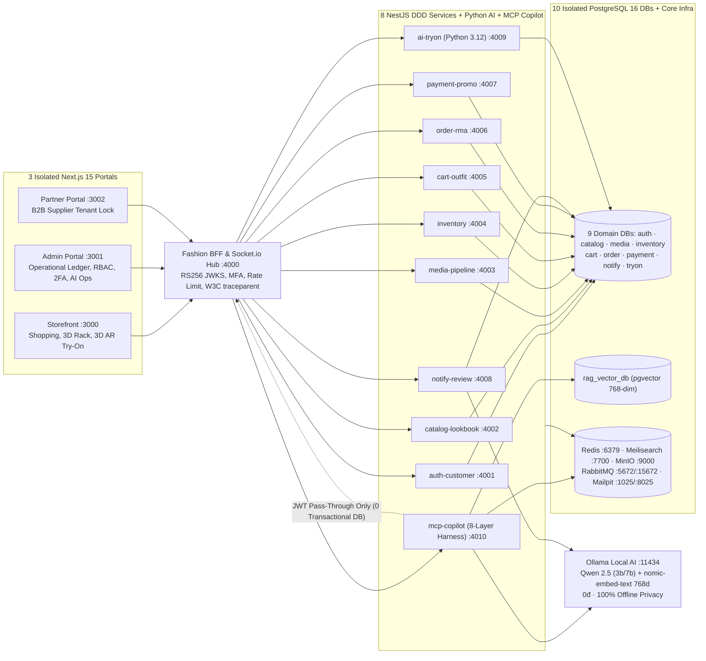

### 3.2. Bản đồ 14 Cổng Dịch vụ, Local Ollama Engine & 10 Cơ sở dữ liệu Cô lập

| # | Thành phần / Workspace | Cổng | Công nghệ | Database cô lập (`svc_*`) | Vai trò chính |
|---:|---|---|---|---|---|
| 1 | `apps/storefront` | `3000` | Next.js 15 + R3F + GSAP + Lenis + MediaPipe | — | Cổng khách hàng (tách biệt tuyệt đối nội bộ; Gương 3D AR tại thiết bị) |
| 2 | `apps/admin-portal` | `3001` | Next.js 15 + React 19 | — | Sổ cái điều hành nội bộ + Ollama MCP Copilot + AI Ops/DLQ |
| 3 | `apps/partner-portal` | `3002` | Next.js 15 + React 19 | — | Cổng Nhà cung cấp B2B khóa chặt `supplier_id` |
| 4 | `apps/bff` | `4000` | NestJS + Socket.io | — | Gateway RS256, 2FA, Rate Limit 5 nhóm, Cache, Realtime Hub |
| 5 | `services/auth-customer` | `4001` | NestJS | `auth_db` (`svc_auth`) | IAM, RBAC 6 vai trò, TOTP/Email 2FA, Hồ sơ khách, Audit Logs |
| 6 | `services/catalog-lookbook` | `4002` | NestJS | `catalog_db` (`svc_catalog`) | SPU/SKU, Crowd Size Advisor, Lookbook Studio, Meilisearch |
| 7 | `services/media-pipeline` | `4003` | NestJS + Sharp | `media_db` (`svc_media`) | Kiểm định Magic Bytes, `2:3` Alpha, `3:4` Flat-Lay, Visual Anchor |
| 8 | `services/inventory` | `4004` | NestJS + Redis Lua | `inventory_db` (`svc_inventory`) | Đa kho, Giữ chỗ 15p (0 Oversell), PO → GRN → Công nợ |
| 9 | `services/cart-outfit` | `4005` | NestJS + Redis | `cart_db` (`svc_cart`) | Giỏ hàng 30 ngày, Combo `-5%`/`-10%`, Share Outfit, Merge |
| 10 | `services/order-rma` | `4006` | NestJS | `order_db` (`svc_order`) | Checkout Saga, Thanh toán trễ, RMA 2 chiều & QC 3 tiêu chí |
| 11 | `services/payment-promo` | `4007` | NestJS | `payment_db` (`svc_payment`) | Voucher phân bổ ròng, VietQR/VNPay/MoMo HMAC, Hoàn tiền |
| 12 | `services/notify-review` | `4008` | NestJS + SMTP + Ollama Fast | `notify_db` (`svc_notify`) | Verified Fit Reviews (`±4cm/±4kg`), NLP Cảm xúc cục bộ, Mailpit |
| 13 | `services/ai-tryon` | `4009` | Python 3.12 + FastAPI | `tryon_db` (`svc_tryon`) | Backend Try-On 2 bước, SHA-256 Cache, Auto-Purge 15p MinIO |
| 14 | `apps/mcp-copilot` | `4010` | Node + MCP SDK + **Ollama Qwen 2.5** (`nomic-embed-text` 768-dim) | `rag_vector_db` (`svc_rag`) | 8-Layer AI Harness, Hybrid RAG 768-dim, Prompt Injection Sandbox (0 API key!) |

**Hạ tầng lõi & Local AI Engine**: **Ollama Local AI (`:11434`, `qwen2.5:3b` / `qwen2.5:7b` + `nomic-embed-text` 768-dim)**, PostgreSQL 16 (`:5432`, tự động chuyển PGlite/SQLite cục bộ khi không có Docker), Redis (`:6379`), Meilisearch (`:7700`), MinIO (`:9000` / Console `:9001`), RabbitMQ (`:5672` / Management `:15672`), Mailpit SMTP (`:1025` / Web UI `:8025`).

### 3.3. Sơ đồ Kiến trúc Triển khai & Mạng Nginx 3-VHost HTTPS (`infra/docker-compose.yml` + `infra/nginx/nginx.conf`)

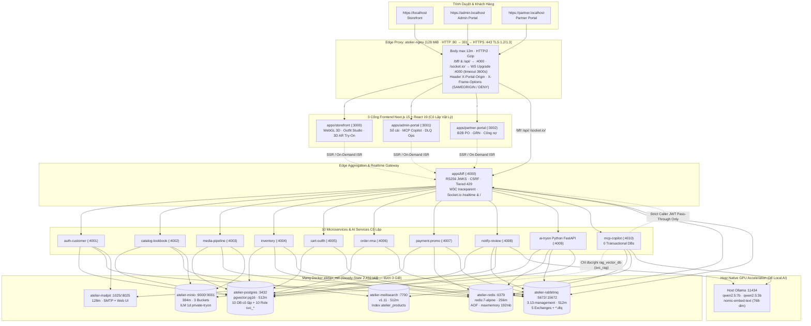

- **Chế độ triển khai kép**:
  - **Docker Compose (`infra/docker-compose.yml`)**: 7 container thường trực tổng ngân sách RAM `2,432 MiB` (`atelier-postgres 512m`, `atelier-redis 256m`, `atelier-meilisearch 512m`, `atelier-rabbitmq 512m`, `atelier-minio 384m`, `atelier-mailpit 128m`, `atelier-nginx 128m`) + init job `atelier-minio-mc 64m` (đỉnh `2,496 MiB < 3 GiB`) + profile tùy chọn `--profile ollama-docker`.
  - **Local Dev Harness (`scripts/local-infra-dev.mjs`)**: Tự động dựng cụm thay thế hoàn chỉnh khi máy chưa cài Docker Desktop (Redis `:6379` hỗ trợ đủ 4 Lua scripts `-- ATELIER_LUA_*`, Meilisearch `:7700`, MinIO `:9000`, Mailpit `:1025/:8025`, RabbitMQ Management + DLQ `:15672` và 10 DB cô lập PGlite/SQLite).

### 3.4. Sơ đồ Event-Driven Topology (RabbitMQ 5 Exchanges · Queues · Retry Tiers · 4 DLQ)

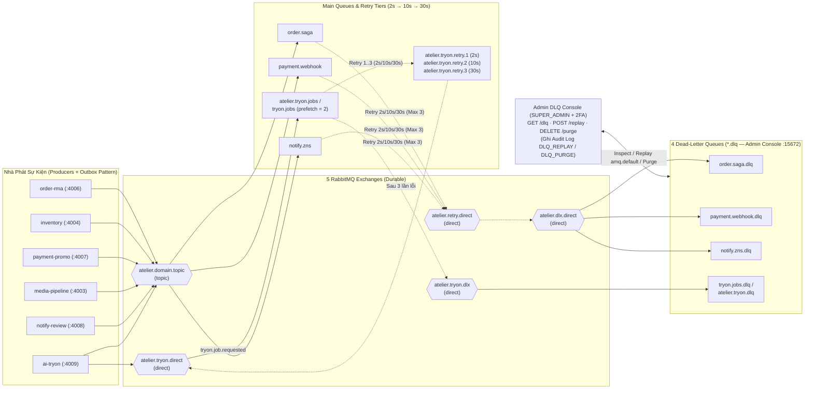

### 3.5. Đặc tả Hạ tầng Hỗ trợ (Redis Lua · MinIO 3 Buckets · Meilisearch · Socket.io · 18 Events)

| Hạ tầng | Cấu trúc / Quy tắc thật trong mã nguồn | Mục đích vận hành |
|---|---|---|
| **Redis 7 (`:6379`) & 4 Lua Scripts** | • **4 Lua Scripts nguyên tử**: `-- ATELIER_LUA_RESERVE` & `-- ATELIER_LUA_RELEASE` (`inv:avail:{skuId}`), `-- ATELIER_LUA_QUOTA` & `-- ATELIER_LUA_QUOTA_REFUND` (`tryon:quota:user:{uid}:{YYYYMMDD}`, `tryon:quota:ip:{ip}:{YYYYMMDD}`).<br>• **14 nhóm khóa chính**: `user:perm_ver:{uid}`, `user:locked:{uid}`, `revoked_jti:{jti}`, `revoked_family:{fid}`, `mfa:email_otp:{uid}` (300s), `promo:flash:{CODE}`, `cart:user:{uid}` / `cart:guest:{sid}` (30 ngày), `tryon:cache:{sha256}` (900s), `copilot:cache:{hash}` (300s), `storefront:{bootstrap,rack,occasions,seasons}:v1`, `season:restyle:{sha256}` (7 ngày), `rl:bff:{bucket}:{ip}:{slot}` (5 nhóm Rate Limit). | Chặn oversell Flash Sale `0%`, thu hồi JWT tức thời `< 1ms`, kiểm soát Dual Quota Try-On, Semantic Cache Copilot & Sliding-window Rate Limiter (`auth_login: 30/60s`, `auth_2fa: 20/60s`, `tryon_sessions: 30/60s`, `promo_evaluate: 60/60s`, `checkout_orders: 120/60s`). |
| **MinIO S3 (`:9000` / `:9001`)** | • `atelier-public` (*public read*): ảnh `2:3` Alpha (`720×1080`), Studio Layer, Packaging, Lookbook Studio (`960×1280`), Hero.<br>• `atelier-garments` (*private / HTTP 403*): ảnh flat-lay `3:4` (`768×1024`) phục vụ VTON.<br>• `atelier-private-tryon` (*private / HTTP 403*, ILM `1d` + cron `TryOnAutoPurgeTask` 60s): `uploads/*` (Presigned PUT 180s) & `results/*` (Presigned GET 900s), **xóa cứng sau đúng 15 phút**. | Cô lập hoàn toàn tài nguyên công khai, tài nguyên sản xuất AI và ảnh cá nhân riêng tư khách hàng. |
| **Meilisearch v1.11 (`:7700`)** | Index `atelier_products` (`primaryKey: id`): **7** `searchableAttributes`, **12** `filterableAttributes` (`inStockSizes`, `occasionSlugs`, `seasonSlugs`, `isTryonEnabled`, `minPriceVnd`...), **2** `sortableAttributes`, **7 nhóm từ đồng nghĩa tiếng Việt** (`đầm dự tiệc ↔ váy đi tiệc`, `áo khoác ↔ blazer/trench`, `quần tây ↔ quần âu`, `áo sơ mi lụa ↔ sơ mi lụa`). | Tìm kiếm tiếng Việt không dấu chịu lỗi chính tả & nguồn keyword cho Layer 3 Hybrid RAG. |
| **Socket.io (`/realtime` & `/`)** | Client subscribe: `tryon:subscribe` (`tryon:{id}`), `order:subscribe` (`order:{code}`). Server emit: `tryon:progress`, `tryon:completed`, `tryon:failed`, `order:paid`, `order:updated`, `order:packed`, `order:shipped`, `order:delivered`, `payment:late-alert`. **Replay Buffer 60s (10 sự kiện/khóa)** chống race-condition. | Cập nhật thanh toán VietQR, trạng thái đơn hàng và tiến độ AI Try-On tức thời. |
| **RabbitMQ 18 `EVENT_NAMES` + 9 Outbox nội bộ** | `order.created`, `inventory.stock.reserved`, `inventory.stock.reserve_failed`, `payment.succeeded`, `payment.expired`, `payment.late.detected`, `rma.requested`, `rma.qc_passed`, `media.asset.processed`, `procurement.po.submitted`, `procurement.po.confirmed`, `inventory.stock.replenished`, `review.fit_stats.aggregated`, `tryon.job.{queued,progress,completed,failed}`, `tryon.media.purged` (+ 9 sự kiện outbox trạng thái nội bộ). | Đồng bộ Eventual Consistency giữa 10 DB thông qua `outbox_events` & `processed_events`. |

---

## 4. Sơ đồ Use Case và Ma trận Vai trò RBAC

### 4.1. Ma trận Tác nhân Thật (6 Vai trò RBAC + Khách vãng lai + 3 Hệ thống ngoài)

Nguồn mã đối chiếu: `packages/contracts/src/rbac.ts`, `packages/contracts/src/auth.ts`, `apps/bff/src/security/guards.ts`.

| Tác nhân (Actor) | Mã vai trò (`Role`) | Cổng được phép | 2FA bắt buộc | Phạm vi quyền & cô lập chính |
|---|---|---|:---:|---|
| **Khách vãng lai** | *(Guest — không JWT)* | Storefront (`:3000`) | Không | `x-guest-session-id` + IP quota (`5 lượt Try-On/ngày`), duyệt 3D/PDP/Search, phối đồ, giỏ hàng & checkout khách |
| **Khách hàng** | `CUSTOMER` | Storefront (`:3000`) | Tùy chọn | `catalog.product.read`, `customer.copilot.access`; hồ sơ số đo, sổ địa chỉ, RMA 7–14 ngày, Verified Fit Review, quota Try-On theo hạng (`ai-tryon` Lua: `BRONZE:10 / SILVER:12 / GOLD:15 / DIAMOND:25`; `auth_db` seed mặc định `5/8/12/20`) |
| **Quản trị cấp cao** | `SUPER_ADMIN` | Admin (`:3001`), Storefront | **Bắt buộc** (`TOTP`/`EMAIL_OTP`) | Toàn quyền 21 permissions (trừ `supplier.*`), IAM/RBAC, thu hồi JWT tức thì, xem giá vốn (`finance.cost_price.read`), hoàn tiền, Replay/Purge `*.dlq` |
| **Vận hành Danh mục & AI** | `CATALOG_AI_OPERATOR` | Admin (`:3001`), Storefront | Tùy chọn | 7 permissions (`catalog.*`, `inventory.stock.read`, `tryon.signals.read`, `copilot.access`); SPU/SKU, Homepage CMS, Dual Media, Lookbook AI; **bị che giá vốn** |
| **Quản lý Kho & Thu mua** | `WAREHOUSE_MANAGER` | Admin (`:3001`), Storefront | **Bắt buộc** (`TOTP`/`EMAIL_OTP`) | 10 permissions (`inventory.*`, `procurement.cost_price.read`, `tryon.signals.read`, `copilot.access`); đa kho, duyệt PO `NHAP_AI`, lập GRN, xem công nợ & **xem giá vốn** |
| **Nhân viên Đơn hàng & RMA** | `ORDER_STAFF` | Admin (`:3001`), Storefront | Tùy chọn | 6 permissions (`order.read`, `order.manage`, `order.rma.manage`, `catalog.product.read`, `inventory.stock.read`, `copilot.access`); đóng gói, giao vận, duyệt RMA & QC 3 tiêu chí; **bị che giá vốn** |
| **Đối tác Nhà cung cấp** | `SUPPLIER` | Partner (`:3002`), Storefront | **Bắt buộc** (`TOTP`/`EMAIL_OTP`) | 3 permissions (`supplier.portal.access`, `supplier.po.confirm`, `inventory.po.read`); **khóa cứng theo `supplierId` trong JWT**, ẩn hoàn toàn PO `NHAP_AI` |
| **Ollama Local AI** | *(External System)* | Host `:11434` | N/A | `qwen2.5:7b` (Main Tool-Calling), `qwen2.5:3b` (Fast Classifier/Sentiment), `nomic-embed-text` (768-dim Embedding) — `0₫` cục bộ |
| **Cổng thanh toán** | *(External System)* | Webhook `:4007` | N/A | VietQR (NAPAS EMVCo), VNPay Sandbox, MoMo Sandbox gửi IPN chữ ký HMAC-SHA256 |
| **Mailpit / SMTP & Zalo ZNS** | *(External System)* | SMTP `:1025` / `:8025` | N/A | Gửi Email OTP 2FA, xác nhận đơn, ảnh đóng gói `packPhotoUrl`, thông báo PO gửi NCC & nhật ký ZNS |

### 4.2. Sơ đồ Use Case Tổng quan Toàn nền tảng

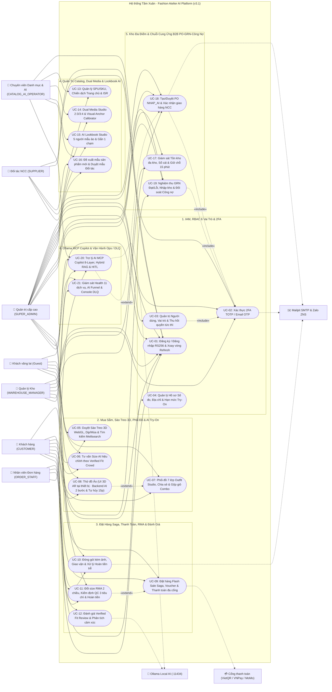

### 4.3. Sơ đồ Use Case Phân rã Storefront (`:3000`)

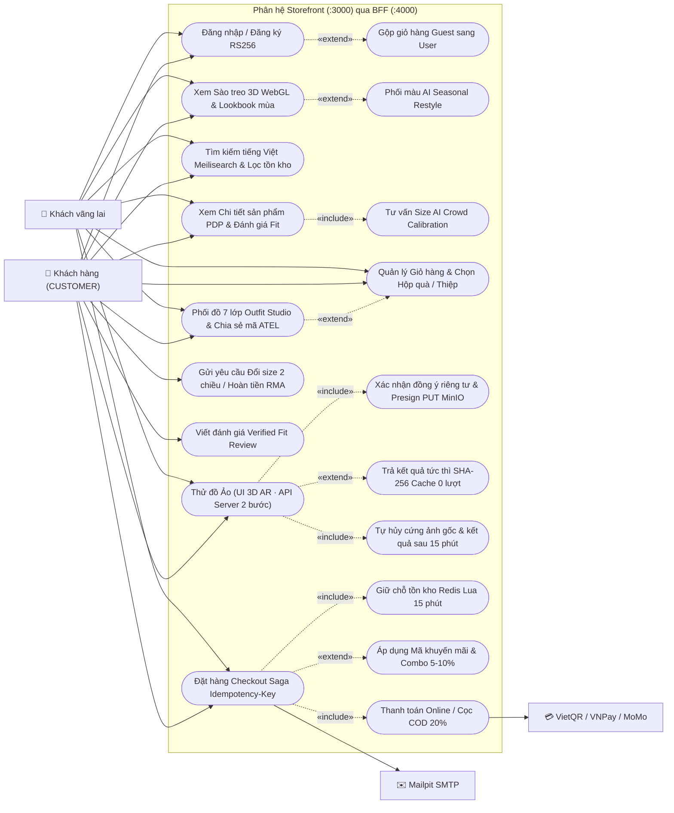

### 4.4. Sơ đồ Use Case Phân rã Admin Portal (`:3001`) và Partner Portal (`:3002`)

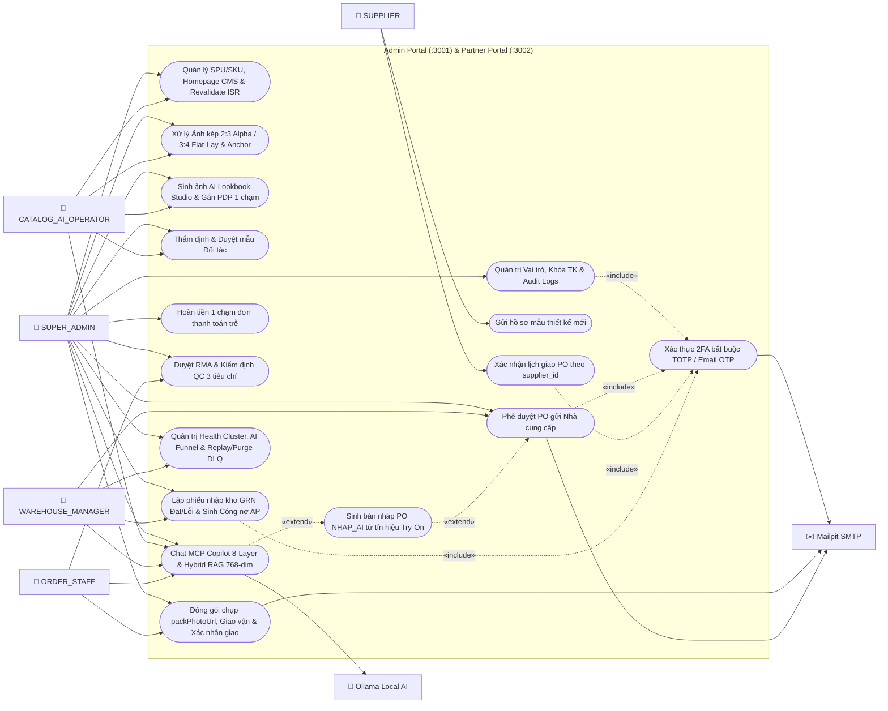

### 4.5. Bảng Ánh xạ 21 Use Case với Endpoint BFF / Dịch vụ Thật

| Phân hệ | Mã UC | Tên Use Case | Vai trò thực hiện | Endpoint BFF / Dịch vụ xử lý thật |
|---|:---:|---|---|---|
| **1. IAM & 2FA** | UC-01 | Đăng ký, Đăng nhập RS256 JWKS, Refresh Rotation + Chống Token Reuse & Logout CSRF | 6 vai trò + Guest | `POST /bff/v1/auth/{register,login,refresh,logout}`, `/api/v1/auth/*` → `auth-customer:4001` |
| | UC-02 | Thiết lập / Xác thực 2FA TOTP (QR + 8 Recovery Codes) & Email OTP (6 số, TTL 300s) | `SUPER_ADMIN`, `WAREHOUSE_MANAGER`, `SUPPLIER` | `POST /api/v1/auth/2fa/{totp/setup,totp/verify,email-otp/send,email-otp/verify}` |
| | UC-03 | Quản trị Users, Gán vai trò, Khóa tài khoản + Thu hồi JWT tức thì Redis & Audit Logs | `SUPER_ADMIN` | `GET/PATCH /api/v1/admin/users/*`, `GET/PUT /admin/roles/*`, `GET /admin/audit-logs` |
| | UC-04 | Quản lý Hồ sơ số đo (`body-profile`), Sổ địa chỉ & Hạn mức Try-On | `CUSTOMER` | `GET/PUT /bff/v1/customers/me/body-profile`, `CRUD /addresses`, `GET /tryon-quota` |
| **2. Mua sắm, 3D & Try-On** | UC-05 | Duyệt Trang chủ Editorial, Sào 3D WebGL, Lookbook 6 Dịp / 6 Mùa, AI Restyle & Meilisearch | Guest, `CUSTOMER` | `GET /bff/v1/storefront/{bootstrap,rack-collection,occasions,seasons,products,:slug}`, `POST /seasons/:slug/ai-restyle` → `catalog-lookbook:4002` |
| | UC-06 | Tư vấn Size AI hiệu chỉnh theo độ co giãn & thống kê Verified Fit Crowd | Guest, `CUSTOMER` | `POST /bff/v1/storefront/size-recommend` → `catalog-lookbook:4002` |
| | UC-07 | Phối đồ 7 lớp Outfit Studio, Chia sẻ mã `ATEL*`, Giỏ hàng Combo `-5%`/`-10%`, Gộp giỏ | Guest, `CUSTOMER` | `POST /bff/v1/storefront/outfit-studio/preview`, `POST /outfits`, `GET /outfits/share/:code`, `CRUD /cart/*`, `POST /cart/{outfit-bundle,merge}` → `cart-outfit:4005` |
| | UC-08 | Thử đồ Ảo (UI Storefront: 3D AR tại thiết bị · Backend: Try-On 2 bước, SHA-256 Cache, Auto-Purge 15p) | Guest, `CUSTOMER` | UI: Three.js + MediaPipe (`/thu-do-ai`); API Backend: `POST /bff/v1/storefront/tryon/{upload-url,sessions,bookmarks,signals}`, `GET /tryon/{sessions/:id,quota}` → `ai-tryon:4009` |
| **3. Đặt hàng, Thanh toán & RMA** | UC-09 | Checkout Saga (`Idempotency-Key`, Authoritative Pricing, Cọc COD 20%), Redis Lua 15p, Voucher, VietQR/VNPay/MoMo HMAC | Guest, `CUSTOMER`, Cổng TT | `POST /bff/v1/storefront/orders`, `POST /promotions/evaluate`, `POST /v1/payments/webhooks/:provider` → `order-rma:4006`, `payment-promo:4007`, `inventory:4004` |
| | UC-10 | Quản lý đơn hàng, Đóng gói chụp `packPhotoUrl`, Giao vận & Hoàn tiền 1 chạm đơn thanh toán trễ | `ORDER_STAFF`, `SUPER_ADMIN` | `GET /api/v1/admin/orders`, `POST /orders/:code/{pack,ship,deliver,refund-late-payment}`, `POST /payments/refunds` |
| | UC-11 | Yêu cầu Đổi size 2 chiều (`INSTANT_2WAY`) / Tiêu chuẩn / Hoàn tiền (7–14 ngày), Duyệt & QC 3 tiêu chí | `CUSTOMER`, `ORDER_STAFF`, `SUPER_ADMIN` | `POST/GET /bff/v1/storefront/orders/:code/rma`, `GET /api/v1/admin/rma`, `POST /rma/:id/{approve,qc-complete}`, `GET /rma/stats` |
| | UC-12 | Đánh giá Verified Fit Review (đơn `DELIVERED`/`COMPLETED`), Cảm xúc Ollama `qwen2.5:3b` & Đồng bộ `fitStats` | `CUSTOMER`, `ORDER_STAFF`, `CATALOG_AI_OPERATOR` | `GET /bff/v1/storefront/reviews/products/:id`, `POST /reviews`, `GET /api/v1/admin/reviews/fit-summary` → `notify-review:4008` |
| **4. Catalog, Media & Lookbook** | UC-13 | Quản lý SPU/SKU (che giá vốn theo RBAC), Homepage Campaign CMS, Xóa Cache & Revalidate ISR | `SUPER_ADMIN`, `CATALOG_AI_OPERATOR` | `GET/POST/PATCH /api/v1/admin/products/*`, `PATCH /skus/:id`, `GET/PUT /homepage-campaign` |
| | UC-14 | Tải ảnh, Kiểm định Magic Bytes, Ảnh kép `2:3` Alpha & `3:4` Flat-Lay, Visual Anchor Calibrator | `SUPER_ADMIN`, `CATALOG_AI_OPERATOR`, `SUPPLIER` | `POST /api/v1/admin/media/{presign,upload,:id/finalize}`, `PATCH /media/:id/spatial-metadata`, `POST /media/validate-garment` → `media-pipeline:4003` |
| | UC-15 | AI Lookbook Studio tạo ảnh `960×1280` trên 5 người mẫu ảo & Gắn 1 chạm lên PDP | `SUPER_ADMIN`, `CATALOG_AI_OPERATOR` | `GET /api/v1/admin/lookbook/virtual-models`, `POST /catalog/products/:id/lookbooks`, `POST .../lookbooks/:sessionId/attach` |
| | UC-16 | Đối tác nộp mẫu sản phẩm mới (`PENDING_REVIEW`) & Admin/Catalog duyệt hoặc từ chối | `SUPPLIER`, `CATALOG_AI_OPERATOR`, `SUPER_ADMIN` | `GET/POST /api/v1/partner/submissions`, `GET /api/v1/admin/submissions`, `PATCH /submissions/:id/review` |
| **5. Kho & B2B PO-GRN-Công nợ** | UC-17 | Giám sát Tồn kho 3 kho (`CENTRAL_WH`, `HN_ATELIER`, `HCM_SHOWROOM`), Giữ chỗ 15p & Sổ cái | `WAREHOUSE_MANAGER`, `SUPER_ADMIN`, `ORDER_STAFF` | `GET /api/v1/admin/inventory/{warehouses,stock-levels,reservations,ledger}` → `inventory:4004` |
| | UC-18 | Quản lý NCC, Lập PO thủ công / AI Draft (`NHAP_AI`), Duyệt gửi PO & NCC xác nhận lịch giao | `WAREHOUSE_MANAGER`, `SUPER_ADMIN`, `SUPPLIER` | `GET/POST /api/v1/admin/procurement/purchase-orders/*`, `POST .../submit`, `GET/POST /api/v1/partner/purchase-orders/:id/confirm` |
| | UC-19 | Lập GRN tách Đạt/Lỗi, Cộng tồn & Đồng bộ Redis/Catalog/Meilisearch, Tự sinh Công nợ `UNPAID` (+30d) | `WAREHOUSE_MANAGER`, `SUPER_ADMIN`, `SUPPLIER` | `GET/POST /api/v1/admin/procurement/goods-receipts`, `GET /payables`, `GET /api/v1/partner/{goods-receipts,payables}` |
| **6. MCP Copilot & Ops/DLQ** | UC-20 | Hội thoại MCP Copilot 8 lớp, Hybrid RAG 768-dim, Sandbox Prompt Injection, Action Cards `NHAP_AI` | 4 vai trò Admin | `POST /api/v1/admin/copilot/chat`, `POST /api/v1/admin/promotions/ai-clearance-draft`, `GET /admin/tryon/demand-summary` → `mcp-copilot:4010` |
| | UC-21 | Giám sát Health 11 dịch vụ + 6 nút hạ tầng, AI Ops Funnel, Inspect / Replay / Purge `*.dlq` | `SUPER_ADMIN`, `WAREHOUSE_MANAGER` | `GET /api/v1/admin/ops/{health-cluster,ai-funnel,dlq}`, `POST /dlq/:queue/replay`, `DELETE /dlq/:queue/purge` |

---

## 5. Sơ đồ Luồng Dữ liệu DFD

### 5.1. DFD Mức 0 — Sơ đồ Ngữ cảnh (Context Diagram)

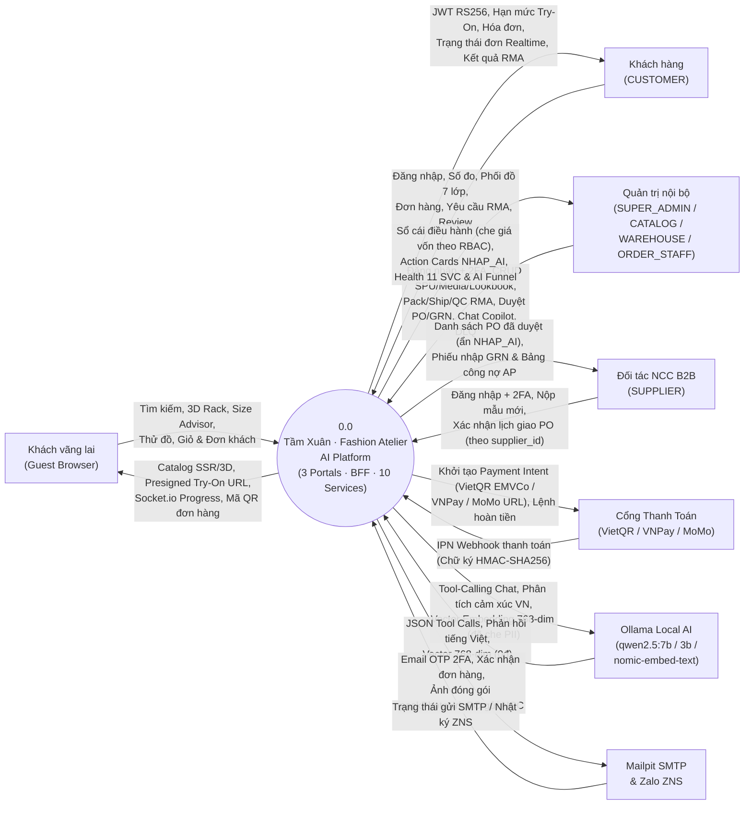

### 5.2. DFD Mức 1 — Sơ đồ Phân rã Chức năng (7 Tiến trình P1–P7 và 14 Kho Dữ liệu)

```mermaid
flowchart TB
    subgraph EXT_IN["Tác Nhân Ngoài (Người Dùng & Đối Tác)"]
        E_USER["Khách vãng lai & Khách hàng<br/>(Storefront :3000)"]
        E_ADMIN["4 Vai Trò Quản Trị<br/>(Admin Portal :3001)"]
        E_SUPP["Nhà Cung Cấp B2B<br/>(Partner Portal :3002)"]
    end

    subgraph EXT_SYS["Tác Nhân Hệ Thống Ngoài"]
        E_PAY["Cổng Thanh Toán<br/>VietQR / VNPay / MoMo"]
        E_OLLAMA["Ollama Local AI<br/>(:11434)"]
        E_SMTP["Mailpit SMTP<br/>& Zalo ZNS"]
    end

    subgraph PROCS["7 Tiến Trình Xử Lý Chính (Qua Edge BFF :4000)"]
        P1(("1.0<br/>Xác thực RS256,<br/>RBAC & 2FA<br/>(bff + auth-customer)"))
        P2(("2.0<br/>Danh mục, Tìm kiếm,<br/>Media & Lookbook<br/>(catalog + media-pipeline)"))
        P3(("3.0<br/>Phối đồ, Giỏ hàng &<br/>Thử đồ AI 2 bước<br/>(cart-outfit + ai-tryon)"))
        P4(("4.0<br/>Đặt hàng Saga,<br/>Thanh toán & RMA<br/>(order-rma + payment-promo)"))
        P5(("5.0<br/>Tồn kho Đa kho &<br/>Chuỗi cung ứng B2B<br/>(inventory)"))
        P6(("6.0<br/>Thông báo Đa kênh &<br/>Verified Fit Review<br/>(notify-review)"))
        P7(("7.0<br/>MCP Copilot 8-Layer<br/>& Vận hành Ops/DLQ<br/>(mcp-copilot + bff ops)"))
    end

    subgraph DBS["Kho Dữ Liệu Quan Hệ Cô Lập (10 PostgreSQL 16 DBs)"]
        D1[("D1: auth_db")]
        D2[("D2: catalog_db")]
        D3[("D3: media_db")]
        D4[("D4: inventory_db")]
        D5[("D5: cart_db")]
        D6[("D6: order_db")]
        D7[("D7: payment_db")]
        D8[("D8: notify_db")]
        D9[("D9: tryon_db")]
        D10[("D10: rag_vector_db<br/>pgvector 768-dim")]
    end

    subgraph INFRA_DS["Kho Dữ Liệu Hạ Tầng Chia Sẻ"]
        D11[("D11: Redis 7<br/>Cache / Lua / Quota / Revoke")]
        D12[("D12: MinIO S3<br/>3 Buckets")]
        D13[("D13: Meilisearch<br/>atelier_products")]
        D14[("D14: RabbitMQ<br/>5 Exchanges & 4 DLQ")]
    end

    E_USER -->|"Đăng nhập, Số đo"| P1
    E_USER -->|"Tìm kiếm, 3D, Size"| P2
    E_USER -->|"Phối đồ, Giỏ, Thử đồ"| P3
    E_USER -->|"Checkout, RMA"| P4
    E_USER -->|"Đánh giá Fit"| P6

    E_ADMIN -->|"2FA, IAM, Audit"| P1
    E_ADMIN -->|"SPU/SKU, Media, Lookbook"| P2
    E_ADMIN -->|"Pack/Ship/Deliver, QC RMA"| P4
    E_ADMIN -->|"Kho, Duyệt PO, GRN"| P5
    E_ADMIN -->|"Chat Copilot, Ops/DLQ"| P7

    E_SUPP -->|"2FA Partner"| P1
    E_SUPP -->|"Nộp mẫu & Ảnh"| P2
    E_SUPP -->|"Xác nhận PO, Xem GRN/AP"| P5

    P1 -->|"JWT Claims & supplierId"| P2 & P3 & P4 & P5 & P6 & P7
    P4 -->|"Lấy giá chuẩn & Giỏ hàng"| P2 & P3
    P4 -->|"Reserve / Commit / Release / Restock"| P5
    P4 -->|"Cộng +5 lượt Try-On VIP"| P1
    P4 -->|"Gửi Email Xác nhận & Ảnh đóng gói"| P6
    P5 -->|"Đồng bộ tồn kho mới nhập"| P2
    P5 -->|"Gửi Email PO cho NCC & Audit"| P6 & P1
    P6 -->|"Cập nhật fitStats Crowd"| P2
    P7 -->|"Strict JWT Pass-Through qua BFF<br/>(0 kết nối DB nghiệp vụ)"| P2 & P3 & P4 & P5 & P6

    P1 -->|"Gửi OTP 2FA"| E_SMTP
    P6 -->|"Gửi Email / Log ZNS"| E_SMTP
    P4 <-->|"Payment Intent / IPN HMAC / Refund"| E_PAY
    P6 <-->|"Phân tích cảm xúc qwen2.5:3b"| E_OLLAMA
    P7 <-->|"Tool-Calling qwen2.5:7b & Embed 768-dim"| E_OLLAMA

    P1 <--> D1 & D11
    P2 <--> D2 & D3 & D11 & D12 & D13
    P3 <--> D5 & D9 & D11 & D12
    P4 <--> D6 & D7 & D11
    P5 <--> D4 & D11
    P6 <--> D8
    P7 <--> D10 & D11 & D13
    P2 & P3 & P4 & P5 & P6 -->|"Domain / Try-On Events"| D14
    P7 <-->|"Inspect / Replay / Purge *.dlq"| D14
```

---

## 6. Sơ đồ Thực thể Kết hợp ERD

> **Nguồn đối chiếu**: Trích xuất 100% trực tiếp từ DDL thực tế (`infra/sql/init-isolated-dbs.sql`, 8 tệp `services/*/src/db/schema.sql`, `services/ai-tryon/app/db/models.py` + Alembic `0001..0003`, `packages/ai-harness/src/layer3-rag/pgvector-rag-store.ts`). Tổng cộng **10 cơ sở dữ liệu PostgreSQL 16 cô lập**, **10 role tối thiểu quyền `svc_*`** (`REVOKE ALL FROM PUBLIC`, cấm Cross-DB SQL JOIN ở tầng kết nối), **64 bảng nghiệp vụ thật** và **45 khóa ngoại vật lý nội DB**.

### 6.1. Bảng Tổng hợp 10 Cơ sở dữ liệu Cô lập (64 Bảng Thật · 45 Khóa Ngoại Vật Lý)

| # | Tên CSDL | Role sở hữu | Dịch vụ chủ quản (Port) | Số bảng | Số FK nội DB | Danh sách bảng thật |
|---:|---|---|---|---:|---:|---|
| 1 | `auth_db` | `svc_auth` | `auth-customer` (`:4001`) | **11** | **9** | `users`, `roles`, `permissions`, `role_permissions`, `user_roles`, `auth_sessions`, `two_factor_auth`, `customer_addresses`, `customer_body_profiles`, `tryon_quotas`, `audit_logs` |
| 2 | `catalog_db` | `svc_catalog` | `catalog-lookbook` (`:4002`) | **13** | **11** | `categories`, `size_charts`, `products`, `product_variants`, `skus`, `occasion_lookbooks`, `occasion_lookbook_items`, `seasonal_collections`, `packaging_options`, `homepage_campaigns`, `supplier_product_submissions`, `lookbook_studio_sessions`, `product_media` |
| 3 | `media_db` | `svc_media` | `media-pipeline` (`:4003`) | **2** | **1** | `media_assets`, `asset_spatial_metadata` |
| 4 | `inventory_db` | `svc_inventory` | `inventory` (`:4004`) | **13** | **13** | `warehouses`, `stock_levels`, `stock_reservations`, `stock_reservation_items`, `inventory_ledger`, `outbox_events`, `processed_events`, `suppliers`, `purchase_orders`, `purchase_order_items`, `goods_receipts`, `goods_receipt_items`, `supplier_payables` |
| 5 | `cart_db` | `svc_cart` | `cart-outfit` (`:4005`) | **3** | **1** | `carts`, `cart_items`, `saved_outfits` |
| 6 | `order_db` | `svc_order` | `order-rma` (`:4006`) | **7** | **5** | `orders`, `order_items`, `shipments`, `rma_requests`, `rma_items`, `outbox_events`, `processed_events` |
| 7 | `payment_db` | `svc_payment` | `payment-promo` (`:4007`) | **6** | **1** | `payment_transactions`, `processed_webhooks`, `promotions`, `voucher_redemptions`, `outbox_events`, `processed_events` |
| 8 | `notify_db` | `svc_notify` | `notify-review` (`:4008`) | **2** | **0** | `product_reviews`, `notification_logs` |
| 9 | `tryon_db` | `svc_tryon` | `ai-tryon` (`:4009`, Python) | **6** | **4** | `temp_user_images`, `tryon_sessions`, `tryon_jobs`, `tryon_results`, `saved_tryon_looks`, `tryon_demand_events` *(+ `alembic_version` do Alembic tự sinh)* |
| 10 | `rag_vector_db` | `svc_rag` | `mcp-copilot` (`:4010`) | **1** | **0** | `rag_documents` (`pgvector` `vector(768)` Ollama `nomic-embed-text`, exact Cosine `<=>` / L2 `<->` + RRF `k=60`) |
| | **TỔNG CỘNG** | **10 Roles** | **10 Bounded Contexts** | **64** | **45** | **100% kiểm chứng từ mã DDL thực tế** |

### 6.2. Ma trận Liên kết Logic Liên Dịch vụ (Cross-DB Logical References)

| Khóa logic (X-FK) | CSDL & Bảng chủ quản | Các CSDL & Bảng tham chiếu | Cơ chế bảo toàn toàn vẹn |
|---|---|---|---|
| `user_id` / `actor_id` / `uploaded_by` / `approved_by` | `auth_db.users(id)` | 8 DB (`media_db`, `catalog_db`, `inventory_db`, `cart_db`, `order_db`, `payment_db`, `notify_db`, `tryon_db`) | Trích từ JWT RS256 (`sub`) đã xác thực tại BFF qua header `x-user-id` |
| `supplier_id` | `inventory_db.suppliers(id)` | `auth_db.users`, `catalog_db.skus`, `catalog_db.supplier_product_submissions`, `media_db.media_assets` | Khóa cô lập tenant B2B qua JWT claim `supplierId` + Deterministic UUID |
| `product_id` / `variant_id` / `sku_id` | `catalog_db.products` / `product_variants` / `skus` | `inventory_db`, `cart_db`, `order_db`, `payment_db`, `notify_db`, `tryon_db` | Đồng bộ qua API nội bộ, `inventory.stock.replenished` & `review.fit_stats.aggregated` |
| `media_id` (`asset_id`) | `media_db.media_assets(id)` | `catalog_db.product_variants`, `catalog_db.supplier_product_submissions` | Sự kiện `media.asset.processed` (`autoAttachAsTryOnGarment: false`) + Spatial API |
| `order_id` / `order_item_id` | `order_db.orders` / `order_items` | `inventory_db.stock_reservations`, `payment_db.*`, `notify_db.product_reviews(order_item_id UK)` | Checkout Saga (`order.created`, `payment.succeeded`, `payment.late.detected`) |
| `reservation_id` / `warehouse_code` | `inventory_db.stock_reservations` / `warehouses` | `order_db.orders`, `order_db.rma_requests`, `order_db.shipments` | Reserve / Commit / Release 15p (86400s cho đổi size RMA) |
| `batch_code` / `supplier_batch_code` | `inventory_db.goods_receipt_items(batch_code)` | `order_db.order_items`, `order_db.rma_items` | Truy xuất ngược lô nhập NCC gây tỷ lệ RMA `LOI_SAN_XUAT` cao |
| `voucher_code` / `refund_transaction_id` | `payment_db.promotions` / `payment_transactions` | `order_db.orders`, `order_db.rma_requests` | Lock / Redeem / Release voucher & hoàn tiền tự động khi QC Pass |

> **Quy ước đường nối trong sơ đồ ERD**: Đường **nét liền (`--`)** biểu diễn khóa ngoại vật lý nội DB (`REFERENCES`); đường **nét đứt (`..`)** biểu diễn liên kết logic liên DB (**X-FK**) hoặc tham chiếu logic nội DB (**L-FK**).

### 6.3. Sơ đồ ERD Tổng quan Liên dịch vụ (Macro Cross-DB ERD)

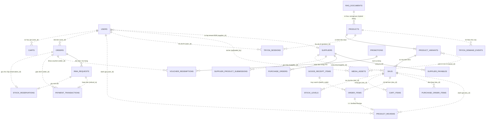

### 6.4. Sơ đồ ERD Cụm 1 — `auth_db` (Định danh, RBAC, 2FA, Khách hàng & Audit — 11 bảng)

```mermaid
erDiagram
    USERS {
        uuid id PK
        varchar email UK "NOT NULL"
        varchar phone UK
        varchar status "ACTIVE | LOCKED | PENDING"
        boolean mfa_enabled
        int permission_version
        varchar loyalty_tier "BRONZE..DIAMOND"
        int cod_trust_score
        uuid supplier_id "X-FK suppliers"
    }
    ROLES {
        uuid id PK
        varchar code UK "6 vai tro RBAC"
        varchar name
    }
    PERMISSIONS {
        uuid id PK
        varchar code UK "23 quyen chi tiet"
        varchar domain
    }
    USER_ROLES {
        uuid user_id PK,FK
        uuid role_id PK,FK
    }
    ROLE_PERMISSIONS {
        uuid role_id PK,FK
        uuid permission_id PK,FK
    }
    AUTH_SESSIONS {
        uuid id PK
        uuid user_id FK
        varchar refresh_token_hash UK
        uuid token_family_id
        boolean mfa_verified
        timestamptz expires_at
        boolean revoked
    }
    TWO_FACTOR_AUTH {
        uuid user_id PK,FK
        varchar method "TOTP | EMAIL_OTP"
        jsonb recovery_codes_jsonb
        timestamptz verified_at
    }
    CUSTOMER_ADDRESSES {
        uuid id PK
        uuid user_id FK
        varchar recipient_name
        varchar province_code
        varchar street_line
        boolean is_default
    }
    CUSTOMER_BODY_PROFILES {
        uuid user_id PK,FK
        float8 height_cm
        float8 weight_kg
        float8 bust_cm
        float8 waist_cm
        float8 hip_cm
        varchar fit_preference "SLIM | REGULAR | RELAXED"
    }
    TRYON_QUOTAS {
        uuid user_id PK,FK
        int daily_limit
        int used_today
        timestamptz reset_at
    }
    AUDIT_LOGS {
        uuid id PK
        uuid actor_id "L-FK users"
        varchar actor_type "USER | AI_COPILOT | SYSTEM"
        varchar action
        varchar resource_type
        varchar resource_id
        jsonb metadata_jsonb
        timestamptz created_at
    }

    USERS ||--o{ USER_ROLES : "gan vai tro"
    ROLES ||--o{ USER_ROLES : "thuoc ve"
    ROLES ||--o{ ROLE_PERMISSIONS : "so huu quyen"
    PERMISSIONS ||--o{ ROLE_PERMISSIONS : "cap cho"
    USERS ||--o{ AUTH_SESSIONS : "mo phien"
    USERS ||--o| TWO_FACTOR_AUTH : "cau hinh 2FA (1-1)"
    USERS ||--o{ CUSTOMER_ADDRESSES : "luu so dia chi"
    USERS ||--o| CUSTOMER_BODY_PROFILES : "ho so so do (1-1)"
    USERS ||--o| TRYON_QUOTAS : "han muc thu do (1-1)"
    USERS |o..o{ AUDIT_LOGS : "ghi nhan thao tac (L-FK)"
```

### 6.5. Sơ đồ ERD Cụm 2 — `catalog_db` (13 bảng) + `media_db` (2 bảng)

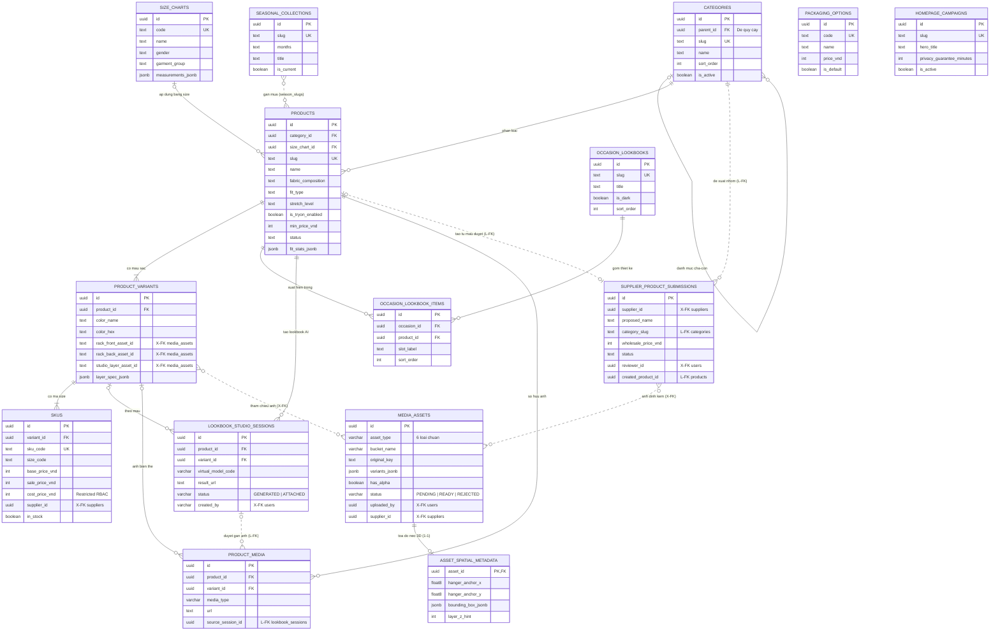

### 6.6. Sơ đồ ERD Cụm 3 — `inventory_db` (Tồn kho Đa kho, Giữ chỗ & Chuỗi cung ứng B2B — 13 bảng)

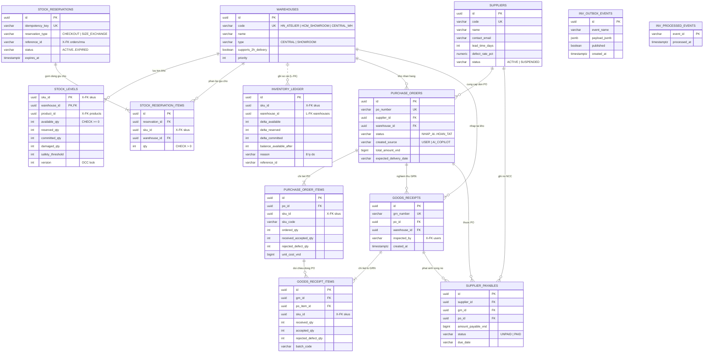

### 6.7. Sơ đồ ERD Cụm 4 — `cart_db` (3 bảng) + `order_db` (7 bảng) + `payment_db` (6 bảng)

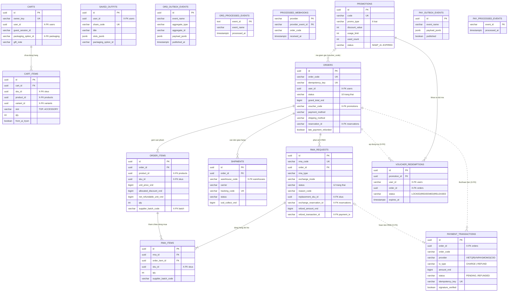

### 6.8. Sơ đồ ERD Cụm 5 — `notify_db` (2 bảng) + `tryon_db` (6 bảng) + `rag_vector_db` (1 bảng)

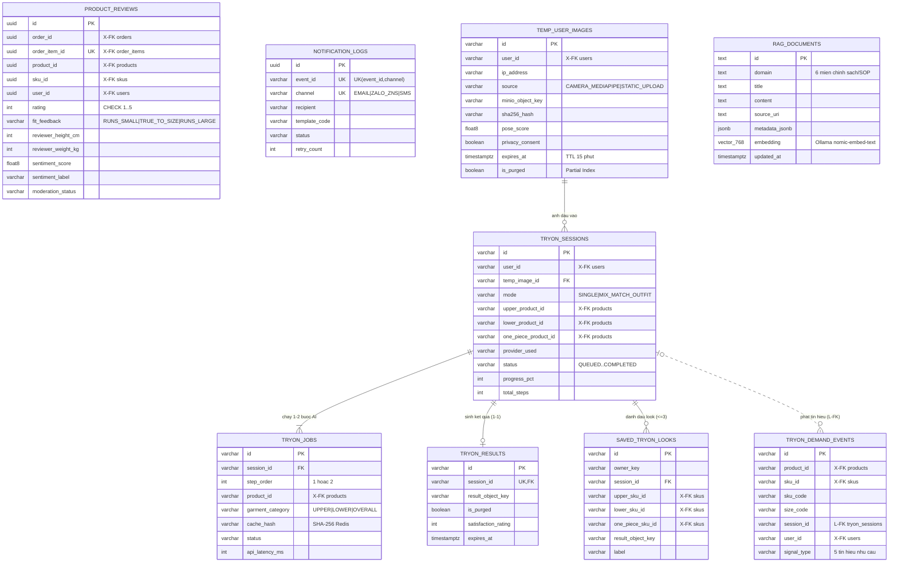

---

## 7. Sơ đồ Quan hệ Dữ liệu RD và Chuẩn hóa 3NF

### 7.1. Đánh giá Chuẩn hóa 3NF & Phi chuẩn hóa có Chủ đích (Controlled Denormalization)

1. **Đạt chuẩn 1NF – 2NF – 3NF ở toàn bộ dữ liệu giao dịch cốt lõi**:
   - Các quan hệ N–N (`users ↔ roles`, `roles ↔ permissions`, `occasion_lookbooks ↔ products`) đều được tách thành bảng nối chuẩn (`user_roles`, `role_permissions`, `occasion_lookbook_items`) với khóa chính kép hoặc cặp `UNIQUE`.
   - Không có phụ thuộc hàm bộ phận trên các bảng khóa chính kép (`role_permissions`, `user_roles`, `stock_levels(sku_id, warehouse_id)`, `processed_webhooks(provider, provider_event_id)`).
   - Không có phụ thuộc bắc cầu trong cùng DB (`products → product_variants → skus`, `purchase_orders → purchase_order_items ← goods_receipt_items ← goods_receipts → supplier_payables`, `orders → order_items ← rma_items ← rma_requests`).
   - Các thực thể phụ 1–1 có chu kỳ cập nhật và chính sách bảo mật khác biệt được tách bảng độc lập (`two_factor_auth`, `customer_body_profiles`, `tryon_quotas`, `asset_spatial_metadata`, `tryon_results`).
2. **Phi chuẩn hóa có chủ đích (Controlled Denormalization)** cho Thương mại điện tử & Microservices:
   - **Bất biến tài chính & lịch sử**: `orders` lưu snapshot `shipping_address_jsonb`, `packaging_option_jsonb`; `order_items` lưu snapshot `unit_price_vnd`, `allocated_discount_vnd`, `net_refundable_unit_vnd` để hoàn tiền RMA không bao giờ sai lệch khi giá danh mục thay đổi.
   - **Đọc nhanh không JOIN liên DB (CQRS Read-Projection)**: `products.min_price_vnd`, `products.stock_status_summary`, `products.fit_stats_jsonb`; `stock_levels.sku_code`; `purchase_order_items.product_name`; `payment_transactions.order_code`.
   - **Dữ liệu bán cấu trúc (`JSONB`)**: `size_charts.measurements_jsonb`, `media_assets.variants_jsonb`, `asset_spatial_metadata.bounding_box_jsonb`, `rma_requests.qc_checklist_jsonb`, `saved_outfits.slots_jsonb`.

### 7.2. Sơ đồ RD Vật lý (Physical Relational Schema — Đủ 64/64 Bảng & 45/45 FK)

#### RD Vật lý Phần 1 — `auth_db`, `catalog_db`, `media_db`, `inventory_db` (39 bảng · 34 FK vật lý)

```mermaid
erDiagram
    USERS {
        uuid id PK
        varchar email UK
        varchar phone UK
        uuid supplier_id "X-FK suppliers"
    }
    ROLES {
        uuid id PK
        varchar code UK
    }
    PERMISSIONS {
        uuid id PK
        varchar code UK
    }
    USER_ROLES {
        uuid user_id PK,FK
        uuid role_id PK,FK
    }
    ROLE_PERMISSIONS {
        uuid role_id PK,FK
        uuid permission_id PK,FK
    }
    AUTH_SESSIONS {
        uuid id PK
        uuid user_id FK
        varchar refresh_token_hash UK
    }
    TWO_FACTOR_AUTH {
        uuid user_id PK,FK
    }
    CUSTOMER_ADDRESSES {
        uuid id PK
        uuid user_id FK
    }
    CUSTOMER_BODY_PROFILES {
        uuid user_id PK,FK
    }
    TRYON_QUOTAS {
        uuid user_id PK,FK
    }
    AUDIT_LOGS {
        uuid id PK
        uuid actor_id "L-FK users"
    }

    CATEGORIES {
        uuid id PK
        uuid parent_id FK
        text slug UK
    }
    SIZE_CHARTS {
        uuid id PK
        text code UK
    }
    PRODUCTS {
        uuid id PK
        uuid category_id FK
        uuid size_chart_id FK
        text slug UK
    }
    PRODUCT_VARIANTS {
        uuid id PK
        uuid product_id FK
    }
    SKUS {
        uuid id PK
        uuid variant_id FK
        text sku_code UK
    }
    OCCASION_LOOKBOOKS {
        uuid id PK
        text slug UK
    }
    OCCASION_LOOKBOOK_ITEMS {
        uuid id PK
        uuid occasion_id FK "UK(occasion_id,product_id)"
        uuid product_id FK
    }
    SEASONAL_COLLECTIONS {
        uuid id PK
        text slug UK
    }
    PACKAGING_OPTIONS {
        uuid id PK
        text code UK
    }
    HOMEPAGE_CAMPAIGNS {
        uuid id PK
        text slug UK
    }
    SUPPLIER_PRODUCT_SUBMISSIONS {
        uuid id PK
        uuid supplier_id "X-FK suppliers"
        uuid created_product_id "L-FK products"
    }
    LOOKBOOK_STUDIO_SESSIONS {
        uuid id PK
        uuid product_id FK
        uuid variant_id FK
    }
    PRODUCT_MEDIA {
        uuid id PK
        uuid product_id FK
        uuid variant_id FK
    }

    MEDIA_ASSETS {
        uuid id PK
    }
    ASSET_SPATIAL_METADATA {
        uuid asset_id PK,FK
    }

    WAREHOUSES {
        uuid id PK
        varchar code UK
    }
    STOCK_LEVELS {
        uuid sku_id PK "X-FK skus"
        uuid warehouse_id PK,FK
    }
    STOCK_RESERVATIONS {
        uuid id PK
        varchar idempotency_key UK
    }
    STOCK_RESERVATION_ITEMS {
        uuid id PK
        uuid reservation_id FK
        uuid warehouse_id FK
    }
    INVENTORY_LEDGER {
        uuid id PK
        uuid warehouse_id "L-FK warehouses"
    }
    SUPPLIERS {
        uuid id PK
        varchar code UK
    }
    PURCHASE_ORDERS {
        uuid id PK
        varchar po_number UK
        uuid supplier_id FK
        uuid warehouse_id FK
    }
    PURCHASE_ORDER_ITEMS {
        uuid id PK
        uuid po_id FK
    }
    GOODS_RECEIPTS {
        uuid id PK
        varchar grn_number UK
        uuid po_id FK
        uuid warehouse_id FK
    }
    GOODS_RECEIPT_ITEMS {
        uuid id PK
        uuid grn_id FK
        uuid po_item_id FK
    }
    SUPPLIER_PAYABLES {
        uuid id PK
        uuid supplier_id FK
        uuid grn_id FK
        uuid po_id FK
    }
    INV_OUTBOX_EVENTS {
        uuid id PK
    }
    INV_PROCESSED_EVENTS {
        varchar event_id PK
    }

    USERS ||--o{ USER_ROLES : "FK"
    ROLES ||--o{ USER_ROLES : "FK"
    ROLES ||--o{ ROLE_PERMISSIONS : "FK"
    PERMISSIONS ||--o{ ROLE_PERMISSIONS : "FK"
    USERS ||--o{ AUTH_SESSIONS : "FK"
    USERS ||--o| TWO_FACTOR_AUTH : "PK,FK"
    USERS ||--o{ CUSTOMER_ADDRESSES : "FK"
    USERS ||--o| CUSTOMER_BODY_PROFILES : "PK,FK"
    USERS ||--o| TRYON_QUOTAS : "PK,FK"

    CATEGORIES |o--o{ CATEGORIES : "FK parent_id"
    CATEGORIES ||--o{ PRODUCTS : "FK"
    SIZE_CHARTS |o--o{ PRODUCTS : "FK"
    PRODUCTS ||--o{ PRODUCT_VARIANTS : "FK"
    PRODUCT_VARIANTS ||--o{ SKUS : "FK"
    OCCASION_LOOKBOOKS ||--o{ OCCASION_LOOKBOOK_ITEMS : "FK"
    PRODUCTS ||--o{ OCCASION_LOOKBOOK_ITEMS : "FK"
    PRODUCTS ||--o{ LOOKBOOK_STUDIO_SESSIONS : "FK"
    PRODUCT_VARIANTS |o--o{ LOOKBOOK_STUDIO_SESSIONS : "FK"
    PRODUCTS ||--o{ PRODUCT_MEDIA : "FK"
    PRODUCT_VARIANTS |o--o{ PRODUCT_MEDIA : "FK"

    MEDIA_ASSETS ||--o| ASSET_SPATIAL_METADATA : "PK,FK"

    WAREHOUSES ||--o{ STOCK_LEVELS : "PK,FK"
    STOCK_RESERVATIONS ||--o{ STOCK_RESERVATION_ITEMS : "FK"
    WAREHOUSES ||--o{ STOCK_RESERVATION_ITEMS : "FK"
    SUPPLIERS ||--o{ PURCHASE_ORDERS : "FK"
    WAREHOUSES ||--o{ PURCHASE_ORDERS : "FK"
    PURCHASE_ORDERS ||--o{ PURCHASE_ORDER_ITEMS : "FK"
    PURCHASE_ORDERS ||--o{ GOODS_RECEIPTS : "FK"
    WAREHOUSES ||--o{ GOODS_RECEIPTS : "FK"
    GOODS_RECEIPTS ||--o{ GOODS_RECEIPT_ITEMS : "FK"
    PURCHASE_ORDER_ITEMS ||--o{ GOODS_RECEIPT_ITEMS : "FK"
    SUPPLIERS ||--o{ SUPPLIER_PAYABLES : "FK"
    GOODS_RECEIPTS ||--o{ SUPPLIER_PAYABLES : "FK"
    PURCHASE_ORDERS ||--o{ SUPPLIER_PAYABLES : "FK"
```

#### RD Vật lý Phần 2 — `cart_db`, `order_db`, `payment_db`, `notify_db`, `tryon_db`, `rag_vector_db` (25 bảng · 11 FK vật lý)

```mermaid
erDiagram
    CARTS {
        uuid id PK
        varchar owner_key UK
    }
    CART_ITEMS {
        uuid id PK
        uuid cart_id FK
    }
    SAVED_OUTFITS {
        uuid id PK
        varchar share_code UK
    }

    ORDERS {
        uuid id PK
        varchar order_code UK
        varchar idempotency_key UK
    }
    ORDER_ITEMS {
        uuid id PK
        uuid order_id FK
    }
    SHIPMENTS {
        uuid id PK
        uuid order_id FK
        varchar tracking_code UK
    }
    RMA_REQUESTS {
        uuid id PK
        varchar rma_code UK
        uuid order_id FK
    }
    RMA_ITEMS {
        uuid id PK
        uuid rma_id FK
        uuid order_item_id FK
    }
    ORD_OUTBOX_EVENTS {
        uuid id PK
    }
    ORD_PROCESSED_EVENTS {
        text event_id PK
    }

    PAYMENT_TRANSACTIONS {
        uuid id PK
        varchar idempotency_key UK
    }
    PROCESSED_WEBHOOKS {
        varchar provider PK
        varchar provider_event_id PK
    }
    PROMOTIONS {
        uuid id PK
        varchar code UK
    }
    VOUCHER_REDEMPTIONS {
        uuid id PK
        uuid promotion_id FK
    }
    PAY_OUTBOX_EVENTS {
        uuid id PK
    }
    PAY_PROCESSED_EVENTS {
        varchar event_id PK
    }

    PRODUCT_REVIEWS {
        uuid id PK
        uuid order_item_id UK
    }
    NOTIFICATION_LOGS {
        uuid id PK
        varchar event_id UK "UK(event_id,channel)"
        varchar channel UK
    }

    TEMP_USER_IMAGES {
        varchar id PK
    }
    TRYON_SESSIONS {
        varchar id PK
        varchar temp_image_id FK
    }
    TRYON_JOBS {
        varchar id PK
        varchar session_id FK
    }
    TRYON_RESULTS {
        varchar id PK
        varchar session_id UK,FK
    }
    SAVED_TRYON_LOOKS {
        varchar id PK
        varchar session_id FK
    }
    TRYON_DEMAND_EVENTS {
        varchar id PK
    }

    RAG_DOCUMENTS {
        text id PK
        vector_768 embedding
    }

    CARTS ||--o{ CART_ITEMS : "FK"
    ORDERS ||--o{ ORDER_ITEMS : "FK"
    ORDERS ||--o{ SHIPMENTS : "FK"
    ORDERS ||--o{ RMA_REQUESTS : "FK"
    RMA_REQUESTS ||--o{ RMA_ITEMS : "FK"
    ORDER_ITEMS ||--o{ RMA_ITEMS : "FK"
    PROMOTIONS ||--o{ VOUCHER_REDEMPTIONS : "FK"
    TEMP_USER_IMAGES ||--o{ TRYON_SESSIONS : "FK"
    TRYON_SESSIONS ||--o{ TRYON_JOBS : "FK"
    TRYON_SESSIONS ||--o| TRYON_RESULTS : "UK,FK"
    TRYON_SESSIONS ||--o{ SAVED_TRYON_LOOKS : "FK"
```

### 7.3. Chỉ mục Đặc biệt & Ràng buộc Toàn vẹn Cốt lõi

| DB | Bảng | Chỉ mục / Ràng buộc | Loại đặc biệt | Tác dụng vận hành |
|---|---|---|---|---|
| `inventory_db` | `stock_reservations` | `idx_stock_res_active_exp (status, expires_at) WHERE status = 'ACTIVE'` | **Partial Index** | Quét giữ chỗ hết hạn 15p trong `O(log N_active)` |
| `inventory_db` | `outbox_events` | `idx_outbox_events_unpublished (published, created_at ASC) WHERE published = FALSE` | **Partial Index** | Worker relay Outbox sang RabbitMQ chỉ quét bản ghi chưa phát |
| `tryon_db` | `temp_user_images` | `idx_temp_user_images_unpurged_expires (expires_at) WHERE is_purged = false` | **Partial Index** (`0003`) | Tác vụ tự hủy 15p (`TryOnAutoPurgeTask`) chỉ quét ảnh chưa xóa |
| `inventory_db` | `stock_levels` | `CHECK (available_qty >= 0)` + `version INTEGER` | **DB Guard + OCC** | Tầng bảo vệ ACID cuối cùng chống bán âm tồn kho |
| `order_db` | `orders` | `idempotency_key UNIQUE`, `order_code UNIQUE` | **Idempotency UK** | Chống tạo đơn trùng khi retry mạng / bấm liên tiếp |
| `payment_db` | `processed_webhooks` | `PRIMARY KEY (provider, provider_event_id)` | **Composite PK** | Chống xử lý lặp IPN webhook VietQR / VNPay / MoMo |
| `payment_db` | `payment_transactions` | `idempotency_key UNIQUE` | **Idempotency UK** | Chống thu tiền hoặc hoàn tiền hai lần |
| `notify_db` | `notification_logs` | `CONSTRAINT uq_notify_event_channel UNIQUE (event_id, channel)` | **Composite UK** | Mỗi sự kiện chỉ gửi đúng 1 Email và 1 ZNS (`ON CONFLICT DO NOTHING`) |
| `notify_db` | `product_reviews` | `order_item_id UNIQUE`, `CHECK (rating BETWEEN 1 AND 5)` | **Verified Review UK** | Mỗi dòng hàng đã giao chỉ đánh giá xác thực tối đa 1 lần |
| `catalog_db` | `occasion_lookbook_items` | `UNIQUE (occasion_id, product_id)` | **Composite UK** | Không gán trùng 1 thiết kế hai lần vào cùng Lookbook dịp mặc |
| `rag_vector_db` | `rag_documents` | `embedding vector(768)` + `embedding <=> $1::vector` | **pgvector Cosine** | Hybrid RAG 768-dim (Ollama `nomic-embed-text`) + RRF `k=60` |
| `auth_db` | `auth_sessions` | `refresh_token_hash UNIQUE`, `idx_auth_sessions_family (token_family_id)` | **Token Rotation** | Phát hiện Refresh Token Reuse Attack & thu hồi cả họ phiên |

### 7.4. Danh mục 64/64 Lược đồ Quan hệ Chuẩn học thuật 3NF theo 10 CSDL

<details>
<summary><strong>Xem đầy đủ 64/64 Lược đồ Quan hệ Chuẩn hóa 3NF phân theo 10 CSDL (Nhấn để mở rộng)</strong></summary>

> **Quy ước ký pháp**: `<u>col</u>` = Khóa chính (**PK**) · `#col` = Khóa ngoại vật lý nội DB (**FK**) · `<u>#col</u>` = Vừa là **PK** vừa là **FK** · `~col` = Tham chiếu logic xuyên DB (**X-FK**) hoặc nội DB (**L-FK**) · `[UK]` = Ràng buộc duy nhất (`UNIQUE`).

#### 1. `auth_db` (11 quan hệ)
1. **USERS**(<u>id</u>, email [UK], phone [UK], password_hash, full_name, avatar_url, status, mfa_enabled, permission_version, loyalty_tier, cod_trust_score, ~supplier_id, created_at, updated_at)
2. **ROLES**(<u>id</u>, code [UK], name, description)
3. **PERMISSIONS**(<u>id</u>, code [UK], domain, description)
4. **ROLE_PERMISSIONS**(<u>#role_id</u>, <u>#permission_id</u>)
5. **USER_ROLES**(<u>#user_id</u>, <u>#role_id</u>)
6. **AUTH_SESSIONS**(<u>id</u>, #user_id, refresh_token_hash [UK], token_family_id, csrf_token, last_access_jti, device_info, ip_address, mfa_verified, expires_at, revoked, created_at)
7. **TWO_FACTOR_AUTH**(<u>#user_id</u>, method, totp_secret_encrypted, recovery_codes_jsonb, verified_at)
8. **CUSTOMER_ADDRESSES**(<u>id</u>, #user_id, recipient_name, phone, province_code, province_name, district_code, district_name, ward_code, ward_name, street_line, is_default, created_at, updated_at)
9. **CUSTOMER_BODY_PROFILES**(<u>#user_id</u>, height_cm, weight_kg, bust_cm, waist_cm, hip_cm, shoulder_cm, fit_preference, updated_at)
10. **TRYON_QUOTAS**(<u>#user_id</u>, daily_limit, used_today, reset_at)
11. **AUDIT_LOGS**(<u>id</u>, ~actor_id, actor_email, actor_type, action, resource_type, resource_id, before_jsonb, after_jsonb, metadata_jsonb, correlation_id, ip_address, created_at)

#### 2. `catalog_db` (13 quan hệ)
12. **CATEGORIES**(<u>id</u>, #parent_id, slug [UK], name, description, sort_order, is_active)
13. **SIZE_CHARTS**(<u>id</u>, code [UK], name, gender, garment_group, fit_note, measurements_jsonb)
14. **PRODUCTS**(<u>id</u>, #category_id, slug [UK], name, subtitle, brand_name, description, fabric_composition, fit_type, stretch_level, fabric_weight, gender, is_tryon_enabled, tryon_garment_category, tryon_flat_asset_url, fit_calibration_note, min_price_vnd, stock_status_summary, status, #size_chart_id, ~occasion_slugs, ~season_slugs, fit_stats_jsonb, created_at, updated_at)
15. **PRODUCT_VARIANTS**(<u>id</u>, #product_id, color_name, color_hex, lookbook_main_url, ~rack_front_asset_id, ~rack_back_asset_id, ~studio_layer_asset_id, tryon_flat_preview_url, rack_front_url, rack_back_url, studio_layer_url, layer_spec_jsonb)
16. **SKUS**(<u>id</u>, #variant_id, sku_code [UK], size_code, base_price_vnd, sale_price_vnd, cost_price_vnd, ~supplier_id, weight_grams, in_stock, is_returnable)
17. **OCCASION_LOOKBOOKS**(<u>id</u>, slug [UK], title, subtitle, palette_bg, palette_ink, palette_accent, is_dark, badge_tag, hero_image_url, sort_order)
18. **OCCASION_LOOKBOOK_ITEMS**(<u>id</u>, #occasion_id [UK1], #product_id [UK1], slot_label, sort_order)
19. **SEASONAL_COLLECTIONS**(<u>id</u>, slug [UK], months, title, season_tag, subtitle, palette_hex, hero_image_url, is_current, sort_order)
20. **PACKAGING_OPTIONS**(<u>id</u>, code [UK], name, description, swatch_hex, price_vnd, image_url, back_image_url, is_default, sort_order)
21. **HOMEPAGE_CAMPAIGNS**(<u>id</u>, slug [UK], eyebrow, hero_title, hero_subtitle, atelier_manifesto, cta_label, service_note, privacy_guarantee_minutes, hero_image_url, intro_jsonb, hero_jsonb, atelier_steps_jsonb, finale_jsonb, is_active, updated_at)
22. **SUPPLIER_PRODUCT_SUBMISSIONS**(<u>id</u>, ~supplier_id, proposed_name, ~category_slug, wholesale_price_vnd, suggested_retail_vnd, fabric_composition, available_sizes_jsonb, color_name, color_hex, ~asset_ids_jsonb, raw_size_spec_jsonb, flat_asset_url, rack_asset_url, notes, status, ~reviewer_id, review_note, reviewed_at, ~created_product_id, created_at, updated_at)
23. **LOOKBOOK_STUDIO_SESSIONS**(<u>id</u>, #product_id, #variant_id, virtual_model_code, scene_prompt, source_garment_url, result_url, object_key, provider_used, status, attached_at, ~created_by, created_at)
24. **PRODUCT_MEDIA**(<u>id</u>, #product_id, #variant_id, media_type, url, object_key, ~source_session_id, sort_order, created_at)

#### 3. `media_db` (2 quan hệ)
25. **MEDIA_ASSETS**(<u>id</u>, asset_type, bucket_name, original_key, variants_jsonb, mime_type, size_bytes, width, height, has_alpha, dominant_hex, ~uploaded_by, ~supplier_id, status, rejection_reason, created_at)
26. **ASSET_SPATIAL_METADATA**(<u>#asset_id</u>, hanger_anchor_x, hanger_anchor_y, bounding_box_jsonb, layer_z_hint, updated_at)

#### 4. `inventory_db` (13 quan hệ)
27. **WAREHOUSES**(<u>id</u>, code [UK], name, type, province_code, city, address, supports_2h_delivery, priority, is_active, created_at)
28. **STOCK_LEVELS**(<u>~sku_id</u>, <u>#warehouse_id</u>, ~product_id, sku_code, available_qty, reserved_qty, committed_qty, damaged_qty, safety_threshold, version, updated_at)
29. **STOCK_RESERVATIONS**(<u>id</u>, idempotency_key [UK], reservation_type, ~reference_id, status, expires_at, committed_at, released_at, created_at)
30. **STOCK_RESERVATION_ITEMS**(<u>id</u>, #reservation_id, ~sku_id, #warehouse_id, qty)
31. **INVENTORY_LEDGER**(<u>id</u>, ~sku_id, ~warehouse_id, delta_available, delta_reserved, delta_committed, balance_available_after, reason, reference_id, ~actor_id, note, created_at)
32. **OUTBOX_EVENTS** *(inventory_db)*(<u>id</u>, event_name, payload_jsonb, published, created_at)
33. **PROCESSED_EVENTS** *(inventory_db)*(<u>event_id</u>, processed_at)
34. **SUPPLIERS**(<u>id</u>, code [UK], name, contact_email, lead_time_days, defect_rate_pct, status, created_at)
35. **PURCHASE_ORDERS**(<u>id</u>, po_number [UK], #supplier_id, #warehouse_id, status, created_source, expected_delivery_date, confirmed_delivery_date, supplier_note, total_amount_vnd, notes, rationale, ~created_by, ~approved_by, approved_at, ~confirmed_by, confirmed_at, created_at, updated_at)
36. **PURCHASE_ORDER_ITEMS**(<u>id</u>, #po_id, ~sku_id, sku_code, ~product_id, product_name, ordered_qty, received_qty, received_accepted_qty, rejected_defect_qty, unit_cost_vnd)
37. **GOODS_RECEIPTS**(<u>id</u>, grn_number [UK], #po_id, #warehouse_id, ~inspected_by, notes, created_at)
38. **GOODS_RECEIPT_ITEMS**(<u>id</u>, #grn_id, #po_item_id, ~sku_id, received_qty, accepted_qty, rejected_defect_qty, batch_code)
39. **SUPPLIER_PAYABLES**(<u>id</u>, #supplier_id, #grn_id, #po_id, amount_payable_vnd, status, due_date, created_at)

#### 5. `cart_db` (3 quan hệ)
40. **CARTS**(<u>id</u>, owner_key [UK], ~user_id, guest_session_id, ~packaging_option_id, gift_note, updated_at)
41. **CART_ITEMS**(<u>id</u>, #cart_id, ~sku_id, ~product_id, ~variant_id, slot, qty, bundle_group_id, from_ai_tryon, created_at)
42. **SAVED_OUTFITS**(<u>id</u>, ~user_id, guest_session_id, share_code [UK], title, slots_jsonb, ~packaging_option_id, gift_note, preview_url, created_at)

#### 6. `order_db` (7 quan hệ)
43. **ORDERS**(<u>id</u>, order_code [UK], idempotency_key [UK], ~user_id, guest_session_id, customer_email, customer_phone, status, subtotal_vnd, combo_discount_vnd, voucher_discount_vnd, ~voucher_code, packaging_fee_vnd, shipping_fee_vnd, deposit_required_vnd, grand_total_vnd, payment_method, shipping_method, delivery_date, delivery_slot, shipping_address_jsonb, packaging_option_jsonb, gift_note, ~reservation_id, reservation_expires_at, late_payment_refunded, paid_at, delivered_at, cancelled_at, cancel_reason, payment_intent_jsonb, created_at, updated_at)
44. **ORDER_ITEMS**(<u>id</u>, #order_id, ~product_id, ~variant_id, ~sku_id, sku_code, product_name, color_name, size_code, image_url, unit_price_vnd, allocated_discount_vnd, net_refundable_unit_vnd, qty, bundle_group_id, is_returnable, ~supplier_batch_code)
45. **SHIPMENTS**(<u>id</u>, #order_id, ~warehouse_code, carrier, tracking_code [UK], status, pack_photo_url, cod_collect_vnd, updated_at)
46. **RMA_REQUESTS**(<u>id</u>, rma_code [UK], #order_id, ~user_id, rma_type, exchange_mode, status, reason_code, customer_note, evidence_photos_jsonb, qc_checklist_jsonb, ~replacement_sku_id, ~exchange_reservation_id, refund_amount_vnd, ~refund_transaction_id, created_at, updated_at)
47. **RMA_ITEMS**(<u>id</u>, #rma_id, #order_item_id, ~sku_id, ~product_id, size_purchased, qty, ~supplier_batch_code)
48. **OUTBOX_EVENTS** *(order_db)*(<u>id</u>, event_name, aggregate_type, aggregate_id, correlation_id, payload_jsonb, published_at, created_at)
49. **PROCESSED_EVENTS** *(order_db)*(<u>event_id</u>, event_name, processed_at)

#### 7. `payment_db` (6 quan hệ)
50. **PAYMENT_TRANSACTIONS**(<u>id</u>, ~order_id, ~order_code, provider, tx_type, amount_vnd, status, provider_tx_id, idempotency_key [UK], qr_payload, payment_url, signature_verified, raw_payload_jsonb, expires_at, created_at, paid_at)
51. **PROCESSED_WEBHOOKS**(<u>provider</u>, <u>provider_event_id</u>, order_code, received_at)
52. **PROMOTIONS**(<u>id</u>, code [UK], name, description, promo_type, discount_value, max_discount_vnd, min_order_vnd, target_sizes_jsonb, ~target_product_ids_jsonb, ~target_sku_codes_jsonb, bonus_tryon_credits, usage_limit, used_count, per_user_limit, status, created_by_actor_type, start_at, end_at, created_at, updated_at)
53. **VOUCHER_REDEMPTIONS**(<u>id</u>, #promotion_id, ~user_id, ~order_id, status, expires_at, created_at)
54. **OUTBOX_EVENTS** *(payment_db)*(<u>id</u>, event_name, payload_jsonb, published, created_at)
55. **PROCESSED_EVENTS** *(payment_db)*(<u>event_id</u>, processed_at)

#### 8. `notify_db` (2 quan hệ)
56. **PRODUCT_REVIEWS**(<u>id</u>, ~order_id, ~order_item_id [UK], ~product_id, ~sku_id, ~user_id, reviewer_name, rating, fit_feedback, reviewer_height_cm, reviewer_weight_kg, size_purchased, comment, photo_urls_jsonb, sentiment_score, sentiment_label, moderation_status, created_at)
57. **NOTIFICATION_LOGS**(<u>id</u>, event_id [UK1], channel [UK1], recipient, template_code, subject, payload_jsonb, status, retry_count, sent_at, created_at)

#### 9. `tryon_db` (6 quan hệ)
58. **TEMP_USER_IMAGES**(<u>id</u>, ~user_id, guest_session_id, ip_address, source, minio_object_key, sha256_hash, pose_score, privacy_consent, expires_at, is_purged, purged_at, created_at)
59. **TRYON_SESSIONS**(<u>id</u>, ~user_id, guest_session_id, #temp_image_id, mode, ~upper_product_id, ~lower_product_id, ~one_piece_product_id, provider_used, provider_display_badge, status, progress_pct, step_order, total_steps, step_message, total_duration_ms, error_code, error_message, created_at, completed_at)
60. **TRYON_JOBS**(<u>id</u>, #session_id, step_order, ~product_id, garment_category, cache_hash, external_job_id, status, estimated_cost_usd, api_latency_ms, created_at)
61. **TRYON_RESULTS**(<u>id</u>, #session_id [UK], result_object_key, is_purged, satisfaction_rating, expires_at, created_at)
62. **SAVED_TRYON_LOOKS**(<u>id</u>, owner_key, #session_id, ~upper_sku_id, ~lower_sku_id, ~one_piece_sku_id, result_object_key, label, created_at)
63. **TRYON_DEMAND_EVENTS**(<u>id</u>, ~product_id, ~sku_id, sku_code, size_code, ~session_id, ~user_id, signal_type, created_at)

#### 10. `rag_vector_db` (1 quan hệ)
64. **RAG_DOCUMENTS**(<u>id</u>, domain, title, content, source_uri, metadata_jsonb, embedding, updated_at)

</details>

---

## 8. Sơ đồ Trạng thái State Machine Diagrams

> Toàn bộ tên trạng thái (enum) dưới đây khớp 100% với mã nguồn `packages/contracts/src/*`, `services/order-rma`, `services/inventory` và `services/ai-tryon`.

### 8.1. Vòng đời Đơn hàng (`OrderStatus` — 10 Trạng thái)

`OrderStatus`: `PENDING_RESERVATION`, `FAILED_OUT_OF_STOCK`, `AWAITING_PAYMENT`, `CONFIRMED`, `PACKING`, `SHIPPED`, `DELIVERED`, `COMPLETED`, `CANCELLED`, `LATE_PAYMENT_NEEDS_REFUND`.
*(Trạng thái phụ trợ: `PaymentTransactionStatus` = `PENDING → SUCCEEDED | FAILED | EXPIRED | LATE_SUCCEEDED → REFUNDED`; `ShipmentStatus` = `READY_TO_PICK → PICKED → IN_TRANSIT → DELIVERED | DELIVERY_FAILED`; `voucher_redemptions` = `LOCKED → REDEEMED | RELEASED`.)*

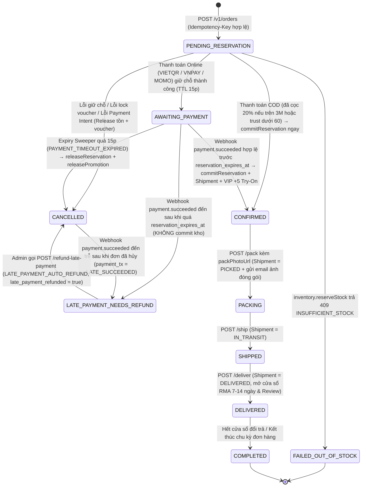

### 8.2. Vòng đời Đổi trả RMA (`RmaStatus` — 12 Trạng thái) & Kiểm định QC 3 Tiêu chí

- `RmaType`: `SIZE_EXCHANGE`, `COLOR_EXCHANGE`, `RETURN_REFUND` · `RmaExchangeMode`: `INSTANT_2WAY`, `STANDARD_QC`.
- `RmaReasonCode`: `SAI_KICH_CO_CHAT`, `SAI_KICH_CO_RONG`, `SAI_MAU_MO_TA`, `LOI_SAN_XUAT`, `KHAC`.
- **3 Tiêu chí QC (`CompleteRmaQcDtoSchema`)**: `tagsIntact` (còn nguyên tem mác), `unwashed` (chưa giặt là), `noStainsOrOdor` (không vết bẩn/mùi lạ) + cờ tổng `passed`.

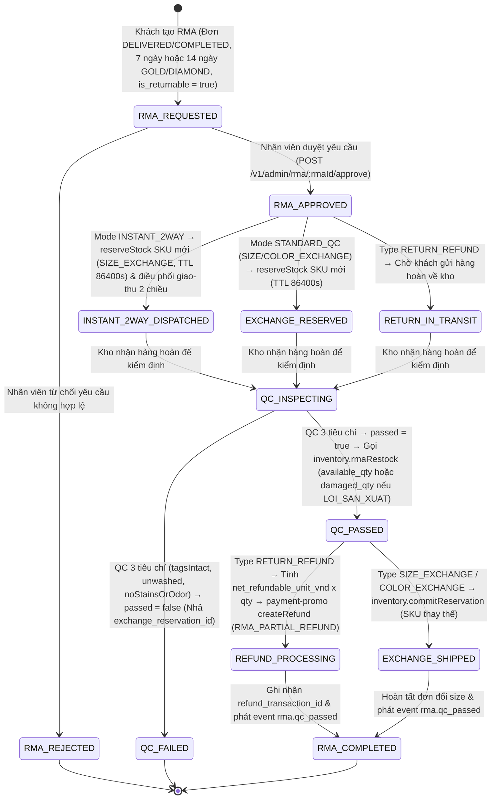

### 8.3. Vòng đời Đơn nhập kho B2B (`PurchaseOrderStatus`) & Công nợ NCC (`SupplierPayableStatus`)

- `PurchaseOrderStatus` (6 trạng thái): `NHAP_AI`, `CHO_NCC_XAC_NHAN`, `NCC_DA_XAC_NHAN`, `HOAN_TAT_MOT_PHAN`, `HOAN_TAT`, `DA_HUY`.
- `SupplierPayableStatus`: `UNPAID`, `PAID` · `SubmissionStatus`: `PENDING_REVIEW`, `APPROVED`, `REJECTED`.

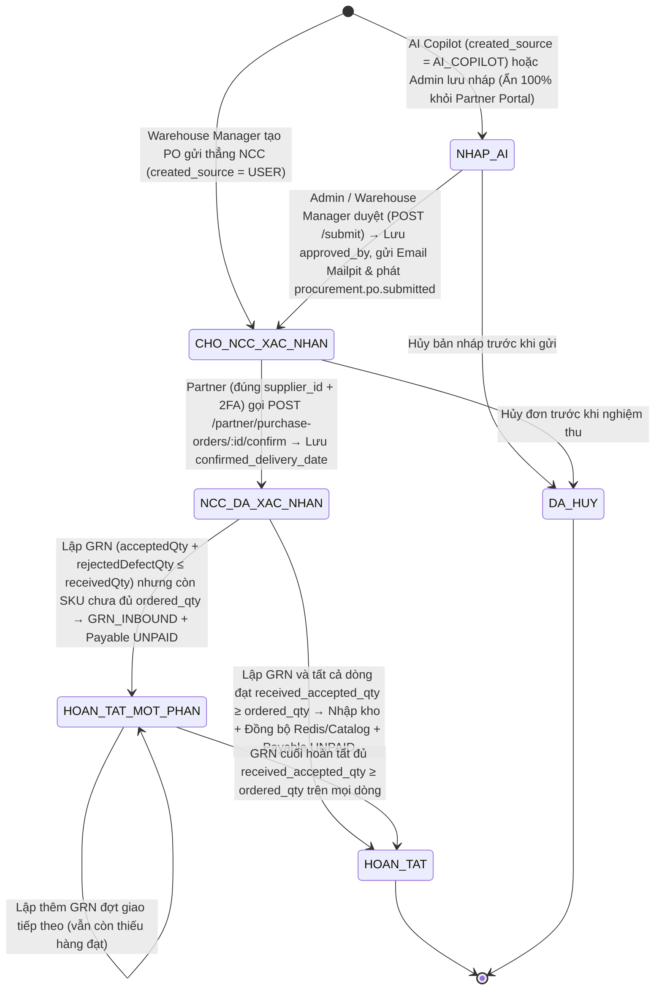

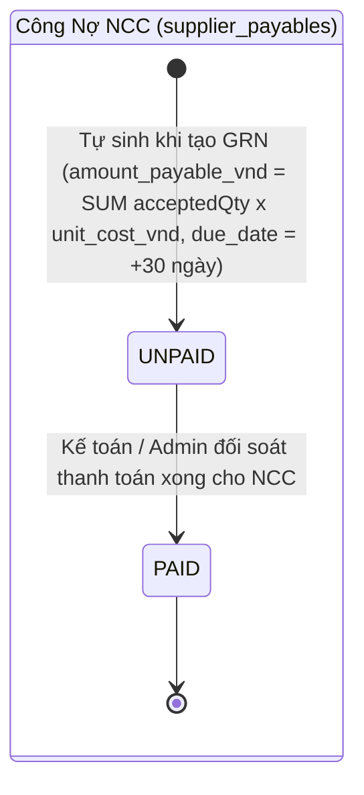

### 8.4. Vòng đời Giữ chỗ Tồn kho 15p (`ReservationStatus`) & Phiên Thử đồ AI (`TryOnSessionStatus`)

#### Giữ chỗ Tồn kho (`ReservationStatus` — 4 trạng thái)

```mermaid
stateDiagram-v2
    [*] --> ACTIVE : reserveStock (Redis LUA_RESERVE_SCRIPT + PG FOR UPDATE theo skuId ASC, TTL 900s CHECKOUT / 86400s SIZE_EXCHANGE)

    ACTIVE --> COMMITTED : commitReservation (Thanh toán thành công / COD / RMA QC Pass → reserved_qty giảm, committed_qty tăng, ledger COMMIT)
    ACTIVE --> RELEASED : releaseReservation (Hủy đơn / Lỗi Saga / RMA QC Fail → hoàn available_qty PG + Redis LUA_RELEASE_SCRIPT, ledger CANCEL_RELEASE)
    ACTIVE --> EXPIRED : runExpireSweep quá expires_at (15 phút) → hoàn available_qty PG + Redis LUA_RELEASE_SCRIPT, ledger RELEASE_EXPIRED

    COMMITTED --> [*]
    RELEASED --> [*]
    EXPIRED --> [*]
```

#### Phiên Thử đồ AI Backend (`TryOnSessionStatus` — 5 trạng thái) & Tự hủy Riêng tư 15 Phút

> **Lưu ý kiến trúc**: Sơ đồ dưới đây đặc tả máy trạng thái thật của dịch vụ backend `services/ai-tryon :4009` (đã nghiệm thu Gate 6 `pnpm verify:all`). Giao diện Storefront `/thu-do-ai` hiện vận hành chế độ Gương 3D AR tại thiết bị nên không gửi ảnh lên máy chủ.

```mermaid
stateDiagram-v2
    [*] --> COMPLETED : SHA-256 Cache Hit (Redis tryon cache & file MinIO còn tồn tại → 0 VND, 0 trừ quota, provider = CACHE_HIT)
    [*] --> QUEUED : Cache Miss → Magic Bytes hợp lệ → Trừ Dual Quota Redis Lua → Đẩy vào hàng đợi (HTTP 202)

    QUEUED --> PROCESSING_STEP_1 : Worker nhận job (prefetch = 2) → Emit Socket.io progress (SINGLE 60% / MIX_MATCH Bước 1 Áo 45%)
    PROCESSING_STEP_1 --> PROCESSING_STEP_2 : Mode MIX_MATCH_OUTFIT hoàn tất Bước 1 → Chuyển Bước 2 Quần/Váy (85%)
    PROCESSING_STEP_1 --> COMPLETED : Mode SINGLE hoàn tất → Lưu MinIO results/:sessionId.webp + Set Redis cache (900s) + Emit completed
    PROCESSING_STEP_2 --> COMPLETED : Mode MIX_MATCH_OUTFIT hoàn tất → Lưu MinIO + Set Redis cache (900s) + Emit completed

    PROCESSING_STEP_1 --> FAILED : Lỗi POSE_TOO_CLOSE / VTON_PROVIDER_ERROR → Hoàn +1 Dual Quota (LUA_DUAL_QUOTA_REFUND) + Emit failed
    PROCESSING_STEP_2 --> FAILED : Lỗi VTON Bước 2 → Hoàn +1 Dual Quota (LUA_DUAL_QUOTA_REFUND) + Emit failed

    COMPLETED --> PRIV : Presigned GET URL (TTL 900s, unsigned = HTTP 403)
    state "Vòng đời ảnh riêng tư (atelier-private-tryon)" as PRIV {
        [*] --> STORED_PRIVATE
        STORED_PRIVATE --> HARD_PURGED : TryOnAutoPurgeTask (mỗi 60s) khi expires_at ≤ NOW (+15p) → MinIO delete_object + Xóa Redis cache + is_purged = true
        HARD_PURGED --> [*]
    }

    FAILED --> [*]
    PRIV --> [*]
```

---

## 9. Sơ đồ Tuần tự Sequence Diagrams

### 9.1. Luồng 1 — Xác thực RS256 JWKS + RBAC + 2FA (TOTP / Email OTP) + Thu hồi Quyền Tức thì

```mermaid
sequenceDiagram
    autonumber
    actor User as Người dùng (Admin / Partner / Customer)
    participant BFF as BFF Edge (:4000)<br/>JwtVerifier & Guards
    participant Auth as auth-customer (:4001)<br/>JWKS RS256
    participant DB as auth_db (PG16)
    participant Redis as Redis (:6379)
    participant Mail as Mailpit SMTP (:1025)

    Note over BFF,Auth: Khởi động / Định kỳ 5 phút: BFF đồng bộ khóa công khai RS256
    BFF->>Auth: GET /.well-known/jwks.json
    Auth-->>BFF: Public JWK (RSA 2048-bit, kid = atelier-rs256-*)

    User->>BFF: POST /api/v1/auth/login {email, password}
    BFF->>Auth: Proxy POST /v1/auth/login
    Auth->>DB: Kiểm tra password_hash, status, roles, permissions, permission_version
    Auth->>DB: INSERT auth_sessions (refresh_token_hash, token_family_id, mfa_verified=false)
    Auth->>Redis: SET user:perm_ver:{sub} & DEL user:locked:{sub}
    Auth-->>BFF: Access JWT RS256 (mfaVerified=false) + Set-Cookie atelier_refresh_token (HttpOnly) & atelier_csrf_token
    BFF-->>User: 200 OK {accessToken, csrfToken, mfaRequired: true}

    alt Truy cập tài nguyên Admin/Partner khi chưa qua 2FA
        User->>BFF: GET /api/v1/admin/overview (Bearer pre-MFA JWT)
        BFF->>BFF: AdminPortalGuard / PartnerPortalGuard kiểm tra isMfaRequiredForRoles && !mfaVerified
        BFF-->>User: 403 Forbidden (MFA_REQUIRED)
    end

    alt Xác thực 2FA bằng Email OTP
        User->>BFF: POST /api/v1/auth/2fa/email-otp/send (Bearer JWT)
        BFF->>Auth: Proxy POST /v1/auth/2fa/email-otp/send
        Auth->>Redis: SET mfa:email_otp:{userId} = 6-digit (TTL 300s)
        Auth->>Mail: Gửi Email chứa mã OTP 6 chữ số
        Mail-->>User: Hộp thư nhận mã OTP
        User->>BFF: POST /api/v1/auth/2fa/email-otp/verify {code}
        BFF->>Auth: Proxy verify OTP
        Auth->>Redis: GET & DEL mfa:email_otp:{userId} (timingSafeEqual)
    else Xác thực 2FA bằng TOTP (RFC 6238 / Recovery Code)
        User->>BFF: POST /api/v1/auth/2fa/totp/verify {code}
        BFF->>Auth: Giải mã totp_secret_encrypted & xác thực TOTP
    end

    Auth->>DB: Xoay vòng auth_sessions nguyên tử (revoked=true bản cũ, tạo bản mới mfa_verified=true) + Ghi audit_logs
    Auth-->>BFF: Access JWT RS256 mới (mfaVerified=true, supplierId) + Refresh/CSRF Cookie mới
    BFF-->>User: 200 OK {accessToken, csrfToken, mfaVerified: true}

    Note over User,Redis: Kiểm soát quyền tức thì (< 1ms) & Chống Refresh Token Reuse
    User->>BFF: Gọi API bảo vệ (Bearer JWT)
    BFF->>BFF: Xác minh chữ ký RS256 bằng JWKS cache
    BFF->>Redis: Pipeline GET user:locked:{sub}, user:perm_ver:{sub}, revoked_jti:{jti}
    alt SUPER_ADMIN vừa đổi quyền / khóa tài khoản
        Redis-->>BFF: user:perm_ver:{sub} > jwt.permissionVersion (hoặc locked=1)
        BFF-->>User: 403 Forbidden (PERMISSION_REVOKED) ngay lập tức
    else Token hợp lệ & Đủ Permission
        BFF-->>User: 200 OK (dữ liệu đã kiểm tra RBAC & supplierId)
    end
```

### 9.2. Luồng 2 — Flash Sale Checkout Saga + Redis Lua Giữ chỗ 15p (0 Oversell) + Webhook HMAC + Late Payment Auto-Refund

```mermaid
sequenceDiagram
    autonumber
    actor Cust as Khách hàng
    actor Admin as Admin / ORDER_STAFF
    participant BFF as BFF (:4000)<br/>RateLimit + Socket.io
    participant Ord as order-rma (:4006)<br/>order_db
    participant Cat as catalog-lookbook (:4002)
    participant Inv as inventory (:4004)<br/>inventory_db
    participant Redis as Redis (:6379)<br/>Lua Gate
    participant Pay as payment-promo (:4007)<br/>payment_db
    participant GW as Cổng Thanh Toán<br/>VietQR / VNPay / MoMo
    participant Noti as notify-review (:4008)

    Cust->>BFF: POST /bff/v1/storefront/orders (Header Idempotency-Key)
    BFF->>Ord: Proxy POST /v1/orders (strip client price & spoof headers)
    Ord->>Ord: 1. Kiểm tra idempotency_key (nếu trùng trả replay ngay)
    Ord->>Cat: 2. Lấy giá bán chính thức (Authoritative Pricing) & Packaging
    Cat-->>Ord: Giá gốc/sale chuẩn từ catalog_db
    Ord->>Pay: 3. POST /v1/promotions/evaluate (Combo 5-10% + Voucher)
    Pay-->>Ord: Kết quả phân bổ giảm giá từng dòng (net_refundable_unit_vnd)
    Ord->>Ord: 4. INSERT orders (status = PENDING_RESERVATION) + order_items

    Note over Ord,Redis: Tầng chống Oversell 0% & Deadlock 0% (Lock Ordering skuId ASC)
    Ord->>Inv: 5. POST /v1/inventory/reserve (items sắp xếp skuId ASC, TTL 900s)
    Inv->>Redis: EVAL LUA_RESERVE_SCRIPT (-- ATELIER_LUA_RESERVE trên inv:avail:{skuId})
    alt Redis báo hết tồn kho (INSUFFICIENT)
        Redis-->>Inv: ['INSUFFICIENT', skuId, avail, req]
        Inv-->>Ord: 409 Conflict (INSUFFICIENT_STOCK)
        Ord->>Ord: UPDATE orders SET status = FAILED_OUT_OF_STOCK
        Ord-->>Cust: 409 Conflict (0% Oversell)
    else Redis trừ thành công (OK)
        Inv->>Inv: ACID PG Tx: SELECT stock_levels ... FOR UPDATE → UPDATE available_qty -= qty, reserved_qty += qty
        Inv->>Inv: INSERT stock_reservations (ACTIVE, +15p) & inventory_ledger (RESERVE)
        Inv-->>Ord: 200 OK {reservationId, expiresAt}
    end

    opt Có mã Voucher
        Ord->>Pay: 6. Lock Voucher (Redis promo:flash:{code} + voucher_redemptions = LOCKED)
    end
    Ord->>Pay: 7. POST /v1/payments/intents (VIETQR / VNPAY / MOMO / COD)
    Pay-->>Ord: PaymentIntent {transactionId, vietQrPayload, paymentUrl}
    Ord->>Ord: UPDATE orders SET status = AWAITING_PAYMENT (hoặc CONFIRMED nếu COD) + Outbox order.created
    Ord-->>Cust: 201 Created {orderCode, status, paymentIntent}

    Note over GW,Noti: Nhánh A — Thanh toán đúng hạn (< 15 phút)
    GW->>Pay: POST /v1/payments/webhooks/vietqr (Header X-Signature HMAC-SHA256)
    Pay->>Pay: Xác minh HMAC timingSafeEqual + Kiểm tra khớp exact amountVnd
    Pay->>Pay: ACID Tx: INSERT processed_webhooks (ON CONFLICT DO NOTHING) + tx = SUCCEEDED + voucher = REDEEMED
    Pay->>Ord: POST /internal/events/payment-succeeded (x-internal-secret)
    Ord->>Inv: POST /v1/inventory/commit (ACTIVE → COMMITTED, reserved → committed)
    Ord->>Ord: UPDATE orders = CONFIRMED, tạo Shipment (READY_TO_PICK)
    par Đẩy Realtime Socket.io
        Ord->>BFF: POST /internal/realtime/order-event (emit order:paid)
    and Thông báo & Quyền lợi VIP
        Ord->>Noti: Gửi Email xác nhận đơn hàng (Mailpit) + Cộng +5 lượt Try-On VIP
    end

    Note over Ord,Pay: Nhánh B — Quá hạn 15p & Thanh toán trễ (Late Payment Auto-Refund)
    Ord->>Ord: Expiry Sweeper: AWAITING_PAYMENT quá hạn → CANCELLED (PAYMENT_TIMEOUT_EXPIRED)
    Ord->>Inv: releaseReservation (EXPIRED/RELEASED + Redis LUA_RELEASE_SCRIPT hoàn tồn)
    GW->>Pay: Webhook thanh toán đến trễ cho đơn đã CANCELLED
    Pay->>Ord: POST /internal/events/payment-succeeded
    Ord->>Ord: Phát hiện đơn đã CANCELLED/Hết hạn → KHÔNG gọi commitReservation! Đổi status = LATE_PAYMENT_NEEDS_REFUND
    Ord-->>Pay: Trả orderStatus = LATE_PAYMENT_NEEDS_REFUND
    Pay->>Pay: Đổi payment_transactions = LATE_SUCCEEDED & phát payment.late.detected
    Admin->>BFF: POST /api/v1/admin/orders/:code/refund-late-payment (Hoàn tiền 1 chạm)
    BFF->>Ord: Gọi refundLatePayment → Pay.createRefund (LATE_PAYMENT_AUTO_REFUND) → Order = CANCELLED (late_payment_refunded = true)
```

### 9.3. Luồng 3 — Phòng Thử Đồ AI 2 Bước + SHA-256 Cache + Tự Hủy Ảnh Gốc MinIO Sau 15 Phút

> [!NOTE]
> **Ghi chú đồng bộ Frontend / Backend**: Sơ đồ tuần tự này mô tả đầy đủ quy trình thực thi tại **Backend `services/ai-tryon :4009` + BFF `/bff/v1/storefront/tryon/*`** (được nghiệm thu PASS 100% ở Gate 6 `pnpm verify:all`). Riêng giao diện `VirtualTryOnModal.tsx` (`/thu-do-ai`) trên Storefront hiện chạy chế độ **Gương 3D AR tại thiết bị** (Three.js + MediaPipe Pose, xử lý trực tiếp trên trình duyệt và không tải ảnh người dùng về máy chủ).

```mermaid
sequenceDiagram
    autonumber
    actor Cust as Khách hàng (API Client / Storefront)
    participant BFF as BFF (:4000)<br/>Socket.io /realtime
    participant TryOn as ai-tryon Python (:4009)<br/>tryon_db
    participant MinIO as MinIO S3 (:9000)<br/>atelier-private-tryon
    participant Redis as Redis (:6379)<br/>Cache & Dual Quota
    participant Worker as TryOnWorkerConsumer<br/>(prefetch=2)

    Cust->>BFF: POST /bff/v1/storefront/tryon/upload-url {privacyConsent: true, sha256Hash, poseScore}
    BFF->>TryOn: Proxy kèm x-user-id / x-guest-session-id / x-loyalty-tier / x-client-ip
    TryOn->>Redis: Kiểm tra Dual Quota (read-only: user limit theo Loyalty + IP limit)
    TryOn->>MinIO: Tạo Presigned PUT URL (bucket atelier-private-tryon, TTL 180s)
    TryOn->>TryOn: Lưu temp_user_images (expires_at = NOW + 15 phút, is_purged = false)
    TryOn-->>Cust: 200 OK {uploadUrl, tempImageId, objectKey, purgeAt}

    Cust->>MinIO: PUT uploadUrl (Tải ảnh chân dung trực tiếp lên MinIO, bỏ qua BFF)
    MinIO-->>Cust: 200 OK

    Cust->>BFF: POST /bff/v1/storefront/tryon/sessions {tempImageId, mode: MIX_MATCH_OUTFIT, upper/lower}
    BFF->>TryOn: Proxy POST /v1/tryon/sessions
    TryOn->>MinIO: Tải bytes ảnh gốc & Kiểm định Magic Bytes (JPEG/PNG/WebP)
    alt Magic Bytes giả mạo / sai định dạng
        TryOn->>MinIO: delete_object ngay lập tức & đánh dấu is_purged = true
        TryOn-->>Cust: 400 Bad Request (INVALID_MAGIC_BYTES)
    end

    TryOn->>TryOn: Tính cache_hash = SHA-256(sha256Hash:mode:upper:lower:onePiece)
    TryOn->>Redis: GET tryon:cache:{cache_hash}
    alt SHA-256 Cache HIT (và MinIO head_object tồn tại)
        TryOn->>MinIO: Tạo Presigned GET URL (TTL 900s)
        TryOn->>TryOn: Lưu TryOnSession (COMPLETED, provider = CACHE_HIT, 0 trừ quota)
        TryOn-->>Cust: 200 OK {cacheHit: true, resultUrl, remainingQuota giữ nguyên}
    else Cache MISS
        TryOn->>Redis: EVAL LUA_DUAL_QUOTA_RESERVE (-- ATELIER_LUA_QUOTA trừ 1 lượt User + IP)
        TryOn->>TryOn: Tạo TryOnSession (QUEUED) + 2 TryOnJob (Step 1 UPPER, Step 2 LOWER)
        TryOn->>Worker: Enqueue TryOnQueuedTask (+ mirror RabbitMQ atelier.tryon.direct)
        TryOn-->>Cust: 202 Accepted {sessionId, status: QUEUED, totalSteps: 2}
    end

    Cust->>BFF: Socket.io emit 'tryon:subscribe' {sessionId} (vào room tryon:{sessionId})

    Worker->>MinIO: Đọc ảnh chân dung + Tải ảnh phẳng 3:4 từ atelier-garments
    Worker->>BFF: POST /internal/realtime/tryon-event (tryon:progress Bước 1/2 Áo 45%)
    BFF-->>Cust: Socket.io push 'tryon:progress' (45%)
    Worker->>Worker: Chạy VTON Step 1 (UPPER) → Output trung gian
    Worker->>BFF: POST /internal/realtime/tryon-event (tryon:progress Bước 2/2 Quần/Váy 85%)
    BFF-->>Cust: Socket.io push 'tryon:progress' (85%)
    Worker->>Worker: Chạy VTON Step 2 (LOWER) trên ảnh trung gian

    alt Thành công cả 2 bước
        Worker->>MinIO: put_object results/{sessionId}.webp vào atelier-private-tryon
        Worker->>Redis: SET tryon:cache:{cache_hash} (TTL 900s)
        Worker->>TryOn: UPDATE TryOnSession = COMPLETED, INSERT TryOnResult (+15p) & TryOnDemandEvent
        Worker->>BFF: POST /internal/realtime/tryon-event (tryon:completed + Presigned GET URL)
        BFF-->>Cust: Socket.io push 'tryon:completed' {resultUrl, purgeAt}
    else Thất bại (POSE_TOO_CLOSE / Provider Error)
        Worker->>Redis: EVAL LUA_DUAL_QUOTA_REFUND (Hoàn tự động +1 lượt User + IP)
        Worker->>TryOn: UPDATE TryOnSession = FAILED, TryOnJob = FAILED
        Worker->>BFF: POST /internal/realtime/tryon-event (tryon:failed, quotaRefunded: true)
        BFF-->>Cust: Socket.io push 'tryon:failed'
    end

    Note over TryOn,MinIO: Sau đúng 15 phút — TryOnAutoPurgeTask chạy nền mỗi 60 giây
    TryOn->>TryOn: Truy vấn temp_user_images & tryon_results (is_purged=false, expires_at <= NOW)
    TryOn->>MinIO: delete_object ảnh gốc uploads/* & ảnh kết quả results/* (GET sau đó trả 404/403)
    TryOn->>Redis: DEL tryon:cache:{cache_hash}
    TryOn->>TryOn: UPDATE is_purged = true, purged_at = NOW
```

### 9.4. Luồng 4 — Đổi trả RMA 2 Chiều + Kiểm định QC 3 Tiêu chí + Hoàn tiền / Đổi Size

```mermaid
sequenceDiagram
    autonumber
    actor Cust as Khách hàng
    actor Staff as ORDER_STAFF / SUPER_ADMIN
    participant BFF as BFF (:4000)
    participant Ord as order-rma (:4006)<br/>order_db
    participant Inv as inventory (:4004)<br/>inventory_db
    participant Pay as payment-promo (:4007)<br/>payment_db
    participant RMQ as RabbitMQ<br/>atelier.domain.topic

    Cust->>BFF: POST /bff/v1/storefront/orders/:orderCode/rma {type, exchangeMode, reasonCode, targetSkuId, customerNote}
    BFF->>Ord: Proxy POST /v1/orders/:orderCode/rma (kèm verified x-user-id & x-loyalty-tier)
    Ord->>Ord: Kiểm tra sở hữu đơn (chống IDOR), trạng thái DELIVERED/COMPLETED, cửa sổ 7-14 ngày & is_returnable
    Ord->>Ord: Sanitize customerNote (max 300 ký tự) + INSERT rma_requests (RMA_REQUESTED) & rma_items
    Ord->>RMQ: Phát sự kiện rma.requested
    Ord-->>Cust: 201 Created {rmaCode, status: RMA_REQUESTED}

    Staff->>BFF: POST /api/v1/admin/rma/:rmaId/approve {exchangeMode, targetSkuId}
    BFF->>Ord: Proxy approveRma (+ ghi audit_logs RMA_APPROVED)
    alt Đổi nhanh 2 chiều (INSTANT_2WAY) hoặc Đổi tiêu chuẩn (STANDARD_QC)
        Ord->>Inv: POST /v1/inventory/reserve (reservationType = SIZE_EXCHANGE, targetSkuId, TTL 86400s)
        Inv-->>Ord: 200 OK {exchangeReservationId}
        Ord->>Ord: Cập nhật status = INSTANT_2WAY_DISPATCHED (nếu 2 chiều) hoặc EXCHANGE_RESERVED
    else Trả hàng hoàn tiền (RETURN_REFUND)
        Ord->>Ord: Cập nhật status = RETURN_IN_TRANSIT
    end
    Ord-->>Staff: 200 OK {status, exchangeReservationId}

    Note over Staff,Pay: Hàng hoàn về kho — Kiểm định QC 3 tiêu chí (tagsIntact, unwashed, noStainsOrOdor)
    Staff->>BFF: POST /api/v1/admin/rma/:rmaId/qc-complete {tagsIntact, unwashed, noStainsOrOdor, passed}
    BFF->>Ord: Proxy completeRmaQc
    alt QC KHÔNG đạt (passed = false)
        opt Có giữ chỗ đổi size trước đó
            Ord->>Inv: releaseReservation (CANCEL_RELEASE) hoàn lại tồn SKU mới
        end
        Ord->>Ord: UPDATE rma_requests = QC_FAILED + lưu qc_checklist_jsonb
        Ord-->>Staff: 200 OK {status: QC_FAILED}
    else QC ĐẠT chuẩn (passed = true)
        Ord->>Ord: UPDATE rma_requests = QC_PASSED + lưu qc_checklist_jsonb
        Ord->>Inv: POST /v1/inventory/internal/rma-restock (restockable = reasonCode != LOI_SAN_XUAT)
        Inv->>Inv: Nếu restockable → available_qty += qty (RMA_RESTOCK), nếu lỗi SX → damaged_qty += qty
        Inv-->>Ord: 200 OK
        alt Loại RETURN_REFUND (Hoàn tiền từng phần chính xác)
            Ord->>Ord: Tính refundAmountVnd = net_refundable_unit_vnd x qty, status = REFUND_PROCESSING
            Ord->>Pay: POST /v1/payments/refunds (idempotencyKey = rma-refund:{rmaId}, reason = RMA_PARTIAL_REFUND)
            Pay-->>Ord: 200 OK {refundId, status: COMPLETED}
        else Loại SIZE_EXCHANGE / COLOR_EXCHANGE
            Ord->>Inv: POST /v1/inventory/commit (chốt trừ kho SKU thay thế)
            Ord->>Ord: status = EXCHANGE_SHIPPED
        end
        Ord->>Ord: Chốt status = RMA_COMPLETED + Outbox rma.qc_passed
        Ord->>RMQ: Phát sự kiện rma.qc_passed
        BFF->>BFF: Xóa Redis cache Storefront & Revalidate ISR + ghi audit_logs RMA_QC_COMPLETED
        Ord-->>Staff: 200 OK {status: RMA_COMPLETED}
    end
```

### 9.5. Luồng 5 — Chuỗi Cung ứng B2B (AI Đề xuất PO `NHAP_AI` → Duyệt → Partner Xác nhận → GRN → Kho & Công nợ)

```mermaid
sequenceDiagram
    autonumber
    actor WH as WAREHOUSE_MANAGER (2FA)
    actor Supp as SUPPLIER (Partner Portal + 2FA)
    participant MCP as mcp-copilot (:4010)
    participant BFF as BFF (:4000)
    participant Inv as inventory (:4004)<br/>inventory_db
    participant Cat as catalog-lookbook (:4002)<br/>& Meilisearch
    participant Noti as notify-review (:4008)<br/>& Mailpit
    participant RMQ as RabbitMQ<br/>atelier.domain.topic

    WH->>BFF: POST /api/v1/admin/copilot/chat ("Phân tích SKU thử nhiều sắp hết & lập nháp PO")
    BFF->>MCP: Forward kèm Caller JWT RS256
    MCP->>BFF: GET /api/v1/admin/tryon/demand-summary & /inventory/stock-levels (JWT Pass-Through)
    MCP->>BFF: POST /api/v1/admin/procurement/purchase-orders/ai-draft (createdSource = AI_COPILOT)
    BFF->>Inv: Tạo PO bắt buộc khóa status = NHAP_AI + Ghi Audit Log (actorType = AI_COPILOT)
    Inv-->>MCP: 201 Created {poNumber, status: NHAP_AI}
    MCP-->>WH: Trả Action Card NHAP_AI (requiresHumanApproval = true)

    Note over Supp,Inv: Bảo mật cô lập — Khi PO ở trạng thái NHAP_AI, Partner Portal trả 403 PO_DRAFT_FORBIDDEN_FOR_SUPPLIER

    WH->>BFF: POST /api/v1/admin/procurement/purchase-orders/:id/submit (Bấm "Duyệt gửi Đối tác")
    BFF->>Inv: Chuyển NHAP_AI → CHO_NCC_XAC_NHAN, lưu approved_by & approved_at
    par Gửi Email thông báo NCC
        Inv->>Noti: POST /internal/notify/po-submitted → Gửi Email PO qua Mailpit
    and Phát sự kiện Domain
        Inv->>RMQ: Phát procurement.po.submitted
    end
    Inv-->>WH: 200 OK {status: CHO_NCC_XAC_NHAN}

    Supp->>BFF: GET /api/v1/partner/purchase-orders (PartnerPortalGuard: role=SUPPLIER, 2FA=true, supplierId)
    BFF->>Inv: Inject x-supplier-id từ JWT (chỉ thấy PO của chính mình, loại NHAP_AI)
    Supp->>BFF: POST /api/v1/partner/purchase-orders/:id/confirm {confirmedDeliveryDate, supplierNote}
    BFF->>Inv: Kiểm tra row.supplier_id == jwt.supplierId → Chuyển CHO_NCC_XAC_NHAN → NCC_DA_XAC_NHAN
    Inv->>RMQ: Phát procurement.po.confirmed
    Inv-->>Supp: 200 OK {status: NCC_DA_XAC_NHAN}

    Note over WH,Cat: Hàng về kho — Nghiệm thu thực tế GRN (VD: nhận 10, đạt 8, lỗi 2)
    WH->>BFF: POST /api/v1/admin/procurement/goods-receipts {poId, items: [{receivedQty, acceptedQty, rejectedDefectQty, batchCode}]}
    BFF->>Inv: Kiểm tra acceptedQty + rejectedDefectQty <= receivedQty
    Inv->>Inv: ACID Tx: INSERT goods_receipts + items, UPSERT stock_levels (available += accepted, damaged += defect)
    Inv->>Inv: Ghi inventory_ledger (GRN_INBOUND), cập nhật PO → HOAN_TAT_MOT_PHAN hoặc HOAN_TAT
    Inv->>Inv: Tự động INSERT supplier_payables (status = UNPAID, amount = SUM acceptedQty x unit_cost_vnd, due_date = +30d)
    Inv->>Inv: Đồng bộ chính xác tổng tồn mới lên Redis inv:avail:{skuId}
    par Đồng bộ Catalog & Meilisearch
        Inv->>Cat: POST /v1/catalog/internal/stock-replenished (cập nhật In Stock & Meilisearch)
    and Phát sự kiện RabbitMQ
        Inv->>RMQ: Phát inventory.stock.replenished
    and Làm mới Cache Storefront
        BFF->>BFF: Xóa Redis cache Storefront & Revalidate On-Demand ISR
    end
    Inv-->>WH: 201 Created {grnNumber, poStatus, payableId, payableAmountVnd}
    Supp->>BFF: GET /api/v1/partner/goods-receipts & /payables (Đối soát công nợ UNPAID theo supplier_id)
```

### 9.6. Luồng 6 — Ollama MCP Copilot 8-Layer Harness + Hybrid RAG 768-dim + Prompt Injection Sandbox + HITL

```mermaid
sequenceDiagram
    autonumber
    actor Admin as Nhân sự Admin<br/>(ORDER_STAFF / WAREHOUSE_MANAGER)
    participant BFF as BFF (:4000)<br/>JwtAuth + AdminPortalGuard
    participant MCP as mcp-copilot (:4010)<br/>0 Transactional DBs
    participant Harness as 8-Layer AI Harness<br/>(L2/L5/L6/L7/L8)
    participant Redis as Redis (:6379)<br/>copilot:cache:*
    participant RAG as rag_vector_db (PG16)<br/>+ Meilisearch
    participant Ollama as Ollama Local AI (:11434)<br/>qwen2.5:7b & nomic-embed-text

    Admin->>BFF: POST /api/v1/admin/copilot/chat {message, sessionId} (Bearer Caller JWT)
    BFF->>BFF: Xác minh RS256 JWKS, 2FA & Permission copilot.access
    BFF->>MCP: Forward POST /v1/copilot/chat (giữ nguyên Authorization Bearer JWT)

    MCP->>Harness: [Layer 5] assertNoSuperuserToken() & xác thực RBAC role/permission
    MCP->>Harness: [Layer 6] maskPii(message) + detectPromptInjection(message)
    alt Phát hiện Prompt Injection trực tiếp (VD: bỏ qua NHAP_AI / lộ giá vốn)
        Harness-->>MCP: blocked = true (PROMPT_INJECTION_BLOCKED)
        MCP->>Harness: [Layer 8] Ghi Telemetry BLOCKED_GUARDRAIL (costUsd = 0)
        MCP-->>Admin: 200 OK {guardrailBlocked: true, actionCards: []}
    end

    Note over MCP,Redis: [Layer 7] Semantic Cache & 3-Tier Router (Tier 0 / Tier 1 / Tier 2)
    opt Câu hỏi chính sách/SOP Read-Only (POLICY_RAG_QA)
        MCP->>Redis: GET copilot:cache:{sha256(intent+role+locale)} (TTL 300s)
        alt Cache HIT
            Redis-->>MCP: Trả ngay câu trả lời đã đệm (Tier 0, 0 token)
            MCP-->>Admin: 200 OK {cacheHit: true}
        else Cache MISS
            MCP->>Ollama: [Layer 1/3] /api/embed (nomic-embed-text → vector 768-dim)
            MCP->>RAG: [Layer 3] Hybrid RAG: pgvector Cosine + Full-Text + Meilisearch (RRF k=60)
            RAG-->>MCP: Top-K trích dẫn chính sách GROUNDED
        end
    end

    Note over MCP,Ollama: [Layer 4 & 5] Chạy trong AsyncLocalStorage JwtPassThroughContext (0 Superuser Token)
    MCP->>Harness: authorizeToolCall() lọc danh sách Tool hợp lệ theo RBAC của Caller
    alt Lượt chứa dữ liệu khách hàng (analyze_refund_and_sizing_issues)
        MCP->>Harness: [Layer 6] Bật untrustedTurnActive = true (Khóa cứng mọi MUTATING_DRAFT tool)
    end

    loop Multi-step Ollama Tool Calling (Tối đa 4 bước)
        MCP->>Ollama: [Layer 1/2] /api/chat (qwen2.5:7b, System Prompt theo Role, JSON Schema Tools)
        Ollama-->>MCP: Yêu cầu gọi MCP Tool (VD: get_tryon_demand_signals / analyze_refund / create_po_draft)
        alt Tool ghi bị gọi trong lượt untrustedTurnActive
            Harness-->>MCP: Ném UntrustedTurnMutationBlockedError (PROMPT_INJECTION_BLOCKED)
        else Tool hợp lệ theo RBAC
            MCP->>BFF: HTTP GET/POST qua BffPassThroughClient (Forward nguyên Caller JWT + W3C traceparent)
            BFF-->>MCP: Kết quả nghiệp vụ thật (403 nếu JWT không đủ quyền)
            MCP->>Harness: [Layer 6] Bọc ghi chú khách trong thẻ «untrusted_customer_note» (max 300 ký tự, che PII)
            MCP->>Harness: [Layer 6] enforceHumanInTheLoop() khóa cứng status = NHAP_AI, autoAttachAsTryOnGarment = false
            MCP->>Harness: [Layer 5] redactRestrictedFields() xóa cost_price / giaNhap nếu thiếu quyền giá vốn
        end
    end

    MCP->>Harness: [Layer 8] Ghi Telemetry (modelUsed, promptEvalCount, evalCount, tokensPerSec, costUsd = 0)
    MCP-->>BFF: Trả {reply, actionCards (NHAP_AI), toolTraces, citations, safetyReport, ollamaTelemetry}
    BFF->>BFF: Defense-in-depth redactRestrictedFields() lần 2 theo JWT roles
    BFF-->>Admin: 200 OK (Admin xem Action Card & chủ động bấm Duyệt thủ công)
```

---

## 10. Sơ đồ Hoạt động Activity Diagrams

### 10.1. Luồng Hoạt động: Checkout Saga, Giữ chỗ 15 Phút & Thanh toán Đa cổng

```mermaid
flowchart TD
    START(("Bắt đầu<br/>Checkout")) --> IDEM{"Kiểm tra Header<br/>Idempotency-Key<br/>đã tồn tại?"}
    IDEM -->|"Có (Replay)"| RET_REPLAY["Trả về đơn hàng & PaymentIntent cũ<br/>(idempotentReplay = true)"] --> END_OK(("Kết thúc"))
    IDEM -->|"Chưa có"| PRICE["Lấy giá bán chuẩn từ catalog-lookbook<br/>(Loại bỏ mọi trường giá client gửi)"]
    PRICE --> PROMO["Gọi payment-promo đánh giá<br/>Combo 5-10% & Voucher"]
    PROMO --> COD_CHK{"Phương thức = COD<br/>và (Tổng trên 3 triệu hoặc<br/>trustScore dưới 60)?"}
    COD_CHK -->|"Có & chưa cọc 20%"| ERR_COD["Trả 400 COD_RISK_DEPOSIT_REQUIRED"] --> END_ERR(("Dừng"))
    COD_CHK -->|"Hợp lệ"| INS_ORD["Lưu orders = PENDING_RESERVATION<br/>& order_items (kèm net_refundable_unit_vnd)"]
    INS_ORD --> SORT_SKU["Sắp xếp danh sách SKU tăng dần<br/>(skuId ASC chống Deadlock)"]
    SORT_SKU --> LUA_RES["Chạy Redis Lua -- ATELIER_LUA_RESERVE<br/>+ PostgreSQL SELECT ... FOR UPDATE"]
    LUA_RES --> STK_OK{"Đủ tồn kho<br/>toàn bộ SKU?"}
    STK_OK -->|"Thiếu tồn"| FAIL_OOS["Cập nhật đơn = FAILED_OUT_OF_STOCK<br/>Trả 409 Conflict (0% Oversell)"] --> END_ERR
    STK_OK -->|"Đủ tồn"| LOCK_V{"Có áp dụng<br/>Voucher?"}
    LOCK_V -->|"Có"| DO_LOCK["Lock Voucher trên payment-promo<br/>(Redis promo:flash:* + LOCKED)"]
    DO_LOCK --> V_OK{"Lock Voucher<br/>thành công?"}
    V_OK -->|"Thất bại"| COMP_1["Bù trừ: Release tồn kho + Hủy đơn CANCELLED"] --> END_ERR
    V_OK -->|"Thành công"| PAY_INT
    LOCK_V -->|"Không"| PAY_INT["Tạo Payment Intent<br/>(VietQR / VNPay / MoMo / COD)"]
    PAY_INT --> PI_OK{"Tạo Payment Intent<br/>thành công?"}
    PI_OK -->|"Thất bại"| COMP_2["Bù trừ: Release tồn kho + Release Voucher<br/>+ Hủy đơn CANCELLED"] --> END_ERR
    PI_OK -->|"Thành công"| IS_COD{"Thanh toán<br/>COD?"}
    IS_COD -->|"Có"| COD_COMMIT["Commit tồn kho ngay → CONFIRMED<br/>Tạo Shipment + Gửi Email + VIP +5 Try-On"] --> END_OK
    IS_COD -->|"Online"| WAIT_PAY["Chuyển đơn = AWAITING_PAYMENT<br/>Bắt đầu đếm ngược giữ chỗ 15 phút"]
    WAIT_PAY --> WAIT_EVT{"Sự kiện xảy ra<br/>trong 15 phút?"}
    WAIT_EVT -->|"Webhook HMAC hợp lệ<br/>trước hạn"| PAID_OK["Deduplicate processed_webhooks → Commit kho<br/>CONFIRMED + Shipment + Socket order:paid + Email + VIP +5"] --> END_OK
    WAIT_EVT -->|"Quá hạn 15 phút"| EXP_SWEEP["Sweeper hủy đơn CANCELLED<br/>Release tồn PG+Redis & Release Voucher"]
    EXP_SWEEP --> LATE_CHK{"Webhook thanh toán<br/>đến trễ sau khi hủy?"}
    LATE_CHK -->|"Không"| END_ERR
    LATE_CHK -->|"Có"| LATE_MARK["KHÔNG trừ kho! Đánh dấu<br/>Order = LATE_PAYMENT_NEEDS_REFUND<br/>Payment = LATE_SUCCEEDED"]
    LATE_MARK --> ADMIN_REF["Admin hoàn tiền 1 chạm<br/>(LATE_PAYMENT_AUTO_REFUND) → CANCELLED"] --> END_OK
```

### 10.2. Luồng Hoạt động: Phòng Thử Đồ AI Backend 2 Bước, Kiểm định Bảo mật & Tự hủy 15 Phút

```mermaid
flowchart TD
    S(("Bắt đầu<br/>Thử đồ AI")) --> CONSENT{"Khách xác nhận<br/>privacyConsent = true?"}
    CONSENT -->|"Không"| E1["Trả 400 PRIVACY_CONSENT_REQUIRED"] --> F_END(("Kết thúc"))
    CONSENT -->|"Có"| Q_CHK{"Còn Dual Quota?<br/>(User Loyalty + IP)"}
    Q_CHK -->|"Hết lượt"| E2["Trả 429 QUOTA_EXCEEDED"] --> F_END
    Q_CHK -->|"Còn lượt"| PRESIGN["Cấp Presigned PUT URL (TTL 180s)<br/>Lưu temp_user_images (expires_at = +15p)"]
    PRESIGN --> PUT_S3["Client tải ảnh trực tiếp lên<br/>bucket atelier-private-tryon"]
    PUT_S3 --> MAGIC["Kiểm định Magic Bytes<br/>(JPEG / PNG / WebP thật)"]
    MAGIC --> M_OK{"Ảnh hợp lệ?"}
    M_OK -->|"Giả mạo"| DEL_BAD["Xóa cứng ngay trên MinIO<br/>Trả 400 INVALID_MAGIC_BYTES"] --> F_END
    M_OK -->|"Hợp lệ"| HASH["Tính SHA-256(ảnh + mode + upper/lower)"]
    HASH --> CACHE{"Redis tryon:cache:{hash}<br/>& MinIO object tồn tại?"}
    CACHE -->|"HIT (dưới 1 giây)"| RET_HIT["Trả ngay Presigned GET URL (TTL 900s)<br/>provider = CACHE_HIT · 0 VND · 0 trừ quota"] --> PURGE_WAIT
    CACHE -->|"MISS"| DEDUCT["Trừ 1 lượt qua Redis Lua<br/>-- ATELIER_LUA_QUOTA"]
    DEDUCT --> ENQ["Tạo TryOnSession = QUEUED (202 Accepted)<br/>Đẩy vào Worker Pool (prefetch = 2)"]
    ENQ --> STEP1["Chạy Bước 1 (Áo / Đầm)<br/>Emit Socket.io tryon:progress (45%/60%)"]
    STEP1 --> MODE2{"Mode = MIX_MATCH_OUTFIT<br/>(2 bước)?"}
    MODE2 -->|"Có"| STEP2["Chạy Bước 2 (Quần / Chân váy)<br/>Emit Socket.io tryon:progress (85%)"] --> RES_OK
    MODE2 -->|"Không (SINGLE)"| RES_OK{"Xử lý VTON<br/>thành công?"}
    RES_OK -->|"Lỗi POSE_TOO_CLOSE / VTON"| REF_Q["Chạy Redis Lua -- ATELIER_LUA_QUOTA_REFUND<br/>Hoàn +1 lượt · Status = FAILED · Emit tryon:failed"] --> F_END
    RES_OK -->|"Thành công"| SAVE_RES["Lưu results/{sessionId}.webp vào atelier-private-tryon<br/>Set tryon:cache (TTL 900s) · Emit tryon:completed"]
    SAVE_RES --> PURGE_WAIT["Chờ đủ 15 phút (expires_at ≤ NOW)"]
    PURGE_WAIT --> AUTO_PURGE["TryOnAutoPurgeTask (chu kỳ 60s):<br/>Xóa cứng MinIO uploads/* & results/* + DEL Redis cache<br/>Cập nhật is_purged = true (GET trả 404/403)"] --> F_END
```

### 10.3. Luồng Hoạt động: Vận hành 8-Layer AI Harness & Phê duyệt Human-in-the-Loop (`NHAP_AI`)

```mermaid
flowchart TD
    A0(("Yêu cầu Chat<br/>Admin Copilot")) --> L5_TOK["Layer 5: Kiểm tra Caller JWT RS256<br/>Chặn tuyệt đối Superuser/Bypass Token"]
    L5_TOK --> L6_IN["Layer 6: Che PII (Email, SĐT VN, Địa chỉ)<br/>Quét Prompt Injection trực tiếp"]
    L6_IN --> INJ{"Phát hiện<br/>Prompt Injection?"}
    INJ -->|"Có"| BLK["Chặn ngay (BLOCKED_GUARDRAIL)<br/>Ghi Telemetry Layer 8"] --> Z(("Kết thúc"))
    INJ -->|"Không"| L7_ROUTE["Layer 7: Three-Tier Router<br/>(Tier 0 Cache/Formula → Tier 1 Fast → Tier 2 Ollama)"]
    L7_ROUTE --> IS_QA{"Câu hỏi chính sách<br/>POLICY_RAG_QA?"}
    IS_QA -->|"Có"| SEM_C{"Redis copilot:cache:*<br/>HIT?"}
    SEM_C -->|"HIT"| RET_C["Trả ngay kết quả Cache (0 token)"] --> Z
    SEM_C -->|"MISS"| RAG_Q["Layer 3: Ollama nomic-embed-text (768-dim)<br/>Hybrid RAG (pgvector + FTS + Meilisearch, RRF k=60)"] --> SYNTH
    IS_QA -->|"Không (MCP Tools)"| RBAC_T{"Layer 5: authorizeToolCall()<br/>Caller đủ quyền RBAC?"}
    RBAC_T -->|"Không đủ quyền"| ERR_403["Từ chối HTTP 403 FORBIDDEN<br/>Ghi Telemetry BLOCKED_RBAC"] --> Z
    RBAC_T -->|"Đủ quyền"| UNTRUST{"Tool có đọc ghi chú<br/>khách hàng (RMA)?"}
    UNTRUST -->|"Có"| LOCK_MUT["Bật untrustedTurnActive = true<br/>KHÓA CỨNG mọi MUTATING_DRAFT Tool<br/>Bọc «untrusted_customer_note»"] --> LOOP
    UNTRUST -->|"Không"| LOOP["Layer 1/2/4: Ollama qwen2.5:7b Tool-Calling Loop (≤ 4 bước)<br/>Fallback RuleBasedMcpOrchestrator nếu offline"]
    LOOP --> EXEC_BFF["Gọi BFF qua AsyncLocalStorage JWT Pass-Through<br/>(0 kết nối DB giao dịch trực tiếp)"]
    EXEC_BFF --> IS_MUT{"Là Tool ghi<br/>MUTATING_DRAFT?"}
    IS_MUT -->|"Có"| HITL["Layer 6: enforceHumanInTheLoop()<br/>Khóa status = NHAP_AI · autoAttach = false<br/>Tạo Action Card yêu cầu duyệt tay"] --> REDACT
    IS_MUT -->|"Không (READ_ONLY)"| REDACT["Layer 5: redactRestrictedFields()<br/>Xóa sạch cost_price / giaNhap nếu thiếu quyền"]
    REDACT --> SYNTH["Tổng hợp phản hồi tiếng Việt + Trích dẫn RAG"]
    SYNTH --> TELE["Layer 8: Ghi AI Telemetry (tokens/s, costUsd = 0)<br/>Lưu Semantic Cache (nếu Read-Only)"]
    TELE --> HUMAN{"Nhân sự duyệt<br/>Action Card NHAP_AI?"}
    HUMAN -->|"Không có Card / Chưa duyệt"| Z
    HUMAN -->|"Bấm Phê duyệt thủ công"| APPLY["Gọi API nghiệp vụ thật (VD: POST /po/:id/submit)<br/>Ghi Audit Log người duyệt (USER)"] --> Z
```

---

## 11. Tài khoản Demo RBAC và Bộ lệnh Kiểm định Chất lượng

### 11.1. Tài khoản Demo theo 6 Vai trò RBAC

Mật khẩu chung cho toàn bộ tài khoản demo nội bộ và kiểm thử: **`Atelier@2026!`**

| Vai trò (Role) | Email đăng nhập | Cổng truy cập | Yêu cầu 2FA | Phạm vi đặc quyền chính |
|---|---|---|---|---|
| `SUPER_ADMIN` | `lebao01121@gmail.com` | `:3001` | **Bắt buộc** (TOTP / Mailpit OTP) | Toàn quyền IAM/RBAC, AI Ops/Health, Replay/Purge `*.dlq`, Giá vốn |
| `CATALOG_AI_OPERATOR` | `operator@atelier.local` | `:3001` | Không | Quản trị SPU/SKU, Dual Media Studio, AI Lookbook Studio (Ẩn giá vốn) |
| `WAREHOUSE_MANAGER` | `warehouse@atelier.local` | `:3001` | **Bắt buộc** (TOTP / Mailpit OTP) | Tồn kho đa kho, Duyệt PO `NHAP_AI`, Nghiệm thu GRN, Xem giá vốn |
| `ORDER_STAFF` | `staff@atelier.local` | `:3001` | Không | Đóng gói + Ảnh hộp quà, Giao vận, Hoàn tiền trễ, Duyệt & QC RMA (Chặn `403` tạo PO) |
| `SUPPLIER` (A / B / C) | `supplier-a@atelier.local`<br/>`supplier-b@atelier.local`<br/>`supplier-c@atelier.local` | `:3002` | **Bắt buộc** (TOTP / Mailpit OTP) | Khóa cứng theo JWT `supplier_id`: Xác nhận PO, Xem GRN, Đối soát công nợ |
| `CUSTOMER` (A / B) | `customer@atelier.local`<br/>`customer-b@atelier.local` | `:3000` | Không | Mua sắm, Phối đồ, Thử đồ 3D AR, Checkout, Đổi Size RMA (Bị chặn `403` trên `:3001` & `:3002`) |

> **Mẹo 2FA nhanh khi demo**: Khi đăng nhập `SUPER_ADMIN`, `WAREHOUSE_MANAGER`, hoặc `SUPPLIER`, nhấn **"Gửi mã OTP qua Email"** trên màn hình `TwoFactorGate` rồi mở **Mailpit (`http://localhost:8025`)** để lấy mã 6 chữ số tức thì.

### 11.2. Bộ Lệnh Kiểm định Chất lượng & Tải cao

```powershell
# Kiểm định toàn diện 6 Cổng Nghiệm Thu (Build, UI/Motion, AI Evals, Flash-Sale, Security/IDOR/DLQ, E2E)
pnpm verify:all

# Kiểm định giao diện, 3-Portal Isolation & chuẩn Quiet Luxury (Static Regex Scanner)
pnpm verify:ui

# Bộ đánh giá định lượng 8 lớp AI Harness (Tool Accuracy, Hybrid RAG 768d, 100% Prompt Injection Block)
pnpm eval:ai

# Kiểm thử tải Flash Sale đồng thời (100 request / 5 tồn kho -> 0 Oversell, 0 Deadlock)
pnpm test:flash-sale

# Xuất tập dữ liệu SFT/DPO (JSONL đã lọc PII) cho vòng lặp tinh chỉnh mô hình AI nội bộ
pnpm ai:export-sft

# Kiểm định theo từng giai đoạn (Phase 0 -> Phase 5)
pnpm verify:phase0
pnpm verify:phase1
pnpm verify:phase2
pnpm verify:phase3
pnpm verify:phase4
pnpm verify:phase5
```
