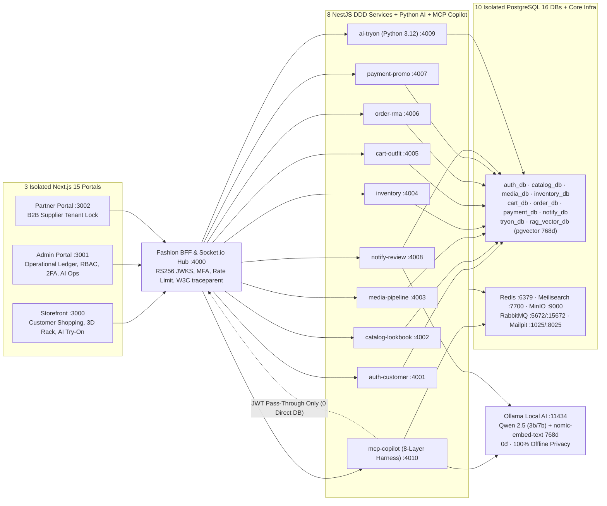

# Tầm Xuân · Fashion Atelier AI Platform (v3.1 — 100% Local AI Ollama)

Nền tảng thương mại điện tử thời trang cao cấp **Editorial Quiet Luxury** vận hành **100% Local AI bằng Ollama (`qwen2.5` + `nomic-embed-text` 768-dim, `0₫ / Offline Privacy`, không cần bất kỳ cloud LLM API key nào)** — tích hợp **Sào Treo 3D WebGL**, **Mix & Match Outfit Studio 7 lớp**, **Phòng Thử Đồ AI riêng tư tự hủy sau 15 phút**, **Chống bán vượt tồn kho Flash Sale (0 Oversell / 0 Deadlock)**, **Chuỗi cung ứng B2B PO → GRN → Công nợ**, và **Trợ lý Điều hành AI MCP Copilot 8 lớp Human-in-the-Loop**.

---

## Khởi chạy Toàn bộ Hệ thống chỉ với 1 Lệnh `./run`

Hỗ trợ đồng nhất trên **Git Bash, WSL, Linux, macOS, Windows PowerShell (`./run`) và Windows CMD (`run` / `.\run`)**:

```bash
# Khởi chạy trọn gói: Kiểm tra môi trường + .env + HTTPS certs + Dọn cổng
# + Tự bật Host Ollama (:11434) & Tự chọn mô hình thông minh theo RAM (qwen2.5:3b / qwen2.5:7b + nomic-embed-text 768-dim)
# + Bật Hạ tầng (Docker Compose / tự dự phòng Local Dev Harness nếu máy chưa cài Docker)
# + Build packages/* + Migrate 10 DB + Smart Auto-Seed + Bật đồng thời 14 cổng (3000..3002, 4000..4010)
./run
```

### Tự động Quản lý Local Ollama AI thông minh theo RAM
- **Mặc định dùng Host Ollama (`http://127.0.0.1:11434`)**: tận dụng trực tiếp GPU phần cứng (NVIDIA CUDA / Apple Silicon Metal / AMD ROCm) với độ trễ tối thiểu và không tốn phí API (`0₫`).
- **Tự chọn mô hình theo RAM (`RAM-Aware Auto-Pull`)**:
  - Máy `<= 16 GB RAM` (hoặc RAM trống `< 6 GB`): tự động ưu tiên **`qwen2.5:3b`** làm mô hình chính (tránh tràn bộ nhớ) + **`nomic-embed-text`** (`768-dim`).
  - Máy `> 16 GB RAM`: sẵn sàng dùng **`qwen2.5:7b`** làm mô hình chính + **`qwen2.5:3b`** cho tác vụ phân loại nhanh + **`nomic-embed-text`** (`768-dim`).
  - Nếu mô hình chưa có trên máy, `./run` tự động chạy `ollama pull` có hiển thị tiến trình trực tiếp; nếu máy chưa cài Ollama, MCP Copilot tự động hạ cánh êm ái về `RuleBasedMcpOrchestrator`.
- **Tùy chọn chạy Ollama trong Docker**: dùng `./run --ollama-docker` để kích hoạt container `atelier-ollama` (`--profile ollama-docker`) gắn volume bền vững `ollama_models`.

Các cờ dòng lệnh tiện ích đi kèm:
- `./run --ollama-docker` : Khởi động thêm container Ollama chính thức trong Docker Compose (`--profile ollama-docker`, cổng `11434`).
- `./run --seed` : Ép nạp lại bộ dữ liệu mẫu (`pnpm db:seed`: 20 thiết kế, ảnh MinIO `2:3` & `3:4`, 6 vai trò RBAC, 54 reviews, tín hiệu MCP Copilot).
- `./run --reset` : Xóa sạch volume Docker / dữ liệu cục bộ cũ, dựng lại 10 DB cô lập từ đầu, migrate, seed và khởi chạy.
- `./run --status` : Kiểm tra nhanh trạng thái sống/chết của **Ollama Engine (`:11434`)**, cụm Hạ tầng và toàn bộ cổng `3000..3002`, `4000..4010`.
- `./run --down` : Giải phóng sạch các cổng `3000..4010` và tắt cụm Docker (`docker compose down`; giữ nguyên system Ollama daemon nếu có sẵn).
- `./run --verify` : Bật hạ tầng và chạy tổng kiểm toán `pnpm eval:ai` + `pnpm verify:all` (6/6 Gates).
- `./run --smoke-test` : Chạy trọn 6 bước, xác minh 14/14 cổng trả về `200 OK` + trạng thái Ollama Engine rồi tự tắt gọn không kẹt cổng.
- `./run --docker` / `./run --local` : Ép bắt buộc Docker Desktop hoặc chọn chủ động Local Dev Harness.
- `./run --help` : Xem hướng dẫn đầy đủ.

---

## 1. Kiến trúc Tổng thể (3 Portals · BFF · 8 DDD Services · Python AI · Ollama Local AI · 10 Isolated DBs)



---

## 2. Bản đồ 14 Cổng Dịch vụ, Local Ollama Engine & 10 Cơ sở dữ liệu Cô lập

| # | Thành phần / Workspace | Cổng | Công nghệ | Database cô lập (`svc_*`) | Vai trò chính |
|---|---|---|---|---|---|
| 1 | `apps/storefront` | `3000` | Next.js 15 + R3F + GSAP + Lenis | — | Cổng khách hàng (tách biệt tuyệt đối nội bộ) |
| 2 | `apps/admin-portal` | `3001` | Next.js 15 + React 19 | — | Sổ cái điều hành nội bộ + Ollama MCP Copilot + AI Ops/DLQ |
| 3 | `apps/partner-portal` | `3002` | Next.js 15 + React 19 | — | Cổng Nhà cung cấp B2B khóa chặt `supplier_id` |
| 4 | `apps/bff` | `4000` | NestJS + Socket.io | — | Gateway RS256, 2FA, Rate Limit, Cache, Realtime Hub |
| 5 | `services/auth-customer` | `4001` | NestJS | `auth_db` (`svc_auth`) | IAM, RBAC 6 vai trò, TOTP/Email 2FA, Audit Logs |
| 6 | `services/catalog-lookbook` | `4002` | NestJS | `catalog_db` (`svc_catalog`) | SPU/SKU, Crowd Size Advisor, Lookbook Studio, Meilisearch |
| 7 | `services/media-pipeline` | `4003` | NestJS + Sharp | `media_db` (`svc_media`) | Kiểm định Magic Bytes, 2:3 Alpha, 3:4 Flat-Lay, Anchor |
| 8 | `services/inventory` | `4004` | NestJS + Redis Lua | `inventory_db` (`svc_inventory`) | Đa kho, Giữ chỗ 15p (0 Oversell), PO → GRN → Công nợ |
| 9 | `services/cart-outfit` | `4005` | NestJS + Redis | `cart_db` (`svc_cart`) | Giỏ hàng 30 ngày, Combo -5%/-10%, Share Outfit, Merge |
| 10 | `services/order-rma` | `4006` | NestJS | `order_db` (`svc_order`) | Checkout Saga, Thanh toán trễ, RMA 2 chiều & QC 3 tiêu chí |
| 11 | `services/payment-promo` | `4007` | NestJS | `payment_db` (`svc_payment`) | Voucher phân bổ ròng, VietQR/VNPay/MoMo HMAC, Hoàn tiền |
| 12 | `services/notify-review` | `4008` | NestJS + SMTP + Ollama Fast | `notify_db` (`svc_notify`) | Verified Fit Reviews (`±4cm/±4kg`), NLP Cảm xúc cục bộ, Mailpit |
| 13 | `services/ai-tryon` | `4009` | Python 3.12 + FastAPI | `tryon_db` (`svc_tryon`) | Try-On 2 bước, SHA-256 Cache, Auto-Purge 15p MinIO |
| 14 | `apps/mcp-copilot` | `4010` | Node + MCP SDK + **Ollama Qwen 2.5** (`nomic-embed-text` 768-dim) | `rag_vector_db` (`svc_rag`) | 8-Layer AI Harness, Hybrid RAG 768-dim, Prompt Injection Sandbox (0 API key!) |

**Hạ tầng lõi & Local AI Engine**: **Ollama Local AI (`:11434`, `qwen2.5:3b` / `qwen2.5:7b` + `nomic-embed-text` 768-dim)**, PostgreSQL 16 (`:5432`, tự động chuyển PGlite/SQLite cục bộ khi không có Docker), Redis (`:6379`), Meilisearch (`:7700`), MinIO (`:9000` / Console `:9001`), RabbitMQ (`:5672` / Management `:15672`), Mailpit SMTP (`:1025` / Web UI `:8025`).

---

## 3. Khởi chạy Nhanh trên Windows (2 Lệnh thay thế)

Yêu cầu: **Node.js >= 20**, **pnpm 9.15+**, **Python 3.12** (đã cài sẵn trong `services/ai-tryon/.venv`), và tùy chọn **Ollama** trên máy host (`http://127.0.0.1:11434`) hoặc `--ollama-docker`.

```powershell
# Bước 1: Kiểm tra môi trường, cài đặt, build toàn bộ 21 workspaces & khởi tạo dữ liệu mẫu 20 sản phẩm
pnpm demo:ready

# Bước 2: Khởi động đồng thời toàn bộ hạ tầng + 11 microservices + 3 cổng Next.js
pnpm start:all
```

Sau khi khởi chạy thành công, mở đồng thời 4 cửa sổ trình duyệt:
- **Storefront (Khách hàng)**: `http://localhost:3000`
- **Admin Portal (Sổ cái điều hành & Ollama MCP Copilot)**: `http://localhost:3001`
- **Partner Portal (Nhà cung cấp B2B)**: `http://localhost:3002`
- **Mailpit (Hộp thư OTP 2FA, Đơn hàng, PO)**: `http://localhost:8025`

---

## 4. Tài khoản Demo theo 6 Vai trò RBAC

Mật khẩu chung cho toàn bộ tài khoản demo nội bộ và kiểm thử: **`Atelier@2026!`**

| Vai trò (Role) | Email đăng nhập | Cổng truy cập | Yêu cầu 2FA | Phạm vi đặc quyền chính |
|---|---|---|---|---|
| `SUPER_ADMIN` | `admin@atelier.local` | `:3001` | **Bắt buộc** (TOTP / Mailpit OTP) | Toàn quyền IAM/RBAC, AI Ops/Health, Replay/Purge `*.dlq`, Giá vốn |
| `CATALOG_AI_OPERATOR` | `operator@atelier.local` | `:3001` | Không | Quản trị SPU/SKU, Dual Media Studio, AI Lookbook Studio (Ẩn giá vốn) |
| `WAREHOUSE_MANAGER` | `warehouse@atelier.local` | `:3001` | **Bắt buộc** (TOTP / Mailpit OTP) | Tồn kho đa kho, Duyệt PO `NHAP_AI`, Nghiệm thu GRN, Xem giá vốn |
| `ORDER_STAFF` | `staff@atelier.local` | `:3001` | Không | Đóng gói + Ảnh hộp quà, Giao vận, Hoàn tiền trễ, Duyệt & QC RMA (Chặn `403` tạo PO) |
| `SUPPLIER` (A / B / C) | `supplier-a@atelier.local`<br/>`supplier-b@atelier.local`<br/>`supplier-c@atelier.local` | `:3002` | **Bắt buộc** (TOTP / Mailpit OTP) | Khóa cứng theo JWT `supplier_id`: Xác nhận PO, Xem GRN, Đối soát công nợ |
| `CUSTOMER` (A / B) | `customer@atelier.local`<br/>`customer-b@atelier.local` | `:3000` | Không | Mua sắm, Phối đồ, Thử đồ AI, Checkout, Đổi Size RMA (Bị chặn `403` trên `:3001` & `:3002`) |

> **Mẹo 2FA nhanh khi demo**: Khi đăng nhập `SUPER_ADMIN`, `WAREHOUSE_MANAGER`, hoặc `SUPPLIER`, nhấn **"Gửi mã OTP qua Email"** trên màn hình `TwoFactorGate` rồi mở **Mailpit (`http://localhost:8025`)** để lấy mã 6 chữ số tức thì.

---

## 5. Bộ Lệnh Kiểm định Chất lượng & Tải cao

```powershell
# Kiểm định toàn diện 6 Cổng Nghiệm Thu (Build, UI/Motion, AI Evals, Flash-Sale, Security/IDOR/DLQ, E2E)
pnpm verify:all

# Kiểm định giao diện, 3-Portal Isolation & 20 chu kỳ Headless Chrome (0 memory/WebGL leaks)
pnpm verify:ui

# Bộ đánh giá định lượng 8 lớp AI Harness (Tool Accuracy, Hybrid RAG 768d, 100% Prompt Injection Block)
pnpm eval:ai

# Kiểm thử tải Flash Sale đồng thời (100 request / 5 tồn kho -> 0 Oversell, 0 Deadlock)
pnpm test:flash-sale

# Xuất tập dữ liệu SFT/DPO (JSONL đã lọc PII) cho vòng lặp tinh chỉnh mô hình AI nội bộ
pnpm ai:export-sft

# Kiểm định theo từng giai đoạn (Phase 0 -> Phase 5)
pnpm verify:phase0
pnpm verify:phase1
pnpm verify:phase2
pnpm verify:phase3
pnpm verify:phase4
pnpm verify:phase5
```
