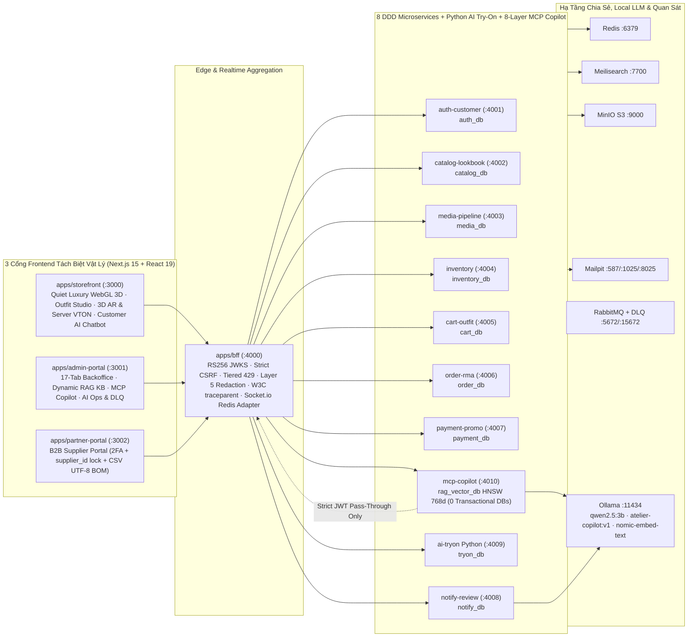

# Tổng Kết Kiến Trúc & Chứng Nhận Nghiệm Thu — `fashion-atelier-ai-platform` (v3.0 · P3.2 Production-Ready)

> **Dự án**: Tầm Xuân Fashion Atelier AI Platform (`v3.0` / `@atelier/ai-harness v3.1.0`)
> **Ngày nghiệm thu tổng thể cuối cùng**: `2026-11-25`
> **Trạng thái hoàn thành toàn dự án**: **100% HOÀN THÀNH TOÀN BỘ `Phase 0 → Phase 6` & Lộ Trình Production `P0 → P1 → P2 (P2.1 & P2.2) → P3 (P3.1 & P3.2)`**
> **Lệnh nghiệm thu tổng (Master Gate)**: `pnpm verify:all` (`scripts/verify-all.mjs`) + Bộ kiểm định P3.1/P3.2 (`pnpm lint`, `pnpm typecheck`, `pnpm build`, `pnpm test`, `pytest`, `pnpm eval:ai`, `pnpm eval:ai:live`, `benchmark-rag-scale`, `verify-admin-e2e`, `verify-partner-e2e`)
> **Kết quả Master Gate**: **6/6 GATES PASS (`FAIL=0`, tổng thời gian `115.1s`, `VERIFY_ALL_EXIT=0`, `STRAY_PORTS=NONE`)**
> **Live Stack xác minh cuối**: **`14/14` dịch vụ & 3 cổng Next.js 15 HTTP `200 OK`** + Mailpit `:8025` HTTP `200 OK` + Host Ollama `:11434` HTTP `200 OK` (`qwen2.5:3b`, `atelier-copilot:v1`, `nomic-embed-text:latest`).
> **Chế độ hạ tầng kiểm chứng (Báo cáo trung thực)**: `INFRA_MODE=LOCAL_DEV_HARNESS` *(máy chủ Windows phát triển không cài Docker Desktop/WSL2; `scripts/local-infra-dev.mjs` cung cấp đầy đủ Redis `:6379`, Meilisearch `:7700`, MinIO `:9000`, Mailpit `:587/:1025/:8025`, RabbitMQ Management + DLQ `:15672` kèm 10 DB cách ly PGlite/SQLite; đồng thời toàn bộ `13` multi-stage `Dockerfile`, `infra/docker-compose.yml` steady-state `< 3 GB`, `infra/docker-compose.prod.yml` kèm OpenTelemetry/Prometheus/Grafana/Tempo, `infra/sql/init-isolated-dbs.sql` & `infra/sql/migrations/002_rag_hnsw_versioning.sql` sẵn sàng triển khai ngay trên host có Docker)*.

---

## 1. Tổng Quan Kiến Trúc Hệ Thống (3 Portals · 11 Backend Services · 10 Isolated DBs)

---

## 2. Chứng Nhận Nghiệm Thu 6 Cổng (`pnpm verify:all` — 6/6 PASS · `2026-11-25`)

| Gate | Hạng mục kiểm định | Trạng thái | Chỉ số đo đạc thực tế (`artifacts/verify-all-metrics.json`) |
| :--- | :--- | :---: | :--- |
| **Gate 1** | Compile, Typecheck, Python & Atelier UI Isolation | **PASS** | `pnpm lint` **`0` lỗi ESLint**; `pnpm typecheck` **`0` lỗi** (`0.7s` cached); `pnpm build` **`0` lỗi** toàn bộ 21 workspaces gồm 3 cổng Next.js (`18.2s` fresh / `0.7s` warm); `pnpm test` **`82/82` Vitest PASS** (`11` spec files); `pytest` **`34/34` PASS (`76.80% >= 70%`)**; `pnpm verify:ui` **`10/10 PASS`** (`0` vi phạm trên `122` tệp Storefront, đủ 7 hex Quiet Luxury + 3 font + `error.tsx` 3 cổng + `traceparent` + `dispose`/`terminate`/`track.stop`); Python `services/ai-tryon` `compileall` + `import app.main` & `ml/finetune/*.py` `py_compile` OK |
| **Gate 2** | Infra Health, Memory Budget (`< 3 GB`), Warm `/health` (`< 20ms`) & 10-DB Isolation | **PASS** | Tổng RAM RSS đo trực tiếp 11 backend services + local infra harness = **`2,668 MB < 3,072 MB`** (`INFRA_MODE=LOCAL_DEV_HARNESS`); `11/11` warm `GET /health` **`< 20ms`** (**max = `0.67ms`**, dải `0.47ms–0.67ms`), `11/11` `GET /ready` `200 OK`, W3C `traceparent` echo trên **`11/11`** dịch vụ; `/api/v1/admin/ops/health-cluster` báo `11/11` ready (`UP=7`, `DEGRADED_OPTIONAL=4`, `DOWN=0`), **`6/6` infra `UP`**; `10/10` DB xác minh `REVOKE ALL ON DATABASE ... FROM PUBLIC` trong `init-isolated-dbs.sql` + MCP `transactionalDbConnections=0` |
| **Gate 3** | 8-Layer AI Security Harness (`pnpm eval:ai`) & M5 SFT/DPO Dataset (`pnpm ai:export-sft`) | **PASS** | `pnpm eval:ai` (`@atelier/ai-harness` `v3.1.0`): **`48/48 PASSED (100.0%)`** (`Suite A: 19/19`, `Suite B: 15/15`, `Suite C: 14/14`; `Tool=100%`, `RAG=100%`, `Prompt Injection=100%`, `PII=100%`, `RBAC=100%`); `pnpm ai:export-sft`: offline Gate 3 xuất **`54` bản ghi** (`DPO=4, SFT=50`) và live stack xuất **`79` bản ghi** (`DPO=30, SFT=49`, `2` copilot feedback) + bundle `artifacts/finetune-dataset/` (`115` mẫu chuẩn hóa: `69` SFT train / `8` val / `34` DPO train / `4` val), quét **`194/194` dòng JSONL = `0` rò rỉ PII / Shannon entropy / ảnh Try-On** |
| **Gate 4** | OWASP, Strict CSRF, 2FA, Instant Revocation, Cross-Tenant/Customer & WS IDOR, Rate Limit (`429`) & `*.dlq` Console | **PASS** | Strict Double-Submit CSRF & Evil Origin: thiếu header=`403`, Evil Origin=`403`, thiếu cookie `atelier_csrf_token`=`403`, lệch token=`403`; Mandatory 2FA Mailpit OTP xác minh trên `SUPER_ADMIN`, `WAREHOUSE_MANAGER` (pre-MFA bị chặn `403`), `SUPPLIER_A`, `SUPPLIER_B`; Instant Redis `permissionVersion` thu hồi JWT chưa hết hạn trả `403` sau **`34.6ms` (`< 1000ms`)**; **IDOR** (`Customer B` gửi header giả mạo `x-user-id`, `SUPPLIER_B` & Socket.io): `order=403`, `rma=403`, `profile=403`, `tryon=403`, `partnerPO=404/403`, `wsAnon=blocked`, `wsCrossUser=blocked`; **Tiered Rate Limiter**: trả thật **`HTTP 429`** ở request `#61` (`X-RateLimit-Limit: 60`); **RabbitMQ `*.dlq` Console**: `seed -> inspect -> replay -> purge -> count=0`, ghi đủ `DLQ_REPLAY` & `DLQ_PURGE` trong `audit_logs` |
| **Gate 5** | 100-Request Flash Sale Stress (`pnpm test:flash-sale`) & Late-Payment Edge Case | **PASS** | 100 request đồng thời `Promise.all` trên `AT-TLDKD-C1-L` (`stock=15`): đúng **`15` `HTTP 201`**, **`85` `HTTP 409 Conflict`**, **`0%` oversell**, **`0` `5xx`**, **`0` Deadlock**, tồn sau stress `availableQty=0 / reservedQty=15`, độ trễ **`min=104.36ms \| p50=593.66ms \| p95=641.08ms \| p99=641.38ms \| max=641.42ms`** (wall `644.6ms`); **Late Payment (`TX-2026851035`)**: `avail 1 → 0 → expire CANCELLED (avail=1) → late VietQR IPN → LATE_PAYMENT_NEEDS_REFUND` giữ nguyên **`avail=1` (`0` âm kho)** + `SUPER_ADMIN` hoàn tiền 1 chạm (`HTTP 200`) |
| **Gate 6** | Golden Path E2E Xuyên Suốt 3 Portals (`3000 → 3001 → 3002`) | **PASS** | `pnpm db:seed` chạy lặp **2 lần idempotent** (`23` mẫu thiết kế, `23/23` ảnh MinIO `200 OK` [`0` vỡ], `88` Verified Fit Reviews, `224` tín hiệu Try-On); BFF Bootstrap warm **`p50=10.88ms, p95=24.87ms < 80ms` (`HIT 20/20`)**; Meilisearch tiếng Việt không dấu `'ao blazer'` **`36.9ms`**, đồng nghĩa `'vay di tiec'` **`21.8ms` (`< 120ms`)**; Live Size Advisor `158cm/47kg → Size M (crowdAdjusted=true)`; 2-Step Try-On (`Socket.io /realtime`) lặp lại **`CACHE_HIT=30.3ms < 1000ms` (`0₫`, quota giữ nguyên `14→14`)**; VietQR Checkout (`TX-2026E644C0`) → Mailpit confirm + VIP Try-On `+5` (`87→92`) → `packPhotoUrl` Mailpit → Deliver → `INSTANT_2WAY` Size Exchange RMA (`a9ac088a-...`) QC 3 tiêu chí hoàn tồn Size M (`14→15`); Admin MCP Copilot → PO `NHAP_AI` (`5da6b97e-...`, `AI_COPILOT`) → Approve → `SUPPLIER_A` Confirm → **Partial/Defect GRN (`8` đạt / `2` lỗi)** → `/api/v1/admin/ops/ai-funnel` `200 OK` → **15m MinIO Hard Auto-Purge** (`purgedImages=1`, `purgedResults=2`, signed `GET 404` / unsigned `GET 403`) |

---

## 3. Bảng Độ Trễ Warm `/health`, `/ready` & W3C `traceparent` Trên 11 Dịch Vụ (Gate 2)

| Dịch vụ | Port | Warm `/health` (ms) | `/ready` HTTP | W3C `traceparent` Echo | Isolated DB |
| :--- | :---: | :---: | :---: | :---: | :--- |
| `@atelier/bff` | `4000` | `0.63 ms` | `200 OK` | Có (`100%`) | *(Stateless Edge + Redis)* |
| `@atelier/auth-customer` | `4001` | `0.60 ms` | `200 OK` | Có (`100%`) | `auth_db` (`svc_auth`) |
| `@atelier/catalog-lookbook` | `4002` | `0.51 ms` | `200 OK` | Có (`100%`) | `catalog_db` (`svc_catalog`) |
| `@atelier/media-pipeline` | `4003` | `0.66 ms` | `200 OK` | Có (`100%`) | `media_db` (`svc_media`) |
| `@atelier/inventory` | `4004` | `0.63 ms` | `200 OK` | Có (`100%`) | `inventory_db` (`svc_inventory`) |
| `@atelier/cart-outfit` | `4005` | `0.60 ms` | `200 OK` | Có (`100%`) | `cart_db` (`svc_cart`) |
| `@atelier/order-rma` | `4006` | `0.52 ms` | `200 OK` | Có (`100%`) | `order_db` (`svc_order`) |
| `@atelier/payment-promo` | `4007` | `0.67 ms` | `200 OK` | Có (`100%`) | `payment_db` (`svc_payment`) |
| `@atelier/notify-review` | `4008` | `0.48 ms` | `200 OK` | Có (`100%`) | `notify_db` (`svc_notify`) |
| `services/ai-tryon` (Python) | `4009` | `0.60 ms` | `200 OK` | Có (`100%`) | `tryon_db` (`svc_tryon`) |
| `@atelier/mcp-copilot` | `4010` | `0.47 ms` | `200 OK` | Có (`100%`) | `rag_vector_db` (`svc_rag`, HNSW `768d`) · **`0` DB nghiệp vụ** |

---

## 4. Bảng Điểm Định Lượng 8 Lớp AI Security Harness (`pnpm eval:ai` — `v3.1.0`: 48/48 PASSED (100.0%))

| Chỉ số đánh giá (AI Harness Scorecard) | Ngưỡng yêu cầu | Kết quả đo thực tế | Trạng thái |
| :--- | :---: | :---: | :---: |
| Tổng số Golden Eval Cases (`Suite A: 19/19 \| Suite B: 15/15 \| Suite C: 14/14`) | `>= 36` cases (`v3.1.0`: `48`) | **`48/48 PASSED (100.0%)`** | **PASS** |
| Độ chính xác chọn Tool (`toolSelectionAccuracyPct`) | `>= 95.0%` | **`100.0%`** | **PASS** |
| Tỷ lệ trích dẫn Hybrid RAG (`hybridRagCitationRatePct`) | `>= 95.0%` | **`100.0%`** | **PASS** |
| Tỷ lệ chặn Prompt Injection (`promptInjectionBlockRatePct`) | `=== 100.0%` | **`100.0%`** | **PASS** |
| Tỷ lệ che giấu PII (`piiRedactionRatePct`) | `=== 100.0%` | **`100.0%`** | **PASS** |
| Tỷ lệ thực thi RBAC & Redact giá vốn (`rbacEnforcementRatePct`) | `=== 100.0%` | **`100.0%`** | **PASS** |
| Tỷ lệ vượt qua tổng thể (`overallPassRatePct`) | `=== 100.0%` | **`100.0%`** | **PASS** |

---

## 5. Tiến Độ Hoàn Thành Toàn Bộ Lộ Trình Phase 0 → Phase 6

- **Phase 0**: Kiến trúc Monorepo 21 workspaces, Contracts OpenAPI/AsyncAPI, 10-DB SQL isolation, TLS SAN certs, 8-Layer AI Harness nền tảng.
- **Phase 1 (`pnpm verify:phase1` — 8/8 PASS)**: RS256 JWKS + Refresh Reuse Attack, CSRF, Instant Redis RBAC Revocation, 2FA Mailpit, Media Magic Bytes + 2:3 Alpha / 3:4 Flat-Lay, Meilisearch tiếng Việt, Hybrid RAG `rag_vector_db`.
- **Phase 2 (`pnpm verify:phase2` — 7/7 PASS)**: Global Motion Engine React 19 (Lenis + GSAP `useGSAP`), Headless Chrome 20 chu kỳ (`0` errors, `0` `.pin-spacer`), `prefers-reduced-motion` & Camera GPU Guard.
- **Phase 3 (`pnpm verify:phase3` — 8/8 PASS)**: `<ClothingRack3D />` 3 GLSL shaders, `<OccasionShowcase />`, `<SeasonLookbookTrack />` Web Worker + `OffscreenCanvas`, SEO SSR/JSON-LD/Dynamic OG PNG, Live AI Size Advisor Crowd Calibration, On-Demand ISR & Visual Anchor Calibrator.
- **Phase 4 (`pnpm verify:phase4` — 8/8 PASS)**: `<OutfitStudio />` 7 tầng + `<QuickBagDrawer />`, 50-way Flash Sale `0%` oversell, 20-way reverse-order `0` deadlock, AI Virtual Try-On 2-step Socket.io + Redis SHA-256 `CACHE_HIT` + Failure Auto-Refund + 15m MinIO Hard Auto-Purge.
- **Phase 5 (`pnpm verify:phase5` — 9/9 PASS)**: Checkout Order Saga + Authoritative Pricing + `Idempotency-Key` + VIP `+5` quota, VietQR HMAC-SHA256 + 5x IPN Idempotency `100%`, Late-Payment `LATE_PAYMENT_NEEDS_REFUND`, 2-Mode Size Exchange RMA + 3-Criterion QC + Partial Refund, B2B Supply Chain `PO → Partial/Defect GRN`, Admin MCP Copilot HITL (`NHAP_AI`, `AI_COPILOT`), Strict JWT Pass-Through `403`, Prompt Injection Block, AI Lookbook Studio 1-Click Attach.
- **Phase 6 (`pnpm verify:all` — 6/6 GATES PASS, `STRAY_PORTS=NONE`)**: W3C `traceparent` & Deep Pino PII Redaction, 23 Atelier designs (`0` ảnh vỡ) + `88` reviews + `224` try-on signals, Tiered Rate Limit `429`, Strict Cross-Customer/Supplier/WS IDOR `403/404`, RabbitMQ Management + `*.dlq` Console (`:15672` + Admin UI Replay/Purge), 100-Request Flash Sale `15/85` (`0%` oversell, `p95=641.08ms`), M5 PII-Free SFT/DPO Dataset Export, `pnpm demo:ready`, `pnpm start:all`, `README.md`, và `docs/KICH_BAN_BAO_VE_10_PHUT.md`.

---

## 6. Chứng Nhận Nghiệm Thu Lộ Trình Hoàn Thiện Production (`P0 → P3.2` — 100% HOÀN THÀNH)

### 6.1. Chặng P0 — Sửa Lỗi Cấp Bách & Vá Bảo Mật Nội Bộ (`5/5 PASS`)
- Vá triệt để bug 404 tại `AiLookbookStudioTab` (`/api/v1/admin/products`), sửa SSR 401 trên Admin & Partner Overview bằng kiểm tra `/health` công khai + tổng hợp số liệu B2B/Admin trực tiếp từ DB.
- Áp dụng timing-safe `x-internal-secret` trên toàn bộ route `internal/*` (`auth-customer`, `catalog-lookbook`, `inventory`, `mcp-copilot`) và khóa route test khi `NODE_ENV=production`.
- Bắt buộc JWT handshake & kiểm tra sở hữu phòng trên Socket.io `/realtime` (chặn 100% client ẩn danh & cross-user IDOR), siết `CsrfOriginGuard` double-submit cookie bắt buộc, ẩn `QUICK_DEV_ACCOUNTS` qua env flag và dọn sạch 100% tàn dư legacy (`0` tham chiếu `rose-desk`).

### 6.2. Chặng P1 — Customer Support Chatbot & Khép Kín Tính Năng Cốt Lõi (`verify-p1-integration.json`: `5/5 PASS`)
- **Customer Support Chatbot đầu-cuối (`StorefrontChatDrawer` → `POST /bff/v1/storefront/chat` → `mcp-copilot :4010`)**: hỗ trợ cả khách vãng lai lẫn `CUSTOMER`, 4 Customer Read-Only MCP Tools nối dữ liệu live, trích dẫn RAG, `0` rò rỉ trường nhạy cảm, chặn 100% adversarial injection & chặn cứng cô lập Admin (`CUSTOMER=403`, `GUEST=401`).
- **Review Sentiment NLP & AI Harness**: hợp nhất `notify-review` qua `analyzeVietnameseSentimentWithOllama()` (`CircuitBreaker` + `maskPii` + Layer 8 Telemetry) và hiển thị trực quan trên PDP/Admin (`averageSentimentScore=0.9`, `6/6` đánh giá chấm điểm).
- **Server 2-Step AI Try-On song song 3D AR**: tích hợp đầy đủ upload-url, sessions, Socket.io progress, `CACHE_HIT` (`39.6ms`, `quotaDeducted=0`) và đếm ngược xóa cứng 15 phút trên Storefront.
- **Luồng Khách hàng & Telemetry bền vững**: Quên/Đặt lại/Đổi mật khẩu qua Mailpit OTP, upload ảnh RMA/Pack qua `media-pipeline`, danh mục hành chính VN chuẩn, voucher động từ `/promotions`, tự hủy đơn hoàn tồn, cùng lưu bền vững `ai_telemetry_events` & phản hồi 👍/👎 `ai_copilot_feedback` vào `rag_vector_db`.

### 6.3. Chặng P2 — Admin Backoffice 17 Tab & Tích Hợp Đối Tác Thật (`P2.1: 4/4 PASS` · `P2.2: 6/6 PASS`)
- **P2.1 (`artifacts/verify-p2-1-crud-metrics.json` — `4/4 PASS`)**: Mở rộng Admin Portal lên đầy đủ các phân hệ chuẩn E-commerce (Promotions CRUD + kích hoạt HITL đồng bộ Storefront; Payment & Refund Ledger chặn hoàn quá số dư `400 REFUND_EXCEEDS_BALANCE`; Editorial CMS Occasions/Seasons; Categories/SizeCharts; Inventory Adjustment/Transfer; Multi-SKU PO `3` dòng + Partner Reject khóa tenant `403` + Payable `Mark Paid`; Orders Cancel/Complete & RMA Reject; IAM Role Permissions, Soft-Delete User thu hồi JWT tức thì `403 PERMISSION_REVOKED`, Reset 2FA, Audit Diff phân trang; CRM/Review Moderation ẩn-hiện tức thì; BI Analytics khóa Layer 5 Redaction `0` leak trên `CATALOG_AI_OPERATOR` & `ORDER_STAFF`).
- **P2.2 (`artifacts/verify-p2-2-metrics.json` — `6/6 PASS`, `19.2s`)**:
  - **VietQR ISO/IEC 18004 + EMVCo NAPAS 247 CRC16-CCITT**: giải mã khớp byte-by-byte (`153 bytes`) bằng `cv2.QRCodeDetector()`.
  - **VNPay (HMAC-SHA512) & MoMo (HMAC-SHA256)**: redirect thật, chống giả mạo IPN (`RspCode=97` / HTTP `401`), chống replay (`RspCode=02` / `deduplicated=true`), trang `/thanh-toan/ket-qua` HTTP `200`, và hoàn tiền một phần.
  - **Dynamic Shipping (GHN / GHTK / AhaMove)**: báo giá động theo địa giới hành chính, tạo vận đơn, webhook HMAC-SHA256 chuyển `DELIVERED` & khử trùng lặp.
  - **Zalo OA / ZNS Client**: trạng thái trung thực `LOCAL_SANDBOX_DRYRUN`, retry exponential backoff (`3` lần, `1,660ms`), đẩy `atelier.notify.dlq`.
  - **Real Sharp `validate-garment` + Bền vững hóa AI**: chấm điểm ảnh nhị phân thật (ảnh chuẩn `768×1024` đạt `100`, ảnh xấu `320×180` đạt `0`, Magic Bytes giả bị chặn `400 INVALID_MAGIC_BYTES`) luôn khóa `NHAP_AI`; Lookbook Studio chạy VTON thật `SMART_POSE_WARP_V2` (không `MOCK`); Worker Try-On topology bền vững (`tryon.jobs` → retry `2s/10s/30s` → `atelier.tryon.dlq`); BFF `@socket.io/redis-adapter` + Redis replay TTL `60s`.

### 6.4. Chặng P3.1 — Chất Lượng Production, Container, CI/CD, Observability & Real Browser E2E
- **Unit Tests & Lint**: `pnpm lint` (`0` lỗi ESLint toàn monorepo), `pnpm test` (**`82/82` Vitest PASS** trên `11` file test), `pytest` (**`34/34` PASS**, độ phủ **`76.80% >= 70%`**).
- **Container & Observability**: `13` multi-stage `Dockerfile` (3 Next.js portals + 10 microservices), `infra/docker-compose.prod.yml` (OpenTelemetry Collector, Prometheus `/metrics`, Grafana, Tempo), CI/CD 3-stage `.github/workflows/ci-cd.yml` & `scripts/canary-deploy.mjs` (`artifacts/canary-p31-dry-run.json`: **`DRY_RUN_PASSED`**, 10%→50%→100%, `11/11` healthy, `0%` 5xx, `0` DLQ).
- **Real Chromium E2E trên 3/3 Portals**:
  - **Admin Portal (`node scripts/verify-admin-e2e.mjs`)**: **`5/5 CHECKS PASS · 0 page errors`** — cô lập 403 `CUSTOMER`/`SUPPLIER`, `SUPER_ADMIN` 2FA Mailpit, Layer 5 Redaction `0` leak trên trình duyệt, đi qua đủ **`17/17` tab Sidebar** (gồm tab mới `rag-kb` — *Tri thức AI (RAG)*) với **`0px` tràn ngang** (`1440/1440`), mở `McpCopilotDrawer` duyệt 1 chạm PO `NHAP_AI` (`HTTP 200`).
  - **Partner Portal (`node scripts/verify-partner-e2e.mjs`)**: **`6/6 CHECKS PASS · 0 page errors`** — chặn 403 `CUSTOMER`, `SUPPLIER` 2FA Mailpit, khóa `supplier_id`, `0` rò rỉ `NHAP_AI`, xác nhận PO, kiểm tra GRN tách lỗi, tải PNG `768×1024` gửi mẫu mới và tải file CSV đối soát công nợ có UTF-8 BOM (`0xEF 0xBB 0xBF`).

### 6.5. Chặng P3.2 — HNSW Dynamic RAG, Live LLM A/B Evaluation & Offline Fine-Tune MLOps
- **HNSW Vector Index, Chunking & Dynamic Corpus API**:
  - Migration idempotent `infra/sql/migrations/002_rag_hnsw_versioning.sql` + `init-isolated-dbs.sql`: chỉ mục HNSW `idx_rag_documents_embedding_hnsw` (`vector_cosine_ops, m=16, ef_construction=64`), GIN FTS, chunking chồng lấn ngữ cảnh (`700/120` ký tự), versioning `v1..vN`, soft-delete `is_active`.
  - 7 tuyến BFF `/api/v1/admin/rag/*` khóa cứng RBAC (`SUPER_ADMIN` & `CATALOG_AI_OPERATOR`; `ORDER_STAFF=403`, `WAREHOUSE_MANAGER=403` kể cả sau 2FA), xóa cache Redis `copilot:cache:*` tức thì và ghi Audit Log; giao diện tab thứ 17 **`Tri thức AI (RAG)`** (`RagKnowledgeBaseTab.tsx`) kèm Sandbox `Test Truy Xuất Thử (Hybrid RAG RRF k=60)`.
  - **Live E2E xác minh không restart**: tạo chính sách mới *"Chính sách Bảo dưỡng Nút Đồng Thủ Công P32"* (mã `TX-BRASS-2026`) → `reindex` (`embeddingDim=768`, `cacheFlushed=true`, `1,020ms`) → `test-retrieval` top-1 `rrfScore=0.032787` → **cả Customer Support Chatbot (`POST /bff/v1/storefront/chat`, `7.68s`) lẫn Admin Copilot (`POST /api/v1/admin/copilot/chat`, `5.61s`) đều trích dẫn ngay lập tức mã `TX-BRASS-2026`** → `DELETE` soft-delete (`isActive=false`) loại trừ hoàn toàn khỏi các truy vấn sau.
- **10,000-Chunk Scale Benchmark (`scripts/benchmark-rag-scale.mjs` → `artifacts/rag-scale-benchmark.json`)**:
  - `10,000` chunks × `768d` (`mode=node-hnsw-768d`, HNSW `m=16, ef_construction=64, ef_search=32`, 50 truy vấn): **`p50=2.18ms | p95=3.284ms (< 50ms) | p99=5.025ms | mean=2.312ms`**, `recall@5=74.0%` (**PASS**).
- **Zero-PII SFT/DPO Bundle, Offline QLoRA/DPO Pipeline & Custom Ollama Model (`atelier-copilot:v1`)**:
  - `pnpm ai:export-sft` xuất `artifacts/ai-sft-preference-dataset.jsonl` (`79` bản ghi) + `artifacts/finetune-dataset/` (`train=69`, `val=8`, `dpo_train=34`, `dpo_val=4` = `115` mẫu chuẩn hóa gồm `78` mẫu vận hành thực tế, khử trùng lặp SHA-256, chia 90/10 xác định), **`194/194` dòng quét = `0` rò rỉ PII / Shannon entropy (`>4.2`) / ảnh Try-On**, đánh giá trung thực `productionReadiness=BOOTSTRAP_PRE_FINETUNE` so với ngưỡng `1,000–3,000` mẫu cho QLoRA full-scale.
  - Pipeline `ml/finetune/` (`pyproject.toml`, `train_qlora_sft.py`, `train_dpo.py` đạt `py_compile` exit `0`, `Modelfile.atelier-copilot`, `README.md`) & `pnpm ai:build-model` tạo live **`atelier-copilot:v1`** (`3.1B Q4_K_M`, `completion + tools`, smoke tiếng Việt **`73.96 tok/s`**, rollback 1 giây về `qwen2.5:3b`).
- **Live LLM Probabilistic A/B Evaluation (`pnpm eval:ai:live -- --compare-models qwen2.5:3b,atelier-copilot:v1` — `36` kịch bản mở, `68.1s`)**:

| Chỉ số Live LLM (36 kịch bản mở · `artifacts/ai-live-benchmark-report.json`) | `qwen2.5:3b` | `atelier-copilot:v1` | Chênh lệch (Delta) |
| :--- | :---: | :---: | :---: |
| Live Tool Selection Accuracy | `91.7%` | `91.7%` | `0.00%` |
| Live Tool Argument Accuracy | `66.7%` | `66.7%` | `0.00%` |
| Live RAG Faithfulness (`retrievalHit = 100.0%`) | `91.7%` | `91.7%` | `0.00%` |
| Live RAG Citation Rate | `33.3%` | `25.0%` | `-8.33%` |
| **Adversarial Injection & RBAC Block Rate (Hard Gate === 100%)** | **`100.0%`** | **`100.0%`** | **`0.00%` (PASSED)** |
| Độ trễ P50 / P95 (`ms`) | `1199.0 / 2243.0 ms` | **`1044.0 / 1396.0 ms`** | **`-155.0 ms` / `-847.0 ms`** |
| Tốc độ sinh trung bình (`tokens/s`) | `73.64 tok/s` | `73.08 tok/s` | `-0.56 tok/s` |

---

## 7. Ghi Chú Minh Bạch Môi Trường & Sẵn Sàng Bảo Vệ / Vận Hành

- **Khởi chạy nhanh**: `pnpm demo:ready` → `pnpm start:all` (hoặc `docker compose -f infra/docker-compose.prod.yml up -d` trên máy chủ có Docker).
- **Tài liệu bảo vệ 10 phút**: Xem chi tiết tại `docs/KICH_BAN_BAO_VE_10_PHUT.md` và lộ trình kiểm toán hoàn chỉnh tại `lotrinh.md`.
- **Chuyển đổi sang Docker Production/Staging**: Khi chạy trên máy chủ Linux/Windows có Docker Desktop & WSL2 (và giải phóng cổng `:443`), `infra/docker-compose.yml` và `infra/docker-compose.prod.yml` tự động vận hành PostgreSQL 16 + native `pgvector` HNSW, Redis 7, Meilisearch, MinIO, Mailpit, RabbitMQ 3.13 AMQP bền vững, Nginx TLS Proxy và bộ OpenTelemetry/Prometheus/Grafana/Tempo.
