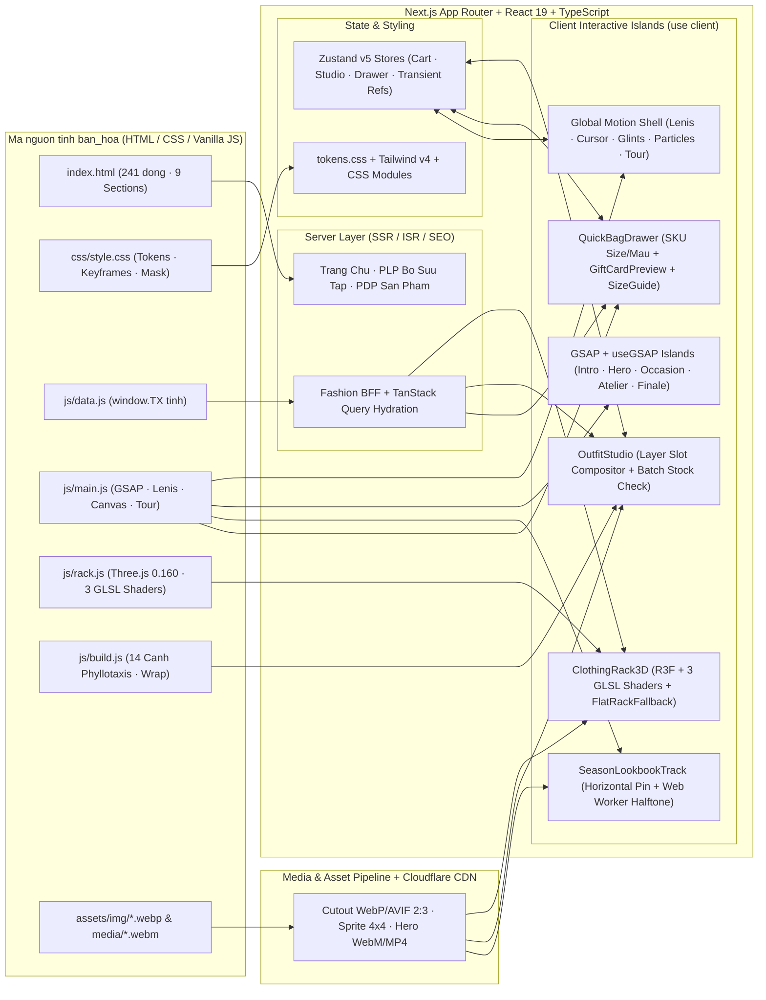
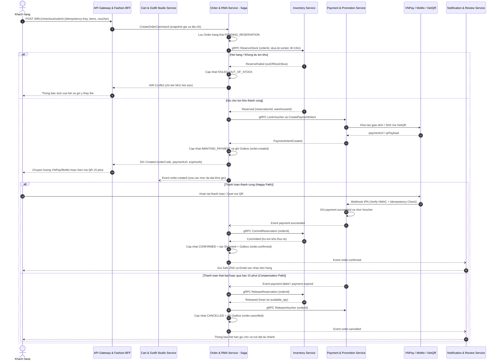
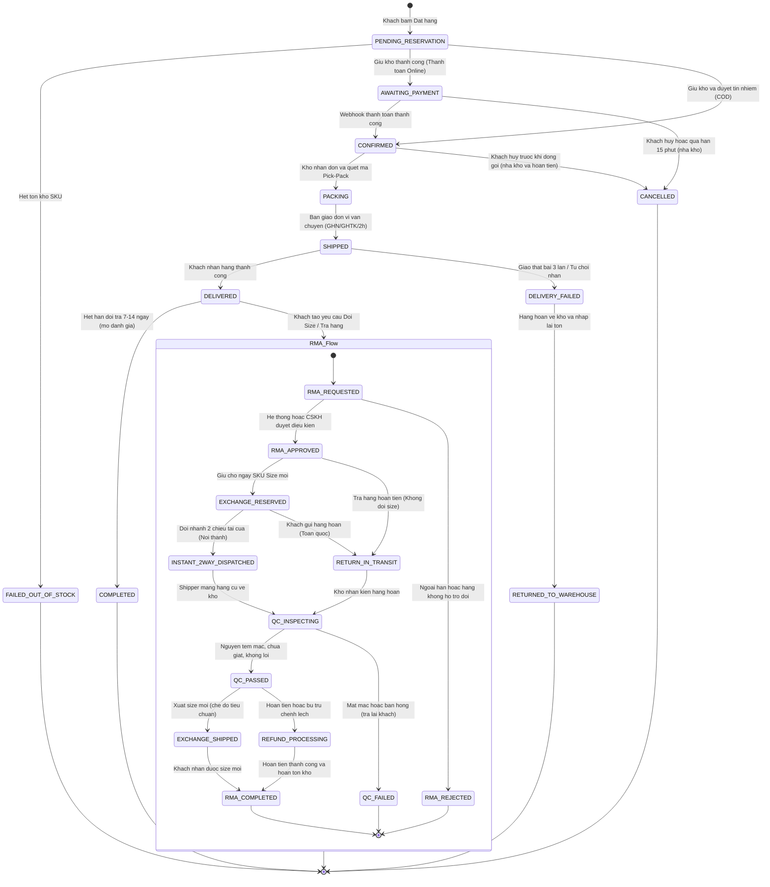
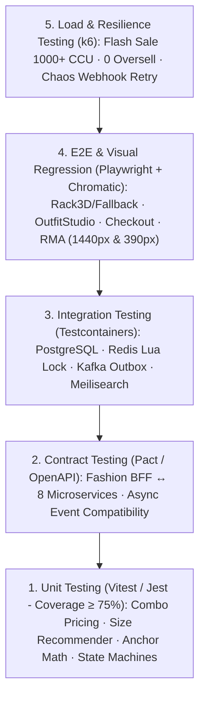

# Lộ Trình Chuyển Đổi Website Bán Hoa (`ban_hoa`) Sang Nền Tảng Thương Mại Điện Tử Thời Trang Cao Cấp (React + Microservices)

> **Mã nguồn cơ sở đối chiếu**: `d:\doancosothue\ban_hoa` (**Tầm Xuân · Flower Atelier** — gồm `index.html` 241 dòng, `css/style.css` 31 KB, `js/main.js`, `js/rack.js`, `js/build.js`, `js/data.js` chứa `window.TX`, 40+ ảnh tách nền `assets/img/*.webp`, ảnh quy trình `images/p01..p03`, sprite `assets/petals/petals.png` và video nền `media/rose-desk.{webm,mp4}`).  
> **Mục tiêu tài liệu**: Cung cấp bản thiết kế tổng thể (Master Technical & Business Blueprint) từ đánh giá tính khả thi, ánh xạ 1:1 hiệu ứng tương tác, mô hình hóa nghiệp vụ thời trang, chuyển đổi công nghệ Frontend sang **Next.js (React 19 + TypeScript)**, kiến trúc **Backend Microservices theo DDD**, cho đến lộ trình thực thi theo từng giai đoạn, DevOps, kiểm thử và quản trị rủi ro.

---

## Tóm Tắt Điều Hành (Executive Summary)

### Trả lời trực diện: Có chuyển từ website bán hoa sang website bán quần áo được không?

**HOÀN TOÀN KHẢ THI — và đây là một trong những phép chuyển đổi tự nhiên nhất (mức độ tương thích thẩm mỹ, tỷ lệ tài nguyên và ẩn dụ tương tác đạt 95%+).**

Mã nguồn hiện tại tại `d:\doancosothue\ban_hoa` đã sở hữu sẵn một ngôn ngữ thiết kế **Editorial Quiet Luxury** (`--cocoa: #1C1410`, `--ivory: #FBF7EF`, `--gold: #B08A4A`, font `Cormorant Garamond` + `Be Vietnam Pro` + `Dancing Script`), tỷ lệ ảnh tách nền chuẩn **`2:3` (`720×1080` WebP alpha)** khớp tuyệt đối với ảnh trang phục treo móc/ghost-mannequin, cùng 3 "hiệu ứng đinh" mà khi đưa sang ngành thời trang thậm chí còn **hợp lý và có lực chuyển đổi thương mại cao hơn cả bán hoa**:
1. **Giá treo 3D WebGL (`js/rack.js`)**: Quần áo treo xuôi trên thanh đồng thau, đung đưa theo gió chuột và tiến ra trình diễn xóa phông là biểu tượng kinh điển nhất của boutique thời trang cao cấp.
2. **Sợi chỉ vàng xưởng chế tác (`#atelier`)**: Sợi chỉ vàng Bezier kèm hạt ngọc chạy qua 4 công đoạn chính là ẩn dụ bản địa hoàn hảo của ngành **may đo thủ công (Tailoring / Couture)**.
3. **Chọn theo dịp (`#occasion`) & Công cụ tự ghép (`js/build.js`)**: Chuyển trực tiếp thành **Dress Code Showcase** (6 dịp mặc) và **Mix & Match Outfit Studio** (phối Áo / Quần-Váy / Đầm / Áo khoác / Phụ kiện kèm kiểm tra tồn kho theo size và chiết khấu Combo Set).

Tuy nhiên, `ban_hoa` hiện mới là **Static Showcase Web** (dữ liệu hard-code trong `window.TX`, không có giỏ hàng, không có tồn kho, nút `#odSend` *"Gửi đơn qua Zalo"* chỉ hiện toast demo). Để bán quần áo thực tế ở quy mô production, dự án cần đồng thời giải quyết **3 nâng cấp nền tảng**: chuẩn hóa mô hình dữ liệu thời trang (**SPU → Variant Màu/Vải → SKU Size + Tồn kho đa kho + Đổi Size RMA**), tái cấu trúc Frontend sang **React + TypeScript** hỗ trợ SEO đa trang mà không rò rỉ GPU/ScrollTrigger, và xây dựng Backend theo ranh giới miền nghiệp vụ rõ ràng.

### Bốn Khuyến Nghị Kiến Trúc Chiến Lược

| Trụ cột | Khuyến nghị ưu tiên | Giá trị cốt lõi mang lại |
| :--- | :--- | :--- |
| **1. Trải nghiệm & Hiệu ứng** | Bảo toàn 100% Design Tokens từ `css/style.css` và ánh xạ 1:1 toàn bộ 9 khu vực + lớp hiệu ứng toàn cục; thay thuật toán xoắn phyllotaxis (`js/build.js`) bằng **Garment Layer Slot Compositor** và bỏ phép lật ngược `Math.PI` ở `js/rack.js`. | Giữ trọn đẳng cấp thẩm mỹ khác biệt, nâng tỷ lệ tương tác & giá trị đơn trung bình (AOV) qua Mix & Match Combo. |
| **2. Công nghệ Frontend** | **Next.js 15+ (App Router) + React 19 + TypeScript** theo mô hình **Hybrid Client Islands**: Server Components (SSR/ISR) cho SEO trang Danh mục (PLP) / Chi tiết sản phẩm (PDP); `'use client'` + `dynamic(ssr: false)` cho Three.js (`@react-three/fiber`), `@gsap/react` (`useGSAP`), `lenis/react`, Zustand v5 và TanStack Query v5. | Đạt chuẩn SEO & OpenGraph Zalo/Facebook, bảo vệ Core Web Vitals (LCP < 2.5s), chống hoàn toàn lỗi StrictMode và WebGL memory leak. |
| **3. Kiến trúc Backend** | Thiết kế đích gồm **9 Dịch vụ lõi theo DDD** (`API Gateway & Fashion BFF` + 8 Microservices độc lập DB + Event Broker + Saga/Outbox/Idempotency). Áp dụng chiến lược thực chiến **Modular Monolith (team 2–3 dev) → Strangler Fig (4–8 dev) → Full Microservices (10+ dev)**. | Chống bán lố tồn kho (0% oversell) khi Flash Sale, tự động hóa Đổi Size (RMA), đồng thời tránh rơi vào bẫy "thuế phân tán" quá sớm. |
| **4. Lộ trình Triển khai** | Cung cấp song song **2 lộ trình**: **Bản Chuẩn 16–17 tuần** (Phase 0 → Phase 6, 4–6 kỹ sư, full platform) và **Bản Rút gọn Fast-Track MVP 8–10 tuần** (2–3 kỹ sư, ra mắt nhanh với Modular Monolith + 4 hiệu ứng đinh). | Linh hoạt theo ngân sách & quy mô đội ngũ nhưng cùng chung hợp đồng API/Event để mở rộng không phải đập đi viết lại. |

---

## Mục Lục

- [Phần 1: Đánh Giá Tính Khả Thi & Ánh Xạ 1:1 Ý Tưởng – Hiệu Ứng (Bán Hoa → Bán Quần Áo)](#phần-1-đánh-giá-tính-khả-thi--ánh-xạ-11-ý-tưởng--hiệu-ứng-bán-hoa--bán-quần-áo)
  - [1.1. Sáu lý do kiến trúc chứng minh sự tương thích gần như 1:1](#11-sáu-lý-do-kiến-trúc-chứng-minh-sự-tương-thích-gần-như-11)
  - [1.2. Bảng ánh xạ 1:1 toàn diện (9 phân khu + Lớp hiệu ứng toàn cục)](#12-bảng-ánh-xạ-11-toàn-diện-9-phân-khu--lớp-hiệu-ứng-toàn-cục)
  - [1.3. Giải phẫu kỹ thuật chuyển đổi 3 "Hiệu ứng đinh" (Signature Effects)](#13-giải-phẫu-kỹ-thuật-chuyển-đổi-3-hiệu-ứng-đinh-signature-effects)
- [Phần 2: Phân Tích Khoảng Trống & Toàn Bộ Nghiệp Vụ Thương Mại Điện Tử Thời Trang](#phần-2-phân-tích-khoảng-trống--toàn-bộ-nghiệp-vụ-thương-mại-điện-tử-thời-trang)
  - [2.1. Phân tích khoảng trống nghiệp vụ (Gap Analysis)](#21-phân-tích-khoảng-trống-nghiệp-vụ-gap-analysis)
  - [2.2. Ánh xạ mô hình dữ liệu từ `window.TX` sang Thực thể Thời trang](#22-ánh-xạ-mô-hình-dữ-liệu-từ-windowtx-sang-thực-thể-thời-trang)
  - [2.3. Bảy luồng nghiệp vụ thời trang đầu–cuối (End-to-End Workflows)](#23-bảy-luồng-nghiệp-vụ-thời-trang-đầucuối-end-to-end-workflows)
- [Phần 3: Kiến Trúc Chuyển Đổi Công Nghệ Frontend (HTML/Vanilla JS → React + TypeScript)](#phần-3-kiến-trúc-chuyển-đổi-công-nghệ-frontend-htmlvanilla-js--react--typescript)
  - [3.1. So sánh & Lựa chọn Framework: Next.js (App Router) vs. Vite SPA](#31-so-sánh--lựa-chọn-framework-nextjs-app-router-vs-vite-spa)
  - [3.2. Hướng dẫn Port chi tiết 5 Engine hiệu ứng sang React 19](#32-hướng-dẫn-port-chi-tiết-5-engine-hiệu-ứng-sang-react-19)
  - [3.3. Quản lý Trạng thái (Zustand v5 + TanStack Query v5)](#33-quản-lý-trạng-thái-zustand-v5--tanstack-query-v5)
  - [3.4. Cấu trúc thư mục `apps/storefront/src/` & Sơ đồ ánh xạ Legacy → Target](#34-cấu-trúc-thư-mục-appsstorefrontsrc--sơ-đồ-ánh-xạ-legacy--target)
  - [3.5. Quy chuẩn Tài nguyên Ảnh & Video cho Thời trang (Asset & Photography Pipeline)](#35-quy-chuẩn-tài-nguyên-ảnh--video-cho-thời-trang-asset--photography-pipeline)
- [Phần 4: Kiến Trúc Backend Microservices (DDD & Chiến Lược Thực Chiến)](#phần-4-kiến-trúc-backend-microservices-ddd--chiến-lược-thực-chiến)
  - [4.1. Sơ đồ Kiến trúc Tổng thể Hệ thống](#41-sơ-đồ-kiến-trúc-tổng-thể-hệ-thống)
  - [4.2. Đặc tả chi tiết 9 Dịch vụ Lõi (Bounded Contexts)](#42-đặc-tả-chi-tiết-9-dịch-vụ-lõi-bounded-contexts)
  - [4.3. Giao tiếp Liên dịch vụ (Sync vs. Async) & Mẫu Đảm bảo Độ tin cậy](#43-giao-tiếp-liên-dịch-vụ-sync-vs-async--mẫu-đảm-bảo-độ-tin-cậy)
  - [4.4. Sơ đồ Tuần tự Luồng Checkout Order Saga (Happy Path & Compensation)](#44-sơ-đồ-tuần-tự-luồng-checkout-order-saga-happy-path--compensation)
  - [4.5. Sơ đồ Trạng thái Vòng đời Đơn hàng & Đổi Size / Trả hàng (Order & RMA State Machine)](#45-sơ-đồ-trạng-thái-vòng-đời-đơn-hàng--đổi-size--trả-hàng-order--rma-state-machine)
  - [4.6. Tư vấn Thực chiến: Lộ trình Tiến hóa Kiến trúc (Modular Monolith → Strangler Fig → Microservices)](#46-tư-vấn-thực-chiến-lộ-trình-tiến-hóa-kiến-trúc-modular-monolith--strangler-fig--microservices)
- [Phần 5: Lộ Trình Chuyển Đổi Chi Tiết Từng Giai Đoạn (Phase 0 → Phase 6)](#phần-5-lộ-trình-chuyển-đổi-chi-tiết-từng-giai-đoạn-phase-0--phase-6)
  - [5.1. Nguyên tắc dẫn dắt & So sánh 2 Kịch bản Triển khai (Chuẩn 16–17 tuần vs. MVP 8–10 tuần)](#51-nguyên-tắc-dẫn-dắt--so-sánh-2-kịch-bản-triển-khai-chuẩn-1617-tuần-vs-mvp-810-tuần)
  - [5.2. Sơ đồ Lộ trình Tiến hóa Hệ thống](#52-sơ-đồ-lộ-trình-tiến-hóa-hệ-thống)
  - [5.3. Kế hoạch Thực thi Chi tiết Phase 0 → Phase 6](#53-kế-hoạch-thực-thi-chi-tiết-phase-0--phase-6)
- [Phần 6: Hạ Tầng, DevOps, Kiểm Thử, Observability, Rủi Ro & Kế Hoạch Hành Động Tuần 1](#phần-6-hạ-tầng-devops-kiểm-thử-observability-rủi-ro--kế-hoạch-hành-động-tuần-1)
  - [6.1. Chiến lược Monorepo, Môi trường Local/Production & CI/CD](#61-chiến-lược-monorepo-môi-trường-localproduction--cicd)
  - [6.2. Hạ tầng Pipeline Media & CDN (Đặc thù WebGL Thời trang)](#62-hạ-tầng-pipeline-media--cdn-đặc-thù-webgl-thời-trang)
  - [6.3. Kim tự tháp Kiểm thử (Testing Pyramid)](#63-kim-tự-tháp-kiểm-thử-testing-pyramid)
  - [6.4. Chiến lược Observability (Giám sát Toàn diện)](#64-chiến-lược-observability-giám-sát-toàn-diện)
  - [6.5. Ma trận Rủi ro & Giải pháp Giảm thiểu (10 Rủi ro trọng yếu)](#65-ma-trận-rủi-ro--giải-pháp-giảm-thiểu-10-rủi-ro-trọng-yếu)
  - [6.6. Kế hoạch Hành động Ngay Tuần Đầu Tiên (Quick-Start Action Plan) & Decision Log](#66-kế-hoạch-hành-động-ngay-tuần-đầu-tiên-quick-start-action-plan--decision-log)

---

## Phần 1: Đánh Giá Tính Khả Thi & Ánh Xạ 1:1 Ý Tưởng – Hiệu Ứng (Bán Hoa → Bán Quần Áo)

### 1.1. Sáu lý do kiến trúc chứng minh sự tương thích gần như 1:1

Phân tích trực tiếp mã nguồn `d:\doancosothue\ban_hoa` cho thấy việc chuyển đổi từ **Tầm Xuân · Flower Atelier** sang **Luxury Fashion & Tailoring Atelier** không đòi hỏi phải thay đổi bản sắc thẩm mỹ hay đập bỏ hệ thống chuyển động; trái lại, hầu hết các cấu trúc hình học, vật lý và tương tác đều khớp gần như tuyệt đối:

| Tiêu chí | Hiện trạng tại `ban_hoa` (Flower Atelier) | Khi chuyển sang Fashion Atelier | Mức độ khớp |
| :--- | :--- | :--- | :---: |
| **Ngôn ngữ thẩm mỹ & Design Tokens** | Nền tối `--cocoa: #1C1410`, nền sáng `--ivory: #FBF7EF`, điểm nhấn đồng/vàng `--gold: #B08A4A` / `--gold-hi: #EBCF8F`, `--cream: #F4EBDA`, `--champagne: #EBD9B4`; font `Cormorant Garamond` + `Be Vietnam Pro` + `Dancing Script` (`css/style.css`). | Chuẩn ngôn ngữ Editorial Quiet Luxury của các nhà mốt cao cấp (Celine, Loro Piana, local luxury atelier). Bảo toàn 100% Design System gốc, chỉ mở rộng semantic tokens cho badge tồn kho, size và chấm màu. | **100%** |
| **Tỷ lệ khung hình ảnh (Aspect Ratio)** | Toàn bộ 40+ ảnh tách nền trong `assets/img/*.webp` có kích thước chuẩn **`720×1080` (tỷ lệ 2:3, VP8X có kênh alpha)**; ảnh quy trình `images/p01..p03` là **`800×1000` (tỷ lệ 4:5)**. | Ảnh trang phục treo móc, ảnh ghost-mannequin và ảnh lookbook toàn thân đều có tỷ lệ chuẩn **2:3** hoặc **4:5**. Geometry 3D (`W = 2.333`, `H = 3.5` trong `js/rack.js`) và khung vòm `.scard__frame` (`aspect-ratio: 3/4`) tái sử dụng nguyên vẹn. | **100%** |
| **Ẩn dụ vật lý 3D (`js/rack.js`)** | 10 bó hoa treo ngược trên thanh đồng (`CylinderGeometry`), đung đưa theo lực lò xo giảm chấn (`k=9, damping=1.1`), bóng đổ mềm lên tường sau. | **Giá treo quần áo trên thanh đồng** là biểu tượng kinh điển nhất của boutique thời trang. Thậm chí tự nhiên hơn bán hoa vì quần áo treo xuôi trên móc (bỏ bước lật ngược 180° quanh trục Z, thay bằng góc xoay showcase trục Y). | **100%** |
| **Ẩn dụ sợi chỉ vàng (`#atelier`)** | Sợi chỉ Bezier SVG `#threadPath`/`#threadGlow` cùng hạt sáng `#pearl` chạy xuyên qua 4 bước sơ chế – bó hoa. | Trong ngành **may đo thời trang (Tailoring / Couture)**, **sợi chỉ vàng + hạt ngọc khâu nối các công đoạn chọn vải → dựng rập → may tay → là hơi** là ẩn dụ bản địa hoàn hảo nhất. | **100%** |
| **Cơ chế phân loại ngữ cảnh (`#occasion`)** | 6 dịp tặng hoa × 4 bộ gợi ý, đổi toàn bộ bảng màu nền + radial wipe (`#occWipe`). | Hành vi mua thời trang cao cấp xoay quanh **Dress Code / Dịp mặc** (Công sở, Tiệc tối, Dạo phố, Du lịch, Cưới & Áo dài, Tối giản) — tăng chuyển đổi rõ rệt so với lưới sản phẩm phẳng. | **95%** |
| **Công cụ lắp ghép tương tác (`js/build.js`)** | Người dùng nhặt từng cành hoa (14 loại) + chọn 3 giấy gói (back/front layer) → bấm *"Bó hoa"* → sinh thumbnail snapshot đẩy sang Drawer đặt hàng. | Chuyển thành **Mix & Match Outfit Studio**: chọn lớp Áo / Quần-Váy / Đầm liền / Áo khoác / Phụ kiện chồng khớp theo hệ tọa độ chuẩn (thay xoắn phyllotaxis bằng Layer Slot Matrix) + chọn hộp/túi đóng gói → *"Hoàn thiện Set đồ"* kiểm tra tồn kho từng SKU. | **90%** |

**Ba điểm bắt buộc phải nâng cấp kiến trúc (không thể giữ nguyên bản tĩnh):**
1. **Dữ liệu tĩnh → Dữ liệu động đa biến thể (SKU Matrix)**: `js/data.js` hard-code 10 bó hoa với 3 cỡ (`Nhỏ/Vừa/Lớn` nhân hệ số giá `1 / 1.45 / 2.1`). Thời trang bắt buộc quản lý phân cấp **SPU → Variant (Màu sắc/Chất liệu) → SKU (Size) → Tồn kho đa kho thực tế**.
2. **Single Page tĩnh → Kiến trúc đa trang chuẩn SEO**: `index.html` là trang đơn không đủ để Google lập chỉ mục hàng trăm trang Chi tiết sản phẩm (PDP), Danh mục (PLP) và Lookbook, cũng như không tạo được ảnh preview OpenGraph động khi chia sẻ qua Zalo/Facebook.
3. **Quản lý vòng đời GPU/Memory & React StrictMode**: `js/main.js` và `js/rack.js` gắn listener trực tiếp lên `window`, khởi tạo `WebGLRenderer`, `ScrollTrigger`, `setInterval` mà không có `dispose()` khi chuyển route. Khi đưa vào React 19, bắt buộc dùng `useGSAP`/`gsap.context()` và thu hồi tài nguyên WebGL tường minh.

---

### 1.2. Bảng ánh xạ 1:1 toàn diện (9 phân khu + Lớp hiệu ứng toàn cục)

| # | Khu vực & File gốc trong `ban_hoa` | Cơ chế kỹ thuật thực tế hiện có | Phiên bản Thời trang (Fashion Atelier) | Component React đích & Thay đổi kỹ thuật trọng tâm |
| :-: | :--- | :--- | :--- | :--- |
| **0** | **Global Layers**<br>`index.html:36-54`, `js/main.js`, `css/style.css` | Lenis (`duration: 1.15, wheelMultiplier: 0.9`) đồng bộ `gsap.ticker`; Cursor `.cursor` (LERP `0.2`, `.is-view` 74px "Xem"); `.magnetic` (`quickTo` 0.3x/0.4y); `#glints` sparkles trên `[data-glint]`; `#petalfx` sprite 4×4 (`512×512`); `.letterbox` + `#autoplay` tour; `.nav.is-light`. | Giữ nguyên toàn bộ hệ thống tương tác toàn cục; đổi sprite `#petalfx` thành **bụi ánh kim / sợi tơ lụa / nhũ champagne**; đổi `#autoplay` thành **"Lookbook Tour"**; `<SiteHeader />` bổ sung ô Tìm kiếm, Tài khoản và Badge Giỏ hàng. | `<SmoothScrollProvider />`, `<CustomCursor />`, `<MagneticButton />`, `<GlintsCanvas />`, `<FabricParticleCanvas />`, `<LookbookAutoTour />`, `<SiteHeader />`. Tự dừng toàn bộ rAF ở trang `/thanh-toan` & `/tai-khoan` và khi `document.hidden`. |
| **1** | **Intro Mở Màn**<br>`#intro` (`index.html:30-34`, `js/main.js:playIntro`) | SVG `.intro__ring` (`r=92`, `dasharray: 578`) vẽ vòng tròn 1.3s → monogram `.intro__mono` (`T&X`) mở blur → nổ 46 hạt `petalFX.burst` → mở màn hình tròn qua `maskImage: radial-gradient(...)` bán kính `0.6 * hypot(W,H)` → gỡ `#intro` & unlock Lenis. Có fallback safety-net `9000ms`. | **Mở cửa Nhà Mốt / Khai màn BST**: Vòng chỉ vàng khép kín quanh Monogram thương hiệu thời trang mới, dòng tagline *"May đo thủ công · Hà Nội"*, nổ hạt nhũ ánh kim mở ra phim sàn diễn/xưởng may. | `<IntroCurtain />`: Chạy **1 lần mỗi phiên** (`sessionStorage`) tại trang chủ `/`; rút ngắn <= 1.8s + nút bỏ qua + safety-net 5–8s; không bao giờ chặn khách vào thẳng `/san-pham/[slug]` từ SEO/Social. |
| **2** | **Hero Editorial**<br>`#top` (`index.html:58-76`, `js/main.js`) | Video nền `#heroFilm` (`rose-desk.webm` 717KB / `.mp4` 1.9MB, poster `rose-desk.jpg`), lớp phủ `.hero__veil`; hàm `split()` chuẩn hóa Unicode `"NFC"` tách `.ch` kèm `.shimmer` lệch pha (`-0.35s`, `-0.9s`) + `data-glint`; ScrollTrigger scrub scale video `1 -> 1.18`, ký tự bay tán xạ lên (`-40 - i*12%`). | **Lookbook Campaign Film**: Video chuyển động chậm tà váy lụa/chất liệu cashmere hoặc góc quay xưởng may; tên BST ánh kim shimmer; CTA *"Khám phá Bộ sưu tập"* + thông điệp dịch vụ (*"May đo theo số đo · Đổi size 7–14 ngày · Giao nhanh 2h"*). | `<HeroEditorial />` + `<SplitShimmerText />`: Render JSX thuần chuẩn hóa `"NFC"` (không mutate `innerHTML` tránh vỡ Hydration); poster `priority` đạt LCP < 2.5s; video tải sau hydration và hỗ trợ thay động từ CMS. |
| **3** | **Giá Treo 3D WebGL**<br>`#rack` (`js/rack.js`, `js/main.js`) | Pinned ScrollTrigger (`end += 0.62*vh*(n-1)`) + hàm dừng `plateau()`; Three.js 0.160 thanh đồng (`MeshPhysicalMaterial` + `RoomEnvironment`), 10 bó hoa `PlaneGeometry(2.33, 3.5)`, **3 cặp GLSL shader** (12-tap Poisson blur + rim glow, shadow wall mềm, 118 hạt bụi/halo), Raycaster + vật lý lò xo 2 trục (Z-swing, Y-twist), auto-present sau `0.28s`, fallback `flatRack()`. | **Giá Treo Quần Áo 3D Trên Thanh Đồng**: 10–12 thiết kế Signature treo trên móc gỗ/đồng; rê chuột tạo gió làm vạt áo đung đưa theo trọng lượng vải; dừng cuộn thì áo tiến ra trình diễn (hàng áo bên cạnh tách dạt & xóa phông DOF); `.rack__card` kính mờ hiện **Tên mẫu, Chất liệu, Chấm màu (Swatches), Pill Size còn hàng, Giá** & nút *"Xem nhanh / Chọn Size"*. | `<ClothingRack3D />` (`next/dynamic ssr: false`, dùng `<RackCanvasR3F />` + `<FlatRackFallback />`): Bỏ lật ngược `Math.PI`, thêm xoay Y showcase & lật **Mặt trước / Mặt sau**, đổi texture theo màu ngay trên giá treo, `IntersectionObserver` pause loop, và `dispose()` triệt để. |
| **4** | **Chọn Theo Dịp**<br>`#occasion` (`index.html:100-116`, `js/main.js`, `js/data.js`) | Pinned ScrollTrigger qua 6 dịp (`TX.occasions`), đổi palette `--ink`/`--accent` + nền `#occBg`; tràn tròn `#occWipe` (`clip-path: circle(0% -> 150%)`) từ tâm ảnh; 2 vòng SVG `#occRingC` (1.5px) & `#occRingG` (14px glow); đổi dịp / 4 mẫu con `.occ__sets` với hiệu ứng rơi đàn hồi `elastic.out(1, .42)` / `elastic.out(1, .5)`. | **Chọn Trang Phục Theo Dịp (Dress Code)**: 6 dịp thời trang — **1. Công sở thanh lịch** (Be ấm), **2. Tiệc tối & Sự kiện** (Cacao tối ánh kim `is_dark: true`), **3. Dạo phố cuối tuần** (Xanh khói), **4. Du lịch & Resort** (Cát ngà), **5. Cưới & Áo dài** (Trắng ngọc), **6. Tối giản / Quà tặng** (Hồng phấn đất); mỗi dịp 4 set gợi ý + nút *"Xem toàn bộ dịp"* sang PLP. | `<OccasionShowcase />` + `<OccasionSetThumbnails />`: Đọc theme & sản phẩm tham chiếu thật từ `GET /bff/v1/occasions`; pre-decode ảnh dịp kế tiếp để `elastic.out` không khựng khung hình. |
| **5** | **Tự Bó Hoa → Mix & Match Outfit Studio**<br>`#build` (`js/build.js`, `js/main.js`) | Grid 3 cột: Trái 14 `.chip` (`#bPalette`), Giữa sân khấu `#bStage` với `.bq__back` (`z:0`), `#bqStems` (xoắn ốc phyllotaxis góc vàng `2.39996 rad`), `.bq__tie` (`z:150`), `.bq__front` (`z:200`), Phải chọn 3 giấy gói `.wrapsw` + tạm tính + `LABOR = 100k`. Click cành bay vào bó (`back.out(1.3)`), bấm *"Bó hoa"* đóng gói + nổ hạt, `snapshot()` clone DOM. | **Mix & Match Outfit Studio**: Trái chọn tab **Áo / Quần-Váy / Đầm liền / Áo khoác / Phụ kiện**; Giữa sân khấu Ghost-Mannequin chồng lớp chính xác vai-eo-gấu (`TOP`/`BOTTOM`/`ONE_PIECE`/`OUTERWEAR`/`ACCESSORY`); Phải chọn **Size + Màu từng món**, chọn **Hộp/Túi đóng gói**, xem **tồn kho từng SKU**, tự tính **ưu đãi Combo (-5%/-10%)**, nút **"Hoàn thiện Set đồ"** (hiệu ứng đóng hộp + nổ nhũ) → **"Thêm cả bộ vào giỏ"**. | `<OutfitStudio />` (`<GarmentLayerStage />` + `compositor.ts`): Thay phyllotaxis bằng **Garment Layer Slot Matrix** xử lý luật loại trừ (`ONE_PIECE` thay `TOP`+`BOTTOM`); kiểm tra tồn kho đồng thời (`batch-availability`); thay `cloneNode` bằng **Offscreen Canvas Composite** tạo ảnh set đồ sắc nét. |
| **6** | **Lịch Hoa → Lookbook 4 Mùa / 6 BST**<br>`#seasons` (`index.html:150-158`, `js/main.js`) | Pinned Horizontal Scroll (`track.scrollWidth - innerWidth`); 6 thẻ `.scard` khung vòm (`3/4`), nhãn `.scard__now` ("Đang vào mùa"). Mỗi thẻ chứa `<canvas>` chạy thuật toán **Halftone Pointillism** (`getImageData`, ô `5.5*dpr`) hóa dần thành ảnh gốc sắc nét khi vào tâm `0.58 * innerWidth`. | **Lookbook 4 Mùa / 6 Bộ Sưu Tập (Drop Calendar)**: *T1–2: Tết & Áo Dài Lụa*, *T3–4: Xuân Linen*, *T5–6: Hạ Lụa & Resort*, *T7–8: Thu Công Sở*, *T9–10: Cashmere & Tweed*, *T11–12: Dạ Tiệc Cuối Năm* (`Đang mở bán`). Hiệu ứng **chấm dệt sợi vải (Pointillism / Linen Weave)** hóa nét dần; click thẻ mở trang BST `/bo-suu-tap/[slug]`. | `<SeasonLookbookTrack />` + `<HalftoneCardCanvas />`: Chuyển `getImageData` và vòng lặp tính luminance sang **Web Worker (`halftone.worker.ts`) + `OffscreenCanvas` + `Float32Array`**, lazy init bằng `IntersectionObserver` (`rootMargin: '400px'`); native snap scroll mượt trên Mobile. |
| **7** | **Xưởng Hoa → Xưởng May Đo**<br>`#atelier` (`index.html:161-188`, `js/main.js`) | 4 bước `.step` zic-zac, khung vòm `4/5` chuyển động `@keyframes drift` (16s). SVG `#thread` tự tính Cubic Bezier (`#threadPath` + `#threadGlow` blur 4px), vẽ theo cuộn (`scrub: 0.6`), `#pearl` chạy theo `getPointAtLength()`. Đồng hồ `.step__time` đếm lên `4:30 / 8:00 / 10:00 / 12:00`. | **Hành Trình Chế Tác Tại Xưởng May (Atelier Craftsmanship)**: Sợi chỉ vàng dẫn dắt 4 công đoạn: **01 (08:00 / 02h) Tuyển chọn vải tự nhiên** (Lụa, Linen, Wool), **02 (11:00 / 08h) Dựng rập 3D & cắt thủ công**, **03 (14:30 / 18h) May đo & khâu tay chi tiết**, **04 (17:00 / 24h) Là hơi, kiểm chuẩn & đóng hộp**. | `<AtelierCraftJourney />` + `<GoldenThreadSvg />`: Dùng `ResizeObserver` trên `.atelier__body` tự tính lại đường Bezier khi ảnh load xong hoặc đổi viewport; di chuyển `#pearl` bằng `transform: translate3d(...)` tránh layout thrashing. |
| **8** | **Finale & Quick Bag Drawer**<br>`#contact`, `#order` (`index.html:191-232`, `js/main.js`) | 3 trích dẫn `.voice`; tiêu đề `#finaleWord` gồm `.finale__base` + `.finale__lit` rọi sáng `mask-image: radial-gradient(circle 15vw at var(--mx) var(--my))`; mưa cánh hoa mỗi `260ms`. Drawer `#order` (`data-lenis-prevent`), thẻ thiệp `.order__card` nghiêng `-4deg` font `Dancing Script` live-preview theo `#odMsg`; chọn Size/Quà/Ngày giao + `#toast`. | **Đánh Giá Xác Thực & Quick Bag / Checkout Drawer**: `.voices` hiển thị Verified Fit Reviews kèm số đo (*"Chị Minh Anh · 1m62 · 50kg · Mặc size S"*). `#finaleWord` rọi sáng tên nhà mốt + mưa sợi tơ ánh kim. **Quick Bag Drawer** giữ nguyên thiệp viết tay `.order__card` cho đơn quà tặng, nâng cấp chọn **Màu sắc, Size (+ Bảng Size / Gợi ý Size), Gói quà, Quản lý nhiều món & nguyên Set Outfit**, nối thẳng sang `/thanh-toan` (VNPay/MoMo/VietQR/COD). | `<FinaleShowcase />` (rAF-throttled `pointermove` chỉ chạy khi in-view) + `<QuickBagDrawer />` (2 chế độ `quick-config` & `cart`) + `<GiftCardPreview />` + `<SizeGuideModal />`. |

---

### 1.3. Giải phẫu kỹ thuật chuyển đổi 3 "Hiệu ứng đinh" (Signature Effects)

#### A. Từ 3D Hanging Flower Rack (`js/rack.js`) → `<ClothingRack3D />`
Đây là thành phần đồ họa phức tạp nhất của dự án. Khi chuyển sang thời trang, ta bảo toàn trọn vẹn "linh hồn" vật lý và hệ shader nhưng hiệu chỉnh các thông số cho trang phục treo móc:

1. **Hệ thanh đồng & Móc áo (Hardware Geometry)**:
   - Giữ nguyên thanh đồng thau `CylinderGeometry(0.055, 0.055, (n-1)*2.25 + 9, 32)` tại `RAIL_Y = 2.72`, vật liệu `MeshPhysicalMaterial({ color: 0xd9b26a, metalness: 1, roughness: 0.22, clearcoat: 0.6 })` kết hợp `PMREMGenerator` + `RoomEnvironment(0.04)`.
   - Giữ khoen đồng `TorusGeometry(0.05, 0.018, 8, 20)` trượt trên thanh, thay sợi ruy băng `PlaneGeometry(0.035, 0.55)` bằng cổ móc áo thanh mảnh (hoặc khớp chính xác đầu móc tích hợp trong ảnh WebP cutout 2:3 thông qua tọa độ `hanger_anchor_y` từ Backend).
2. **Hiệu chỉnh logic trình diễn (`pres: 0 -> 1`)**:
   - Trong `js/rack.js` gốc, bó hoa xoay ngược sẵn (`mesh.rotation.z = Math.PI`) và khi `present()` thì `pivot.rotation.z` xoay thêm `±Math.PI * pres` để lật xuôi.
   - Với **quần áo**: đặt `mesh.rotation.z = 0` ngay từ đầu (treo xuôi tự nhiên). Khi `pres: 0 -> 1`, trang phục nhấc nhẹ khỏi thanh đồng (`sin(pres * PI) * 0.6`), tiến về phía camera (`z -> 3.4`), xoay nhẹ trục Y từ góc treo thanh lịch `-0.22 rad` về chính diện `0 rad` kèm dao động tinh tế `sin(t * 0.6) * 0.06` tạo cảm giác chiều sâu 3D.
   - **Tương tác thời trang mở rộng**: Khi khách bấm **Color Swatch** hoặc nút **"Mặt trước / Mặt sau"** trên `.rack__card`, shader crossfade `uMap` sang texture màu mới hoặc mặt sau kèm cú xoay Y `180°` mượt mà ngay trên thanh đồng.
3. **Bảo toàn 3 cặp Custom GLSL Shaders**:
   - **`FRAG` (12-tap Poisson Disk Blur + Warm Rim Glow)**: Giữ `PD[12]` và mipmap bias `log2(max(1.0, rad * 900.0)) - 0.6`. Áo đang trình diễn (`pres = 1`) nhận viền sáng ấm `glow = 0.35`, các áo xung quanh nhận `dim -> 0.62` và `blur -> 0.006` (xóa phông DOF siêu mượt mà không tốn post-processing render pass).
   - **`SHADOW_FRAG` (Wall Silhouette Shadow)**: Chiếu bóng mờ trên tường showroom (`z = -2.2`, `blur: 0.03 -> 0.06`, `strength: 0.42 -> 0.22`) kèm khử cạnh chữ nhật `smoothstep(0.0, 0.14, vUv)`.
   - **`SPARK_VERT / SPARK_FRAG` (118 GPU Particles)**: 90 hạt bụi ánh sáng lơ lửng (`kind = 0`) + 28 hạt halo xoay quanh mẫu đang trình diễn (`kind = 1`) với `AdditiveBlending`.
4. **Hệ vật lý con lắc gió theo trọng lượng vải (`Spring-Damper Oscillator`)**:
   - Giữ hệ phương trình góc lắc Z (`va += (-k_z * a - d_z * va + force) * dt`, mặc định `k_z=9, d_z=1.1`, clamp `[-0.6, 0.6]`) và góc xoắn Y (`vb += (-k_y * b - d_y * vb + force * 0.9) * dt`, mặc định `k_y=6, d_y=1.4`).
   - Nâng cấp: truyền tham số `fabricWeight` từ dữ liệu sản phẩm để **váy lụa tơ tằm** lay nhẹ và biên độ mềm mại hơn **áo khoác dạ tweed/wool**.

#### B. Từ Build Bouquet (`js/build.js`) → `<OutfitStudio />` (Mix & Match Outfit Studio)
Trong `js/build.js`, hoa xếp theo đường xoắn ốc góc vàng (**Phyllotaxis** `2.39996 rad`) quanh tâm `C (50%, 37%)` với cuống chụm vào điểm buộc `B (50%, 70%)`. Sang thời trang, ta thay bằng **Garment Layer Slot Architecture** nhưng giữ nguyên cảm giác *"click chọn món bên trái → món đồ bay cong mượt vào sân khấu và khớp vào tổng thể"*:

- **Trật tự 7 tầng trên sân khấu (`#bStage` / `<GarmentLayerStage />`)**:
  1. `z-index: 0` — **Hậu cảnh hộp/túi mở (`.outfit__pkg-back`)** *(thay `.bq__back`)*
  2. `z-index: 10` — **`TOP`** (Áo trong: áo lụa hai dây, áo sơ mi, áo len mỏng)
  3. `z-index: 20` — **`BOTTOM`** (Quần âu, chân váy) hoặc **`ONE_PIECE`** (Đầm liền — thuộc nhóm loại trừ `exclusivity_group: "TORSO_FULL"`, tự động thay thế cặp `TOP` + `BOTTOM` nhưng giữ nguyên `OUTERWEAR` & `ACCESSORY`)
  4. `z-index: 30` — **`OUTERWEAR`** (Blazer, Trench Coat, Cardigan khoác ngoài vai lớp 10 & 20)
  5. `z-index: 40` — **`ACCESSORY`** (Thắt lưng, khăn lụa, túi xách đặt đúng tọa độ neo)
  6. `z-index: 150` — **Ruy băng / Mác niêm phong (`.outfit__seal`)** *(thay `.bq__tie`)*
  7. `z-index: 200` — **Nắp hộp / Túi giấy mặt trước (`.outfit__pkg-front`)** *(thay `.bq__front`)*
- **Bảo toàn chuyển động bay & đóng gói**:
  - Khi bấm món trong palette bên trái, đo `getBoundingClientRect()` từ thẻ nguồn tới vị trí neo của slot trên sân khấu, dùng GSAP bay từ `scale: 0.35, opacity: 0, rotation: -18deg` vào đúng trục vai/eo với easing `back.out(1.3)` (`0.85s`).
  - Khi bấm **"Hoàn thiện Set đồ"** (thay *"Bó hoa"*): toàn bộ lớp trang phục thu gọn nhẹ (`scale: 0.92`), kích hoạt timeline đóng hộp `back` + `front` (`scaleY: 0.05 -> 1`, trượt nắp `y: 0.22*H -> 0`), nổ hạt nhũ vàng qua `<FabricParticleCanvas />`, gọi `POST /bff/v1/outfit-studio/preview` xác nhận tồn kho từng SKU + giá Combo Set rồi mở nút **"Thêm cả bộ vào giỏ"**.

#### C. Từ Atelier Golden Thread (`#atelier`) → `<AtelierCraftJourney />`
- Giữ trọn logic tính đường cong Cubic Bezier uốn lượn dọc mép trong (tại giữa chiều cao `offsetHeight * 0.5`, lệch `±20px`) từng ảnh `.step__media` trong `buildThread()` (`M W/2 -60 C ...`) và hạt sáng `#pearl` chạy bám theo `getPointAtLength()`.
- Nâng cấp chống lệch tọa độ trong React: gắn `ResizeObserver` lên `.atelier__body` để tự động tính lại `d` và `totalLength` bất cứ khi nào ảnh lazy-load xong hoặc đổi kích thước cửa sổ; dùng `transform: translate3d(...)` để dịch chuyển `#pearl` ở GPU composite layer.

---

## Phần 2: Phân Tích Khoảng Trống & Toàn Bộ Nghiệp Vụ Thương Mại Điện Tử Thời Trang

### 2.1. Phân tích khoảng trống nghiệp vụ (Gap Analysis)

Hiện trạng `d:\doancosothue\ban_hoa` nhúng cứng toàn bộ danh mục vào biến toàn cục `window.TX` trong `js/data.js` (gồm 7 khóa gốc: `rack`, `sizes`, `addons`, `occasions`, `stems`, `wraps`, `seasons`), kết hợp luồng đặt hàng đơn lẻ trong `#order` (`index.html:219-231`) kết thúc bằng nút `#odSend` chỉ phát thông báo demo. Bảng dưới đây chỉ rõ 9 khoảng trống cốt lõi cần lấp đầy để vận hành TMĐT thời trang thực tế:

| Khía cạnh nghiệp vụ | Hiện trạng Demo Bán Hoa (`js/data.js`, `index.html`, `js/main.js`) | Yêu cầu TMĐT Thời trang Production | Mức độ khoảng trống |
| :--- | :--- | :--- | :--- |
| **1. Mô hình Sản phẩm & Ma trận SKU** | `TX.rack` gồm 10 bó hoa phẳng `{ id, name, flowers, price }`. Giá lưu chuỗi `"1.850.000₫"` tách bằng regex `num()` và làm tròn `10.000₫` qua `vnd()`. Dữ liệu bị nhân bản cứng giữa `TX.rack` và `TX.occasions[*].sets` (`b01-rose-peony`, `b08-red-rose`, `b03-orchid`, `b04-hydrangea`, `b05-daisy`), cũng như lặp lại giữa các dịp (như `b10-hatbox` xuất hiện ở cả dịp *Tình yêu* & *Quà tặng* và dùng ở `#atelier`). | Phân cấp chuẩn **SPU (Product) → Variant (Màu sắc / Chất liệu) → SKU vật lý (Size)**. Mỗi SKU có mã SKU/Barcode riêng, giá nguyên dương (VND), giá niêm yết, giá vốn (COGS), trọng lượng đóng gói, slug SEO và trạng thái vòng đời (`DRAFT/ACTIVE/DISCONTINUED`). Một nguồn dữ liệu duy nhất (Single Source of Truth). | **Rất lớn (Nền tảng)** |
| **2. Kích cỡ (Size), Form dáng & Giá** | `TX.sizes` có 3 mức (`Nhỏ k=1`, `Vừa k=1.45`, `Lớn k=2.1`) tính giá bằng phép nhân tuyến tính `basePrice * k`. Không có bảng số đo hay tồn kho theo size. | Quần áo dùng size rời rạc (`XS/S/M/L/XL/2XL`, size số `28–34`, `Free Size`, hoặc **May đo Bespoke**). Size phổ thông **đồng giá** (không nhân hệ số `k`), chỉ cấu hình phụ phí riêng cho Big Size/May đo. Bắt buộc có **Size Chart từng dòng**, thuộc tính **Fit** (`Slim`/`Regular`/`Relaxed`/`Oversize`), độ co giãn và **Tư vấn Size** theo số đo cơ thể. | **Rất lớn (Đặc thù ngành)** |
| **3. Tồn kho & Đa điểm bán** | Không có khái niệm tồn kho (`stock`). Mọi bó hoa và 14 loại cành (`TX.stems`) được xem là vô hạn. | Quản lý tồn kho thực tế theo cặp `(sku_id, warehouse_id)` đa kho/showroom (Kho trung tâm HN/HCM + Showroom trưng bày). Tách 3 trạng thái `available`, `reserved`, `committed`; khóa phân tán chống **oversell** trong Flash Sale. | **Nghiêm trọng** |
| **4. Phối đồ (`#build`)** | `js/build.js` xếp tối đa 40 cành từ `TX.stems` (14 loại, mỗi loại tối đa 15 cành) bằng tọa độ `head/hw/sw`, cộng cứng `LABOR = 100.000₫` + 1 trong 3 giấy `TX.wraps`. Xuất sang `#order` dạng 1 item ảo `{ custom: true }` và ẩn chọn size (`#odSizeGrp.hidden = true`). | **Mix & Match Outfit Studio** phân tầng trang phục (`TOP`/`BOTTOM`/`ONE_PIECE`/`OUTERWEAR`/`ACCESSORY`), luật loại trừ slot, **bắt buộc chọn Size & Màu riêng từng món**, kiểm tra tồn kho đồng thời toàn bộ SKU thành phần, tính **giá ưu đãi Combo Set**, cho phép lưu & chia sẻ link bộ phối. | **Rất lớn** |
| **5. Giỏ hàng & Khuyến mãi** | Không có Giỏ hàng đa món — bấm `#rcOrder`, `#occOrder`, `#bOrder`, `#finaleOrder` đều chỉ mở `#order` đặt **1 sản phẩm duy nhất** kèm 4 `TX.addons` cố định. Không có mã giảm giá. | Giỏ hàng bền vững đa món & đa thiết bị (hợp nhất Guest Redis + User Account), hỗ trợ thêm cả Outfit Bundle nhiều SKU cùng lúc. Promotion Engine hỗ trợ Voucher (`%`/tiền cố định/Freeship), Combo Set, Flash Sale giới hạn suất và phân bổ chiết khấu xuống từng dòng (`allocated_discount_vnd`). | **Rất lớn** |
| **6. Đặt hàng & Thanh toán** | Nút `#odSend` (*"Gửi đơn qua Zalo"*) chỉ gọi `toast(...)`. Không có địa chỉ hành chính, cổng thanh toán hay hóa đơn. | Quy trình Checkout chuẩn với Order State Machine. Tích hợp đa cổng thanh toán Việt Nam: **VNPay (ATM/Visa/QR), MoMo, VietQR tự động đối soát, COD** (có luật chống boom hàng). Bắt buộc xác thực chữ ký Webhook, **Idempotency Key** và đối soát định kỳ. | **Nghiêm trọng** |
| **7. Giao vận & Khung giờ** | `#odDays` (3 ngày kế tiếp) và `#odSlots` (5 khung 2 giờ) cố định nội thành Hà Nội. | 3 phương thức: (1) **Giao hỏa tốc 2h nội thành HN/HCM** (Ahamove/GrabExpress — giữ nguyên điểm mạnh chọn khung giờ của bản mẫu); (2) **Giao tiêu chuẩn toàn quốc 1–4 ngày** (GHN/GHTK/Viettel Post) tính cước động; (3) **Nhận tại cửa hàng (BOPIS)** / hẹn thử đồ. Hỗ trợ Smart Order Routing & Split Shipment. | **Lớn** |
| **8. Đổi Size / Trả hàng (RMA) & Đánh giá** | Không tồn tại nghiệp vụ hậu mãi. `.voices` trong `#contact` là 3 câu nhận xét hard-code. | Ngành quần áo online có tỷ lệ đổi trả 15–30%. Cần luồng **RMA & Size Exchange** chuyên biệt (đổi 2 chiều tại cửa hoặc hoàn về kho kiểm định QC → xuất size mới/hoàn tiền) cùng **Verified Fit Reviews** kèm chiều cao/cân nặng/size đã mặc để giảm tỷ lệ đổi size. | **Rất lớn (Sống còn)** |
| **9. CMS, Backoffice & Asset Pipeline** | Thêm 1 sản phẩm phải sửa tay `js/data.js`, chép ảnh vào `assets/img/` và deploy lại toàn bộ website. | Backoffice CMS đầy đủ: CRUD Sản phẩm/SKU hàng loạt, nhập/xuất kho, duyệt đơn/in vận đơn, xử lý RMA, lập lịch Occasion/Season Lookbook, và **Visual Anchor Calibrator** chỉnh trực quan tọa độ móc treo 3D & lớp phối đồ. | **Lớn** |

---

### 2.2. Ánh xạ mô hình dữ liệu từ `window.TX` sang Thực thể Thời trang

| Khóa cũ trong `window.TX` (`js/data.js`) | Thực thể Thời trang mục tiêu | Quy tắc chuyển đổi & Thiết kế dữ liệu cốt lõi |
| :--- | :--- | :--- |
| **`TX.rack[]`** (`{ id, name, flowers, price }`) | **`Product` (SPU)** + **`ProductVariant` (Màu/Vải)** + **`SKU` (Size)** + **`RackShowcaseSlot`** | Tách cấu hình trưng bày 3D (`sortOrder`, `hangerAnchor`, URL texture WebP front/back) khỏi dữ liệu gốc sản phẩm. Trường `flowers` chuyển thành thuộc tính cấu trúc: `fabric_composition` (*"100% Lụa tơ tằm Bảo Lộc 19 momme"*), `fit_type`, `stretch_level`, `care_instructions`, `color_name`, `color_hex`, `fabric_weight`. |
| **`TX.sizes[]`** (`{ name, note, k }`) | **`SizeOption`** + **`ProductSizeChart`** + **`CustomerBodyProfile`** | Bỏ hệ số nhân giá `k`. Gắn `ProductSizeChart` gồm số đo sản phẩm (`chest_cm`, `waist_cm`, `hip_cm`, `shoulder_cm`, `length_cm`) và dải khuyến nghị chiều cao/cân nặng. Đối chiếu với `CustomerBodyProfile` để tự gợi ý size tối ưu. |
| **`TX.addons[]`** (`{ name, price }`) | **`AccessoryProduct` (Cross-sell SKU)** & **`GiftAddOn`** | Mỗi phụ kiện bán kèm (ghim cài áo đồng thau, khăn lụa cổ, nước hoa xịt vải trà trắng, móc gỗ tuyết tùng) là một **SKU độc lập** có tồn kho, ảnh và số lượng trong giỏ hàng. |
| **`TX.occasions[]`** (`{ key, line, bg, ink, accent, dark, tag, sets[] }`) | **`OccasionLookbook`** + **`LookbookEntry`** (liên kết M-N tới `Product` / `OutfitPreset`) | Giữ nguyên hệ bảng màu cảm xúc (`theme_bg`, `theme_ink`, `theme_accent`, `is_dark`, `badge_tag`) để nuôi hiệu ứng Radial Wipe & SVG Ring. **Không copy trùng dữ liệu sản phẩm** mà tham chiếu ID thật để giá và tồn kho luôn đồng bộ. |
| **`TX.stems[]`** (`{ id, name, price, head, hw, sw, big, filler }`) | **`OutfitStudioItem`** (ánh xạ 1-1 tới `ProductVariant`) + **`LayerLayoutSpec`** | Thay tọa độ cành hoa bằng thông số tầng trang phục: `slot_category` (`TOP`/`BOTTOM`/`ONE_PIECE`/`OUTERWEAR`/`ACCESSORY`), `z_index`, `anchor_x`, `anchor_y`, `scale_ratio`, `exclusivity_group`. Bỏ `LABOR = 100.000₫`, thay bằng quy tắc **Combo Set Discount** (phối >= 2 món giảm 5%, >= 3 món giảm 10%). |
| **`TX.wraps[]`** (`{ id, name, sw, price }` + `-back/-front.webp`) | **`PackagingOption`** (3 cấp độ đóng gói & Quà tặng) | Chuyển 3 giấy gói thành: (1) *Túi vải Dustbag Linen tiêu chuẩn* (`0₫`), (2) *Hộp cứng Signature Ivory + Giấy nến* (`80.000₫`), (3) *Hộp quà Cao cấp Cocoa + Nơ lụa + Thiệp viết tay & Xịt hương vải* (`150.000₫`). Giữ cặp asset `-back.webp` / `-front.webp` cho animation đóng gói. |
| **`TX.seasons[]`** (`{ months, name, note, img, now }`) | **`SeasonalCollection`** (Drop Calendar 6 BST trong năm) | Chuyển 6 mùa hoa sang 6 BST thời trang kèm `slug`, `launch_at`, `end_at`, cờ `is_current` tự tính theo thời gian thực, nối trực tiếp sang `/bo-suu-tap/[slug]` hoặc đăng ký Waitlist trước ngày ra mắt. |
| **`#order`**, **`#atelier`**, **`.voices`** | **`Cart` / `CheckoutSession`**, **`HomepageCampaignCMS`**, **`ProductReview`** | `#order` trở thành `<QuickBagDrawer />` kết nối Cart/Checkout; `#atelier` & `#top` quản trị động qua CMS; `.voices` lấy từ `ProductReview` đã xác thực đơn giao thành công. |

#### Minh họa cấu trúc JSON mục tiêu cho 1 Sản phẩm & Ma trận SKU (tiến hóa từ `TX.rack[0]`)

```json
{
  "productId": "prod_ao_lua_ngoc_lan",
  "slug": "ao-lua-co-tau-ngoc-lan",
  "name": "Áo Lụa Cổ Tàu Ngọc Lan",
  "subtitle": "Lụa tơ tằm Bảo Lộc 19 momme · Dáng suông nhẹ",
  "categoryId": "cat_tops",
  "occasionIds": ["occ_office", "occ_evening"],
  "seasonCollectionId": "col_autumn_2026",
  "fitProfile": {
    "fitType": "RELAXED",
    "stretchLevel": "NONE",
    "fabricWeight": "LIGHT",
    "modelStats": "Người mẫu cao 1m68, 49kg, số đo 82-60-89 mặc size S"
  },
  "rackDisplay": {
    "enabled": true,
    "sortOrder": 1,
    "frontWebpUrl": "https://cdn.atelier.vn/rack/prod_ao_lua_ngoc_lan/ivory-front.webp",
    "backWebpUrl": "https://cdn.atelier.vn/rack/prod_ao_lua_ngoc_lan/ivory-back.webp",
    "hangerAnchor": { "x": 0.5, "y": 0.045 },
    "aspectRatio": 0.667
  },
  "outfitStudioLayer": {
    "slotCategory": "TOP",
    "zIndex": 10,
    "exclusivityGroup": "TORSO_UPPER",
    "layerWebpUrl": "https://cdn.atelier.vn/studio/prod_ao_lua_ngoc_lan/ivory-layer.webp",
    "anchor": { "x": 0.5, "y": 0.34, "scale": 1.0 }
  },
  "variants": [
    {
      "variantId": "var_ngoc_lan_ivory",
      "colorName": "Trắng Ngà",
      "colorHex": "#EFE7DA",
      "skus": [
        {
          "skuCode": "AT-ALNL-IVR-S",
          "size": "S",
          "basePriceVnd": 1850000,
          "salePriceVnd": 1850000,
          "weightGrams": 240,
          "availableQty": 12
        },
        {
          "skuCode": "AT-ALNL-IVR-M",
          "size": "M",
          "basePriceVnd": 1850000,
          "salePriceVnd": 1850000,
          "weightGrams": 255,
          "availableQty": 4
        },
        {
          "skuCode": "AT-ALNL-IVR-L",
          "size": "L",
          "basePriceVnd": 1850000,
          "salePriceVnd": 1850000,
          "weightGrams": 270,
          "availableQty": 0
        }
      ]
    }
  ]
}
```

---

### 2.3. Bảy luồng nghiệp vụ thời trang đầu–cuối (End-to-End Workflows)

1. **Luồng 1 — Khám phá, Tìm kiếm & Lọc Đa chiều (Discovery & Faceted Search)**:
   - Khách bước vào trải nghiệm cảm xúc qua `<ClothingRack3D />`, `<OccasionShowcase />` và `<SeasonLookbookTrack />`; mọi thẻ đều phản ánh giá nhỏ nhất, chấm màu và trạng thái size còn hàng từ BFF.
   - Tìm kiếm toàn văn trên **Meilisearch** hỗ trợ tiếng Việt có/không dấu (*"ao so mi lua"* → *"Áo sơ mi lụa"*), đồng nghĩa (*"đầm dự tiệc"* ↔ *"váy đi tiệc"*), kết hợp bộ lọc trọng yếu nhất ngành thời trang: **"Còn hàng theo Size của tôi"** bên cạnh Màu sắc, Chất liệu, Dịp mặc, Form dáng và Khoảng giá.
2. **Luồng 2 — Mix & Match Outfit Studio (Tiến hóa từ `#build`)**:
   - Khách chọn từng tầng (`TOP`, `BOTTOM`, `ONE_PIECE`, `OUTERWEAR`, `ACCESSORY`); hệ thống tự giải quyết xung đột tầng (`ONE_PIECE` thay `TOP` + `BOTTOM` nhưng giữ `OUTERWEAR` & `ACCESSORY`).
   - Bảng phải hiển thị bộ chọn **Size + Màu cho từng món** và gọi `POST /v1/inventory/batch-availability` kiểm tra tồn kho đồng thời; cảnh báo ngay món nào hết size đang chọn.
   - `Payment & Promotion Service` tính thử **ưu đãi Combo Set** (mua >= 2 món giảm 5%, >= 3 món giảm 10%); khách chọn hộp/túi đóng gói (`PackagingOption`), có thể **Lưu bộ phối (`Save Outfit`)** tạo link chia sẻ hoặc **"Thêm cả bộ vào giỏ"** (mang chung `bundle_group_id`).
3. **Luồng 3 — Giỏ hàng & Giữ chỗ Tồn kho có Thời hạn (Cart & Reservation TTL)**:
   - Khách vãng lai lưu giỏ trên Redis (`cart_session_id`, TTL 30 ngày) và tự động **hợp nhất (`Cart Merge`)** khi đăng nhập, đồng thời làm mới giá và tồn kho hiện hành.
   - **Không giữ kho khi mới thêm vào giỏ** (chống bot xả giỏ khóa kho). Chỉ khi bấm **"Đặt hàng / Thanh toán"**, `Order & RMA Service` yêu cầu `Inventory Service` thực hiện **Soft Reserve TTL 15 phút** (cho thanh toán online) hoặc **Commit** (cho COD đã qua lọc rủi ro) bằng **Redis Lua Script + PostgreSQL Atomic Update** (`SELECT ... FOR UPDATE` sắp xếp theo `sku_id` tăng dần chống Deadlock và đảm bảo `available_qty >= 0`). Quá 15 phút chưa thanh toán, cơ chế Delayed Queue tự giải phóng kho và nhả voucher.
4. **Luồng 4 — Đặt hàng, Thanh toán & Webhook Idempotency**:
   - **Order Snapshot**: Đóng băng tên, màu, size, giá gốc, mức giảm giá phân bổ từng dòng (`allocated_discount_vnd`), phí gói quà, nội dung thiệp (`gift_note`) và địa chỉ ngay lúc tạo đơn — đảm bảo tính chính xác tuyệt đối số tiền hoàn khi khách trả lẻ 1 món trong đơn.
   - **Đa kênh thanh toán Việt Nam**: VNPay (QR/ATM/Visa), Ví MoMo, VietQR tự động đối soát (qua PayOS/Casso/Ngân hàng trong 3–10 giây) và COD (có quy tắc kiểm soát rủi ro boom hàng: đơn > 3.000.000₫ hoặc điểm tín nhiệm thấp yêu cầu cọc 20% VietQR hoặc xác thực OTP).
   - **Bảo mật & Idempotency cho Webhook**: Mọi IPN bắt buộc (a) xác minh chữ ký HMAC-SHA256/RSA, (b) đối chiếu khớp tuyệt đối `amount`, (c) chống xử lý lặp qua bảng `processed_webhooks` có ràng buộc `UNIQUE(provider, provider_event_id)`.
5. **Luồng 5 — Giao vận Thông minh & Xử lý Sự cố (Fulfillment & Smart Order Routing)**:
   - **Smart Order Routing**: Tự chọn kho/showroom đủ hàng gần khách nhất (ưu tiên Showroom nội thành HN/HCM để kích hoạt **Giao hỏa tốc 2 giờ** qua Ahamove/GrabExpress kèm chọn khung giờ; đơn tỉnh điều phối về Kho trung tâm qua **GHN / GHTK / Viettel Post**; hỗ trợ tách kiện minh bạch **Split Shipment** khi cần).
   - **Đóng gói chuẩn Atelier**: Nhân viên kho quét mã vạch từng SKU (`Pick & Pack`) chống nhầm size, chụp ảnh hộp đồ trước khi niêm phong gửi cho khách (kế thừa trải nghiệm *"ảnh chụp trước khi giao"* nổi bật của bản mẫu).
   - **Sự cố giao vận**: Tự động cập nhật webhook vận đơn; gửi Zalo ZNS nhắc lịch khi giao trượt lần 1–2; chỉ hoàn tồn kho (`restock`) sau khi kiện hoàn quay về kho và qua quét kiểm tra nguyên vẹn.
6. **Luồng 6 — Nghiệp vụ Đặc thù Ngành Quần Áo (Size Exchange RMA, Size Advisor & Verified Fit Reviews)**:
   - **Quy trình Đổi Size / Đổi Màu / Trả hàng (RMA & Size Exchange)**: Áp dụng cho đơn `DELIVERED` trong **7–14 ngày** (7 ngày chuẩn, 14 ngày cho hạng thành viên VIP — cấu hình động), loại trừ hàng may đo riêng/đồ lót/xả kho `non_returnable`:
     - *Chế độ A — Đổi nhanh 2 chiều tại cửa (Instant Doorstep Exchange, nội thành HN/HCM)*: Duyệt yêu cầu xong, `Inventory Service` **khóa ngay SKU size mới (`EXCHANGE_RESERVED`)**; shipper giao size mới đồng thời thu size cũ trong 1 lượt đi.
     - *Chế độ B — Đổi/Trả tiêu chuẩn toàn quốc (Return → QC → Reship/Refund)*: Cấp vận đơn chiều hoàn (miễn phí lần đổi size đầu tiên) → kho thực hiện **Checklist QC** (*còn nguyên tem mác/seal, chưa giặt/chưa sửa, không vết bẩn/mùi lạ*) → Đạt QC thì xuất size mới + nhập lại kho cũ (hoặc bù trừ chênh lệch giá/hoàn tiền); không đạt QC thì chụp ảnh bằng chứng và hoàn trả khách.
   - **Tư vấn Chọn Size Thông minh (Size Recommendation Engine)**: Kết hợp số đo khách trong `CustomerBodyProfile` (Chiều cao, Cân nặng, 3 vòng tùy chọn, gu mặc Ôm/Vừa/Rộng) với `ProductSizeChart` (có tính độ co giãn/form) và dữ liệu thực tế `Fit Distribution` từ nhóm khách có hình thể tương đồng (±2cm, ±2kg).
   - **Đánh giá Xác thực Kèm Thông số (Verified Fit Reviews)**: Chỉ mở sau khi đơn `DELIVERED` (nhắc qua Zalo ZNS sau 3 ngày); thu thập ảnh mặc thật + `size_purchased` + `reviewer_body_snapshot` (`1m62 · 51kg`) + `fit_feedback` (`RUNS_SMALL` / `TRUE_TO_SIZE` / `RUNS_LARGE`) → hiển thị thanh thống kê *"87% khách hàng đánh giá Chuẩn Size"* trên PDP.
7. **Luồng 7 — Quản trị Backoffice / CMS & Visual Anchor Calibrator**:
   - Tạo nhanh ma trận biến thể `Màu × Size`, nhập bảng số đo theo template, lập lịch chiến dịch `OccasionLookbook` / `SeasonalCollection` / Flash Sale.
   - **Visual Anchor Calibrator**: Nhân viên biên tập tải ảnh tách nền lên Backoffice, kéo-thả trực quan điểm móc treo (`hanger_anchor`) và khung neo vai/eo (`layer_bbox`), xem trước ngay trên giá treo 3D & sân khấu Mix & Match trước khi Publish mà không cần viết dòng code nào.

---

## Phần 3: Kiến Trúc Chuyển Đổi Công Nghệ Frontend (HTML/Vanilla JS → React + TypeScript)

### 3.1. So sánh & Lựa chọn Framework: Next.js (App Router) vs. Vite SPA

| Tiêu chí | Next.js 15+ (App Router + React 19) | Vite 6 + React 19 (SPA thuần) | Đánh giá cho TMĐT Thời trang |
| :--- | :--- | :--- | :--- |
| **SEO & OpenGraph (Zalo / FB / Google)** | **Xuất sắc**: SSR/ISR xuất HTML đầy đủ cho PDP (`/san-pham/[slug]`), PLP (`/bo-suu-tap/[slug]`), Lookbook, kèm JSON-LD `Product`/`Offer` và ảnh OG động. | **Hạn chế mặc định**: HTML rỗng, bot tìm kiếm và crawler Zalo/Facebook khó đọc ảnh/giá động nếu không tự dựng tầng prerender/SSR. | Thời trang sống nhờ tìm kiếm tự nhiên & chia sẻ link mẫu đồ → **Next.js thắng tuyệt đối**. |
| **Core Web Vitals & Tải ban đầu** | Server Components trả HTML + poster LCP ngay; các engine nặng (Three.js, GSAP, Canvas) tách thành `'use client'` + `next/dynamic({ ssr: false })` code-splitting theo section. | Phải tải và thực thi bundle JS trước khi vẽ khung hình đầu tiên, dễ chậm FCP/LCP trên 4G. | Next.js giữ LCP < 2.5s dù trang chủ chứa WebGL & motion phong phú. |
| **Tích hợp Three.js / GSAP / Lenis** | Đòi hỏi kỷ luật ranh giới Server/Client (`'use client'`, không gọi `window`/`document` khi SSR) và cleanup chặt khi chuyển route. | Đơn giản hơn ở giai đoạn đầu vì toàn bộ chạy phía trình duyệt. | Hoàn toàn kiểm soát gọn gàng bằng mô hình **Hybrid Client Islands**. |
| **Tối ưu Ảnh & Font** | Tích hợp sẵn `next/font/google` (self-host `Cormorant Garamond`, `Be Vietnam Pro`, `Dancing Script` zero-CLS) và `next/image` (AVIF/WebP responsive). | Phải cấu hình thủ công font preload, plugin nén ảnh và CDN loader. | Tiết kiệm đáng kể công sức tối ưu cho hàng nghìn ảnh thời trang. |
| **BFF Proxy & Bảo mật Auth** | Có Route Handlers / Server Actions hỗ trợ HttpOnly Cookie auth và On-Demand ISR Revalidation khi Catalog cập nhật giá/ảnh. | Gọi API trực tiếp từ trình duyệt, quản lý cookie bảo mật phức tạp hơn. | Khớp tự nhiên với kiến trúc `API Gateway & Fashion BFF`. |

> [!TIP]
> **Quyết định kiến trúc Frontend**: Chọn **Next.js 15+ (App Router) + React 19 + TypeScript (Strict Mode)** theo mô hình **Hybrid Client Islands**:
> - **Server Components (RSC)**: Root Layout, Metadata SEO, trang Danh mục (`/bo-suu-tap/[[...slug]]`), Chi tiết sản phẩm (`/san-pham/[slug]`), và bước Prefetch dữ liệu trang chủ (SSR/ISR) truyền qua TanStack Query `HydrationBoundary`.
> - **Client Interactive Islands (`'use client'`)**: Đóng gói toàn bộ các engine hiệu ứng (`<IntroCurtain />`, `<HeroEditorial />`, `<ClothingRack3D />`, `<OccasionShowcase />`, `<OutfitStudio />`, `<SeasonLookbookTrack />`, `<AtelierCraftJourney />`, `<FinaleShowcase />`, `<QuickBagDrawer />`), trong đó `<ClothingRack3D />` được nạp bất đồng bộ bằng `dynamic(..., { ssr: false })` và hoàn toàn không đóng gói vào bundle của trang `/thanh-toan` hay `/tai-khoan`.

---

### 3.2. Hướng dẫn Port chi tiết 5 Engine hiệu ứng sang React 19

Ở chế độ Development, **React 19 StrictMode** thực thi chu kỳ `mount → unmount → mount` cho mọi `useEffect`. Nếu chép thẳng code Vanilla JS từ `js/main.js` và `js/rack.js` sang React sẽ lập tức phát sinh 3 lỗi nghiêm trọng: *nhân đôi pin spacer của ScrollTrigger, hai vòng `requestAnimationFrame` chạy đè nhau, và tràn giới hạn `WebGLRenderingContext`*. Dưới đây là quy chuẩn port an toàn cho cả 5 engine:

#### 1) GSAP 3.12+ & ScrollTrigger → `@gsap/react` (`useGSAP`)
- **Nguyên tắc bắt buộc**: Mọi timeline và `ScrollTrigger` đều khởi tạo bên trong hook **`useGSAP(() => { ... }, { scope: containerRef })`** để tự động thu hồi qua `gsap.context().revert()` khi unmount hoặc đổi route.
- **Thay `split()` mutate DOM bằng JSX thuần**: Component `<SplitShimmerText text="ATELIER" />` chuẩn hóa `text.normalize('NFC')` và xuất trực tiếp `<span className="word"><span className="ch">...</span></span>` trong JSX để không bao giờ gây lỗi React Hydration và không vỡ dấu tiếng Việt.
- **Đồng bộ Route Change**: Sau khi dữ liệu động làm thay đổi chiều cao DOM hoặc khi chuyển route, gọi `ScrollTrigger.refresh()` (có debounce). Cấu hình `ScrollTrigger.config({ ignoreMobileResize: true })` chống nhảy khung trên iOS Safari khi thanh địa chỉ ẩn/hiện.

```tsx
'use client';
import { useRef } from 'react';
import gsap from 'gsap';
import { ScrollTrigger } from 'gsap/ScrollTrigger';
import { useGSAP } from '@gsap/react';

gsap.registerPlugin(ScrollTrigger, useGSAP);

export function HeroEditorial({ title, videoWebm, videoMp4, poster }: HeroProps) {
  const scopeRef = useRef<HTMLElement>(null);

  useGSAP(() => {
    const mm = gsap.matchMedia();
    mm.add('(prefers-reduced-motion: no-preference)', () => {
      const chars = gsap.utils.toArray<HTMLElement>('.hero__title .ch');
      gsap.timeline({
        scrollTrigger: {
          trigger: scopeRef.current,
          start: 'top top',
          end: 'bottom top',
          scrub: true,
        },
      })
        .to('.hero__film', { scale: 1.18, yPercent: 8, ease: 'none' }, 0)
        .to('.hero__copy', { yPercent: -30, opacity: 0, ease: 'none' }, 0)
        .to(chars, {
          yPercent: (i) => -40 - i * 12,
          opacity: 0,
          stagger: 0.02,
          ease: 'none',
        }, 0);
    });
    // useGSAP tự động revert cả timeline, ScrollTrigger và matchMedia khi unmount
  }, { scope: scopeRef });

  return <section ref={scopeRef} className="hero" id="top">{/* SplitShimmerText + Video */}</section>;
}
```

#### 2) Lenis Smooth Scroll → `lenis/react` đồng bộ GSAP Ticker
- Bọc toàn ứng dụng bằng `<SmoothScrollProvider>` cấu hình `options={{ autoRaf: false, duration: 1.15, wheelMultiplier: 0.9 }}` — tắt `autoRaf` để đồng bộ nhịp khung hình duy nhất với `gsap.ticker` (`lagSmoothing(0)`), tái tạo chính xác cảm giác mượt của `js/main.js`.
- Giữ tham chiếu hàm `update` để gọi `gsap.ticker.remove(update)` khi unmount; dùng **Lock Counter / Zustand Selector** (`introActive || drawerOpen || modalOpen`) để gọi `lenis.stop()` / `lenis.start()` an toàn, đồng thời tự động mở khóa và `scrollTo(0, { immediate: true })` khi `usePathname()` đổi (tránh lỗi kẹt cuộn khi người dùng bấm nút Back lúc Drawer đang mở). Luôn giữ `data-lenis-prevent` trên Drawer/Modal có cuộn nội bộ.

```tsx
'use client';
import { ReactLenis, useLenis, type LenisRef } from 'lenis/react';
import { useEffect, useRef } from 'react';
import { usePathname } from 'next/navigation';
import gsap from 'gsap';
import { ScrollTrigger } from 'gsap/ScrollTrigger';
import { useUIStore } from '@/stores/ui.store';

function ScrollTriggerSync() {
  useLenis(() => {
    ScrollTrigger.update();
  });
  return null;
}

export function SmoothScrollProvider({ children }: { children: React.ReactNode }) {
  const lenisRef = useRef<LenisRef>(null);
  const pathname = usePathname();
  const scrollLocked = useUIStore((s) => s.introActive || s.scrollLockCount > 0);

  useEffect(() => {
    const update = (time: number) => lenisRef.current?.lenis?.raf(time * 1000);
    gsap.ticker.add(update);
    gsap.ticker.lagSmoothing(0);
    return () => {
      gsap.ticker.remove(update);
    };
  }, []);

  useEffect(() => {
    const lenis = lenisRef.current?.lenis;
    if (!lenis) return;
    if (scrollLocked) lenis.stop();
    else {
      lenis.start();
      ScrollTrigger.refresh();
    }
  }, [scrollLocked]);

  useEffect(() => {
    lenisRef.current?.lenis?.start();
    lenisRef.current?.lenis?.scrollTo(0, { immediate: true });
    ScrollTrigger.refresh();
  }, [pathname]);

  return (
    <ReactLenis
      ref={lenisRef}
      root
      options={{ autoRaf: false, duration: 1.15, wheelMultiplier: 0.9 }}
    >
      <ScrollTriggerSync />
      {children}
    </ReactLenis>
  );
}
```

#### 3) Three.js 3D Rack (`js/rack.js`) → `@react-three/fiber` (R3F) + `@react-three/drei`
- **Khai báo Scene sạch & Chống drop FPS (Zero-Rerender Pattern)**:
  - Tổ chức cây `<Canvas>` gồm `<BrassRail />`, `<GarmentItem />` (mỗi mẫu áo gắn `GarmentPoissonMaterial` & `WallShadowMaterial`), `<DustParticles />` (118 hạt GPU) và `<Environment resolution={256} frames={1}>` (`RoomEnvironment`).
  - **Tuyệt đối không dùng `useState` cho các biến cập nhật 60Hz** (`focus`, góc đung đưa `a`/`b`, tốc độ chuột `mx`, tiến độ trình diễn `pres`). Toàn bộ lưu trong `useRef` hoặc Zustand transient state (`useRackStore.getState()`), cập nhật trực tiếp lên `mesh.position`, `mesh.rotation` và `material.uniforms` trong hook **`useFrame((state, delta) => ...)`**. Chỉ kích hoạt re-render React (cập nhật thông tin `.rack__card`) khi `presentedIndex` thay đổi.
- **Pause GPU & Xử lý Context Loss / Disposal bắt buộc**:
  1. Dùng `IntersectionObserver` điều khiển `frameloop={inView ? 'always' : 'never'}` trên `<Canvas>` — dừng hẳn render loop khi khách cuộn qua khỏi `#rack`.
  2. Giới hạn `dpr={[1, 1.5]}` như `js/rack.js` gốc để tiết kiệm tới 56% lượng fragment shader trên màn hình Retina 3x.
  3. Lắng nghe `webglcontextlost` (`e.preventDefault()` → tự chuyển sang `<FlatRackFallback />`) và `webglcontextrestored`.
  4. Khi unmount hoặc đổi BST, duyệt toàn scene gọi `geometry.dispose()`, `material.dispose()`, `texture.dispose()`, `envRenderTarget.dispose()`.
  5. Tự động hiển thị `<FlatRackFallback />` (bản React nâng cấp từ `flatRack()` trong `js/main.js`) nếu thiết bị không có WebGL, GPU yếu (`hardwareConcurrency <= 2` / mobile tầm thấp) hoặc bật `prefers-reduced-motion`.

#### 4) 2D Canvases (`#glints`, `#petalfx`, `#seasons` Pointillism) → Custom React Hooks & Web Worker
- **`<GlintsCanvas />` & `<FabricParticleCanvas />`**: Đặt 1 lần duy nhất tại `RootLayout` (`pointer-events-none`), nhận lệnh qua Zustand/Event Bus (`triggerBurst(x, y, count)`, `setRainActive(bool)`). Bắt buộc hủy `cancelAnimationFrame`, `ResizeObserver.disconnect()`, tắt hoàn toàn trên thiết bị cảm ứng (`pointer: coarse`) hoặc khi `document.hidden`, và giới hạn `dpr <= 1.5`.
- **`<HalftoneCardCanvas />` (`#seasons` Lookbook)**: Thay vì chạy 6 vòng `getImageData` đồng loạt trên main thread như `js/main.js`, kích hoạt lazy theo `IntersectionObserver` (`rootMargin: '400px'`), chuyển tính toán luminance & tọa độ chấm dệt sang **Web Worker (`halftone.worker.ts`) + `OffscreenCanvas`** (có fallback main thread cho trình duyệt cũ) và lưu bằng **`Float32Array`** để giảm tải Garbage Collector.

#### 5) Kiến trúc CSS (`css/style.css` → Design Tokens + Tailwind CSS v4 + CSS Modules)
- **Tầng 1 — `packages/ui-tokens/tokens.css`**: Giữ nguyên toàn bộ biến `:root` (`--ivory`, `--cream`, `--champagne`, `--gold`, `--gold-hi`, `--gold-deep`, `--cocoa`, `--cocoa-2`, `--ink`, `--muted`, `--ease: cubic-bezier(.22,.8,.22,1)`) và ánh xạ trực tiếp vào `@theme` của **Tailwind CSS v4** để dùng nhanh trên toàn bộ các trang TMĐT mới (`bg-cocoa`, `text-gold-hi`, `font-serif`, `ease-atelier`).
- **Tầng 2 — CSS Modules (`*.module.css`)**: Giữ nguyên các kỹ thuật CSS đặc thù (`clip-path`, `mask-image`, `-webkit-text-stroke`, 5 `@keyframes`: `shimmer`, `btnsheen`, `pulse`, `drip`, `drift`, `.finale__lit`, `.occ__wipe`, `.intro__ring`, `.order__card`) trong CSS Modules đi kèm từng feature.
- **Tầng 3 — Mobile & Accessibility**: Chuyển toàn bộ `100vh` sang `100svh`/`100dvh` chống lỗi Safari iOS, bảo toàn nguyên khối `@media (prefers-reduced-motion: reduce)` và `@media (hover: none)`.

---

### 3.3. Quản lý Trạng thái (Zustand v5 + TanStack Query v5)

Tách bạch hoàn toàn **Client/Motion State** khỏi **Server/Commerce State**:

| Công cụ | Phạm vi quản lý | Quy tắc tối ưu hiệu năng |
| :--- | :--- | :--- |
| **Zustand v5** (kèm `persist` middleware cho giỏ cục bộ) | 1. `useCartStore`: Giỏ hàng cục bộ/đồng bộ hỗ trợ cả **Single SKU** và **Outfit Bundle (`bundle_group_id`)**, gói quà và lời nhắn thiệp.<br>2. `useOutfitStudioStore`: Các slot đang mặc (`TOP`, `BOTTOM`, `ONE_PIECE`, `OUTERWEAR`, `ACCESSORY`), size/màu từng món, tùy chọn đóng gói (`PackagingOption`), trạng thái `isWrapped`.<br>3. `useDrawerStore`: Mở/đóng `<QuickBagDrawer />`, chế độ `quick-config` vs `cart`, sản phẩm đang cấu hình.<br>4. `useUIStore`, `useCursorStore`, `useTourStore`: `introActive`, `scrollLockCount`, trạng thái cursor (`default`/`view`/`drag`), trạng thái Lookbook Auto Tour. | **Zero-Rerender Pattern**: Các biến đổi ở tần số 60Hz (`rackFocus`, tọa độ chuột `mx/my`) chỉ đọc qua `store.getState()` / `store.subscribe()` bên trong `useFrame` hoặc GSAP ticker, tuyệt đối không bind vào React render tree. |
| **TanStack Query v5** | 1. `useHomeBootstrapQuery`: Dữ liệu khởi tạo trang chủ (`GET /bff/v1/storefront/bootstrap`).<br>2. `useRackCollectionQuery`, `useOccasionsQuery`, `useSeasonsQuery`: Dữ liệu từng phân khu hiệu ứng.<br>3. `useSkuStockQuery(skuIds[])`: **Kiểm tra tồn kho real-time** từng size/màu cho 3D Rack Card, Outfit Studio và Drawer (`staleTime: 15_000`, `refetchOnWindowFocus: true`).<br>4. `useOutfitPreviewMutation`, `useCartSyncMutation`, `useCheckoutSubmitMutation`: Giao tiếp đồng bộ giá Combo, giỏ hàng và đặt hàng kèm `Idempotency-Key`. | Kết hợp **SSR Prefetch + `HydrationBoundary`** từ Next.js Server Component cho Trang chủ, PLP và PDP để hiển thị tức thì không nháy loading spinner. |

---

### 3.4. Cấu trúc thư mục `apps/storefront/src/` & Sơ đồ ánh xạ Legacy → Target

```text
apps/storefront/src/
├── app/                                # Next.js App Router (SSR / ISR / SEO)
│   ├── layout.tsx                      # RootLayout: next/font, Providers, Ambient Overlays
│   ├── page.tsx                        # Trang chủ Editorial Flagship (SSR prefetch & Client Islands)
│   ├── bo-suu-tap/
│   │   └── [[...slug]]/page.tsx        # PLP Bộ sưu tập / Dịp mặc / Mùa (Faceted Filter + SEO)
│   ├── san-pham/
│   │   └── [slug]/page.tsx             # PDP Chi tiết sản phẩm (JSON-LD, Zoom, Size Advisor, Fit Reviews)
│   ├── phoi-do/page.tsx                # Trang chuyên biệt Mix & Match Outfit Studio (deeplink chia sẻ)
│   ├── thanh-toan/page.tsx             # One-Page Checkout 3 bước (VNPay / MoMo / VietQR / COD)
│   ├── don-hang/[code]/page.tsx        # Theo dõi đơn hàng & trạng thái thanh toán real-time
│   ├── tai-khoan/                      # Đơn hàng, Đổi Size (RMA), Tủ đồ Outfit, Sổ địa chỉ, Số đo
│   └── api/                            # Route Handlers mỏng (BFF proxy, On-Demand ISR revalidate)
│
├── features/                           # Ánh xạ 1:1 từng phân khu từ d:\doancosothue\ban_hoa
│   ├── intro/                          # Từ #intro (index.html + js/main.js:playIntro)
│   │   ├── IntroCurtain.tsx
│   │   └── intro.module.css
│   ├── hero/                           # Từ #top (Hero Video + Split Shimmer + Parallax)
│   │   ├── HeroEditorial.tsx
│   │   └── SplitShimmerText.tsx
│   ├── rack-3d/                        # Từ #rack + js/rack.js
│   │   ├── ClothingRack3D.tsx          # Pinned ScrollTrigger + plateau() + RackCard glassmorphism
│   │   ├── RackCanvasR3F.tsx           # <Canvas> (dynamic ssr:false) + BrassRail + GarmentMesh + Sparks
│   │   ├── FlatRackFallback.tsx        # Bản React của flatRack() khi WebGL yếu/context lost
│   │   ├── shaders/
│   │   │   ├── garmentPoisson.glsl.ts  # 12-tap Poisson blur + dim + warm rim glow
│   │   │   ├── wallShadow.glsl.ts      # Soft wall silhouette shadow + UV edge fade
│   │   │   └── sparkParticles.glsl.ts  # 118 ambient dust + focus halo particles
│   │   └── physics/
│   │       └── springPendulum.ts       # Spring-damper 2 trục (Z-swing, Y-twist) theo fabricWeight
│   ├── occasion/                       # Từ #occasion
│   │   ├── OccasionShowcase.tsx        # Pinned ScrollTrigger + #occWipe + dual SVG rings
│   │   ├── OccasionSetThumbnails.tsx
│   │   └── occasion.module.css
│   ├── outfit-studio/                  # Từ #build + js/build.js (Mix & Match Outfit Studio)
│   │   ├── OutfitStudio.tsx            # Layout 3 cột: Palette theo slot / Stage / Size + Stock + Combo
│   │   ├── GarmentLayerStage.tsx       # Chồng lớp 7 tầng + Box Wrap Back/Front + Offscreen Composite
│   │   ├── compositor.ts               # Hệ tọa độ neo & luật loại trừ (ONE_PIECE vs TOP+BOTTOM)
│   │   └── outfitStudio.module.css
│   ├── seasons-lookbook/               # Từ #seasons
│   │   ├── SeasonLookbookTrack.tsx     # Pinned Horizontal Track + .scard__now badge
│   │   ├── HalftoneCardCanvas.tsx      # Pointillism / Fabric-weave transition Canvas
│   │   └── halftone.worker.ts          # Web Worker xử lý getImageData + Float32Array
│   ├── atelier-story/                  # Từ #atelier
│   │   ├── AtelierCraftJourney.tsx     # 4 công đoạn may đo zic-zac + bộ đếm thời gian
│   │   └── GoldenThreadSvg.tsx         # Cubic Bezier path động + ResizeObserver + #pearl
│   ├── finale/                         # Từ #contact
│   │   ├── FinaleShowcase.tsx          # Verified Voices + Spotlight #finaleWord + Mưa tơ ánh kim
│   │   └── finale.module.css
│   └── drawer-bag/                     # Từ #order
│       ├── QuickBagDrawer.tsx          # 2 chế độ Quick Config & Cart + đồng bộ tồn kho
│       ├── GiftCardPreview.tsx         # Tấm thiệp nghiêng -4deg dùng Dancing Script
│       └── SizeGuideModal.tsx          # Bảng số đo & Size Recommendation Engine
│
├── components/
│   ├── layout/                         # SiteHeader (.is-light Observer), SearchOverlay, Footer
│   ├── motion/                         # SmoothScrollProvider, CustomCursor, MagneticButton,
│   │                                   # GlintsCanvas, FabricParticleCanvas, LookbookAutoTour
│   └── ui/                             # GoldButton, LineButton, ColorSwatch, ToastProvider, Modal
├── stores/                             # Zustand stores (ui, cart, outfitStudio, drawer, cursor, tour)
├── services/                           # BFF API client (X-Correlation-ID) + TanStack Query hooks
├── types/                              # Generated OpenAPI TypeScript models & Zod schemas
└── styles/                             # globals.css (kế thừa packages/ui-tokens/tokens.css)
```

#### Sơ đồ Kiến trúc Ánh xạ Frontend (Legacy `ban_hoa` → Target Next.js + R3F + GSAP)



---

### 3.5. Quy chuẩn Tài nguyên Ảnh & Video cho Thời trang (Asset & Photography Pipeline)

Chất lượng thị giác của `<ClothingRack3D />`, `<OutfitStudio />` và `<SeasonLookbookTrack />` phụ thuộc tới **60% vào kỷ luật sản xuất media**. Dựa trên thông số đo thực tế trong `ban_hoa`, toàn bộ khâu chụp và xử lý ảnh phải khóa chặt 5 quy chuẩn sau ngay từ Phase 0:

1. **Ảnh cho Giá Treo 3D (`<ClothingRack3D />`)**:
   - **Master Studio Export**: **`1200×1800px` (tỷ lệ chuẩn `2:3`)**, PNG/WebP alpha lossless upload lên bucket gốc `atelier-raw-uploads`.
   - **Biến thể phục vụ WebGL** (sinh tự động bởi `Media & Asset Pipeline`): Desktop **`720×1080px`**, Mobile/Tablet **`480×720px`**, định dạng **WebP (VP8X, Lossy Q82–85, Alpha)**, dung lượng mục tiêu **70–140 KB/ảnh**.
   - **Tọa độ neo móc treo đồng nhất (Hanger Anchor Spec)**: Mọi mẫu chụp trên **cùng một mẫu móc gỗ/đồng chuẩn** ở tiêu cự cố định 85mm (chống méo phối cảnh). Tâm đầu móc tiếp xúc thanh đồng nằm chuẩn tại **`(x = 50%, y = 4%–8.5%)`** (tinh chỉnh chính xác qua Visual Anchor Calibrator trong Backoffice).
   - **Vùng an toàn biên (Safe Margin >= 15%)**: Mép tay áo và gấu váy phải cách 4 biên ảnh tối thiểu **14%–15%** (nằm trọn trong vùng UV `[0.14, 0.86]`) để shader bóng đổ `SHADOW_FRAG` (`smoothstep(0.0, 0.14, vUv)`) không cắt cụt bóng vạt áo.
   - **Xử lý viền Alpha chống ám đen (Edge Color Padding / Dilation)**: Bắt buộc áp dụng Color Bleed cho pixel rìa trong suốt mang đúng màu vải sát cạnh để khi 12-tap Poisson blur lấy mẫu quanh viền váy trắng/kem không tạo quầng xám bẩn.
   - **Chụp đủ 2 mặt & Màu sắc**: Chụp đồng trục cả `front.webp` và `back.webp` cho từng biến thể màu để hỗ trợ xoay 3D lật mặt và đổi swatch ngay trên giá treo.
2. **Ảnh lớp cho Mix & Match Outfit Studio (`<GarmentLayerStage />`)**:
   - **Lưới Ghost Mannequin Chuẩn hóa (Normalized Body Grid)**: Mọi Áo, Quần, Chân váy, Đầm, Áo khoác chụp trên **cùng 1 cỡ ma-nơ-canh tàng hình (cỡ S/M)** và xuất trên canvas `720×1080px` (master `1200×1800px`) WebP alpha theo 4 đường gióng cố định:
     - **Đường vai (`Shoulder Line`)**: `y = 18%`
     - **Đường eo (`Waist Line`)**: `y = 44%`
     - **Đường hông (`Hip Line`)**: `y = 54%`
     - **Đường gấu mắt cá (`Ankle Line`)**: `y = 92%`
   - Nhờ chuẩn hóa ngay lúc chụp/xuất PSD, 4 lớp `` chồng khít tự nhiên (chỉ tinh chỉnh `offsetY` ±2% trong DB cho áo croptop hoặc quần cạp trễ).
   - **Ảnh bao bì Back / Front**: 3 bộ đóng gói (Túi vải Dustbag Linen / Hộp Signature Ivory / Hộp Cao cấp Cocoa) tách thành cặp `back.webp` (`z: 0`) và `front.webp` (`z: 200`), `720×1080px`, ~25–35 KB/ảnh.
3. **Ảnh Editorial cho Seasons Lookbook (`#seasons`) & Atelier Story (`#atelier`)**:
   - **Lookbook `#seasons`**: Ảnh `720×1080` có độ tương phản sáng–tối và chiều sâu nếp vải rõ ràng để công thức luminance (`0.3R + 0.59G + 0.11B`) của Halftone Pointillism thể hiện chuyển sắc sắc nét.
   - **Atelier Story `#atelier`**: Ảnh tỷ lệ **`4:5`** (`800×1000` hoặc `1000×1250`, WebP Q82 không alpha) quay/chụp thực tế xưởng may ánh sáng ấm tương thích nền `--cocoa` và hiệu ứng `@keyframes drift`.
4. **Sprite Hạt & Hero Video (`#petalfx` & `#top`)**:
   - **Sprite hạt bay**: Thay `assets/petals/petals.png` (`512×512`, lưới `4×4` ô `128×128`) bằng 16 biến thể mảnh lá vàng / sợi tơ ánh champagne / đốm nhũ bokeh (< 120 KB), tái sử dụng 100% logic vật lý rơi và lật 3D.
   - **Hero Video**: Xuất song song `hero-atelier.webm` (VP9/AV1, 1080p 24/30fps, không âm thanh `-an`, loop mượt 10–15s, **< 1.2–1.5 MB**, chừa khoảng tương phản tối bên trái cho tiêu đề), `hero-atelier.mp4` (H.264 High Profile, `-movflags +faststart`, **< 2.0–2.5 MB** cho Safari/iOS) và ảnh poster `hero-atelier-poster.webp` (**< 45–80 KB**).

**Checklist Nghiệm thu Kỹ thuật Frontend & Hiệu ứng**:
- [ ] Duy trì **55–60 FPS** ổn định trên desktop tầm trung tại `<ClothingRack3D />` và `<SeasonLookbookTrack />`; dừng 100% WebGL/rAF loop khi cuộn qua khỏi khung nhìn hoặc chuyển tab.
- [ ] **Zero StrictMode / Route Leak**: Chuyển qua lại `/` ↔ `/san-pham/[slug]` ↔ `/phoi-do` ↔ `/thanh-toan` 20 lần liên tiếp không tăng số `WebGLRenderingContext`, không dư pin-spacer của `ScrollTrigger`, JS Heap ổn định.
- [ ] **Graceful Degradation & A11y**: Tắt WebGL hoặc mobile yếu tự chuyển sang `<FlatRackFallback />`; bật `prefers-reduced-motion: reduce` rút gọn Intro, tắt hạt bay và giữ trọn luồng mua sắm.
- [ ] **Tiếng Việt & Thương mại thật**: `<SplitShimmerText />` chuẩn `"NFC"` hiển thị hoàn hảo trên Chrome/Safari/Firefox; mọi thao tác chọn màu/size trên 3D Rack, Occasion, Outfit Studio phản ánh tồn kho thật từ BFF.

---

## Phần 4: Kiến Trúc Backend Microservices (DDD & Chiến Lược Thực Chiến)

### 4.1. Sơ đồ Kiến trúc Tổng thể Hệ thống

Hệ thống Backend được phân rã theo **Domain-Driven Design (DDD Bounded Contexts)** thành **9 dịch vụ lõi** (1 lớp `API Gateway & Fashion BFF` + 8 Microservices nghiệp vụ sở hữu cơ sở dữ liệu độc lập theo nguyên tắc **Database-per-Service**):

```mermaid
flowchart TB
    subgraph Clients["Kenh Khach hang va Quan tri"]
        Web["Storefront Next.js + React 19 + R3F"]
        Admin["Backoffice CMS va Visual Anchor Calibrator"]
    end

    subgraph Edge["Tang Bien va Tong hop"]
        CDN["Cloudflare CDN va WAF"]
        GW["API Gateway (Kong / Nginx)"]
        BFF["Fashion BFF (Node.js / TypeScript)"]
        AdminAPI["Admin Gateway Routes"]
    end

    subgraph CoreServices["8 Microservices Nghiep vu Theo DDD Bounded Contexts"]
        Auth["Auth va Customer Service"]
        Catalog["Catalog va Lookbook Service"]
        Media["Media va Asset Pipeline Service"]
        Inventory["Inventory Service"]
        Cart["Cart va Outfit Studio Service"]
        Order["Order va RMA Service"]
        Payment["Payment va Promotion Service"]
        Notify["Notification va Review Service"]
    end

    subgraph DataLayer["Database-per-Service va Cache"]
        DB_Auth[("PostgreSQL Auth + Redis Session")]
        DB_Cat[("PostgreSQL Catalog + Meilisearch")]
        DB_Med[("Cloudflare R2 / S3 + PG Metadata")]
        DB_Inv[("PostgreSQL Inventory + Redis Lock")]
        DB_Cart[("Redis Cart + PG Saved Outfits")]
        DB_Ord[("PostgreSQL Order va Outbox")]
        DB_Pay[("PostgreSQL Payment va Promo")]
        DB_Not[("PostgreSQL Reviews va Logs")]
    end

    subgraph Messaging["He thong Su kien Bat dong bo"]
        Broker{{"Event Broker (Kafka / RabbitMQ)"}}
    end

    subgraph External["Doi tac Ngoai He thong"]
        PayGW["VNPay / MoMo / VietQR"]
        ShipGW["GHN / GHTK / Ahamove 2h"]
        MsgGW["Zalo ZNS / Email / SMS"]
    end

    Web --> CDN
    Admin --> CDN
    CDN --> GW
    CDN -.->|"Static WebP / Video HLS"| DB_Med
    GW --> BFF
    GW --> AdminAPI

    AdminAPI --> Catalog
    AdminAPI --> Media
    AdminAPI --> Inventory
    AdminAPI --> Order

    BFF --> Auth
    BFF --> Catalog
    BFF --> Inventory
    BFF --> Cart
    BFF --> Order
    BFF --> Payment
    BFF --> Notify

    Auth --> DB_Auth
    Catalog --> DB_Cat
    Media --> DB_Med
    Inventory --> DB_Inv
    Cart --> DB_Cart
    Order --> DB_Ord
    Payment --> DB_Pay
    Notify --> DB_Not

    Auth <--> Broker
    Order <--> Broker
    Inventory <--> Broker
    Payment <--> Broker
    Catalog <--> Broker
    Media <--> Broker
    Cart <--> Broker
    Notify <--> Broker

    Payment <--> PayGW
    Order <--> ShipGW
    Notify --> MsgGW
```



---

### 4.2. Đặc tả chi tiết 9 Dịch vụ Lõi (Bounded Contexts)

#### 1. `API Gateway & Fashion BFF`
- **Trách nhiệm nghiệp vụ**:
  - **API Gateway (Kong / Nginx)**: Điểm vào duy nhất, chấm dứt TLS, xác thực JWT sơ bộ, Rate Limiting (chống bot xả giỏ / gom hàng Flash Sale), định tuyến `/api/*` và bảo vệ endpoint Webhook theo IP whitelist.
  - **Fashion BFF (Node.js / TypeScript)**: Lớp tổng hợp & định dạng payload chuyên biệt cho trải nghiệm giàu hiệu ứng của Frontend. Thay vì buộc trình duyệt gọi 5 API rời rạc cho `<ClothingRack3D />`, `<OccasionShowcase />` hay `<OutfitStudio />`, BFF gom song song (`Promise.allSettled`) dữ liệu từ Catalog + Inventory + Media + Promotion kèm **Graceful Degradation** (ví dụ `Notification & Review Service` chậm vẫn không làm sập trang PDP).
- **Công nghệ lưu trữ**: Không sở hữu DB nghiệp vụ; dùng **Redis Response Cache** (Cache-Aside TTL 15–300s + xóa cache tức thì theo sự kiện) để `p95 < 80ms`.
- **Core DTOs**: `StorefrontBootstrapDTO`, `RackCollectionDTO`, `OccasionLookbookDTO`, `OutfitPreviewDTO`, `PdpCompositeDTO`.
- **Key REST APIs**:
  - `GET /bff/v1/storefront/bootstrap` (trả Hero Campaign, cấu hình trang chủ, 6 Occasion, 6 Season — thay thế hoàn toàn `window.TX`).
  - `GET /bff/v1/rack-collection`, `GET /bff/v1/occasions`, `GET /bff/v1/seasons`.
  - `GET /bff/v1/products/{slug}` (Product + Ma trận SKU + Tồn kho theo size + Size Recommendation + Verified Fit Reviews).
  - `POST /bff/v1/outfit-studio/preview` (gọi song song Inventory batch check + Promotion tính chiết khấu Combo).
  - `POST /bff/v1/checkout/submit` (chuyển tiếp lệnh tạo đơn kèm `Idempotency-Key` và `X-Correlation-ID`).
- **Domain Events**: Không phát event; tiêu thụ `catalog.product.updated`, `catalog.lookbook.updated` để xóa cache BFF và kích hoạt Next.js On-Demand ISR (`revalidateTag`).

#### 2. `Auth & Customer Service`
- **Trách nhiệm nghiệp vụ**: Đăng ký/đăng nhập đa phương thức (SĐT OTP Zalo/SMS, Email/Password, Google/Apple OAuth2), quản lý Refresh Token Rotation (HttpOnly Cookie), phân quyền RBAC (`CUSTOMER`, `VIP_MEMBER`, `STYLIST`, `WAREHOUSE_STAFF`, `ADMIN`), sổ địa chỉ chuẩn hành chính Việt Nam khớp mã GHN/GHTK, điểm tín nhiệm COD (`cod_trust_score`), và **Hồ sơ Số đo Cơ thể (`CustomerBodyProfile`)**.
- **Database-per-Service**: **PostgreSQL** (ACID) + **Redis** (OTP TTL, Refresh Token Blacklist, Rate-limit đăng nhập).
- **Core Entities**:
  - `users` (`id`, `phone`, `email`, `password_hash`, `role`, `loyalty_tier`, `cod_trust_score`, `status`)
  - `customer_addresses` (`id`, `user_id`, `recipient_name`, `phone`, `province_code`, `district_code`, `ward_code`, `street_line`, `is_default`)
  - `customer_body_profiles` (`user_id`, `height_cm`, `weight_kg`, `bust_cm`, `waist_cm`, `hip_cm`, `shoulder_cm`, `fit_preference`, `updated_at`)
  - `oauth_identities`, `refresh_tokens`
- **Key REST / gRPC APIs**:
  - `POST /v1/auth/otp/request`, `POST /v1/auth/otp/verify`, `POST /v1/auth/refresh`
  - `GET/PUT /v1/customers/me/body-profile`, `GET/POST/PATCH /v1/customers/me/addresses`
  - `gRPC CustomerService.GetCustomerCheckoutContext(userId)` (cung cấp hạng VIP & điểm tín nhiệm COD cho Order/Promotion).
- **Domain Events**:
  - *Published*: `customer.registered`, `customer.body_profile.updated`, `customer.tier.upgraded`
  - *Consumed*: `order.delivered` (cộng tích lũy nâng hạng VIP), `order.delivery_failed_cod` (giảm `cod_trust_score`).

#### 3. `Catalog & Lookbook Service`
- **Trách nhiệm nghiệp vụ**: Single Source of Truth cho toàn bộ danh mục thời trang: SPU (`products`), Biến thể Màu/Vải (`product_variants`), SKU Size (`skus`), Bảng số đo (`size_charts`), Quy tắc Layer cho `<OutfitStudio />`, **Occasion Lookbooks**, **Seasonal Collections**, cấu hình **3D Rack Showcase**, **Homepage Campaigns** (Hero Video & 4 bước Atelier) và **Packaging Options**. Đồng bộ chỉ mục tìm kiếm tiếng Việt.
- **Database-per-Service**: **PostgreSQL** (quan hệ + JSONB cho thuộc tính thời trang & tọa độ layer) + **Meilisearch** (hoặc Elasticsearch khi > 500.000 SKU — hỗ trợ tiếng Việt không dấu, từ đồng nghĩa, faceted search < 30ms).
- **Core Entities**:
  - `products` (`id`, `slug`, `name`, `subtitle`, `category_id`, `fabric_composition`, `fit_type`, `stretch_level`, `fabric_weight`, `status`, `size_chart_id`)
  - `product_variants` (`id`, `product_id`, `color_name`, `color_hex`, `rack_front_asset_id`, `rack_back_asset_id`, `studio_layer_asset_id`, `layer_spec_jsonb`)
  - `skus` (`id`, `variant_id`, `sku_code`, `size_code`, `base_price_vnd`, `sale_price_vnd`, `weight_grams`, `is_returnable`, `status`)
  - `size_charts` (`id`, `name`, `measurements_jsonb`)
  - `occasion_lookbooks`, `occasion_lookbook_items`, `seasonal_collections`, `outfit_presets`, `packaging_options`, `homepage_campaigns`
- **Key REST / gRPC APIs**:
  - `GET /v1/catalog/search?q=&size=&color=&occasion=&season=&minPrice=&maxPrice=&inStockOnly=true`
  - `GET /v1/catalog/products/{slug}`, `GET /v1/catalog/rack-showcase`, `GET /v1/catalog/occasions`, `GET /v1/catalog/seasons`, `GET /v1/catalog/studio-items`
  - `POST /v1/catalog/size-recommend` (đối chiếu `ProductSizeChart` + `fit_stats` với `CustomerBodyProfile`)
  - `gRPC CatalogService.GetSkusSnapshot(skuIds[])` (trả giá & thông tin đóng băng cho Cart/Order).
- **Domain Events**:
  - *Published*: `catalog.product.published`, `catalog.product.updated`, `catalog.sku.created`, `catalog.sku.price_updated`, `catalog.lookbook.updated`
  - *Consumed*: `media.asset.processed`, `inventory.stock.status_changed` (cập nhật mảng `in_stock_sizes` trên Meilisearch), `review.fit_stats.aggregated`.

#### 4. `Media & Asset Pipeline Service`
- **Trách nhiệm nghiệp vụ**: Quản lý vòng đời toàn bộ tài nguyên đồ họa WebGL/Editorial: cấp presigned upload trực tiếp lên Object Storage, kiểm định tự động tỷ lệ `2:3` và kênh Alpha trong suốt (chống viền tối), chuyển mã **WebP/AVIF đa độ phân giải**, transcode Hero Video (`VP9/AV1 .webm`, `H.264 .mp4`, poster), lưu tọa độ `hanger_anchor` và `layer_bbox` từ Visual Anchor Calibrator, và phân phối qua CDN với cache bất biến (`immutable`).
- **Database-per-Service**: **Cloudflare R2 / AWS S3** + **CDN** cho tệp nhị phân; **PostgreSQL** lưu metadata & spatial anchors; **Redis (BullMQ)** điều phối worker xử lý **Sharp / FFmpeg**.
- **Core Entities**:
  - `media_assets` (`id`, `asset_type`: `RACK_CUTOUT | STUDIO_LAYER | PACKAGING_LAYER | LOOKBOOK_PHOTO | HERO_VIDEO | REVIEW_PHOTO`, `original_key`, `variants_jsonb`, `width`, `height`, `has_alpha`, `dominant_hex`, `status`)
  - `asset_spatial_metadata` (`asset_id`, `hanger_anchor_x`, `hanger_anchor_y`, `bounding_box_jsonb`, `layer_z_hint`)
- **Key REST APIs**:
  - `POST /v1/media/presigned-upload`, `POST /v1/media/{assetId}/finalize`, `PATCH /v1/media/{assetId}/spatial-metadata`
- **Domain Events**:
  - *Published*: `media.asset.processed`, `media.asset.failed`
  - *Consumed*: `review.photo.uploaded` (nén & kiểm duyệt ảnh khách mặc thật).

#### 5. `Inventory Service`
- **Trách nhiệm nghiệp vụ**: Quản lý chính xác tuyệt đối tồn kho theo `(sku_id, warehouse_id)` đa kho/showroom với tính nhất quán mạnh (**Strong Consistency**). Thực thi chu trình **Reserve (TTL 15 phút) → Commit / Release**, giữ chỗ riêng cho Đổi Size (`EXCHANGE_RESERVED`), chống oversell và chống Deadlock khi đặt nguyên bộ Outfit nhiều SKU, đồng thời ghi sổ cái bất biến (`inventory_ledger`) phục vụ kiểm toán.
- **Database-per-Service**: **PostgreSQL** (`CHECK (available_qty >= 0)` + sổ cái ledger) + **Redis** (Atomic Lua Script / Distributed Lock cho hot SKU & TTL expiration).
- **Core Entities**:
  - `warehouses` (`id`, `code`, `name`, `type`: `CENTRAL | SHOWROOM`, `province_code`, `district_code`, `lat`, `lng`, `supports_2h_delivery`)
  - `stock_levels` (`sku_id`, `warehouse_id`, `available_qty`, `reserved_qty`, `committed_qty`, `safety_buffer`, `version`) — PK kép `(sku_id, warehouse_id)`
  - `stock_reservations` (`id`, `reservation_type`: `CHECKOUT | SIZE_EXCHANGE`, `reference_id`, `sku_id`, `warehouse_id`, `qty`, `status`, `expires_at`)
  - `inventory_ledger` (`id`, `sku_id`, `warehouse_id`, `delta_qty`, `reason`: `INBOUND | SALE | RETURN_RESTOCK | DAMAGE | TRANSFER`, `ref_id`, `created_at`)
- **Key REST / gRPC APIs**:
  - `POST /v1/inventory/batch-availability`
  - `gRPC InventoryService.ReserveStock(orderId, items[], preferredRegion, ttlSeconds)` (sắp xếp `sku_id` tăng dần chống Deadlock, bắt buộc `idempotency_key`)
  - `gRPC InventoryService.CommitReservation(orderId)`, `gRPC InventoryService.ReleaseReservation(orderId)`
  - `POST /v1/inventory/adjustments` (nhập/xuất/chuyển kho từ Backoffice).
- **Domain Events**:
  - *Published*: `inventory.stock.reserved`, `inventory.stock.reserve_failed`, `inventory.stock.committed`, `inventory.stock.released`, `inventory.stock.status_changed`
  - *Consumed*: `catalog.sku.created`, `order.cancelled`, `payment.failed`, `rma.qc_passed`.

#### 6. `Cart & Outfit Studio Service`
- **Trách nhiệm nghiệp vụ**: Quản lý giỏ hàng Guest & User (tự động `Cart Merge` khi đăng nhập), hỗ trợ nhóm sản phẩm Combo (`bundle_group_id`), tùy chọn đóng gói + lời nhắn thiệp (`gift_note`), và kho bộ phối đã lưu (`Saved Outfits`) kèm link chia sẻ (`share_code`) + ảnh Offscreen Composite.
- **Database-per-Service**: **Redis** (Active Cart đọc/ghi < 5ms, TTL 30 ngày cho khách vãng lai) + **PostgreSQL** (`saved_outfits` lưu lâu dài).
- **Core Entities**:
  - Redis `cart:{sessionOrUserId}` (`items[]`, `packaging_option_id`, `gift_note`, `applied_voucher_codes[]`, `updated_at`)
  - PG `saved_outfits` (`id`, `user_id`, `share_code`, `title`, `items_jsonb`, `packaging_option_id`, `preview_snapshot_url`, `created_at`)
- **Key REST APIs**:
  - `GET /v1/cart`, `POST /v1/cart/items`, `POST /v1/cart/outfit-bundle`, `PATCH /v1/cart/items/{itemId}`, `PUT /v1/cart/packaging`, `POST /v1/cart/merge`
  - `POST /v1/outfits`, `GET /v1/outfits/share/{shareCode}`, `GET /v1/outfits/me`
- **Domain Events**:
  - *Published*: `cart.abandoned`, `outfit.saved`
  - *Consumed*: `order.created` (xóa các món đã đặt thành công khỏi giỏ).

#### 7. `Order & RMA Service`
- **Trách nhiệm nghiệp vụ**: Trái tim vận hành hệ thống — đảm nhiệm vai trò **Saga Orchestrator** cho luồng Checkout, quản lý **Order State Machine**, Smart Order Routing & Shipping Carrier Adapter (GHN / GHTK / Ahamove 2h / Nhận tại cửa hàng), và toàn bộ **RMA & Size Exchange State Machine**. *(Khi team vượt 10+ kỹ sư, lớp Carrier Adapter & Pick/Pack có thể tách gọn thành `Fulfillment & Shipping Service` độc lập).*
- **Database-per-Service**: **PostgreSQL** tích hợp bảng **Transactional Outbox** (`outbox_events`).
- **Core Entities**:
  - `orders` (`id`, `order_code`, `user_id`, `status`, `subtotal_vnd`, `discount_vnd`, `packaging_fee_vnd`, `shipping_fee_vnd`, `grand_total_vnd`, `payment_method`, `shipping_method`, `shipping_address_jsonb`, `gift_note`, `idempotency_key`, `created_at`)
  - `order_items` (`id`, `order_id`, `sku_id`, `product_name`, `color_name`, `size_code`, `unit_price_vnd`, `allocated_discount_vnd`, `qty`, `bundle_group_id`)
  - `shipments` (`id`, `order_id`, `warehouse_id`, `carrier`: `GHN | GHTK | AHAMOVE_2H | PICKUP`, `tracking_code`, `status`, `pack_photo_url`, `cod_amount_vnd`)
  - `rma_requests` (`id`, `rma_code`, `order_id`, `type`: `SIZE_EXCHANGE | COLOR_EXCHANGE | RETURN_REFUND`, `exchange_mode`: `INSTANT_2WAY | STANDARD_QC`, `status`, `reason_code`, `customer_photos_jsonb`, `qc_result_jsonb`, `replacement_order_id`, `price_diff_vnd`) & `rma_items`
  - `outbox_events` (`id`, `aggregate_type`, `aggregate_id`, `event_type`, `payload_jsonb`, `published_at`)
- **Key REST APIs**:
  - `POST /v1/orders` (bắt buộc `Idempotency-Key`), `GET /v1/orders/{orderCode}`, `POST /v1/orders/{orderCode}/cancel`
  - `POST /v1/orders/{orderCode}/rma`, `POST /v1/admin/rma/{rmaId}/approve`, `POST /v1/admin/rma/{rmaId}/qc-complete`
  - `POST /v1/webhooks/carriers/{carrier}`
- **Domain Events**:
  - *Published*: `order.created`, `order.confirmed`, `order.packed`, `order.shipped`, `order.delivered`, `order.cancelled`, `order.delivery_failed_cod`, `rma.requested`, `rma.approved`, `rma.qc_passed`, `rma.completed`
  - *Consumed*: `payment.succeeded`, `payment.failed`, `payment.expired`, `inventory.stock.reserved`, `inventory.stock.reserve_failed`.

#### 8. `Payment & Promotion Service`
- **Trách nhiệm nghiệp vụ**:
  - **Payment**: Tích hợp VNPay, MoMo, VietQR (PayOS/Casso), COD; sinh Payment Intent; xác thực chữ ký IPN có Idempotency; xử lý hoàn tiền toàn phần/một phần (Partial Refund khi trả lẻ 1 món hoặc bù trừ đổi hàng); đối soát định kỳ (Settlement Reconciliation mỗi 15 phút).
  - **Promotion**: Tính chiết khấu Voucher, Combo Outfit Set, Flash Sale có giới hạn tổng suất (`max_redemptions`, `per_user_limit`) và phân bổ chiết khấu xuống từng `order_item`.
- **Database-per-Service**: **PostgreSQL** (bảng giao dịch tài chính append-only + bảng chiến dịch) + **Redis** (đếm lượt Flash Sale & khóa tạm Voucher 15 phút).
- **Core Entities**:
  - `payment_transactions` (`id`, `order_id`, `provider`: `VNPAY | MOMO | VIETQR | COD`, `type`: `CHARGE | REFUND`, `amount_vnd`, `status`, `provider_tx_id`, `idempotency_key`, `raw_response_jsonb`)
  - `processed_webhooks` (`provider`, `provider_event_id`, `received_at`) — `UNIQUE(provider, provider_event_id)`
  - `promotions` (`id`, `code`, `type`: `PERCENT | FIXED | FREESHIP | OUTFIT_COMBO | FLASH_SALE`, `rules_jsonb`, `start_at`, `end_at`, `usage_limit`, `used_count`)
  - `voucher_redemptions` (`id`, `promotion_id`, `user_id`, `order_id`, `status`: `LOCKED | REDEEMED | RELEASED`, `expires_at`)
- **Key REST / gRPC APIs**:
  - `POST /v1/promotions/evaluate`
  - `gRPC PromotionService.LockVoucher` / `ReleaseVoucher`, `gRPC PaymentService.CreatePaymentIntent`
  - `POST /v1/payments/{txId}/refund`, `POST /v1/webhooks/payments/{provider}`
- **Domain Events**:
  - *Published*: `payment.succeeded`, `payment.failed`, `payment.expired`, `payment.refunded`
  - *Consumed*: `order.cancelled`, `rma.qc_passed`.

#### 9. `Notification & Review Service`
- **Trách nhiệm nghiệp vụ**:
  - **Omnichannel Notification**: Gửi thông báo ưu tiên **Zalo ZNS** (tỷ lệ mở > 85% tại Việt Nam, nâng cấp chính thống từ nút giả lập Zalo của bản mẫu), kết hợp Email HTML (kèm hóa đơn và ảnh chụp hộp đồ trước khi giao) và SMS dự phòng, có Retry + Dead Letter Queue.
  - **Verified Fit Reviews**: Chỉ cho phép đánh giá khi đơn ở trạng thái `DELIVERED`, thu thập ảnh thật + số đo + `fit_feedback` (`RUNS_SMALL / TRUE_TO_SIZE / RUNS_LARGE`), kiểm duyệt và tổng hợp Fit Distribution đẩy ngược về `Catalog & Lookbook Service`.
- **Database-per-Service**: **PostgreSQL**.
- **Core Entities**:
  - `product_reviews` (`id`, `order_id`, `order_item_id`, `product_id`, `sku_id`, `user_id`, `rating`, `fit_feedback`, `reviewer_height_cm`, `reviewer_weight_kg`, `size_purchased`, `comment`, `media_asset_ids`, `moderation_status`, `created_at`) — `UNIQUE(order_item_id)`
  - `notification_logs` (`id`, `event_id`, `channel`: `ZALO_ZNS | EMAIL | SMS`, `recipient`, `template_code`, `status`, `retry_count`, `sent_at`) — `UNIQUE(event_id, channel)` chống gửi trùng.
- **Key REST APIs**: `GET /v1/reviews/products/{productId}`, `POST /v1/reviews`, `PATCH /v1/admin/reviews/{id}/moderate`.
- **Domain Events**:
  - *Published*: `review.fit_stats.aggregated`, `review.photo.uploaded`
  - *Consumed*: `order.confirmed`, `order.packed`, `order.shipped`, `order.delivered`, `order.cancelled`, `rma.approved`, `rma.completed`, `payment.refunded`.

---

### 4.3. Giao tiếp Liên dịch vụ (Sync vs. Async) & Mẫu Đảm bảo Độ tin cậy

| Tiêu chí | Giao tiếp Đồng bộ (Sync: gRPC / HTTP2 REST) | Giao tiếp Bất đồng bộ (Async: Kafka / RabbitMQ) |
| :--- | :--- | :--- |
| **Phạm vi áp dụng** | - Truy vấn đọc tổng hợp ở `Fashion BFF` (Catalog, Inventory availability, Size Recommend).<br>- Bước khởi tạo cần phản hồi tức thì lúc khách bấm đặt hàng: `ReserveStock`, `LockVoucher`, `CreatePaymentIntent`. | - Toàn bộ chuỗi hậu xử lý sau sự kiện: Xác nhận thanh toán → Chốt kho → Tạo vận đơn → Xóa giỏ → Gửi Zalo ZNS.<br>- Tác vụ nặng/dài ngày: Transcode WebP/Video, đồng bộ Meilisearch, tổng hợp Fit Reviews, luồng RMA đổi size. |
| **Mẫu bảo vệ bắt buộc** | - **Strict Timeout**: 200–800ms nội bộ, không chờ vô hạn.<br>- **Circuit Breaker**: Mở mạch khi tỷ lệ lỗi > 50%, kích hoạt fallback mượt ở BFF.<br>- **Retry + Exponential Backoff + Jitter**: Chỉ retry lệnh đọc hoặc lệnh ghi có `Idempotency-Key`.<br>- **Bulkhead**: Tách connection pool luồng thanh toán khỏi luồng duyệt sản phẩm. | - **Transactional Outbox Pattern**: Ghi thay đổi DB và bản ghi `outbox_events` trong cùng 1 transaction PostgreSQL; Relay/Debezium đẩy lên Broker đảm bảo **At-Least-Once Delivery**.<br>- **Idempotent Consumer**: Lưu `processed_event_id` để nhận lặp tin nhắn vẫn an toàn tuyệt đối.<br>- **Dead Letter Queue (DLQ)**: Đưa message lỗi sau N lần retry vào DLQ + bắn cảnh báo tức thời. |

> [!IMPORTANT]
> **Vì sao chọn Saga Orchestration thay vì 2PC (Two-Phase Commit)?**  
> Không thể giữ khóa phân tán 2PC xuyên qua `Inventory`, `Promotion` và cổng `VNPay/MoMo` khi người dùng mất 2–10 phút để mở app ngân hàng quét mã QR. Vì vậy `Order & RMA Service` đóng vai trò **Saga Orchestrator**: quản lý trạng thái đơn rõ ràng, gọi từng bước với `Idempotency-Key`, và kích hoạt **Compensating Transactions** (`ReleaseReservation`, `ReleaseVoucher`, `RefundPayment`) ngay khi có lỗi hoặc hết hạn 15 phút.

---

### 4.4. Sơ đồ Tuần tự Luồng Checkout Order Saga (Happy Path & Compensation)



---

### 4.5. Sơ đồ Trạng thái Vòng đời Đơn hàng & Đổi Size / Trả hàng (Order & RMA State Machine)



---

### 4.6. Tư vấn Thực chiến: Lộ trình Tiến hóa Kiến trúc (Modular Monolith → Strangler Fig → Microservices)

> [!WARNING]
> **Cảnh báo "Thuế phân tán" (Microservices Tax)**: Bản thiết kế 9 dịch vụ theo DDD ở trên là **kiến trúc đích (Target Architecture)** để đảm bảo ranh giới dữ liệu không bao giờ rối chéo. Tuy nhiên, nếu nhóm chỉ có **1–3 kỹ sư** mà dựng ngay 9 cụm DB, Kubernetes và Kafka ngay Tuần 1, khoảng 60% thời gian sẽ bị tiêu tốn vào DevOps, CI/CD và gỡ lỗi mạng trước khi bán được chiếc áo đầu tiên.

Hãy chọn cấu hình triển khai khớp đúng quy mô đội ngũ theo tiến trình **Modular Monolith → Strangler Fig → Full Microservices**:

| Giai đoạn & Quy mô Team | Mô hình Khuyến nghị | Cấu trúc Triển khai | Lý do & Điểm kích hoạt nâng cấp |
| :--- | :--- | :--- | :--- |
| **Giai đoạn 1: 1–3 Devs**<br>*(MVP → 1.000 đơn/tháng)* | **Modular Monolith** (1 Backend NestJS/Go/Spring Modulith + Next.js Storefront) | - **1 deployable backend**, **1 cụm PostgreSQL** tách **8 schemas độc lập** (`auth.*`, `catalog.*`, `inventory.*`, `order.*`, `payment.*`, `review.*`...) + **1 Redis** + **Cloudflare R2**.<br>- Dùng **BullMQ (Redis)** thay Kafka.<br>- Dùng **In-process Event Bus + bảng Outbox** giữ ranh giới sự kiện sạch. | Tốc độ ra sản phẩm nhanh gấp **3–4 lần**, debug tại một chỗ, chi phí cloud chỉ **50–150 USD/tháng**, vẫn đầy đủ 100% nghiệp vụ (SKU, Reserve TTL, VietQR/VNPay, Mix & Match, RMA). |
| **Giai đoạn 2: 4–8 Devs**<br>*(Tăng trưởng → 1.000–15.000 đơn/tháng, Flash Sale)* | **Strangler Fig (Tách chọn lọc 3–4 Services)** | Tách trước các miền có đặc thù tài nguyên & độ nhạy cảm cao:<br>1. **`Media & Asset Pipeline`** (tốn CPU xử lý ảnh/video).<br>2. **`Inventory Service` + `Payment & Promotion Service`** (chịu tải đột biến Flash Sale, cô lập lỗi tuyệt đối).<br>3. **`Fashion BFF`** (cache & tổng hợp cho WebGL/Mobile).<br>Giữ lõi `Auth`, `Catalog`, `Order`, `Notify` gọn nhẹ. | Hết xung đột merge code giữa 2 squad (Squad Trải nghiệm/Catalog & Squad Đơn hàng/Kho), scale riêng được cụm Flash Sale mà không nhân bản thừa. |
| **Giai đoạn 3: 10+ Devs**<br>*(Đa thương hiệu / Chuỗi showroom / Hàng nghìn đơn/phút)* | **Full Microservices (Đủ 9 Services + Kubernetes + Kafka)** | Tách hoàn chỉnh 9 Bounded Contexts theo Sơ đồ 4.1; mỗi squad 3–5 kỹ sư sở hữu trọn vẹn 1–2 service (code → DB → deploy → on-call). Có đội Platform/DevOps vận hành K8s, OpenTelemetry, Kong và Chaos Testing. | Triển khai độc lập, cô lập sự cố đa vùng, mở rộng dễ dàng sang Mobile App, POS showroom và đồng bộ sàn (Shopee / TikTok Shop). |

**Năm nguyên tắc "Chuẩn Microservices từ Ngày 1" (áp dụng ngay cả khi bắt đầu bằng Modular Monolith)** để sau này tách bất kỳ module nào chỉ mất **2–5 ngày**:
1. **Cấm `SQL JOIN` xuyên Bounded Context**: `order.orders` chỉ lưu `user_id`, `sku_id` (UUIDv7); tuyệt đối không đặt Foreign Key hay `JOIN` sang `auth.users` hoặc `catalog.skus`.
2. **Giao tiếp xuyên module chỉ qua Public Facade / DTO**: Module `Order` muốn giữ kho chỉ gọi `InventoryFacade.reserveStock(cmd)`, không chạm trực tiếp `StockRepository`. Khi tách service, chỉ đổi `InventoryFacade` thành `InventoryGrpcClient`.
3. **Bắt buộc `Idempotency-Key` & `Transactional Outbox` ngay từ MVP**: Dù dùng BullMQ hay Kafka, mọi API đặt hàng, trừ kho và Webhook thanh toán phải an toàn khi chạy lặp.
4. **Đóng băng Snapshot dữ liệu tài chính**: Mọi `order_items` luôn lưu bản sao tên, size, màu, giá và giảm giá phân bổ tại thời điểm mua — không truy vấn ngược `catalog` để tính tiền hoàn RMA.
5. **Tách biệt Asset tĩnh & Metadata 3D khỏi mã nguồn**: Lưu toàn bộ WebP/Video lên Object Storage + CDN kèm tọa độ `hanger_anchor` và `layer_bbox` trong DB ngay từ ngày đầu (không nhúng ảnh vào `public/` như `ban_hoa`).

---

## Phần 5: Lộ Trình Chuyển Đổi Chi Tiết Từng Giai Đoạn (Phase 0 → Phase 6)

### 5.1. Nguyên tắc dẫn dắt & So sánh 2 Kịch bản Triển khai (Chuẩn 16–17 tuần vs. MVP 8–10 tuần)

Để tránh bẫy **"Big Bang Rewrite"** (viết lại 6 tháng không có sản phẩm chạy thật), lộ trình áp dụng 3 nguyên tắc: (1) **Tách rõ lớp Storefront Motion và Commerce Domain** để kiểm chứng hiệu ứng trên dữ liệu thật sớm; (2) **Value-First Strangler Fig** (lên trước các dịch vụ Read-heavy phục vụ trưng bày/SEO ở Phase 1–3, rồi mới đưa dịch vụ giao dịch Write-heavy vào Phase 4–5); và (3) **Khóa quy chuẩn ảnh tách nền `2:3` + tọa độ neo từ Tuần 1**.

| Tiêu chí | Kịch bản Chuẩn (Full Platform — 16–17 tuần) | Kịch bản Rút gọn (Fast-Track MVP — 8–10 tuần) |
| :--- | :--- | :--- |
| **Quy mô đội ngũ** | **4–6 kỹ sư** (1 Tech Lead, 2 FE/Motion, 2 BE, 1 DevOps/QA) + 1 UI/UX & Media Producer | **2–3 kỹ sư** (1 FE/Motion, 1 Fullstack/BE, 0.5 DevOps/QA) + 1 Designer/Media |
| **Kiến trúc Backend** | Đầy đủ **9 Dịch vụ lõi** (8 Microservices độc lập DB + Gateway/BFF) + Kafka/RabbitMQ + Saga Orchestration | **Modular Monolith** (1 repo NestJS/Go tách sẵn schema DDD + 1 PostgreSQL + Redis/BullMQ) giữ nguyên OpenAPI/AsyncAPI contracts |
| **Hiệu ứng đặc trưng** | Tái tạo **100%** toàn bộ 9 khu vực + lớp toàn cục (`IntroCurtain`, `HeroEditorial`, `ClothingRack3D`, `OccasionShowcase`, `OutfitStudio` full 7 lớp, `SeasonLookbookTrack` Pointillism, `AtelierCraftJourney`, `FinaleShowcase`, `LookbookAutoTour`) | Giữ **4 hiệu ứng chuyển đổi cao nhất**: `HeroEditorial`, `ClothingRack3D` (kèm `FlatRackFallback`), `OccasionShowcase`, `OutfitStudio` cơ bản (Áo/Quần-Váy/Áo khoác); dùng CSS transition nhẹ cho Seasons & hoãn AutoTour sang v2 |
| **Nghiệp vụ Thời trang** | Full SKU (Size/Màu/Fit), Multi-warehouse Inventory Lock, Combo Outfit discount, VNPay/MoMo/VietQR/COD, GHN/GHTK/Giao 2h, **RMA Đổi Size tự động 2 chiều & QC**, Zalo ZNS, Verified Fit Reviews, Backoffice + Visual Anchor Calibrator | Catalog SKU (Size/Màu), 1 kho trung tâm + Redis lock, Giỏ hàng & Mix & Match, VietQR + COD (VNPay thêm ở tuần 10), GHN + Giao 2h bán tự động, Đổi size qua form ticket + Zalo OA, Admin CMS tinh gọn |
| **Hạ tầng Production** | Managed Cloud (Cloud Run / ECS Fargate hoặc EKS/GKE + Helm) + Full Observability (OTel/Prometheus/Grafana/Loki) + Canary Deploy | Vercel (Next.js) + Railway/Render/Cloud Run (Modular Backend) + Managed Postgres/Redis + Cloudflare R2/CDN + Sentry |
| **Mục tiêu kinh doanh** | Vận hành đa kho quy mô lớn, sẵn sàng Flash Sale 1.000–3.000 CCU và tự động hóa hậu mãi | Ra mắt thương hiệu nhanh trong ~2 tháng để kiểm chứng thị trường & chuyển đổi của 3D Rack / Mix & Match với chi phí tối thiểu |

---

### 5.2. Sơ đồ Lộ trình Tiến hóa Hệ thống

```mermaid
flowchart LR
    subgraph SRC["Hien Trang (Static Demo)"]
        S0["ban_hoa Static HTML/CSS/JS · window.TX · 40+ assets · Chot don demo"]
    end

    subgraph P01["Nen Tang (Phase 0 - Phase 1 · Tuan 1-4)"]
        P0["Phase 0 (Tuan 1-2): Nghiep vu · Figma · Chuan anh 2:3 · OpenAPI/AsyncAPI"]
        P1["Phase 1 (Tuan 3-4): Next.js 15 Monorepo · Tokens · CI/CD · BFF/Auth/Catalog/Media"]
        P0 --> P1
    end

    subgraph P23["Trai Nghiem va Showcase (Phase 2 - Phase 3 · Tuan 5-9)"]
        P2["Phase 2 (Tuan 5-6): Core Motion React 19 · Intro · Lenis · Hero · Atelier · Finale"]
        P3["Phase 3 (Tuan 7-9): ClothingRack3D · OccasionShowcase · SeasonLookbookTrack · PDP/PLP SEO"]
        P2 --> P3
    end

    subgraph MVP["Cot Moc Rut Gon (Tuan 8-10)"]
        M1["MVP Fast-Track Go-Live: Modular Monolith + Next.js · Rack3D + OutfitStudio · VietQR/COD + GHN"]
    end

    subgraph P45["TMDT va Giao Dich (Phase 4 - Phase 5 · Tuan 10-15)"]
        P4["Phase 4 (Tuan 10-12): OutfitStudio · QuickBagDrawer · Cart Service · Inventory Redis Lock"]
        P5["Phase 5 (Tuan 13-15): Order Saga/Outbox · RMA Doi Size · VNPay/MoMo/VietQR · GHN/2h · Zalo ZNS · Admin"]
        P4 --> P5
    end

    subgraph P6["Van Hanh va Go-Live (Phase 6 · Tuan 16-17)"]
        P6N["Phase 6 (Tuan 16-17): WebGL 60fps & CWV · k6 Flash Sale · OWASP · OTel/Grafana · Canary Go-Live"]
    end

    S0 --> P0
    P1 --> P2
    P3 -.->|"Nhanh rut gon (Team 2-3 nguoi)"| M1
    P3 --> P4
    P5 --> P6N
    M1 -.->|"Mo rong Wave 2 (Strangler Fig)"| P4
```



---

### 5.3. Kế hoạch Thực thi Chi tiết Phase 0 → Phase 6

#### Phase 0 (Tuần 1–2): Khám Phá, Thiết Kế Nghiệp Vụ Thời Trang, Brand/Design System & Chuẩn Hóa Asset
1. **Mục tiêu & Thời gian**: **2 tuần (Tuần 1–2)** — Khóa phạm vi nghiệp vụ thời trang, Design System, quy chuẩn chụp ảnh/video tương thích tuyệt đối với shader `js/rack.js` & layer `js/build.js`, và ký duyệt hợp đồng API/Event trước khi lập trình sản phẩm.
2. **Nghiệp vụ thời trang**:
   - Chốt cấu trúc SPU/Variant/SKU (`[BST]-[MẪU]-[MÀU]-[SIZE]`), bảng Size Việt Nam/Quốc tế (`XS`–`XXL` + số đo vòng ngực/eo/hông/vai/dài), phân loại form (`Slim`/`Regular`/`Relaxed`/`Oversize`).
   - Chốt 6 Dịp mặc (`OccasionLookbook` thay `TX.occasions`), 6 BST theo mùa (`SeasonalCollection` thay `TX.seasons`), 3 gói đóng gói (`PackagingOption` thay `TX.wraps`), luật phối đồ & mức giảm giá Combo Set (`>= 2 món -5%`, `>= 3 món -10%`).
   - Chốt chính sách Đổi Size/Hoàn trả (7–14 ngày, 2 chế độ đổi 2 chiều nội thành & tiêu chuẩn QC) và chính sách giao vận (GHN/GHTK + Giao 2h).
3. **Công việc Frontend (HTML → React + Hiệu ứng)**:
   - Trích xuất toàn bộ biến màu, font và motion easing từ `css/style.css` sang **Figma Design System** (Desktop 1440px, Tablet 1024px, Mobile 390px) cho Trang chủ Storytelling, PLP, PDP, Outfit Studio, Checkout và Tài khoản/RMA.
   - Ban hành **Asset Specification Playbook**: khóa chuẩn `1200×1800px` (`2:3`) master → `720×1080px` WebP alpha, Safe Margin >= 15%, Edge Color Padding, tọa độ móc treo `(50%, 4%–8.5%)`, lưới Ghost Mannequin (Vai 18% / Eo 44% / Hông 54% / Gấu 92%), Sprite `4×4` (`512×512`) và storyboard Hero Video.
   - Chạy **Technical Spike 2 ngày**: đưa thử 3 ảnh quần áo tách nền thật lên prototype `js/rack.js` để kiểm chứng viền alpha, bóng đổ `SHADOW_FRAG` và biên độ đung đưa.
4. **Công việc Backend (Microservices & Data)**:
   - Chốt Domain Model & Bounded Context Map cho 9 dịch vụ lõi.
   - Viết đặc tả **OpenAPI 3.1** (REST/BFF) & **AsyncAPI 3.0** (toàn bộ Domain Events) cùng ERD Database-per-Service (UUIDv7, bảng `outbox_events`).
   - Nộp hồ sơ đăng ký Sandbox đối tác sớm (tránh tắc Phase 5): VNPay Sandbox, MoMo Test, PayOS/VietQR, GHN/GHTK, Zalo OA & mẫu ZNS.
5. **Deliverables & Tiêu chí Nghiệm thu (DoD)**:
   - [ ] BRD/PRD Thời trang + Asset Specification Playbook được ký duyệt.
   - [ ] Figma Design System đầy đủ 3 breakpoint + tối thiểu **10 ảnh áo treo 3D, 12 món phối đồ, 3 cặp hộp back/front, 1 video Hero mẫu** đạt chuẩn kỹ thuật.
   - [ ] Thư mục `packages/contracts/` (OpenAPI + AsyncAPI + ERD) sẵn sàng cho FE chạy Mock Server (MSW/Prism) song song với BE.

---

#### Phase 1 (Tuần 3–4): Nền Tảng React/Next.js + Hạ Tầng DevOps + 4 Core Services Đầu Tiên
1. **Mục tiêu & Thời gian**: **2 tuần (Tuần 3–4)** — Dựng xong "Walking Skeleton" chạy thông suốt từ Storefront Next.js → Gateway/BFF → 4 Core Services → Database/R2/Meilisearch kèm CI/CD lên Staging.
2. **Nghiệp vụ thời trang**:
   - Đăng ký/đăng nhập đa phương thức (SĐT OTP/Email/OAuth), sổ địa chỉ hành chính VN và **Hồ sơ số đo cơ thể (`CustomerBodyProfile`)**.
   - Quản lý danh mục SPU/Variant/SKU, Size Chart, 6 Occasions & 6 Seasons.
   - Upload & xử lý tự động ảnh tách nền WebP/AVIF đa kích thước, kiểm định tỷ lệ `2:3` & alpha channel, lưu tọa độ móc treo/layer.
3. **Công việc Frontend (HTML → React + Hiệu ứng)**:
   - Khởi tạo **Monorepo (`Turborepo + pnpm`)**: `apps/storefront` (Next.js 15 App Router + React 19 + TypeScript Strict), `packages/ui-tokens` (port toàn bộ `:root` & 5 `@keyframes` từ `css/style.css` sang Tailwind CSS v4 `@theme`), `packages/contracts` (sinh tự động TS types + Zod schemas từ OpenAPI).
   - Xây dựng `app/layout.tsx` dùng `next/font/google` (`Cormorant Garamond`, `Be Vietnam Pro`, `Dancing Script` chống FOUT/CLS), bộ UI Primitives (`<GoldButton />`, `<LineButton />`, `<ToastProvider />`, `<Modal />`, `<Skeleton />`), cài đặt TanStack Query v5 + Zustand v5 + BFF client gắn `X-Correlation-ID`.
4. **Công việc Backend (Microservices & Data)**:
   - Dựng `infra/docker-compose.yml` (PostgreSQL 16, Redis 7, Meilisearch, MinIO, Redpanda, Kong/Nginx) và GitHub Actions CI/CD (PR lint/typecheck/test → Docker multi-stage → Staging).
   - Triển khai **4 dịch vụ đầu tiên**:
     1. **`API Gateway & Fashion BFF`**: Routing, Rate limiting cơ bản, JWT validation, `GET /bff/v1/storefront/bootstrap`.
     2. **`Auth & Customer Service`**: OTP/Email/OAuth, HttpOnly JWT Refresh Rotation, RBAC, Sổ địa chỉ & `customer_body_profiles`.
     3. **`Catalog & Lookbook Service`**: CRUD Product/Variant/SKU/SizeChart/Occasions/Seasons + đồng bộ index Meilisearch.
     4. **`Media & Asset Pipeline Service`**: Presigned upload S3/R2, Sharp/FFmpeg worker (BullMQ) kiểm định `2:3` + alpha, xuất biến thể `480w/720w` (WebGL `2:3`) và `480w/960w/1600w` (PDP/PLP), lưu `asset_spatial_metadata`.
   - Viết script seed dữ liệu mẫu (~30 mẫu thời trang × 2–3 màu × 4 size ≈ 300 SKU + 6 Occasions + 6 Seasons).
5. **Deliverables & Tiêu chí Nghiệm thu (DoD)**:
   - [x] Chạy `pnpm install && pnpm verify:phase1` khởi động & nghiệm thu toàn bộ stack local trong **~23s** (`INFRA_MODE=LOCAL_DEV_HARNESS` trên Windows host chưa cài Docker Desktop/WSL2; tự động nhường sang `infra/docker-compose.yml` khi Docker sẵn sàng).
   - [x] 3 cổng Next.js 15 (`storefront:3000`, `admin-portal:3001`, `partner-portal:3002`), `apps/bff:4000`, `auth-customer:4001`, `catalog-lookbook:4002`, `media-pipeline:4003`, `packages/ai-harness` (`rag_vector_db` pgvector + RRF) và 21 workspaces build & typecheck xanh 100%; Next.js render dữ liệu thật từ `GET /bff/v1/storefront/bootstrap` (Redis Cache HIT `2.1ms`).
   - [x] `Media & Asset Pipeline` kiểm định Magic Bytes (`malware.jpg` → `400 INVALID_MAGIC_BYTES` + xóa MinIO `404`), từ chối ảnh 3D Rack sai tỷ lệ `2:3` hoặc thiếu alpha (`422 INVALID_ASPECT_OR_ALPHA`), xuất biến thể kép `2:3` Alpha (`480w`/`720w`) + `3:4` Flat-Lay (`768x1024`) và lưu `asset_spatial_metadata`.
   - [x] **Phase 1 Acceptance Gate (`pnpm verify:phase1` — 8/8 PASS, `pnpm eval:ai` — 25/25 PASS 100%)**: RS256 JWKS & Refresh Token Reuse Attack (`401 TOKEN_REUSE_DETECTED` + revoke cả `token_family_id`), CSRF + Origin (`403 CSRF_INVALID`), Instant Redis RBAC revocation (`23.6ms < 1000ms`, `403 PERMISSION_REVOKED`) + Audit Logs (`before/after` + `correlationId`), Mandatory 2FA Mailpit OTP (`SUPER_ADMIN`/`SUPPLIER`), Supplier tenant isolation (`403`), `costPriceVnd` redaction (`CATALOG_AI_OPERATOR` = 0 leak), Storefront static scan (23 files, 0 violations / 0 fake size %), Meilisearch tiếng Việt (`ao so mi lua` `17.1ms`, synonym `vay di tiec` `11.3ms` < `120ms`), Hybrid RAG `rag_vector_db` (5 grounded citations `"7–14 ngày"` & `"15 phút"`).

---

#### Phase 2 (Tuần 5–6): Chuyển Đổi Hệ Thống Hiệu Ứng Lõi Sang React 19
1. **Mục tiêu & Thời gian**: **2 tuần (Tuần 5–6)** — Port trọn vẹn lớp Global Motion Engine và các phân khu Storytelling/Editorial từ `index.html` + `js/main.js` sang React 19 không rò rỉ bộ nhớ, không lỗi StrictMode, không kẹt cuộn khi đổi trang.
2. **Nghiệp vụ thời trang**:
   - Trải nghiệm Brand Flagship Storytelling có thể quản trị động từ CMS: Màn khai màn thương hiệu, Hero Lookbook Campaign Video, Hành trình Xưởng may đo 4 bước và Đánh giá nổi bật / Lời mời hẹn thử đồ tại showroom.
3. **Công việc Frontend (HTML → React + Hiệu ứng)**:
   - `<SmoothScrollProvider />` (`lenis/react` đồng bộ `gsap.ticker`, `lagSmoothing(0)`, Lock Counter cho Drawer/Modal, reset cuộn sạch khi `usePathname()` đổi).
   - `<IntroCurtain />` (`useGSAP`, chỉ chạy 1 lần/session ở `/`, <= 1.8s + nút bỏ qua + safety-net 5–8s, không chặn deep-link PDP).
   - Global FX: `<CustomCursor />`, `<MagneticButton />`, `<GlintsCanvas />`, `<FabricParticleCanvas />` (sprite nhũ/sợi tơ 4×4; tắt trên `pointer: coarse`, `prefers-reduced-motion`, dừng khi `document.hidden`).
   - `<HeroEditorial />` + `<SplitShimmerText />` (JSX thuần chuẩn `"NFC"`, poster `priority` cho LCP, video WebM/MP4 tải từ Media Service).
   - `<SiteHeader />` (`IntersectionObserver` đổi `.is-light` theo `data-theme="light" | "dark"`, kèm Search, Tài khoản và Badge Giỏ hàng).
   - `<AtelierCraftJourney />` + `<GoldenThreadSvg />` (`ResizeObserver` tính lại Cubic Bezier động + `#pearl` `translate3d` + bộ đếm thời gian may đo).
   - `<FinaleShowcase />` (rAF-throttled `--mx`/`--my` spotlight khi in-view) & `<LookbookAutoTour />` (lazy-load khi bấm nút xem tự động).
4. **Công việc Backend (Microservices & Data)**:
   - Mở rộng `Catalog & Lookbook Service` với bảng `homepage_campaigns` (cấu hình Hero Video, thông điệp campaign, 4 bước Atelier, trích dẫn nổi bật).
   - Bật Redis Cache-Aside (TTL 5 phút + Event Invalidation) tại `Fashion BFF` cho `/bff/v1/storefront/bootstrap` đạt **p95 < 80ms**.
5. **Deliverables & Tiêu chí Nghiệm thu (DoD)**:
   - [x] Toàn bộ 9 phân khu & lớp hiệu ứng lõi (`SmoothScrollProvider` + Lenis synced `gsap.ticker`, `IntroCurtain`, `CustomCursor`, `MagneticButton`, `GlintsCanvas`, `FabricParticleCanvas`, `LookbookAutoTour`, `SiteHeader` `.is-light`, `HeroEditorial` + `SplitShimmerText` NFC/`Intl.Segmenter`, `AtelierCraftJourney` + `GoldenThreadSvg`, `FinaleShowcase` `#finaleWord` spotlight, Admin CMS `HomepageCampaignTab`) chạy mượt trên dữ liệu BFF thật (**22/22** asset WebP trả `200 OK`, 0 ảnh vỡ `404`; 30x `GET /bff/v1/storefront/bootstrap` đạt `X-Cache: HIT` 30/30, `p50=1.50ms`, **`p95=4.21ms < 80ms`**, `p99=7.33ms`; `PUT /api/v1/admin/homepage-campaign` xóa cache tức thì + ghi `HOMEPAGE_CAMPAIGN_UPDATED` trong `audit_logs`).
   - [x] Kiểm thử **Headless Chrome thật (`playwright-core`)** chuyển route `/` → `/bo-suu-tap` → `/san-pham/[slug]` → `/` **20 chu kỳ liên tiếp (61 navigations trong `7.9s`)**: **0 lỗi Hydration/PageError**, **0 Console Error**, **0 `.pin-spacer` rò rỉ**, scroll mở khóa ổn định (`scrollY=300px`); 7/7 file GSAP/ScrollTrigger bọc trong `useGSAP`.
   - [x] Kiểm thử `prefers-reduced-motion: reduce` (`IntroCurtain` đóng trong `335ms`, `bodyLocked=false`, `errors=0`) và **Camera GPU Guard** (`data-camera-active="true"` dừng ngay `LookbookAutoTour` & canvas loops); Storefront isolation scan **43 file = 0 vi phạm**; hồi quy Phase 1 + `pnpm eval:ai` **25/25 PASS (100%)**; `pnpm verify:phase2` đạt **7/7 PASS (`27.6s`, `INFRA_MODE=LOCAL_DEV_HARNESS`, `STRAY_PORTS=NONE`)**.

---

#### Phase 3 (Tuần 7–9): Tái Tạo 3 Hiệu Ứng Đinh Thời Trang & Hoàn Thiện PLP / PDP Chuẩn SEO
1. **Mục tiêu & Thời gian**: **3 tuần (Tuần 7–9)** — Hoàn thiện 3 phân khu hiệu ứng phức tạp nhất (`<ClothingRack3D />`, `<OccasionShowcase />`, `<SeasonLookbookTrack />`) nối dữ liệu SKU/Media thật và triển khai hệ thống trang bán hàng chuẩn SEO (PLP, PDP, Search).
2. **Nghiệp vụ thời trang**:
   - Duyệt bộ sưu tập trên Giá treo 3D, đổi màu trực tiếp (Color Swatch), lật xem Mặt trước/Mặt sau, xem trạng thái size còn/hết.
   - Khám phá theo 6 Dịp mặc & 6 BST theo mùa (có nhãn *"Đang mở bán"*).
   - Trang Danh mục (PLP) lọc đa chiều kết hợp *"Còn hàng theo Size của tôi"*, Tìm kiếm tiếng Việt không dấu, và Trang Chi tiết Sản phẩm (PDP) đầy đủ ảnh zoom, chọn Màu × Size, Bảng Size Chart.
3. **Công việc Frontend (HTML → React + Hiệu ứng)**:
   - **`<ClothingRack3D />`** (từ `#rack` & `js/rack.js`, tải `next/dynamic({ ssr: false })`): Dựng `<RackCanvasR3F />` với thanh đồng `MeshPhysicalMaterial` + `RoomEnvironment`, bỏ lật ngược `Math.PI`, thêm xoay Y showcase & swap texture Front/Back/Swatch, bảo toàn 3 shader GLSL (`garmentPoisson`, `wallShadow`, `sparkParticles`), con lắc gió theo `fabricWeight`, pause `frameloop` theo `IntersectionObserver`, `webglcontextlost`, explicit `dispose()`, và `<FlatRackFallback />`.
   - **`<OccasionShowcase />`** (từ `#occasion`): Radial wipe `clip-path`, 2 vòng SVG `#occRingC`/`#occRingG`, đổi theme palette động, rơi đàn hồi `elastic.out`, nối `GET /bff/v1/occasions` và chuyển thẳng sang `/bo-suu-tap/[occasion-slug]`.
   - **`<SeasonLookbookTrack />`** (từ `#seasons`): Pinned horizontal scroll trên desktop + native snap scroll trên mobile; `<HalftoneCardCanvas />` chạy thuật toán chấm dệt/pointillism trên **Web Worker (`halftone.worker.ts`) + `OffscreenCanvas` + `Float32Array`**.
   - **Trang TMĐT chuẩn SEO (SSR/ISR)**: `/bo-suu-tap/[[...slug]]` (PLP đồng bộ URL query params), `/san-pham/[slug]` (PDP có JSON-LD `Product`/`Offer`/`AggregateRating` + Dynamic OG Image), và `<SearchOverlay />` debounce 200ms.
4. **Công việc Backend (Microservices & Data)**:
   - Hoàn thiện 3 endpoint BFF chuyên biệt: `GET /bff/v1/rack-collection`, `GET /bff/v1/occasions`, `GET /bff/v1/seasons` và `GET /bff/v1/products/{slug}`.
   - Cấu hình **Meilisearch Vietnamese Tokenizer, Synonyms & Facets** (`size`, `color_family`, `occasion`, `season`, `fabric`, `price_range`).
   - Kết nối sự kiện `catalog.product.updated` → Webhook gọi Next.js **On-Demand ISR (`revalidateTag`)** cập nhật giá/ảnh tức thì không cần rebuild.
5. **Deliverables & Tiêu chí Nghiệm thu (DoD)**:
   - [x] Cả 3 hiệu ứng đinh (`<ClothingRack3D />` `next/dynamic ssr:false` + 3 GLSL shaders `PD[12]`/`uMix`, `wallShadow` `smoothstep`, `118` sparks, con lắc `fabricWeight`, `frameloop` + `cameraActive` guard, explicit `dispose()`, `webglcontextlost` fallback; `<OccasionShowcase />` radial wipe + 2 vòng SVG + `img.decode()`; `<SeasonLookbookTrack />` Web Worker `halftone.worker.ts` + `OffscreenCanvas` + `Float32Array`) nối dữ liệu thật từ BFF (`12` mẫu áo rack 2:3 WebP HTTP `200`, `6` dịp mặc, `6` mùa có `isNow`, `0` rò rỉ `costPriceVnd`/`supplierId`).
   - [x] Mobile (390px) có `<FlatRackFallback />` & native horizontal snap scroll (`scroll-snap-type: x mandatory`); kiểm thử **Headless Chrome thật (`playwright-core`)** 20 chu kỳ liên tiếp `/` → `/bo-suu-tap` → `/san-pham/ao-blazer-linen-dang-suong` → `/` (**61 navigations trong `27.3s`**): **`consoleErrors=0`**, **`pageErrors/hydration=0`**, **`orphanedPinSpacers=0`**, **`maxHomeRackCanvases=1<=1`**, **`plpWebGLCanvases=0`**, `scrollY=320px` mở khóa ổn định.
   - [x] PDP & PLP chuẩn SEO SSR (`200 OK`, `<title>`, `og:title`, `rel="canonical"`), JSON-LD `@type="Product"` + `priceCurrency="VND"` + **`aggregateRating=4.7/5` (6 đánh giá xác thực)** từ `services/notify-review`, `/sitemap.xml` (`200`), Dynamic OG PNG (`image/png`, `39,178 bytes`, magic `89504e47`), tìm kiếm tiếng Việt không dấu & đồng nghĩa Meilisearch (`ao blazer` **`52.0ms`**, synonym `vay di tiec` **`29.2ms`**, facet `size=M&isTryonEnabled=true` **`32.6ms`** — tất cả **`< 120ms`**).
   - [x] **Honest Live Size Advisor + Crowd Calibration & On-Demand ISR (`pnpm verify:phase3` — 8/8 PASS trong `87.1s`, `pnpm eval:ai` — 27/27 PASS 100% gồm Tier-0 `calculate_verified_size` & `search_in_stock_outfits`)**: 0 % size giả trên SSR; `158cm/47kg → Size M (crowdAdjusted=true, runsSmallPct=67%)` vs `175cm/72kg → Size XL (crowdAdjusted=false)`; `POST /api/revalidate` (`401` sai secret / `200` hợp lệ); **Visual Anchor Calibrator** (`PATCH hangerAnchorY 0.06 → 0.11` đồng bộ tức thì sang `GET /bff/v1/storefront/rack-collection` `X-Cache=MISS`); Storefront isolation scan **58 file = 0 vi phạm**; toàn bộ 21 workspaces build & typecheck xanh (`INFRA_MODE=LOCAL_DEV_HARNESS`, `STRAY_PORTS=NONE`) — sẵn sàng bước sang Phase 4.

---

#### Phase 4 (Tuần 10–12): Mix & Match Outfit Studio (từ `js/build.js`) + Cart & Inventory Service
1. **Mục tiêu & Thời gian**: **3 tuần (Tuần 10–12)** — Ra mắt tính năng tạo khác biệt cạnh tranh cao nhất (**`<OutfitStudio />`**), nâng cấp `<QuickBagDrawer />` và triển khai `Inventory Service` + `Cart & Outfit Studio Service` với cơ chế khóa tồn kho chống bán lố tuyệt đối.
2. **Nghiệp vụ thời trang**:
   - Phối đồ trực quan theo 5 slot trang phục trên 4 lớp hiển thị (`TOP`/`BOTTOM`/`ONE_PIECE`/`OUTERWEAR`/`ACCESSORY`) có giải quyết xung đột tầng tự động; chọn Size & Màu riêng cho từng món; kiểm tra tồn kho đồng thời (`batch-availability`).
   - Chọn 3 cấp độ đóng gói quà tặng (`PackagingOption`), tự động tính ưu đãi **Combo Set** (`-5%` / `-10%`), lưu bộ phối (`Save Outfit`) & tạo link chia sẻ.
   - **Tư vấn Chọn Size (`<SizeGuideModal />`)** kết nối `CustomerBodyProfile` và `ProductSizeChart`.
   - Giỏ hàng đồng bộ Guest ↔ User (Cart Merge) và giữ chỗ tồn kho nguyên tử (Reservation TTL 15 phút).
3. **Công việc Frontend (HTML → React + Hiệu ứng)**:
   - **`<OutfitStudio />`** (`/phoi-do` và section `#build` trang chủ): Thay xoắn phyllotaxis bằng `<GarmentLayerStage />` + `compositor.ts` (7 tầng `z-index`, đường gióng Ghost Mannequin); giữ animation bay `back.out(1.3)` từ palette vào sân khấu và hiệu ứng đóng hộp `back`/`front` + burst nhũ vàng; thay DOM `snapshot()` bằng **Offscreen Canvas Composite** tạo ảnh preview sắc nét.
   - **`<QuickBagDrawer />` + `<GiftCardPreview />`** (từ `#order`): Hỗ trợ 2 chế độ `quick-config` (từ 3D Rack / Occasion) và `cart` (món lẻ + Outfit Bundle), giữ thiệp viết tay nghiêng `-4deg` font `Dancing Script`, đổi size/số lượng ngay trong drawer, thanh tiến trình Freeship/Combo và cảnh báo *"Chỉ còn 2 chiếc size M"*.
   - **`<SizeGuideModal />`**: Nhúng đồng bộ tại PDP, `<OutfitStudio />` và `<QuickBagDrawer />`.
4. **Công việc Backend (Microservices & Data)**:
   - Triển khai **`Inventory Service`** (PostgreSQL + Redis): Bảng `warehouses`, `stock_levels` (`available`/`reserved`/`committed` với `CHECK (available_qty >= 0)`), `stock_reservations`, `inventory_ledger`; **Atomic Multi-SKU Reserve** bằng Redis Lua Script + PostgreSQL `SELECT ... FOR UPDATE` sắp xếp `sku_id` tăng dần chống Deadlock; Delayed Queue tự động **Auto-Release** sau 15 phút.
   - Triển khai **`Cart & Outfit Studio Service`** (Redis + PostgreSQL): Active Cart tốc độ < 5ms, sự kiện Merge Cart khi login, bảng `saved_outfits` lưu link chia sẻ, và endpoint `POST /bff/v1/outfit-studio/preview`.
5. **Deliverables & Tiêu chí Nghiệm thu (DoD)**:
   - [x] Khách phối trọn bộ 3–4 món trong `<OutfitStudio />` (7 tầng `z-index` + loại trừ `ONE_PIECE` vs `TOP+BOTTOM`, `OffscreenCanvas` composite snapshot, burst nhũ vàng) & `<QuickBagDrawer />` + `<GiftCardPreview />` (thiệp nghiêng `-4deg` font `Dancing Script`, 140 ký tự): Combo Set chuẩn xác từ server (`2` slot `TOP+BOTTOM` → **`-5% [-302.000₫]`**; `3` slot `TOP+BOTTOM+OUTERWEAR` → **`-10% [-749.000₫]`**), link chia sẻ `shareCode` (`ATELBSCPJE`) khôi phục trọn bộ, và Admin Portal 5th tab `InventoryLedgerTab` (`WAREHOUSE_MANAGER`/`SUPER_ADMIN`).
   - [x] **Concurrency Integration Test (50-way Flash Sale trên SKU tồn `5`)**: 50 request đồng thời `Promise.all` → đúng **5 giữ chỗ thành công (`HTTP 201`)**, **45 nhận `HTTP 409 INSUFFICIENT_STOCK`** trong **`255.1ms`**, tồn kho sau stress `availableQty=0, reservedQty=5` (**0% oversell**, không bao giờ âm).
   - [x] **Multi-SKU Deadlock Test & 15m Auto-Release**: 20 request đặt đồng thời 2 chiều đảo ngược (`10x [A,B,C]` + `10x [C,B,A]` trên tồn `30`) → **`20/20 HTTP 201`**, **`0` deadlock** (`511.8ms`, `avail=10/reserved=20`, `60` dòng `RESERVE` trong `inventory_ledger`); quét hết hạn TTL 15 phút (`EXPIRED`) hoàn tồn đồng bộ `+1` (`10→11`) trên cả PostgreSQL và Redis (`inv:avail:*`).
   - [x] **Idempotent Cart Merge & AI Virtual Try-On Engine (`services/ai-tryon:4009` + Socket.io `/realtime` + 15m Auto-Purge)**: Merge giỏ hàng Guest → User lặp 2 lần liên tiếp chính xác 100% (`totalQty=2` + `giftNote`, **0 nhân đôi**); `tryon_db` cách ly (`REVOKE PUBLIC`), Privacy Consent Gate (`400`), Magic Bytes (`400 INVALID_MAGIC_BYTES`), `atelier-private-tryon` unsigned `GET 403`; 2-Step `MIX_MATCH_OUTFIT` Socket.io (`PROCESSING_STEP_1 → PROCESSING_STEP_2 → COMPLETED`, WebP `9,944B` + HTTP Polling fallback); Redis SHA-256 **`CACHE_HIT` trong `15.7ms` (`< 1000ms`, `0₫`, không trừ quota `14→14`)**; Failure Auto-Refund (`+1`, `14→14`); Max-3 Bookmarks (`409 BOOKMARK_LIMIT_EXCEEDED`), `fromAiTryon=true` + `ADD_TO_CART_AFTER_TRYON`; **15m Hard Auto-Purge MinIO** (`purgedImages=1, purgedResults=2`, signed `GET 404` / unsigned `GET 403`); Storefront isolation **73 file = 0 vi phạm**; **`pnpm eval:ai` 30/30 PASS (100.0%)**; **`pnpm verify:phase4` 8/8 PASS (`21.3s`, `INFRA_MODE=LOCAL_DEV_HARNESS`, `STRAY_PORTS=NONE`)**.

---

#### Phase 5 (Tuần 13–15): Hoàn Thiện Nghiệp Vụ TMĐT Cốt Lõi (Checkout, Thanh Toán, Giao Vận, RMA Đổi Size, Reviews & Backoffice)
1. **Mục tiêu & Thời gian**: **3 tuần (Tuần 13–15)** — Khép kín 100% vòng đời giao dịch thương mại điện tử thời trang từ đặt hàng, thanh toán Việt Nam, giao vận, thông báo Zalo ZNS, hậu mãi Đổi Size/RMA đến công cụ vận hành Backoffice CMS.
2. **Nghiệp vụ thời trang**:
   - Thanh toán VNPay, MoMo, VietQR đối soát tự động và COD (kèm luật chống boom hàng).
   - Promotion Engine: Voucher %, tiền cố định, Freeship, Combo Outfit, Flash Sale có giới hạn suất & phân bổ chiết khấu từng dòng.
   - Giao vận đa kênh: GHN / GHTK toàn quốc + **Giao nhanh 2 giờ nội thành** (Ahamove/GrabExpress kèm chọn ngày/khung giờ kế thừa `#odDays`/`#odSlots`) + Smart Order Routing + ảnh chụp đóng gói trước khi giao.
   - **RMA & Đổi Size 1 chạm**: 2 chế độ Đổi nhanh 2 chiều tại cửa (khóa ngay `EXCHANGE_RESERVED`) & Đổi/Trả tiêu chuẩn qua Checklist QC.
   - **Zalo ZNS + Email** tự động theo vòng đời đơn hàng và **Verified Fit Reviews** kèm số đo & cảm nhận form dáng.
   - **Backoffice CMS (`apps/admin`)**: CRUD Ma trận SKU, Visual Anchor Calibrator, duyệt đơn/in vận đơn, duyệt RMA & kiểm kê kho.
3. **Công việc Frontend (HTML → React + Hiệu ứng)**:
   - **One-Page Checkout (`/thanh-toan`)**: 3 bước gọn (Địa chỉ & Giao vận → Voucher & Thiệp quà → Thanh toán kèm QR động đếm ngược 15 phút theo TTL) + trang kết quả `/don-hang/[code]` cập nhật trạng thái real-time (SSE/polling nhẹ).
   - **Cổng Khách hàng (`/tai-khoan/*`)**: Timeline vận đơn, **Form tự yêu cầu Đổi Size / Hoàn trả 1 chạm**, Tủ đồ Outfit đã lưu, Hồ sơ số đo & Gửi đánh giá Verified Fit Review.
   - **Backoffice Admin (`apps/admin`)**: Quản trị ma trận Màu × Size, **Visual Anchor Calibrator** kéo-thả trực quan điểm móc treo `hangerAnchor` & khung layer `layer_bbox` có Live Preview trên 3D Rack/Outfit Studio, xử lý đơn/in vận đơn/duyệt RMA.
4. **Công việc Backend (Microservices & Data)**:
   - Triển khai **`Order & RMA Service`**: Checkout Saga Orchestrator + **Transactional Outbox (`outbox_events`)** + Shipping Carrier Adapters (GHN/GHTK/Ahamove 2h) + **RMA State Machine** (đổi 2 chiều & QC).
   - Triển khai **`Payment & Promotion Service`**: Adapter VNPay/MoMo/VietQR/COD, xác thực chữ ký HMAC/RSA, bảng `processed_webhooks` đảm bảo **Idempotency 100%**, Partial Refund, Promotion/Flash Sale counter trên Redis.
   - Triển khai **`Notification & Review Service`**: Kafka Consumer tiêu thụ vòng đời Order/RMA gửi Zalo ZNS & Email (có Retry + DLQ + `UNIQUE(event_id, channel)`), lưu Verified Fit Reviews và phát `review.fit_stats.aggregated` cập nhật Size Advisor.
5. **Deliverables & Tiêu chí Nghiệm thu (DoD)**:
   - [x] **Checkout Order Saga, Authoritative Pricing, Idempotency & VIP Try-On Bonus (+5)**: Đơn `TX-2026ABF27B` ghi đè tuyệt đối giá giả mạo client (`1₫ → 1.450.000₫` từ `catalog-lookbook`), `Idempotency-Key` lặp lại trả nguyên `orderCode` (0 trùng đơn), xóa giỏ tự động; thanh toán VietQR → `CONFIRMED`, trừ kho `reserved → committed`, sinh vận đơn `AHM2H-2026ABF27B-5BDE`, gửi email Mailpit + log ZNS chống trùng `UNIQUE(event_id, channel)`, cộng thưởng VIP Try-On **`12 → 17 (+5)`**.
   - [x] **Webhook Idempotency 100%, HMAC-SHA256 & Late-Payment Edge Case**: Chữ ký HMAC giả mạo bị chặn **`HTTP 401 PAYMENT_SIGNATURE_INVALID`**; gửi lặp **5 lần** cùng 1 IPN hợp lệ (`evt-p5-idem-883db430`) → lần 1 xử lý, lần 2–5 trả `200 OK { deduplicated: true }`, trừ kho **đúng 1 lần duy nhất (`0 → 1`)**; kịch bản thanh toán trễ (`TX-2026177DE6`: `avail 1 → 0 → expire CANCELLED avail=1 → late IPN`) chuyển **`LATE_PAYMENT_NEEDS_REFUND`** với `avail=1` (**0 âm kho**) và `SUPER_ADMIN` (2FA) hoàn tiền 1 chạm (`HTTP 200`).
   - [x] **Cả 2 chế độ Đổi Size / RMA + Pack Photo + Partial Refund**: Đóng gói gửi email ảnh hộp `packPhotoUrl` qua Mailpit → `SHIPPED → DELIVERED`; **Mode A `INSTANT_2WAY`** (`RMA-2026521C98`) giữ chỗ `SIZE_EXCHANGE`, QC 3 tiêu chí đạt → hoàn tồn size M cũ (`14 → 15`, `RMA_COMPLETED`); **Mode B `STANDARD_QC`** (`RMA-2026959347`) hoàn tiền bán phần chính xác tuyệt đối **`1.325.250₫ === netRefundableUnitVnd` (`1.550.000₫ - 224.750₫` phân bổ chiết khấu)**, `RMA_COMPLETED`.
   - [x] **B2B Supply Chain (`PO → Partial/Defect GRN`), Admin MCP Copilot HITL, Strict RBAC & AI Lookbook Studio (`pnpm verify:phase5` — 9/9 PASS trong `24.1s`, `pnpm eval:ai` — 34/34 PASS 100.0%)**:
     - PO B2B (`PO-20261123-AFE9DF`) gửi email Mailpit tới `SUPPLIER_A`, khóa cách ly chéo `SUPPLIER_B` (`GET=404`, `CONFIRM=403`), nghiệm thu Partial/Defect GRN (`10 nhận = 8 đạt / 2 lỗi`) cập nhật `availableQty 0 → 8`, `damagedQty += 2`, công nợ `supplier_payables = 3.600.000₫ (8 × 450.000₫)`, Storefront tự động bật lại `inStock=true`.
     - Admin MCP Copilot chuỗi 2 tool (`get_tryon_demand_signals → create_purchase_order_draft`) tạo `PO-20261123-30A819` khóa cứng `status=NHAP_AI`, `createdSource=AI_COPILOT`, `audit_logs actorType=AI_COPILOT`, ẩn với `SUPPLIER_A` (`403`) cho đến khi `WAREHOUSE_MANAGER` duyệt gửi (`CHO_NCC_XAC_NHAN`).
     - Strict JWT Pass-Through RBAC chặn `ORDER_STAFF` (`HTTP 403`, 0 PO tạo mới, 0 rò rỉ `costPriceVnd`); Prompt Injection trên RMA `customer_note` bị bọc `<untrusted_customer_note>` (`promptInjectionDetected=true`, trả `SIZING_ADJUSTMENT_PROPOSAL` + 3 trích dẫn RAG, **0 PO/hoàn tiền trái phép**).
     - `CATALOG_AI_OPERATOR` chạy Tool 1 (`GARMENT_IMAGE_PROCESSED`: `status=NHAP_AI`, `autoAttachAsTryOnGarment=false`, `attached=false`) + **AI Lookbook Studio** (`MODEL_VN_FEMALE_01` → `atelier-public` WebP `25,016B HTTP 200` → gắn 1 chạm hiển thị tức thì trên Storefront PDP); Storefront isolation (`76` file = `0` vi phạm), MCP DB isolation (`8` file = `0` kết nối DB nghiệp vụ), 21 workspaces build & typecheck xanh (`INFRA_MODE=LOCAL_DEV_HARNESS`, `STRAY_PORTS=NONE`).

---

#### Phase 6 (Tuần 16–17): Tối Ưu Hiệu Năng WebGL/CWV, Kiểm Thử Tải, Bảo Mật, Observability & Go-Live
1. **Mục tiêu & Thời gian**: **2 tuần (Tuần 16–17)** — Đạt chuẩn vận hành Production cho ngày khai trương & chiến dịch Flash Sale: đồ họa mượt 60 FPS, Core Web Vitals xanh, chịu tải không oversell, an toàn bảo mật, giám sát toàn trình và cutover không gián đoạn.
2. **Nghiệp vụ thời trang**:
   - Diễn tập kịch bản **Grand Opening & Flash Sale** (đồng bộ kho, vận hành Pick-Pack, xử lý RMA).
   - Triển khai **Commerce Analytics Funnel**: đo tỷ lệ chuyển đổi riêng của `<ClothingRack3D />` → PDP, `<OutfitStudio />` → Add Set, và tỷ lệ đổi size theo từng dòng sản phẩm.
3. **Công việc Frontend (HTML → React + Hiệu ứng)**:
   - Tinh chỉnh WebGL & Media: kiểm tra nén texture `720×1080` Desktop / `480×720` Mobile, kiểm tra `dpr <= 1.5`, nén video Hero `< 1.2 MB` WebM / `< 2 MB` MP4, gắn `fetchPriority="high"` cho poster LCP, đặt `aspect-ratio` cố định giữ **CLS < 0.05**.
   - Kiểm tra rò rỉ bộ nhớ GPU & JS Heap trên Chrome DevTools Memory Profiler (chuyển qua lại Home ↔ PDP ↔ Outfit Studio ↔ Checkout 30 lượt).
   - Gắn GA4 / PostHog phễu thương mại và **Sentry Frontend RUM** kèm Source Maps.
4. **Công việc Backend, Hạ tầng & Bảo mật**:
   - **Kiểm thử tải `k6`** trên Staging tương đương Production:
     - *Browse & Search*: 2.000 người dùng ảo lướt Home/3D Rack/PLP/PDP/Search.
     - *Flash Sale Spike*: 1.000 người dùng cùng đặt 50 chiếc váy cuối cùng trong 30 giây → xác nhận **0 oversell**, không cạn DB connection pool, p95 Checkout < 800ms.
   - **Rà soát Bảo mật (OWASP Top 10)**: Cloudflare WAF + Bot Fight Mode + Kong Rate Limit (Login/OTP, Apply Voucher, Create Order); kiểm thử **IDOR** (khách A không xem/đổi size đơn hay số đo của khách B); xác minh chữ ký webhook; quét `pnpm audit` & Trivy container scan.
   - **Hoàn thiện Observability Stack**: OpenTelemetry tracing xuyên suốt 9 dịch vụ, dashboard Grafana (Hệ thống + Kinh doanh), cảnh báo Telegram/Slack/PagerDuty khi Error Rate > 1%, p95 > 1s hoặc DLQ phát sinh message.
   - **Diễn tập Rollback & Cutover**: Backup & Restore Drill (RPO <= 15 phút, RTO <= 30 phút), triển khai **Canary (10% → 50% → 100%)** hoặc **Blue-Green**, trực chiến Hypercare 72 giờ đầu sau Go-Live.
5. **Deliverables & Tiêu chí Nghiệm thu (DoD)**:
   - [x] **Frontend Performance, Quiet Luxury UI & CWV Guardrails (`pnpm verify:ui` — 10/10 PASS)**: Đủ 7 hex Quiet Luxury (`#FBF7EF..#2B2019`) & 3 font (`Cormorant Garamond`, `Be Vietnam Pro`, `Dancing Script`), `HeroEditorial` `fetchPriority="high"` + deferred `video/webm` & `video/mp4`, `100svh`/`100dvh` + `ignoreMobileResize: true`, CSS `aspect-ratio` + warm `--cream` skeletons, `.normalize('NFC')`, GPU/Worker/Camera cleanup (`dispose()`/`terminate()`/`track.stop()`), `error.tsx` & W3C `traceparent` trên đủ 3 portals, `0` vi phạm cách ly Storefront trên `80` file nguồn; warm BFF Bootstrap **`p50=2.29ms, p95=3.95ms < 80ms` (`HIT 20/20`)**, Meilisearch không dấu/đồng nghĩa **`19.6ms / 15.5ms < 120ms`**.
   - [x] **Backend Resilience (`pnpm test:flash-sale` & Gate 5)**: 100 request Flash Sale đồng thời trên tồn `15` (`AT-ALCSCL-C1-L`) → đúng **`15` `HTTP 201` / `85` `HTTP 409` / `0%` oversell / `0` `5xx` / `0` Deadlock**, `availableQty=0 / reservedQty=15`, độ trễ **`p50=215.27ms | p95=460.04ms | p99=460.26ms`** (`tests/load-k6/flash-sale.js` sẵn sàng cho CI `k6`); Late Payment (`TX-2026571E81`) → `LATE_PAYMENT_NEEDS_REFUND` với `0` âm kho + hoàn tiền 1 chạm `HTTP 200`.
   - [x] **Security, 8-Layer AI Harness & IDOR Hardening (Gates 3 & 4)**: `pnpm eval:ai` đạt **`38/38 PASSED (100.0%)`** (`Tool=100%`, `RAG=100%`, `Prompt Injection=100%`, `PII=100%`, `RBAC=100%`); `pnpm ai:export-sft` xuất `22` bản ghi JSONL (`DPO=7, SFT=15`, **`0`** rò rỉ PII); chặn 100% CSRF/Evil Origin (`403`), Mandatory 2FA Mailpit (`SUPER_ADMIN`/`WAREHOUSE_MANAGER`/`SUPPLIER`), Instant Redis revocation **`29.9ms < 1000ms`**, **Strict IDOR** (`order=403`, `rma=403`, `profile=403`, `tryon=403`, `partnerPO=404/403` kể cả khi giả mạo header `x-user-id`), Tiered Rate Limit **`HTTP 429`** ở req `#61` (`X-RateLimit-Limit: 60`), và 15m MinIO Hard Auto-Purge (`purgedImages=3, purgedResults=2`, signed `404` / unsigned `403`).
   - [x] **Operations, Observability, DLQ Console & Release Package (`pnpm verify:all` — 6/6 GATES PASS trong `20.3s`, `STRAY_PORTS=NONE`)**: `11/11` warm `/health < 20ms` (**max `0.74ms`**), `11/11` `/ready 200 OK`, W3C `traceparent` trên **`11/11`** dịch vụ, tổng RAM đo thực tế **`2,783.8 MB < 3,072 MB`** (`INFRA_MODE=LOCAL_DEV_HARNESS`); Admin **AI Ops, Cluster Health & `*.dlq` Console** (`seed → inspect → replay → purge → count=0` + audit `DLQ_REPLAY`/`DLQ_PURGE`, `/api/v1/admin/ops/ai-funnel` live); `2x` idempotent `pnpm db:seed` (`20` thiết kế, `20/20` ảnh MinIO `200`, `54` reviews, `166` tín hiệu Try-On); hoàn thiện `.github/workflows/ci-cd.yml`, `pnpm demo:ready`, `pnpm start:all`, `README.md`, `docs/KICH_BAN_BAO_VE_10_PHUT.md`, và `docs/TONG_KET_KIEN_TRUC_VA_NGHIEM_THU.md`.

---

## Phần 6: Hạ Tầng, DevOps, Kiểm Thử, Observability, Rủi Ro & Kế Hoạch Hành Động Tuần 1

### 6.1. Chiến lược Monorepo, Môi trường Local/Production & CI/CD

Với đội ngũ **4–6 kỹ sư**, khuyến nghị **Monorepo dùng Turborepo + pnpm** để chia sẻ tức thì OpenAPI/AsyncAPI contracts, Design Tokens và cấu hình Observability giữa Frontend, BFF và các dịch vụ Node.js/TypeScript. *(Nếu tách riêng `Inventory Service` bằng Go để chịu tải > 5.000 CCU, vẫn có thể đặt chung dưới `services/inventory` qua Turborepo task wrapper hoặc tách repo riêng khi team > 12 người).*

```text
fashion-atelier-platform/
├── apps/
│   ├── storefront/          # Next.js 15 (App Router) + React 19 + R3F + GSAP + Lenis
│   ├── admin/               # Next.js Backoffice CMS + Visual Anchor Calibrator
│   └── bff/                 # Fashion BFF (Node.js / TypeScript Aggregation)
├── services/
│   ├── auth-customer/       # Auth & Customer Service (RBAC, Address, Body Profile)
│   ├── catalog-lookbook/    # Catalog & Lookbook Service (SPU/SKU, Occasions, Seasons, Meilisearch)
│   ├── media-pipeline/      # Media & Asset Pipeline Service (R2/S3, WebP Alpha Validator, FFmpeg)
│   ├── inventory/           # Inventory Service (Multi-warehouse, Redis Lua Lock, Reservation TTL)
│   ├── cart-outfit/         # Cart & Outfit Studio Service (Redis Cart, Combo Bundle, Saved Outfits)
│   ├── order-rma/           # Order & RMA Service (Saga Orchestrator, Outbox, Size Exchange RMA)
│   ├── payment-promo/       # Payment & Promotion Service (VNPay/MoMo/VietQR/COD, Voucher/Flash Sale)
│   └── notify-review/       # Notification & Review Service (Zalo ZNS/Email Consumer, Fit Reviews)
├── packages/
│   ├── ui-tokens/           # Design tokens trích từ css/style.css + Tailwind CSS v4 @theme
│   ├── motion-kit/          # Reusable useGSAP / Lenis / Canvas hooks & ReducedMotion guards
│   ├── contracts/           # OpenAPI 3.1, AsyncAPI 3.0, generated TypeScript & Zod schemas
│   └── observability/       # Shared OpenTelemetry + Pino JSON logger (PII redaction)
├── infra/
│   ├── docker-compose.yml   # Local full-stack (Postgres 16, Redis 7, Meilisearch, MinIO, Redpanda, Kong)
│   ├── terraform/           # IaC (Cloud Run/ECS/EKS, RDS/Cloud SQL, Redis, Cloudflare R2/WAF)
│   └── helm/                # Helm charts (sẵn sàng khi mở rộng sang Kubernetes)
└── tests/
    ├── e2e-playwright/      # E2E UI Motion + WebGL Fallback + Outfit Studio + Checkout + RMA
    └── load-k6/             # Browse & Flash Sale stress scripts (0% oversell verification)
```

#### Bảng so sánh Hạ tầng Local & 2 Phương án Production

| Lớp hạ tầng | Local Development | Production — Phương án A (Khuyến nghị team 4–6 người) | Production — Phương án B (Scale lớn > 10 kỹ sư / > 10.000 CCU) |
| :--- | :--- | :--- | :--- |
| **Storefront & Admin** | `turbo dev` (Next.js HMR) | **Vercel Pro** hoặc **Cloudflare Pages/Workers** (Edge SSR + On-Demand ISR tự động) | Next.js Standalone trên **Kubernetes (EKS/GKE)** sau Cloudflare CDN |
| **Gateway & Microservices** | Kong/Nginx + Services local / Docker | **Managed Containers (Google Cloud Run hoặc AWS ECS Fargate)** + Kong/API Gateway (scale-to-zero cho Staging, autoscale theo CPU/RPS cho Prod) | **Kubernetes (EKS/GKE) + Helm Charts + ArgoCD (GitOps)** + HPA/KEDA autoscale theo lag Kafka |
| **Cơ sở dữ liệu & Cache** | `docker-compose` (PostgreSQL 16, Redis 7, Meilisearch) | **Managed PostgreSQL** (Cloud SQL/RDS — tách logical DB/schema riêng từng service) + **Managed Redis** (Memorystore/Upstash) + **Meilisearch Cloud** | Cụm DB độc lập cho từng service trọng yếu (Read Replicas cho `Catalog`, High-IOPS cho `Inventory` & `Order`) + Redis Cluster |
| **Message Broker** | Redpanda single-node (tương thích Kafka) | **CloudAMQP (RabbitMQ)** hoặc **Confluent Cloud / Redpanda Serverless** | **Managed Kafka (AWS MSK / Confluent)** multi-AZ |
| **Media Storage & CDN** | MinIO (tương thích S3) | **Cloudflare R2** (0₫ phí băng thông egress) + **Cloudflare CDN / Images** | **AWS S3 / Cloudflare R2** + Multi-CDN + Edge Worker tối ưu ảnh/video |

#### Luồng CI/CD Tự động (GitHub Actions)
1. **On Pull Request**: `turbo run lint typecheck test --affected` (chỉ kiểm tra app/service bị ảnh hưởng) → OpenAPI/Pact contract verification → `pnpm audit` & Trivy quét bảo mật dependency.
2. **On Merge `main` (Staging)**: Build Docker multi-stage có layer caching → Push registry → Chạy DB migration an toàn theo mẫu **Expand & Contract** (không drop cột trực tiếp gây downtime) → Deploy tự động lên Staging → Chạy **Playwright E2E + Lighthouse CI**.
3. **On Release Tag (Production)**: Cổng duyệt thủ công (Manual Approval Gate) → Triển khai **Canary (10% → 50% → 100%)** hoặc **Blue-Green** → Theo dõi Error Rate & p95 tự động trong 10 phút → Tự động Rollback nếu vượt ngưỡng cảnh báo.

---

### 6.2. Hạ tầng Pipeline Media & CDN (Đặc thù WebGL Thời trang)

Để bảo toàn vẻ sang trọng sắc nét của ảnh thời trang WebGL mà vẫn tối ưu tốc độ tải trên mạng 4G Việt Nam:
- **Kiến trúc 2 Bucket tách biệt**:
  - `atelier-raw-uploads` (Private): tiếp nhận ảnh gốc `1200×1800px` & video thô từ Backoffice qua Presigned URL (không đi qua RAM ứng dụng).
  - `atelier-cdn-assets` (Public qua Cloudflare CDN): lưu các biến thể đã tối ưu bởi **Sharp / FFmpeg Worker (BullMQ)**, gắn hash nội dung và header `Cache-Control: public, max-age=31536000, immutable`.
- **Chi phí băng thông bằng 0 với Cloudflare R2**: Rất quan trọng cho website thời trang có `<ClothingRack3D />` (tải 10–20 texture front/back), `<OutfitStudio />` (tải nhiều lớp layer) và Hero Video (1.2–2 MB/phiên), giúp tránh hóa đơn egress S3 tăng đột biến khi chạy quảng cáo TikTok/Facebook.
- **Biến thể đầu ra chuẩn hóa tự động**:
  - Texture `<ClothingRack3D />`: WebP Lossy Q82–85 + Alpha + Edge Color Padding (`720×1080px` Desktop ~70–140 KB; `480×720px` Mobile).
  - Layer `<OutfitStudio />`: WebP Alpha `720×1080px`, tự động kiểm định tỷ lệ `2:3` và bounding box khớp lưới Ghost Mannequin.
  - Ảnh PDP/PLP: AVIF/WebP tự động theo `Accept` header (`w=480, 960, 1600`).
  - Video Hero: FFmpeg tự động xuất song song `.webm` (VP9/AV1 < 1.2–1.5 MB), `.mp4` (H.264 `+faststart` < 2.0–2.5 MB) và poster WebP (< 45–80 KB).

---

### 6.3. Kim tự tháp Kiểm thử (Testing Pyramid)



**Ba bộ kiểm thử đặc thù bắt buộc chạy trong CI/CD**:
1. **Playwright WebGL & Fallback Test**: Chạy 2 profile trình duyệt — profile có GPU/SwiftShader (xác nhận `<ClothingRack3D />` render mượt, 0 lỗi `console.error`/WebGL) và profile tắt WebGL (xác nhận tự kích hoạt `<FlatRackFallback />` và vẫn đổi màu/chọn size/thêm giỏ bình thường).
2. **Playwright Motion Cleanup & Route-Hopping Test**: Tự động chuyển vòng lặp `/` → `/san-pham/[slug]` → `/phoi-do` → `/thanh-toan` → `/` 20 lượt, xác nhận 0 pin-spacer mồ côi của GSAP, không kẹt cuộn Lenis và số `WebGLRenderingContext` không tăng.
3. **Testcontainers Concurrency & Deadlock Test**: Bắn đồng thời 50 yêu cầu đặt cùng 1 SKU còn tồn `5` và 20 yêu cầu đặt song song các Set Outfit đảo thứ tự SKU → chứng minh **0 oversell** và **0 deadlock**.

---

### 6.4. Chiến lược Observability (Giám sát Toàn diện)

| Trụ cột | Công cụ đề xuất | Chỉ số & Dữ liệu trọng tâm |
| :--- | :--- | :--- |
| **Metrics (Đo lường)** | **Prometheus + Grafana** (hoặc Grafana Cloud cho team nhỏ) | **RED Metrics** từng service (`Request Rate`, `Error %`, `Duration p50/p95/p99`); **Business Metrics thời trang**: tỷ lệ thêm giỏ từ `<ClothingRack3D />` vs `<OutfitStudio />`, tỷ lệ hết hạn Reservation TTL 15 phút, tỷ lệ thanh toán thành công theo từng cổng (VNPay/MoMo/VietQR), và tỷ lệ yêu cầu Đổi Size (RMA) theo từng dòng sản phẩm. |
| **Logs (Nhật ký)** | **Pino (Structured JSON) → Grafana Loki** | Gắn tự động `trace_id`, `order_id`, `service_name`, `env`. **Bắt buộc redact/mask PII** (SĐT, địa chỉ nhà, số đo cá nhân, mật khẩu, token thanh toán) trước khi ghi log. |
| **Distributed Tracing** | **OpenTelemetry SDK → Grafana Tempo / Jaeger** | Lan truyền chuẩn W3C `traceparent` / `X-Correlation-ID` xuyên suốt từ Next.js → API Gateway/BFF → 8 Microservices → Kafka Message Headers → PostgreSQL Query để truy vết tức thì nút thắt của từng đơn hàng. |
| **Frontend RUM & Crash** | **Sentry (Frontend + Backend)** | Theo dõi lỗi runtime JS, sự kiện `webglcontextlost`, giải mã stack trace qua Source Maps, và thu thập Core Web Vitals thực tế từ người dùng iOS/Android tại Việt Nam. |

---

### 6.5. Ma trận Rủi ro & Giải pháp Giảm thiểu (10 Rủi ro trọng yếu)

| Mã | Rủi ro & Nguyên nhân gốc (Gắn trực tiếp với `ban_hoa`) | Tác động / Xác suất | Dấu hiệu nhận biết sớm | Giải pháp Phòng ngừa & Ứng phó (Mitigation & Fallback) |
| :---: | :--- | :---: | :--- | :--- |
| **R01** | **WebGL GPU Memory Leak & Giật lag trên Mobile**: `js/rack.js` dùng `PMREMGenerator`, 10+ texture độ phân giải cao, shader 12-tap Poisson blur và 118 hạt ánh sáng. Chuyển trang trong React không `dispose()` sẽ gây tràn GPU RAM và crash tab Safari iOS. | **Rất Cao** / **Cao** | FPS < 30 trên iPhone tầm trung; GPU RAM tăng dần sau mỗi lượt đổi route; cảnh báo `Too many active WebGL contexts`. | 1. Dùng `IntersectionObserver` bật/tắt `frameloop` khi cuộn qua `#rack`.<br>2. Thu hồi tường minh toàn bộ `Geometry`/`Material`/`Texture`/`PMREM` trong cleanup.<br>3. Giới hạn `dpr <= 1.5`, dùng texture `720×1080` Desktop / `480×720` Mobile.<br>4. Kích hoạt `<FlatRackFallback />` trên mobile GPU yếu hoặc khi xảy ra `webglcontextlost`. |
| **R02** | **Ảnh quần áo tách nền sai tỷ lệ / lệch tâm hoặc ám viền đen**: Cả `js/rack.js` (`W = H * 2/3`, `SHADOW_FRAG` cắt mép `0.14`) và `js/build.js` phụ thuộc chặt vào ảnh cutout đồng nhất. Sai tỷ lệ sẽ khiến áo bay khỏi móc đồng, bóng đổ bị cắt cụt, hoặc váy trắng bị viền xám khi Poisson blur. | **Rất Cao** / **Cao** | Quần áo treo lệch móc, viền xám quanh mép vải sáng, áo/quần khớp lệch eo trong `<OutfitStudio />`. | 1. Khóa **Asset Specification Playbook** (`2:3`, Safe Margin >= 15%, Edge Color Padding, lưới Ghost Mannequin) từ Phase 0.<br>2. Tự động kiểm định tỷ lệ & alpha tại `Media & Asset Pipeline`.<br>3. Dùng **Visual Anchor Calibrator** trong `apps/admin` để căn tọa độ trực quan lưu vào DB. |
| **R03** | **Oversell SKU hot khi Flash Sale hoặc Deadlock khi đặt nguyên bộ Outfit**: Nhiều khách mua cùng lúc chiếc váy Size S cuối cùng, hoặc đặt 2 Set Outfit chứa các SKU giao nhau theo thứ tự đảo ngược. | **Rất Cao** / **Trung bình** | Đơn xác nhận vượt tồn kho thực tế; xuất hiện lỗi DB deadlock trong log `Inventory Service`. | 1. Tách 3 trạng thái `available`/`reserved`/`committed` với ràng buộc `CHECK (available_qty >= 0)`.<br>2. Áp dụng **Redis Lua Script + PostgreSQL `SELECT ... FOR UPDATE`** luôn sắp xếp `sku_id` tăng dần.<br>3. Reservation TTL 15 phút + chạy k6 Flash Sale stress test trước mỗi chiến dịch. |
| **R04** | **Lỗi giao dịch phân tán (Distributed Transaction Failure)**: Khách đã bị trừ tiền VNPay/MoMo nhưng `Order & RMA Service` timeout trước khi gọi `Inventory.Commit` hoặc Webhook gửi lặp nhiều lần. | **Rất Cao** / **Trung bình** | DLQ phát sinh message; tiền đã vào tài khoản nhưng đơn vẫn kẹt ở `AWAITING_PAYMENT` hoặc bị trừ kho 2 lần. | 1. Áp dụng **Saga Orchestration + Transactional Outbox Pattern** chống mất event giữa DB và Broker.<br>2. Bắt buộc `Idempotency-Key` và bảng `processed_webhooks` (`UNIQUE`).<br>3. Chạy job **Đối soát tự động (Reconciliation)** mỗi 15 phút với cổng thanh toán. |
| **R05** | **SEO kém & Mất ảnh preview Zalo/Facebook nếu dùng SPA thuần**: Vite CSR trả HTML rỗng khiến bot tìm kiếm khó index hàng trăm trang sản phẩm và link chia sẻ mất ảnh/giá động. | **Cao** / **Trung bình** | Google Search Console báo trang rỗng/chậm index; link gửi qua Zalo/Messenger không hiển thị ảnh mẫu áo. | 1. Chọn **Next.js App Router (SSR + On-Demand ISR)** cho Trang chủ, PLP, PDP, Lookbook.<br>2. Tách hiệu ứng nặng thành `'use client'` islands.<br>3. Sinh tự động JSON-LD (`Product`, `Offer`, `AggregateRating`), Sitemap và Dynamic OG Image. |
| **R06** | **Đội chi phí vận hành & "Distributed Monolith" khi tách Microservices quá sớm**: Dựng K8s + 9 cụm DB + Kafka cho team 2–3 người ngay ngày đầu khiến 60% nguồn lực đốt vào DevOps. | **Cao** / **Cao** | Thời gian release 1 tính năng nhỏ > 1 tuần; chi phí cloud phình to dù đơn hàng chưa nhiều; khó debug chéo service. | 1. Bắt đầu bằng **Modular Monolith** (team 2–3 dev, tách schema DDD + 5 nguyên tắc chuẩn Microservices) trên Managed Cloud (Vercel + Cloud Run + Cloudflare R2).<br>2. Áp dụng **Strangler Fig** tách dần `Media`, `Inventory`, `Payment`, `BFF` khi đội ngũ >= 4–6 kỹ sư hoặc lưu lượng đòi hỏi. |
| **R07** | **Lỗi GSAP `ScrollTrigger` & `Lenis` khi điều hướng trong React / Next.js**: Chuyển trang không thu hồi `pin-spacer` của `#rack`/`#occasion`/`#seasons` hoặc quên `lenis.start()` khi đóng Drawer gây trắng trang hoặc kẹt cuộn. | **Cao** / **Cao** | Thanh cuộn bị đơ sau khi bấm Back; chiều cao trang sai lệch; hiệu ứng chạy nhân đôi trong React StrictMode. | 1. Bắt buộc bọc mọi animation trong **`useGSAP()` (`@gsap/react`)**.<br>2. Quản lý khóa cuộn bằng Lock Counter tập trung và tự động reset/start Lenis khi `usePathname()` đổi.<br>3. Chạy Playwright route-hopping test tự động ở mọi PR. |
| **R08** | **Độ trễ mạng 4G & Asset nặng làm gãy trải nghiệm mở màn**: `ban_hoa` có video ~2 MB + 40+ ảnh và phải gắn safety-net 9 giây phòng treo màn `#intro`. Khách trên 4G yếu dễ thoát trang trước khi vào được Hero. | **Trung bình** / **Cao** | Bounce rate cao ở 3–5 giây đầu; LCP > 4s trên 4G; màn hình đứng lâu ở `#intro`. | 1. Rút thời lượng `<IntroCurtain />` **<= 1.8 giây**, chạy 1 lần/session ở `/`, có nút bỏ qua + safety timeout 5–8s.<br>2. Poster LCP `< 45–80 KB` tải ưu tiên `priority`, video Hero tải sau hydration.<br>3. Lazy-load texture 3D Rack & Outfit Studio theo vùng cuộn (`IntersectionObserver`). |
| **R09** | **Tỷ lệ Đổi Size / Hoàn hàng cao đặc thù thời trang online (15–30%)**: Khách mua nhầm size, xử lý thủ công gây lệch tồn kho, chậm hoàn tiền hoặc mất size muốn đổi trong lúc chờ shop duyệt. | **Cao** / **Cao** | Tỷ lệ đổi/hoàn > 15%; khách phàn nàn hết size muốn đổi khi đang chờ xử lý qua tin nhắn. | 1. Triển khai sớm **Size Recommendation Engine + Verified Fit Reviews** (kèm chiều cao/cân nặng/size đã mặc) để giảm sai size ngay lúc chọn mua.<br>2. Tự động hóa **Luồng RMA Đổi Size 1 chạm**, khóa ngay `EXCHANGE_RESERVED` cho size mới ngay khi duyệt. |
| **R10** | **Lỗi tương thích Safari / iOS**: `100vh` biến động theo thanh địa chỉ làm giật `ScrollTrigger`, iOS cũ kén codec WebM, giới hạn WebGL context và tụt FPS khi kết hợp `backdrop-filter: blur(18px)` với `clip-path`. | **Trung bình** / **Cao** | Khung `#rack`/`#occasion` bị cắt chân trên iPhone; video Hero đen màn hình trên Safari; `.rack__card` lag khi vuốt. | 1. Đổi sang `100svh`/`100dvh` kết hợp `ScrollTrigger.config({ ignoreMobileResize: true })`.<br>2. Luôn cung cấp `<source type="video/mp4">` H.264 sau `.webm`.<br>3. Giảm bán kính `backdrop-filter` trên mobile và kiểm thử bắt buộc trên iPhone thật (hoặc BrowserStack iOS) ở cuối Phase 2, 3 và 6. |

---

### 6.6. Kế hoạch Hành động Ngay Tuần Đầu Tiên (Quick-Start Action Plan) & Decision Log

Để khởi động dự án ngay từ **Thứ Hai tuần đầu tiên** không có độ trễ giữa các bộ phận, các nhóm triển khai song song kế hoạch 5 ngày sau:

#### Dành cho Chủ dự án / Product Owner (Business & Brand)
- [ ] **Ngày 1 — Chốt Kịch bản Triển khai**: Chọn **Bản Chuẩn (16–17 tuần, 4–6 kỹ sư)** hay **Fast-Track MVP (8–10 tuần, 2–3 kỹ sư)** dựa trên nguồn lực và mốc ra mắt BST đầu tiên.
- [ ] **Ngày 1–2 — Chốt Danh mục Mùa Đầu**: Chọn sẵn **10–12 thiết kế Signature** lên `<ClothingRack3D />`, **6 Dịp mặc (Occasions)**, **15–20 món phối chéo được** cho `<OutfitStudio />` và chính sách ưu đãi Combo Set.
- [ ] **Ngày 2–3 — Nộp Hồ sơ Pháp lý & Sandbox Đối tác**: Đăng ký sớm **VNPay / MoMo / VietQR (PayOS)**, **GHN / GHTK / Ahamove**, và **Zalo OA / Zalo ZNS** (thời gian duyệt 5–10 ngày làm việc — làm ngay Tuần 1 để không nghẽn Phase 5).
- [ ] **Ngày 4–5 — Ký duyệt Chính sách Thời trang**: Chốt bảng Size chuẩn, quy trình Đổi Size 7–14 ngày (2 chiều nội thành & QC toàn quốc), biểu phí giao hàng/Freeship và dịch vụ gói quà.

#### Dành cho UI/UX Designer & Studio Sản xuất Hình ảnh
- [ ] **Ngày 1–2 — Khóa Nhận diện & Design Tokens**: Kế thừa bảng màu & font từ `css/style.css` (`#1C1410` Cocoa, `#FBF7EF` Ivory, `#B08A4A` Gold, `Cormorant Garamond` + `Be Vietnam Pro` + `Dancing Script`) và thiết kế Monogram mới thay `T&X`.
- [ ] **Ngày 2–3 — Chụp thử Bộ Asset Chuẩn Kỹ thuật**: Chụp & tách nền thử **3 mẫu áo/váy treo móc** (đủ `front`/`back`) và **3 món Ghost Mannequin** đạt chuẩn `1200×1800px` (`2:3`, Safe Margin >= 15%, Edge Color Padding) bàn giao cho đội FE trước Ngày 4.
- [ ] **Ngày 4–5 — Wireframe & Storyboard Video Hero**: Chốt kịch bản quay video 12 giây (chừa vùng tương phản tối bên trái cho tiêu đề) và khung màn hình cốt lõi (Home, PLP, PDP, Outfit Studio, Quick Bag Drawer, Checkout).

#### Dành cho Tech Lead, Frontend & Backend Engineers
- [ ] **Ngày 1 — Khởi tạo Monorepo & Quy chuẩn**: Dựng Git repo `Turborepo + pnpm` theo cây thư mục Mục 6.1, cài đặt ESLint, Prettier, Commitlint và Branch Protection.
- [ ] **Ngày 2 — Dựng Hạ tầng Local & Cloud Staging**: Hoàn thiện `infra/docker-compose.yml` (PostgreSQL 16, Redis 7, Meilisearch, MinIO, Redpanda, Kong) và khởi tạo dự án Staging (Vercel + Cloud Run/ECS + Cloudflare R2).
- [ ] **Ngày 3 — Trích xuất Design Tokens & Soạn OpenAPI Draft**:
  - FE chuyển toàn bộ biến CSS, easing và 5 keyframes từ `d:\doancosothue\ban_hoa\css\style.css` sang `packages/ui-tokens`.
  - BE khởi thảo OpenAPI v1 cho `Auth`, `Catalog`, `Media` và `Fashion BFF` (`/bff/v1/storefront/bootstrap`, `/bff/v1/rack-collection`).
- [ ] **Ngày 4 — Technical Spike Kiểm chứng Rủi ro Số 1 (`<ClothingRack3D />` trên Next.js)**: Đưa 3 ảnh quần áo tách nền thật từ Studio vào prototype R3F + 3 GLSL shaders (bỏ lật ngược `Math.PI`), đo FPS thực tế trên Laptop & iPhone, và chốt công thức tọa độ `hangerAnchorY`.
- [ ] **Ngày 5 — Họp Kickoff Review Tuần 1**: Demo trực tiếp prototype Giá treo quần áo 3D trên trình duyệt thật + ký duyệt Contract OpenAPI/AsyncAPI + chốt Backlog chi tiết cho Phase 1.

#### Bảng Quyết định Cần Chốt Tại Buổi Họp Kickoff (Decision Log)

| Hạng mục | Lựa chọn Khuyến nghị | Phương án Thay thế | Hạn chốt |
| :--- | :--- | :--- | :---: |
| **Framework Frontend** | **Next.js 15+ (App Router) + React 19 + TypeScript** | Vite + React Router (chỉ dùng nếu tách riêng Microsite không cần SEO) | Ngày 1 |
| **Ngôn ngữ Backend** | **Node.js (NestJS + TypeScript)** đồng bộ hệ sinh thái type với Next.js/BFF | Go cho `Inventory Service` & Gateway (nếu kỳ vọng Flash Sale > 5.000 CCU ngay ngày đầu) | Ngày 1 |
| **Kiến trúc Khởi đầu** | **9 Microservices từng phần** (4–6 dev) hoặc **Modular Monolith chuẩn DDD** (2–3 dev) | Full Kubernetes + 9 Microservices độc lập từ Ngày 1 (chỉ khi team >= 8–10 kỹ sư) | Ngày 1 |
| **Công cụ Tìm kiếm** | **Meilisearch** (nhẹ, hỗ trợ tiếng Việt không dấu xuất sắc, chi phí thấp) | Elasticsearch / OpenSearch (khi danh mục > 500.000 SKU) | Ngày 3 |
| **Lưu trữ Media & CDN** | **Cloudflare R2 + Cloudflare CDN** (0₫ phí egress cho ảnh/video WebGL) | AWS S3 + CloudFront | Ngày 2 |
